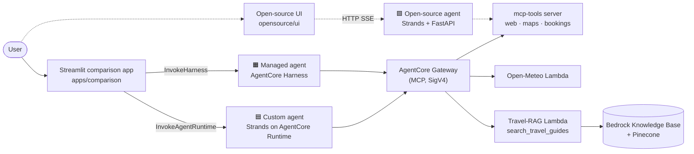
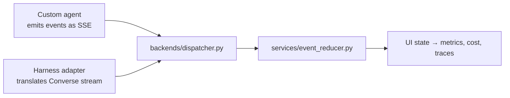
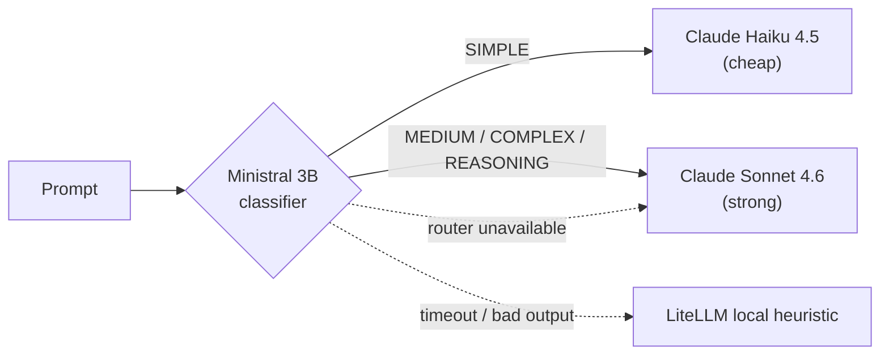
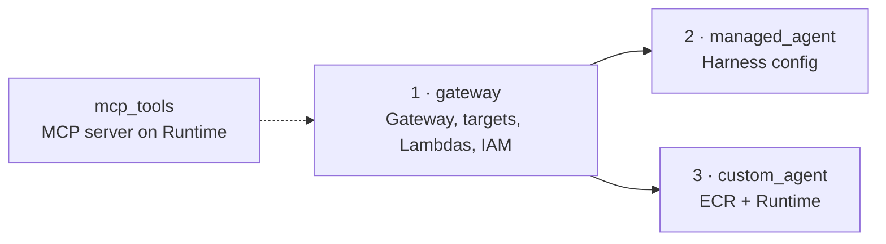
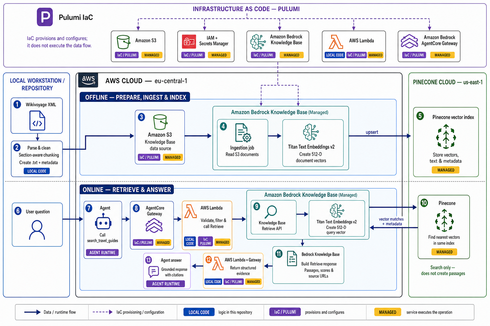

# AWS Agentic Blueprint

**One agent, built three ways, measured side by side.**

This repository is a reference implementation for answering a practical question:
*should you let AWS run your agent loop, write it yourself, or leave AWS entirely?*
It builds the same travel/weather agent as:

| | Architecture | Who owns the agent loop | Where it runs |
|---|---|---|---|
| 🟧 **Managed** | Configuration-defined agent | AWS (AgentCore **Harness**) | Amazon Bedrock AgentCore |
| 🟦 **Custom** | Code-defined **Strands** agent | This repo ([agents/custom/agent.py](agents/custom/agent.py)) | AgentCore **Runtime** (container) |
| 🟩 **Open-source** | Same Strands agent, off AWS | This repo ([opensource/agents/custom/](opensource/agents/custom/)) | Docker Compose (FastAPI + Ollama/Kimi) |

A Streamlit app sends one prompt to the Managed and Custom agents in parallel and
compares **answers, latency, tool calls, reasoning, token usage, prompt-cache
behavior, and measured cost**. The open-source stack ships with its own UI and
uses the same event format and tools.

---

## The core idea

### 1. Same tools, same prompt, different hosting



Every path exposes the same functional tool catalog (weather, web search, maps,
travel-guide retrieval, code interpreter). This *tool parity* is enforced by
[tests/unit/test_benchmark_tool_parity.py](tests/unit/test_benchmark_tool_parity.py),
so a comparison measures the architecture, not a difference in tools.

### 2. One event vocabulary for every backend

All agents use the same six events, so the UI never needs to know which backend
produced them.

```python
{"type": "reasoning",  "content": "..."}
{"type": "text",       "content": "..."}
{"type": "tool_start", "name": "...", "input": {...}}
{"type": "tool_end",   "name": "...", "result": "..."}
{"type": "metrics",    "usage": {...}}
{"type": "error",      "content": "..."}
```



The contract lives in three places that must stay in sync: this README, the
docstring in [agents/custom/agent.py](agents/custom/agent.py), and the typed models
in [apps/comparison/models/events.py](apps/comparison/models/events.py).

### 3. Shared model routing

Both AgentCore agents use the same **LiteLLM complexity router**. A small
classifier (Ministral 3B on Bedrock) scores each prompt and picks a model tier:



The decision is sticky for the whole turn and tool loop, and is recorded with run
metrics and MLflow trace attributes. The open-source stack uses the same pattern
with Ollama (simple) and Kimi (harder tiers).

---

## Repository map

```text
apps/comparison/        Streamlit comparison UI (the main entrypoint)
  backends/             Harness, Runtime and dispatcher adapters → six events
  services/             Event reducer, cost, routing, uploads, feedback, security
  components/           Streamlit views (comparison, history, metrics, AWS CLI)
  models/               Typed event and state definitions

agents/
  managed/              System prompt for the Harness-defined agent
  custom/               Strands agent + SigV4 MCP Gateway client (Runtime container)

opensource/             The same stack without AWS
  agents/custom/        FastAPI SSE agent, guardrails, skills, code interpreter
  mcp-tools/            MCP server: Open-Meteo, web search, OpenStreetMap, travel guides
  ui/                   Open-source Streamlit UI
  compose/              Docker Compose: agent, UI, Ollama, Qdrant, MLflow, OTel

infrastructure/
  pulumi/               IaC source of truth: gateway, managed_agent, custom_agent, mcp_tools
  gateway/              Tool Lambdas (Open-Meteo, travel RAG) + legacy boto3 script
  scripts/              Smoke tests and registry helpers

scripts/                RAG & GraphRAG pipelines (Wikivoyage, DATAtourisme, Pinecone,
                        OpenSearch, Neptune, Neo4j, Qdrant) and their evaluators
evaluations/            AgentCore Evaluations, MLflow scorecards, router datasets
tests/unit/             Offline tests      tests/manual/  Live AWS diagnostics
explanation/            Beginner-friendly guided tour of the codebase
docs/                   Architecture guides: agentic patterns, caching, inference, RAG
```

---

## Quick start

### Option A — AWS comparison app

> ⚠️ The lock file targets Python 3.12, but this checkout is missing the
> `pyproject.toml` that `uv.lock` and `requirements.txt` refer to. Restore it
> before installing; `uv sync --dev` cannot bootstrap the repo as-is.

```bash
uv sync --dev
cp .env.example .env      # set ACTOR_ID, HARNESS_REGION, HARNESS_ARN, RUNTIME_REGION, RUNTIME_ARN
aws sso login             # valid AWS credentials are required
uv run streamlit run apps/comparison/app.py --server.fileWatcherType=none
```

`--server.fileWatcherType=none` is intentional: Streamlit's module watcher probes
lazily imported submodules, which breaks some optional dependencies.

### Option B — Open-source stack (no AWS)

```bash
cd opensource/compose
cp .env.example .env      # set KIMI_API_KEY
docker compose up -d --build
docker compose exec ollama ollama pull qwen3:1.7b
```

Open http://localhost:8501 (UI) and http://localhost:5000 (MLflow traces).
See [opensource/compose/README.md](opensource/compose/README.md) for services,
provider pinning, and guardrails.

---

## Deploying to AWS

Pulumi projects under [infrastructure/pulumi/](infrastructure/pulumi/) define every
AWS resource. **Order matters**: both agents read Gateway outputs through Pulumi
stack references.



```bash
aws sts get-caller-identity
eval "$(aws configure export-credentials --format env)"

cd infrastructure/pulumi/gateway
pulumi stack select mostaphaelansari/agentic-blueprint-gateway/production
pulumi preview --diff && pulumi up

cd ../managed_agent
pulumi stack select mostaphaelansari/agentic-blueprint-managed-agent/production
pulumi preview --diff && pulumi up

cd ../custom_agent
pulumi stack select mostaphaelansari/agentic-blueprint-custom-agent/production
pulumi preview --diff && pulumi up
```

Always review `pulumi preview --diff` before `pulumi up`. The boto3 script in
[infrastructure/gateway/deploy.py](infrastructure/gateway/deploy.py) is legacy and
should only be used while importing existing resources into Pulumi. To host
`mcp-tools` on AgentCore Runtime, see
[infrastructure/pulumi/mcp_tools/README.md](infrastructure/pulumi/mcp_tools/README.md).

No GitHub Actions workflows are included in this checkout; run deployments manually.

---

## Comparison app features

| Feature | What it does |
|---|---|
| **Comparison / Custom agent pages** | Side-by-side Managed vs Custom, or Custom alone. Each page keeps its own conversation and run. |
| **Conversation tree** | New prompts continue from the selected node; **Edit and resubmit** creates a sibling branch. Each node gets fresh AgentCore session IDs so cost stays attributable. |
| **Stop comparison** | Closes both streams and calls `StopRuntimeSession` for the Custom agent. Harness has no stop API, so Managed is cancelled client-side only and may bill until its turn ends. Missing usage shows as *pending*, resolved later by *Refresh session cost*. |
| **File analysis** | One UTF-8 CSV or mmCIF file (≤ 1 MB) is staged as an encrypted, short-lived S3 object and shared via presigned URL. Agents analyze it with a code interpreter; charts render as Vega-Lite. |
| **Mol\* 3D viewer** | mmCIF structures preview in an interactive viewer; residue clicks flow back to Python and can be added to the next prompt. |
| **Feedback** | Thumbs up/down per answer, stored in SQLite (`agent_feedback` table, `FEEDBACK_DB_PATH` or `SESSION_COST_DB_PATH`). |
| **AWS read-only console** | Runs allow-listed read-only AWS CLI commands to inspect the AgentCore and CloudWatch data behind cost figures. Disable with `ENABLE_AWS_CLI_CONSOLE=false`. |
| **Measured cost** | Tokens + Gateway operations + Runtime compute, computed the same way for both agents. |

**Token semantics** (identical for every backend):

```text
Prompt = fresh input + cache read + cache write
Total  = Prompt + output
```

**IAM note:** the UI identity needs `bedrock-agentcore:InvokeAgentRuntime` and
`bedrock-agentcore:StopRuntimeSession` on the Runtime ARN.

<details>
<summary><b>Model-routing configuration</b></summary>

| Variable | Purpose |
|---|---|
| `MODEL_ROUTING_MODE` | Non-UI default: Auto, Economy or Quality |
| `BEDROCK_CHEAP_MODEL_ID` / `BEDROCK_STRONG_MODEL_ID` | Haiku / Sonnet model IDs |
| `HARNESS_CHEAP_MODEL_ID` | Regional override for the Harness |
| `COMPLEXITY_TIERS` | JSON tier → `cheap`/`strong` map (default: only `SIMPLE` is cheap) |
| `COMPLEXITY_TIER_BOUNDARIES` | JSON overrides for 0.15 / 0.35 / 0.60 score boundaries |
| `MODEL_ROUTER_CLASSIFIER_MODEL_ID` / `_REGION` / `_TIMEOUT_MS` | Default `mistral.ministral-3-3b-instruct`, `eu-west-1`, 750 ms |
| `MODEL_ROUTER_CLASSIFIER_INPUT_PER_MTOK` / `_OUTPUT_PER_MTOK` | Classifier pricing (default $0.12 / M tokens) |
| `MODEL_ROUTER_VERSION` | Pin the policy version recorded in traces |

Routing falls back safely to Sonnet if the router is unavailable or picks a model
outside the allowlist. LiteLLM router internals are version-sensitive; re-check
the scorer when upgrading. A learned-router experiment with a 7,212-query
corpus lives in [evaluations/llmrouter/](evaluations/llmrouter/README.md); it is
not on the app's routing path. See [.env.example](.env.example) for all settings.

</details>

---

## RAG and GraphRAG

The agents' `search_travel_guides` tool is backed by a Wikivoyage RAG pipeline:

```text
Wikivoyage dump → clean & chunk (scripts/wikivoyage_rag.py) → S3
  → Bedrock Knowledge Base embeds with Titan → Pinecone
  → Gateway Lambda (search_travel_guides) → agent writes the answer
```



[scripts/](scripts/) also holds the experiments around it: hybrid BM25 + semantic
search, OpenSearch Serverless, Neptune Analytics and Neo4j GraphRAG, Cohere and
Granite embedding comparisons, a self-hosted Qdrant + Ollama counterpart, and a
DATAtourisme Paris corpus.

**GraphRAG result (2Wiki multi-hop, 60 bridge questions):** graph retrieval
raised complete-chain recall at K=5 from **63.3% → 83.3%** (+20 pts, McNemar
p = 0.012). Details in
[docs/graphRAG/2wiki_multihop_benchmark.md](docs/graphRAG/2wiki_multihop_benchmark.md).

Read more: [docs/RAG/Travel_RAG_Pipeline_and_Deployed_Components.md](docs/RAG/Travel_RAG_Pipeline_and_Deployed_Components.md).

---

## Testing and evaluation

```bash
uv run pytest tests/unit                       # offline unit tests
python tests/manual/check_thinking_events.py   # live AWS: reasoning events on/off
uv run python evaluations/run_agentcore_evaluation.py   # AgentCore Evaluations gate
```

[evaluations/](evaluations/README.md) contains:

- **AgentCore Evaluations** — invokes the deployed Custom Runtime on golden
  scenarios, collects spans from CloudWatch, and scores correctness, goal success,
  and trajectory. Fails on any threshold miss.
- **MLflow** — golden-dataset, trace, and guardrail evaluations plus scorecards.
- **Router evaluation** — classifier accuracy and learned-router datasets.

---

## Learn more

| Start here if you want to… | Read |
|---|---|
| Understand the codebase from zero | [explanation/README.md](explanation/README.md) → [00-concepts-for-beginners.md](explanation/00-concepts-for-beginners.md) |
| Compare managed vs custom agents | [docs/Guides about performance concerns/Managed_and_custom_agent_architecture.md](docs/Guides%20about%20performance%20concerns/Managed_and_custom_agent_architecture.md) |
| Choose an agent design pattern | [docs/Agentic Patterns/](docs/Agentic%20Patterns/) (ReAct, supervisor/worker, swarm, A2A, HITL…) |
| Decide Gateway vs self-hosted MCP | [docs/Gateway vs self hosted mcp/](docs/Gateway%20vs%20self%20hosted%20mcp/gateway-vs-self-hosted-mcp.md) |
| Tune latency, caching, tokens, throttling | [docs/Guides about performance concerns/](docs/Guides%20about%20performance%20concerns/) |
| Handle quality, drift, guardrails | [docs/Guides about quality and safety concerns/](docs/Guides%20about%20quality%20and%20safety%20concerns/) |
| Understand LLM inference (vLLM, KV cache) | [docs/inference/](docs/inference/) |
| Get an overview of AgentCore services | [docs/AgentCore service portfolio onepager/](docs/AgentCore%20service%20portfolio%20onepager/agentcore_service_portfolio_onepager.md) |
