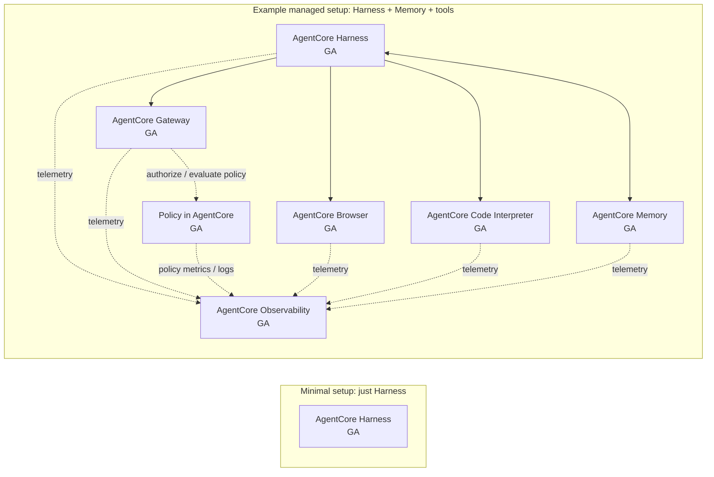
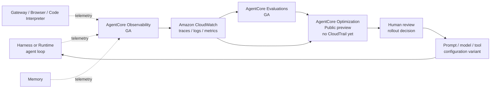

# AgentCore Service Portfolio

> [!summary]
> This page is the service-map anchor for later blueprint guides. Amazon Bedrock AgentCore is a modular portfolio, not one indivisible service: **Harness manages an agent loop and its environment; Runtime hosts custom agent and tool code; Memory supplies durable context; Gateway, Browser, and Code Interpreter expose action surfaces; Identity and Policy control access; Payments handles metered resources; Registry enables discovery; Observability records what happened; Evaluations measures behavior; and optimization tests improvements.** The services can be adopted independently and composed as the agent grows.

## Orchestration and Hosting

Harness and Runtime both run agents in isolated environments, but they are different surfaces:

- **Harness is for configured agents.** You provide a model, instructions, and tools. AWS runs the agent loop: it decides when to call the model, when to use tools, how to carry context forward, and how to produce the response.
- **Runtime is for custom code.** You deploy container-based code or supported direct-code runtimes. AWS hosts it in a secure serverless environment, but your code owns the framework, prompts, tool routing, event shape, and any orchestration loop.

So in this architecture map, **Harness is not shown as a Runtime that you deploy and manage directly**. Harness is the managed-agent service. Runtime is the hosting layer you use when the agent behavior is defined in code.

If a Harness prototype outgrows configuration, AWS supports exporting the Harness orchestration as Strands-based code. At that point the design moves toward Runtime-style ownership: the team gains code-level control and also takes responsibility for the code path.

> [!note]
> AgentCore was announced in preview at AWS Summit New York on July 16, 2025, not at re:Invent. The original portfolio reached general availability on October 13, 2025; managed Harness was introduced in public preview on April 22, 2026, and became generally available on June 17, 2026.

## Portfolio Map

> [!note]
> The table below is a broad portfolio map. Not every blueprint needs every service; start with the execution path and add context, tools, governance, commerce, discovery, and quality services only when the use case calls for them. Maturity is service-level unless a caveat calls out feature-level preview status.

| Service | Maturity | Checked | Owns | Caveat | Agent-stack position |
|---|---|---:|---|---|---|
| **Harness** | Generally available | 2026-06-18 | Managed agent orchestration, tool execution, context, and isolated environment | Became GA on June 17, 2026 | Managed agent layer |
| **Runtime** | Generally available | 2026-06-18 | Secure serverless hosting for custom agent and tool code | Deployment/runtime interface support can evolve by SDK release | Compute layer |
| **Memory** | Generally available | 2026-06-18 | Short-term conversation events and long-term extracted memories | Not a source-of-truth database or workflow engine | Context and state |
| **Gateway** | Generally available | 2026-06-18 | Governed MCP-compatible access to APIs, Lambda functions, services, and MCP servers | Tool correctness and downstream behavior remain yours | Tool plane |
| **Browser** | Generally available | 2026-06-18 | Isolated browser sessions, automation endpoints, live view, and replay | Websites change; prefer stable APIs when available | Web action tool |
| **Code Interpreter** | Generally available | 2026-06-18 | Isolated code execution, supported language runtimes, and file-based analysis | Generated code and analysis still need domain validation | Computation tool |
| **Identity** | Generally available | 2026-06-18 | Agent workload identity, credential providers, token storage, and delegated access | Does not replace enterprise identity design or least privilege | Security plane |
| **Policy** | Generally available | 2026-06-18 | Deterministic authorization for Gateway tool calls using policy engines and Cedar policies | Applies to Gateway traffic; calls that bypass Gateway need other controls | Governance plane |
| **Payments** | Preview | 2026-06-18 | x402-style payment flows, wallet integration, spending limits, and payment telemetry | Preview APIs can change before GA | Commerce plane |
| **Registry** | Public preview | 2026-06-18 | Governed catalog, approval workflow, and semantic/keyword discovery for agents and tools | Discovery/catalog only; it does not host or invoke resources | Discovery plane |
| **Observability** | Generally available | 2026-06-18 | AgentCore metrics, logs, traces, and CloudWatch integration | Operational telemetry is not product-quality scoring | Operations plane |
| **Evaluations** | Generally available with feature caveats | 2026-06-18 | Online and on-demand quality scoring for agents and tools | Batch evaluation and Simulation are public preview; dataset runners inherit the chosen runner's maturity | Quality plane |
| **Optimization** | Public preview | 2026-06-18 | Recommendations, configuration bundles, and A/B experiments | Public preview and no CloudTrail support yet; avoid where CloudTrail audit coverage is required | Improvement loop |

## Service Reference

**AgentCore Harness - generally available.** Harness is the configuration-led managed-agent service: you declare the model, instructions, and tools, and Harness manages the agent loop, tool execution, context, response generation, and an isolated microVM with filesystem and shell access. It does not define your domain rules, product contract, tool semantics, or downstream business behavior. It sits in the managed-agent layer for running an agent without maintaining orchestration code or its execution environment.

**AgentCore Runtime - generally available.** Runtime is the code-hosting service: it provides secure, serverless, session-isolated compute for custom agents and tools, including scaling and invocation endpoints. It does not own the framework, prompts, reasoning policy, event contract, or tool-routing logic implemented by the deployed code. It sits in the compute layer beneath code-defined agent and tool behavior.

**AgentCore Memory - generally available.** Memory stores short-term conversational events and long-term insights such as summaries, preferences, and semantic facts across sessions. It does not replace transactional databases, compliance records, workflow engines, or another authoritative system of record. It sits beside the agent and compute layers as durable context that agents can retrieve and update.

**AgentCore Gateway - generally available.** Gateway converts APIs, Lambda functions, existing services, and MCP servers into tools behind a managed MCP-compatible endpoint, with discovery and authentication at the boundary. It does not implement the downstream service, validate business invariants, or guarantee that the agent selected the right tool. It sits between the agent loop and external capabilities as the governed tool plane.

**AgentCore Browser - generally available.** Browser provides isolated, managed browser sessions for navigating web applications, filling forms, extracting page information, and observing or replaying activity. It does not own the target website, override its terms, or make changing user interfaces as stable as APIs. It sits in the action layer for tasks that genuinely require a rendered web interface.

**AgentCore Code Interpreter - generally available.** Code Interpreter provides isolated sandbox execution for code that helps agents solve computational tasks, analyze files, transform data, and generate artifacts. It does not guarantee that generated code is semantically correct, replace human review for risky analysis, or provide unrestricted access to the Runtime host. It sits in the action layer for tasks that should be executed rather than reasoned through only in tokens.

**AgentCore Identity - generally available.** Identity provides workload identities, credential providers, secure token handling, and delegated access so agents can authenticate inbound users and access AWS or third-party services. It does not replace the corporate identity provider, design least-privilege permissions, or define the organization's entitlement model. It underpins Runtime, Gateway, and other tool access as the security plane.

**AgentCore Policy - generally available.** Policy provides deterministic control over agent-to-tool interactions by associating policy engines with AgentCore Gateway and evaluating Gateway traffic before tool access is allowed. Policies can be written in Cedar or generated from natural language and can use identity and tool input conditions. It does not protect calls that bypass Gateway or replace application-side validation. It sits at the governance boundary between agent intent and tool execution.

**AgentCore Payments - preview.** Payments provides managed payment flows for agents that need to access paid APIs, MCP servers, or content, including x402-style payment handling, wallet integration, spending limits, and payment telemetry. It does not provide the wallet provider, merchant system, legal policy, or consent model. It sits beside Gateway and Browser when an agent needs controlled access to metered resources.

**AWS Agent Registry - public preview.** Registry is the discovery and curation plane for agents, MCP servers, tools, skills, and custom resources. It provides catalog records, approval workflows, semantic and keyword search, and an MCP-native access path. It does not host or invoke the registered resource, and listing something in the registry is not the same as proving it safe. It sits before execution as the place teams and agents find approved capabilities.

**AgentCore Observability - generally available.** Observability exposes service telemetry and integrates AgentCore metrics, logs, and traces with Amazon CloudWatch and OpenTelemetry-compatible tooling. It does not determine whether an answer was useful, whether a business goal succeeded, or whether a release should ship. It spans the stack as the operational layer for tracing, debugging, auditing, and monitoring.

**AgentCore Evaluations - generally available, with feature-level caveats.** Evaluations provides automated assessment tools for agents and tools, including built-in and custom evaluators plus online and on-demand evaluation. Batch evaluation is public preview and does not support AWS CloudTrail. Dataset evaluation can run through an on-demand runner or a batch runner; the batch runner inherits the batch evaluation preview caveat. Simulation is also public preview. Evaluations uses traces, sessions, and spans from instrumented frameworks to create measurable quality signals, but it does not decide the product's quality bar or replace release judgment.

**AgentCore Optimization - public preview.** Optimization proposes and tests behavior changes using traces, evaluation signals, configuration bundles, and A/B experiments. It does not replace evaluator design, human review, or rollout governance. It does not support AWS CloudTrail while in preview, so do not use it for workloads that require CloudTrail audit coverage until AWS adds support. It sits at the end of the improvement loop, where measured behavior becomes candidate configuration changes.

## Composition

**Figure 1.** Start with Harness when AWS should own the agent loop, or Runtime when your code owns it. Add Memory for durable context; choose Gateway, Browser, or Code Interpreter by action type; attach Policy to Gateway for allow/deny decisions; use Identity for credentials; add Payments only for metered resources; use Registry for discovery; and wire the execution path into Observability.

Operate and improve flow:

**Figure 2.** Observability captures execution telemetry and stores traces, logs, and metrics in CloudWatch. Evaluations turns traces and datasets into quality signals, while Optimization uses traces and evaluation results to recommend or validate configuration changes. Human review still owns the rollout decision.

## Selection Guide

* Use **Harness** when AWS should manage the agent orchestration loop, including model calls, tool use, configured context/memory integration, and response generation.
* Deploy through **Runtime** when your application code implements the loop, framework, prompts, tool routing, or custom agent/tool behavior.
* Add **Memory** for context that must persist across turns or sessions, such as conversation history, summaries, user preferences, and reusable facts.
* Add **Gateway** for governed access to APIs, Lambda functions, existing services, or MCP servers exposed as agent tools.
* Add **Browser** when the task requires interaction with a rendered web interface; prefer APIs or Gateway-based tools when a stable API is available.
* Add **Code Interpreter** when the task needs isolated computation, code execution, data analysis, file processing, or generated artifacts.
* Add **Identity** whenever agent workload identity, user delegation, credential storage, or third-party access matters.
* Add **Policy** when Gateway tool calls need deterministic authorization or input controls based on identity, tool, action, or tool parameters.
* Add **Payments** only when the agent must access supported paid APIs, paid MCP servers, paid content, or x402-style metered resources; treat it as preview.
* Add **Registry** when builders or agents need a curated catalog of approved agents, tools, skills, MCP servers, or custom resources; treat it as preview.
* Treat **Observability** as a production operating requirement for tracing, debugging, monitoring, and auditability.
* Add **Evaluations** when agent or tool quality must be scored consistently before or after deployment.
* Add **Optimization** only after traces and evaluators are mature enough to support recommendations and controlled experiments. Check feature-level maturity before production use, and do not rely on AgentCore optimization features for workloads that require CloudTrail audit history until AWS documents CloudTrail support.

## Maturity Note

AWS announced Amazon Bedrock AgentCore preview on July 16, 2025 and the original platform/services reached GA on October 13, 2025. Since then, service-level maturity has changed: Evaluations became GA on March 31, 2026, and Harness became GA on June 17, 2026. Registry, Payments, and Optimization remain preview/public-preview surfaces, and some Evaluations subfeatures such as Batch Evaluation and Simulation have separate preview caveats. Recheck AWS docs for regions, pricing, CloudTrail support, and feature-level maturity before production commitments.

## Sources

- [AWS documentation: AgentCore overview and core services](https://docs.aws.amazon.com/bedrock-agentcore/latest/devguide/what-is-bedrock-agentcore.html)
- [AWS documentation: AgentCore Harness](https://docs.aws.amazon.com/bedrock-agentcore/latest/devguide/harness.html)
- [AWS documentation: AgentCore Runtime](https://docs.aws.amazon.com/bedrock-agentcore/latest/devguide/agents-tools-runtime.html)
- [AWS documentation: AgentCore Memory](https://docs.aws.amazon.com/bedrock-agentcore/latest/devguide/memory.html)
- [AWS documentation: AgentCore Gateway](https://docs.aws.amazon.com/bedrock-agentcore/latest/devguide/gateway.html)
- [AWS documentation: AgentCore Browser](https://docs.aws.amazon.com/bedrock-agentcore/latest/devguide/browser-tool.html)
- [AWS documentation: AgentCore Code Interpreter](https://docs.aws.amazon.com/bedrock-agentcore/latest/devguide/code-interpreter-tool.html)
- [AWS documentation: AgentCore Identity](https://docs.aws.amazon.com/bedrock-agentcore/latest/devguide/identity.html)
- [AWS documentation: AgentCore Policy](https://docs.aws.amazon.com/bedrock-agentcore/latest/devguide/policy.html)
- [AWS documentation: AgentCore Payments](https://docs.aws.amazon.com/bedrock-agentcore/latest/devguide/payments.html)
- [AWS documentation: AWS Agent Registry](https://docs.aws.amazon.com/bedrock-agentcore/latest/devguide/registry.html)
- [AWS documentation: AgentCore Observability](https://docs.aws.amazon.com/bedrock-agentcore/latest/devguide/observability-configure.html)
- [AWS documentation: AgentCore Evaluations](https://docs.aws.amazon.com/bedrock-agentcore/latest/devguide/evaluations.html)
- [AWS documentation: AgentCore Optimization](https://docs.aws.amazon.com/bedrock-agentcore/latest/devguide/optimization.html)
- [AWS documentation: AgentCore Batch Evaluation](https://docs.aws.amazon.com/bedrock-agentcore/latest/devguide/batch-evaluations.html)
- [AWS documentation: AgentCore Dataset Evaluation](https://docs.aws.amazon.com/bedrock-agentcore/latest/devguide/dataset-evaluations.html)
- [AWS documentation: AgentCore Simulation](https://docs.aws.amazon.com/bedrock-agentcore/latest/devguide/simulation.html)
- [AWS What's New: Amazon Bedrock AgentCore preview announcement](https://aws.amazon.com/about-aws/whats-new/2025/07/amazon-bedrock-agentcore-preview/)
- [AWS What's New: Amazon Bedrock AgentCore is now generally available](https://aws.amazon.com/about-aws/whats-new/2025/10/amazon-bedrock-agentcore-available/)
- [AWS What's New: Amazon Bedrock AgentCore Evaluations is now generally available](https://aws.amazon.com/about-aws/whats-new/2026/03/agentcore-evaluations-generally-available/)
- [AWS What's New: AgentCore Harness is now generally available](https://aws.amazon.com/about-aws/whats-new/2026/06/amazon-bedrock-agentcore-harness-generally-available/)
- [AWS What's New: Managed Harness and AgentCore developer features](https://aws.amazon.com/about-aws/whats-new/2026/04/agentcore-new-features-to-build-agents-faster/)
- [AWS blog: Make agents a reality with Amazon Bedrock AgentCore](https://aws.amazon.com/blogs/machine-learning/amazon-bedrock-agentcore-is-now-generally-available/)
- [AWS blog: Get to your first working agent in minutes](https://aws.amazon.com/blogs/machine-learning/get-to-your-first-working-agent-in-minutes-announcing-new-features-in-amazon-bedrock-agentcore/)
