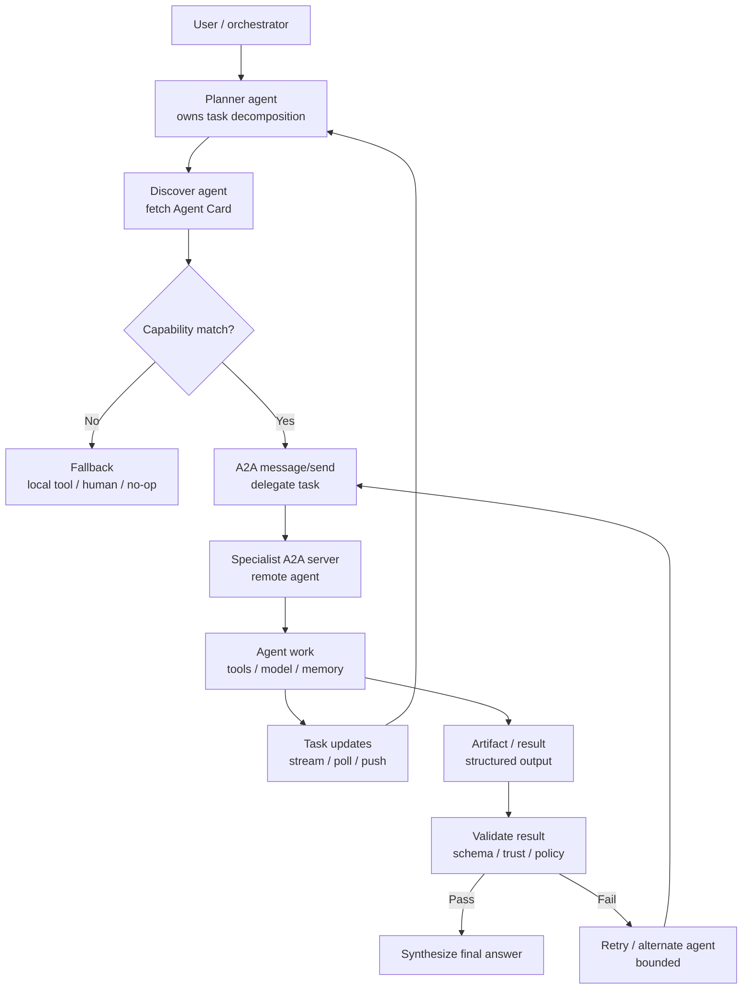

## Intro / Index

A2A uses the Agent-to-Agent protocol so one agent can discover another agent, send it a task or message, receive updates, and consume the returned result without knowing the other agent's internal framework. It solves the problem of multi-agent systems becoming a pile of custom HTTP contracts, brittle adapters, and vendor-specific integration code.

**Protocol status (2026):** A2A was announced by Google in April 2025, donated to the Linux Foundation in June 2025 for vendor-neutral governance, and reached v1.0 in early 2026 with 150+ supporting organizations and SDKs in five languages. v0.3 added gRPC alongside JSON-RPC over HTTP(S); v1.0 added signed Agent Cards, multi-tenancy, and a formal version negotiation and deprecation policy. It complements rather than competes with MCP: MCP standardizes agent-to-tool connections, A2A standardizes agent-to-agent collaboration - the usual progression is MCP first for tools, A2A when independently-owned agents must cooperate.

## Description

The pattern treats agents as network-addressable peers with published capabilities rather than as local functions inside one process. Each A2A server exposes an Agent Card for discovery and handles protocol messages, while clients delegate tasks, stream updates, poll task state, cancel work, or receive completion artifacts.

## Diagram



A2A is a communication pattern, not a reasoning pattern by itself. The upstream agent still owns planning, trust policy, routing, validation, retries, and what to do when a delegated agent fails or returns weak work. In catalog terms: A2A is the protocol layer under a cross-organization Supervisor/Worker - the supervisor logic stays yours; A2A standardizes the wire between supervisor and workers it does not own.

## When to use / when to avoid

**Use it when**

- You need agents built by different teams, frameworks, vendors, or accounts to collaborate through a shared protocol.
- A specialist agent has capabilities the primary agent should not reimplement, such as domain tools, private data access, or expensive long-running workflows.
- Discovery, declared capabilities, task state, streaming updates, cancellation, or artifacts matter.
- You want a cleaner boundary between "agent as tool" and "agent as autonomous peer."
- The receiving agent can enforce its own authentication, authorization, rate limits, and policy.

**Avoid it when**

- A local tool call, MCP tool, Lambda function, or ordinary API is enough.
- The downstream system is not really an agent and has no need for task state, messages, or artifacts.
- All the agents are owned by one team in one process - an in-process graph (Supervisor/Worker, state machine) is simpler; A2A earns its overhead at organizational boundaries, not module boundaries.
- You cannot validate the remote agent's capability claims, identity, or outputs.
- The system needs hard transactional guarantees across agents.
- Latency, cost, or operational complexity is more important than interoperability.

## Footprint

A2A adds protocol overhead, network latency, and another agent's model/tool cost. The upside is modularity: the caller can delegate a whole subtask instead of pulling every tool, prompt, and data source into one giant context.

Rule of thumb:

```text
token_cost ~= caller_planning_tokens + delegated_agent_tokens + caller_validation_tokens
latency ~= discovery/cache_latency + delegated_task_latency + validation_latency
```

Example shape:

|Flow|Model calls|Token behavior|Latency behavior|
|---|--:|---|---|
|Cached Agent Card + simple delegation|2-3|Caller routes; specialist solves|One remote agent round-trip plus model time|
|Multi-turn specialist task|4+|Specialist keeps its own context; caller sees summaries/artifacts|Longer task state, stream, poll, or push cycle|
|Fan-out to several A2A agents|N+|Cost multiplies by delegated agents|Parallelizable, but final synthesis waits for slowest useful result|
|Failed delegation + fallback|+1 or more|Caller pays validation and retry costs|Tail latency grows quickly|

**Worked example - delegating one specialist subtask.** The caller plans and dispatches (1,500 input / 200 output tokens), the remote specialist runs a 3-step internal loop on its own focused context (~8,200 input / ~650 output), and the caller validates the returned artifact (1,200 input / 150 output). At illustrative rates of **$3 / 1M input tokens** and **$15 / 1M output tokens**:

```text
caller (plan + validate):  2,700 in +   350 out ~= $0.013
specialist (internal):     8,200 in +   650 out ~= $0.034
total:                                              ~$0.05 per delegation
```

Token-wise this is nearly identical to running the same work as an in-process Supervisor/Worker dispatch - the protocol itself adds network and auth latency (often 100-500ms per hop, more on cold discovery) but negligible tokens. What changes is the _bill's location_: the specialist's $0.034 lands on its owner's account, invisible to the caller unless usage metadata is returned. Compared with direct tool calling, A2A can reduce the caller's prompt size because the specialist owns its own tools and context; compared with one in-process multi-agent graph, it adds network and auth overhead but gives a stronger service boundary.

## AWS Mapping

|AWS tier|Supported in config?|What you do|
|---|---|---|
|**AgentCore Runtime + A2A server**|**Yes - AWS-supported deployment target.**|Deploy an A2A-compatible server to Runtime. AWS documents A2A containers as stateless, streamable HTTP servers on port `9000` at root path `/` (vs 8080 + `/invocations` for HTTP and 8000 + `/mcp` for MCP), Agent Cards at `/.well-known/agent-card.json`, JSON-RPC communication, SigV4 or OAuth 2.0 authentication, and ARM64 container images. Runtime acts as a transparent proxy - `InvokeAgentRuntime` JSON-RPC payloads pass through unmodified - while adding per-session isolation (via an injected session-id header), SSE streaming support, scalability, auth, and observability.|
|**AgentCore Runtime + custom orchestrator**|**Yes - for A2A clients and multi-agent routing.**|Host the caller/orchestrator in Runtime or another compute service. Your code fetches Agent Cards, selects agents, sends A2A messages, handles task updates, validates artifacts, applies trust policy, and falls back when a remote agent fails. For IAM-based setups, the client assumes a role permitted to invoke the target agent and signs requests with SigV4 - access control via IAM policy instead of external token management.|
|**EventBridge / Step Functions / SQS around A2A**|**Yes, as surrounding workflow plumbing.**|Use AWS workflow and messaging services for scheduling, buffering, retries, fanout, and long-running orchestration. They do not replace A2A; they coordinate when A2A calls happen and how failures are handled.|
|**Bedrock Agents**|**No, not as native A2A server configuration.**|Bedrock Agents can call action groups and knowledge bases, but A2A server hosting, Agent Card serving, and JSON-RPC task handling are not a Bedrock Agents config feature. Put an A2A adapter or custom service in front if a Bedrock Agent must participate as an A2A peer.|
|**AgentCore Harness**|**Not as a first-class A2A server pattern.**|Harness is a managed agent loop. Use it when AWS-managed orchestration is the goal; use Runtime when you need protocol-level A2A server behavior. A Harness-backed agent could still be invoked by custom code that exposes an A2A facade, but that facade owns the protocol contract. Harness is public preview.|

## Common failure modes

- **Capability over-trust:** the caller believes the Agent Card without verifying whether the agent is appropriate for this task. _Mitigation: maintain an allowlist, test capability claims, and validate outputs against task-specific criteria._
- **Identity confusion / card forgery:** an agent endpoint is reachable but not the intended peer, or an attacker serves a fake Agent Card to redirect delegation. _Mitigation: require SigV4/OAuth, TLS, expected issuer/audience - and verify signed Agent Cards (a v1.0 protocol feature: a cryptographic signature proves the card was issued by the domain owner)._
- **Delegation loops:** agent A delegates to agent B, which delegates back to A or fans out without bounds. _Mitigation: pass delegation depth, trace ids, budgets, and loop-prevention metadata._
- **Context leakage:** the caller sends sensitive user or tenant data to a remote agent that should not receive it. _Mitigation: classify data, minimize payloads, redact secrets, and enforce per-agent authorization._
- **Ambiguous ownership:** no component owns final correctness because every agent treats the task as delegated. _Mitigation: make the caller/orchestrator responsible for validation and final synthesis._
- **Protocol success, task failure:** the A2A call succeeds but the remote agent returns a weak, incomplete, or policy-violating artifact. _Mitigation: validate artifacts separately from transport status and use bounded fallback._
- **Version drift:** agents support different protocol versions, transports, or message shapes - concretely, an empty version field means v0.3, and v1.0 introduced formal version negotiation and a deprecation policy. _Mitigation: check Agent Card metadata, negotiate supported interfaces, and run compatibility tests._
- **Streaming blind spots:** partial updates are shown as final facts or lost during reconnects. _Mitigation: distinguish task status updates from final artifacts and persist task ids._
- **Cost opacity:** the caller sees only a delegated task, while the specialist burns tokens and tools internally - and bills its own account. _Mitigation: require delegated agents to return usage metadata or emit per-task telemetry; set per-delegation budgets in the task contract._

## Sources

- [AWS: Deploy A2A servers in AgentCore Runtime](https://docs.aws.amazon.com/bedrock-agentcore/latest/devguide/runtime-a2a.html)
- [AWS: A2A protocol contract](https://docs.aws.amazon.com/bedrock-agentcore/latest/devguide/runtime-a2a-protocol-contract.html)
- [AWS blog: Introducing agent-to-agent protocol support in Amazon Bedrock AgentCore Runtime](https://aws.amazon.com/blogs/machine-learning/introducing-agent-to-agent-protocol-support-in-amazon-bedrock-agentcore-runtime/)
- [AWS: Host agent or tools with AgentCore Runtime](https://docs.aws.amazon.com/bedrock-agentcore/latest/devguide/agents-tools-runtime.html)
- [A2A Protocol specification](https://a2a-protocol.org/latest/specification/)
- [A2A Protocol documentation](https://a2a-protocol.org/latest/)
- [Google Cloud blog: Agent2Agent protocol (A2A) is getting an upgrade (v0.3)](https://cloud.google.com/blog/products/ai-machine-learning/agent2agent-protocol-is-getting-an-upgrade)
- [AWS: AgentCore Harness](https://docs.aws.amazon.com/bedrock-agentcore/latest/devguide/harness.html)
- [AWS: Automate tasks in your application using AI agents](https://docs.aws.amazon.com/bedrock/latest/userguide/agents.html)