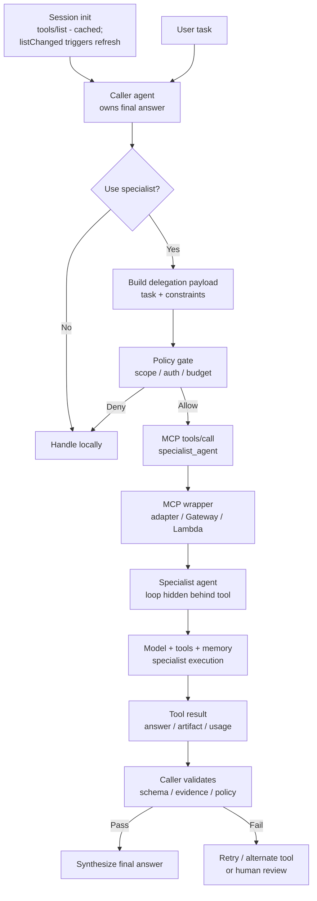

# MCP Agents-as-Tools Pattern


## Intro / Index

MCP Agents-as-Tools exposes another agent behind a Model Context Protocol tool, so the caller invokes it like `research_market`, `triage_ticket`, or `draft_contract_clause` rather than speaking to it as a peer agent. It solves the problem of reusing specialist agents from a normal tool-calling loop when the caller does not need A2A-style task state, streaming updates, cancellation, or agent-card discovery.

In catalog terms, this is the third leg of the delegation triangle: **Supervisor/Worker** delegates to specialists inside one process and trust boundary; **A2A** delegates to autonomous peers over an agent protocol; **MCP Agents-as-Tools** delegates to an agent while _presenting it as a tool_ - maximum interface simplicity, minimum lifecycle visibility. (Both MCP and A2A are now governed by the same Linux Foundation fund, AAIF, so choosing between them is an architecture decision, not a vendor bet.)

## Description

The pattern wraps an agent endpoint, workflow, or managed agent behind an MCP server tool definition. To the calling agent, the specialist looks like any other tool with a name, description, input schema, and result; behind that boundary, the specialist may run its own prompts, tools, memory, retrieval, or multi-step loop.

## Diagram



Discovery is session-level and cached (refreshed on `listChanged`), so the caller selects the specialist from a known catalog rather than re-discovering per task. The caller remains the orchestrator. The specialist agent is a black-box capability with a bounded input and output contract, not a peer that negotiates task lifecycle with the caller.

## When to use / when to avoid

**Use it when**

- A specialist agent already exists and the caller only needs a bounded answer, classification, draft, or artifact from it.
- You want to reuse ordinary MCP tooling, allowlists, auth, Gateway endpoints, and tool-call traces.
- The specialist's internal loop should be hidden from the caller to reduce prompt size and coupling.
- The delegation can fit a clear input schema and result schema.
- You want a quick bridge while evaluating whether full A2A interoperability is worth the extra complexity.

**Avoid it when**

- The caller needs streaming progress, task cancellation, durable remote task state, agent-card discovery, or rich artifacts; use A2A.
- The specialist needs a multi-turn conversation with the caller to clarify the task.
- The caller must inspect or control the specialist's internal tool calls.
- The specialist has side effects that require separate approval or transaction semantics.
- The wrapper would hide too much cost, evidence, or failure detail to validate the result.

## Footprint

MCP Agents-as-Tools can reduce the caller's token footprint because the specialist keeps its own prompts, tools, and working context outside the caller's prompt. The tradeoff is opacity: the delegated agent may spend tokens internally that the caller will not see unless usage metadata is returned or logged.

Rule of thumb:

```text
caller_tokens ~= specialist_tool_schema + delegation_payload + specialist_result + final_synthesis
total_tokens ~= caller_tokens + specialist_agent_internal_tokens
latency ~= mcp_round_trip + specialist_runtime + caller_validation
```

Example shape:

|Flow|Model calls|Token behavior|Latency behavior|
|---|--:|---|---|
|Simple specialist wrapper|2-3|Caller prompt stays small; specialist pays hidden work|One remote agent run plus final synthesis|
|Specialist with tools|4+ internal|Tool result may be compact, but specialist trace can be expensive|Tail latency depends on specialist loop|
|Fan-out to several specialists|N+|Caller pays one tool result per specialist plus synthesis|Parallelizable, but synthesis waits for useful results|
|Failed specialist + fallback|+1 or more|Retry can double both caller and specialist costs|Tail latency grows quickly|

**Worked example - same delegation as the A2A entry, deliberately.** Caller plans and dispatches (1,500 input / 200 output tokens), the specialist runs a 3-step internal loop on its own context (~8,200 input / ~650 output), the caller validates the result (1,200 input / 150 output). At illustrative rates of **$3 / 1M input tokens** and **$15 / 1M output tokens**:

```text
caller (plan + validate):  2,700 in +   350 out ~= $0.013
specialist (hidden):       8,200 in +   650 out ~= $0.034
total:                                              ~$0.05 per delegation
```

These are the _same numbers_ as the A2A worked example - that is the point. Wrapping the agent as an MCP tool versus addressing it as an A2A peer does not change the token economics; it changes **what the caller can see and control**: with MCP the specialist's progress, task state, and internals are invisible behind one tool result; with A2A they are first-class protocol objects. Choose on lifecycle needs, not cost. This pattern is often cheaper than stuffing every specialist tool and document into one giant caller prompt, but it is not automatically cheaper than A2A or direct tools; the hidden specialist loop still needs per-run token, tool, and Runtime telemetry.

## AWS Mapping

|AWS tier|Supported in config?|What you do|
|---|---|---|
|**AgentCore Gateway**|**Yes - strongest AWS-native wrapper surface when the specialist is reachable as an API, Lambda, or service.**|Use Gateway to expose the specialist invocation endpoint as an MCP-compatible tool with ingress auth, egress auth, composition, semantic tool selection, and observability. The specialist may be a Bedrock Agent, Runtime agent, Step Functions workflow, Lambda workflow, or external service behind the target.|
|**AgentCore Runtime + custom code**|**Yes - full control for caller, wrapper, or specialist.**|Host the caller agent, the MCP wrapper server (port `8000` at `/mcp` under Runtime's protocol contract), and/or the specialist agent in Runtime. Use this when you need custom delegation payloads, result validation, streaming-to-summary adapters, usage reporting, budget enforcement, or framework-specific agent logic.|
|**Bedrock Agents**|**Partly, usually as the wrapped specialist, not as native MCP.**|A Bedrock Agent can be placed behind an adapter, Lambda, or API that exposes it as an MCP tool to another client. Bedrock Agents themselves are not the MCP Gateway surface; action groups remain the managed Bedrock tool abstraction.|
|**AgentCore Harness**|**Partly, as caller or wrapped specialist through custom integration.**|A Harness agent can call configured tools, including Gateway-hosted tools, and a Harness-backed capability can be wrapped by a custom MCP adapter. Harness does not by itself turn every agent into an MCP tool contract; the wrapper owns the schema, auth, and result semantics. Harness is public preview.|
|**A2A**|**Better when the remote capability should remain visibly agentic.**|Use MCP Agents-as-Tools when the caller wants a simple tool result. Use A2A when the caller needs peer-agent semantics such as Agent Cards, task ids, updates, cancellation, push/poll status, and artifacts.|

## Common failure modes

- **Agent/tool confusion:** the caller assumes the specialist is deterministic because it appears as a tool. _Mitigation: label specialist tools clearly, return confidence/evidence, and validate outputs._
- **Opaque cost:** the MCP call looks like one tool invocation while the specialist burns many model/tool calls internally. _Mitigation: return usage metadata and emit specialist-side telemetry keyed by caller trace id._
- **Hidden failure detail:** the wrapper compresses rich specialist errors into a vague tool failure. _Mitigation: define structured error categories, retryability, and partial-result fields._
- **Prompt injection through delegation:** user-provided task text instructs the specialist to ignore its own policy or leak data. _Mitigation: separate task data from system instructions, sanitize inputs, and enforce policy inside the specialist._
- **Over-broad specialist tool:** one wrapper can ask the specialist to do anything, bypassing least privilege. _Mitigation: create narrow specialist tools with scoped schemas, auth, and budgets._
- **Stale specialist assumptions:** the caller and specialist use different context, versions, or policy rules. _Mitigation: pass explicit constraints, version the wrapper contract, and include source timestamps._
- **No cancellation semantics:** MCP `tools/call` hides a long-running agent task behind a synchronous-looking call. _Mitigation: keep calls bounded; for genuinely long work use the spec's experimental tasks mechanism (durable requests with polling and deferred results, 2025-11-25), or graduate the interaction to A2A/event-driven async._
- **Result laundering:** the caller treats the specialist's answer as verified just because it came from another agent. _Mitigation: make the caller responsible for final validation, evidence checks, and synthesis._
- **Delegation loops:** a specialist tool calls back into the caller or another wrapper recursively. _Mitigation: pass trace ids, delegation depth, budgets, and loop-prevention markers._

## Sources

- [AWS: Amazon Bedrock AgentCore Gateway](https://docs.aws.amazon.com/bedrock-agentcore/latest/devguide/gateway.html)
- [AWS: Host agent or tools with AgentCore Runtime](https://docs.aws.amazon.com/bedrock-agentcore/latest/devguide/agents-tools-runtime.html)
- [AWS: AgentCore Harness](https://docs.aws.amazon.com/bedrock-agentcore/latest/devguide/harness.html)
- [AWS: Automate tasks in your application using AI agents](https://docs.aws.amazon.com/bedrock/latest/userguide/agents.html)
- [Model Context Protocol: Specification (2025-11-25)](https://modelcontextprotocol.io/specification/2025-11-25)
- [Model Context Protocol: 2025-11-25 changelog](https://modelcontextprotocol.io/specification/2025-11-25/changelog)
- [AWS: Deploy A2A servers in AgentCore Runtime](https://docs.aws.amazon.com/bedrock-agentcore/latest/devguide/runtime-a2a.html)