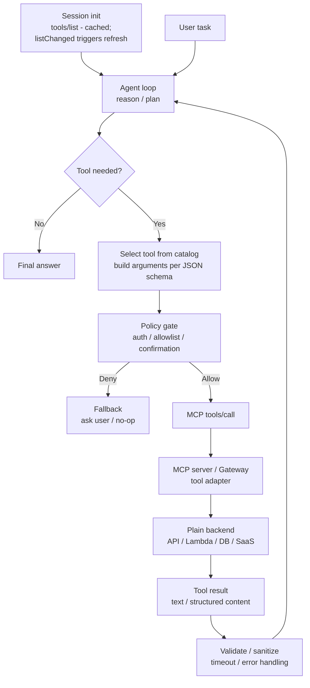

# MCP Tools-as-Tools Pattern

## Intro / Index

MCP Tools-as-Tools uses the Model Context Protocol to expose plain functions, APIs, data lookups, or service actions as tools an agent can discover and invoke. It solves the problem of every agent framework needing a custom adapter for every enterprise system, while keeping the downstream capability a tool rather than pretending it is another agent.

**Protocol status (2026):** MCP was created by Anthropic in November 2024 and donated in December 2025 to the Agentic AI Foundation (AAIF), a directed fund under the Linux Foundation co-founded by Anthropic, Block, and OpenAI - the same foundation that now governs A2A, so the tool protocol and the agent protocol share neutral governance. The 2025-11-25 specification added experimental **tasks** (durable requests with polling and deferred results), OpenID Connect discovery, incremental scope consent, and OAuth client-ID metadata documents; a 2026 revision delivered a stateless core for ordinary HTTP infrastructure plus extensions such as MCP Apps. Tool semantics (tools/list, tools/call, JSON schemas, structured output) are stable across versions.

## Description

The pattern puts a protocol boundary between the agent and external capabilities. An MCP server publishes tool metadata, input schemas, and optional output schemas; an MCP client lists available tools, chooses one, calls it with structured arguments, and feeds the returned result back into the agent loop.

## Diagram



Discovery is a session-level event, not a per-task one: the client lists tools once at initialization, caches the catalog, and refreshes on `listChanged` notifications - the agent loop then selects from the known catalog. The core design boundary is simple: MCP describes and invokes tools, but the tool remains a bounded operation. If the downstream capability has its own planning, task state, and autonomous behavior, it is closer to an A2A agent than an MCP tool.

## When to use / when to avoid

**Use it when**

- You need to expose existing APIs, Lambda functions, databases, SaaS actions, or internal services to one or more agents.
- The operation has clear inputs, outputs, permissions, and failure modes.
- You want framework-neutral tool discovery instead of hard-coding tool adapters into every agent.
- Governance matters: authentication, authorization, audit logs, rate limits, user confirmation, and tool allowlists.
- The same tool surface should be reusable from Bedrock-hosted agents, custom Runtime agents, local assistants, or other MCP clients.

**Avoid it when**

- The downstream component is another autonomous agent with task lifecycle, streaming status, artifacts, or delegation semantics; use A2A instead. (The boundary is narrowing - MCP's experimental tasks now cover durable, pollable operations - but capability delegation to an autonomous peer is still A2A's job.)
- The "tool" requires a long interactive conversation to complete.
- The agent only needs one local deterministic function; a direct in-process call may be simpler.

## Footprint

MCP’s transport envelope does not inherently add model tokens. Tokens are added when the agent framework includes tool descriptions, schemas, tool-call arguments, or tool results in the model context

Rule of thumb:

```text
token_cost ~= tool_descriptions_in_prompt + tool_call_arguments + tool_result_context + followup_reasoning
latency ~= mcp_round_trip + backend_latency + followup_model_call
```

Example shape:

|Flow|Model calls|Token behavior|Latency behavior|
|---|--:|---|---|
|Tool already selected by code|1-2|Small schema plus result|One backend call plus final synthesis|
|Agent chooses from few tools|2+|Tool descriptions fit in prompt|Discovery/selection plus tool execution|
|Agent chooses from many tools|2+|Needs search or pruning to avoid giant prompts|Semantic tool selection adds lookup latency but reduces prompt size|
|Large tool result|2+|Result can dominate context|Summarize, paginate, or return structured fields|

**Worked example - the catalog-bloat math.** An agent connected to 40 tools at ~350 tokens of schema each carries ~14,000 tokens of tool descriptions in _every_ model call. Over a 5-call agent run that is ~70,000 input tokens of pure catalog - at illustrative rates of **$3 / 1M input tokens**, ~$0.21 per run before any actual work. Semantic tool selection that injects only the 5 relevant tools (~1,750 tokens) cuts the catalog cost to ~$0.026 per run - an ~8x reduction on the catalog line alone, plus faster calls. This is why the expensive part of MCP is never the JSON-RPC envelope; it is repeatedly sending long tool catalogs or large tool results back through the model. A gateway or registry that lets the agent search tools before adding them to the prompt cuts both token cost and latency.

## AWS Mapping

|AWS tier|Supported in config?|What you do|
|---|---|---|
|**AgentCore Gateway**|**Yes - strongest AWS-native fit for MCP tools-as-tools.**|Convert OpenAPI APIs, Smithy services, Lambda functions, and existing services into MCP-compatible tools behind a single secure Gateway endpoint. Gateway provides ingress auth, egress auth, composition, semantic tool selection (the direct fix for catalog bloat), observability, and compatibility with frameworks such as Strands, LangGraph, LlamaIndex, and CrewAI.|
|**AgentCore Runtime + custom code**|**Yes - full MCP client or server control.**|Host an MCP client agent, a custom MCP server, or both in Runtime. MCP server containers run on port `8000` at path `/mcp` (vs 9000 + `/` for A2A and 8080 + `/invocations` for HTTP), with Runtime adding session isolation, SigV4/OAuth, and scaling. Use this when you need custom tool selection, custom transports, local state, framework-specific control, streaming, specialized validation, or tool behavior Gateway does not express.|
|**AgentCore Harness**|**Yes, as a managed agent client of configured tools.**|Harness can use configured tools and AgentCore services while AWS owns the loop. Use Harness when you want managed orchestration that calls governed tools; keep complex tool construction, auth boundaries, and MCP endpoint management in Gateway or external MCP servers. Harness is public preview.|
|**Bedrock Agents**|**Partly, through managed action groups rather than native MCP-first tool hosting.**|Bedrock Agents expose tools through action groups and knowledge bases. Use them when the managed Bedrock agent abstraction is enough; use AgentCore Gateway or a custom MCP server when the same tool surface must be MCP-compatible for multiple clients.|
|**A2A**|**Adjacent, not a replacement.**|Use MCP when the remote capability is a tool; use A2A when the remote capability is an agent peer with task state, messages, updates, cancellation, and artifacts. Many systems use both: MCP for tools, A2A for delegation to specialist agents. Both protocols are now governed by the same Linux Foundation fund (AAIF).|

## Common failure modes

- **Tool poisoning:** a malicious or compromised server describes a tool in a way that manipulates the model - including the _rug-pull_ variant, where a server changes a previously-approved tool's description or behavior after installation. _Mitigation: trust only approved servers, review tool metadata, pin/hash approved tool definitions and alert on change, and keep server-provided annotations untrusted unless verified._
- **Stale catalog:** the client's cached tool list no longer matches the server - tools were added, removed, or re-scoped - so the agent calls tools that fail or misses ones it needs. _Mitigation: honor `listChanged` notifications, re-list on reconnect, and treat unknown-tool errors as a refresh trigger._
- **Over-broad tools:** a single tool can do too many actions, making permissions and validation vague. _Mitigation: split high-risk operations into narrow tools with explicit schemas and scopes._
- **Prompt bloat from tool catalogs:** hundreds of tool descriptions fill the context window. _Mitigation: use semantic tool search, allowlists, pagination, and per-task tool subsets._
- **Unsafe side effects:** the agent calls a write, payment, delete, or send operation without approval. _Mitigation: require human confirmation, idempotency keys, policy gates, and audit logs for sensitive tools._
- **Schema drift:** the backend API changes but the MCP tool schema is stale. _Mitigation: generate schemas from source contracts, add contract tests, and version tools explicitly._
- **Unvalidated results:** the agent treats tool output as trusted instructions instead of data - the main prompt-injection channel in tool-using systems. _Mitigation: sanitize outputs, separate data from instructions, validate structured content, and constrain how results enter the prompt._
- **Timeout mismatch:** the model waits on slow tools or retries blindly. _Mitigation: set per-tool timeouts, return structured errors, give the agent clear retry policy - and for genuinely long operations, use the spec's tasks mechanism (durable requests with polling) instead of holding a call open._
- **Auth confusion:** the tool runs with the wrong user, tenant, or service principal. _Mitigation: propagate identity deliberately, enforce least privilege, and log caller identity with every tool call._
- **Cost opacity:** the agent repeatedly calls cheap-looking tools that trigger expensive downstream systems. _Mitigation: attach cost classes, rate limits, budgets, and telemetry to each tool._

## Sources

- [AWS: Amazon Bedrock AgentCore Gateway](https://docs.aws.amazon.com/bedrock-agentcore/latest/devguide/gateway.html)
- [AWS: Host agent or tools with AgentCore Runtime](https://docs.aws.amazon.com/bedrock-agentcore/latest/devguide/agents-tools-runtime.html)
- [AWS: AgentCore Harness](https://docs.aws.amazon.com/bedrock-agentcore/latest/devguide/harness.html)
- [AWS: Automate tasks in your application using AI agents](https://docs.aws.amazon.com/bedrock/latest/userguide/agents.html)
- [Model Context Protocol: Specification (2025-11-25)](https://modelcontextprotocol.io/specification/2025-11-25)
- [Model Context Protocol: 2025-11-25 changelog](https://modelcontextprotocol.io/specification/2025-11-25/changelog)
- [MCP blog: One year of MCP - the November 2025 spec release](https://blog.modelcontextprotocol.io/posts/2025-11-25-first-mcp-anniversary/)