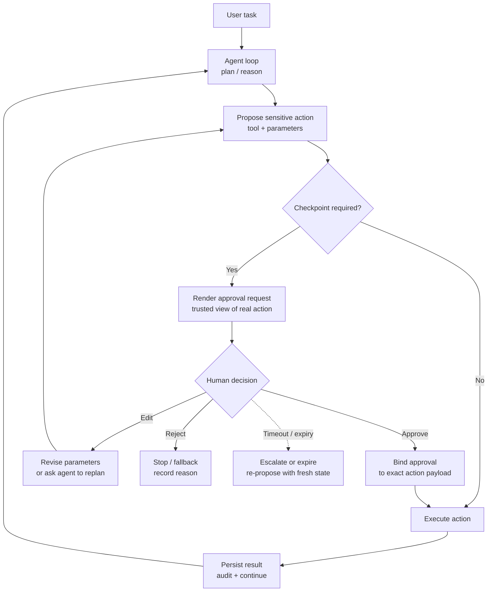

## Intro / Index

Human-in-the-loop checkpoint pauses an agent or workflow before a sensitive step and waits for an authorized person to approve, reject, edit, or redirect the action. It solves the problem of agents being able to draft or propose risky actions faster than the system can safely execute them.

Like Event-Driven/Async, this is a cross-cutting pattern rather than an inner loop: it composes with every other entry in this catalog - a checkpoint can gate a ReAct tool call, a state-machine node, a supervisor's dispatch, or an A2A delegation.

## Description

The pattern separates proposal from execution. The agent prepares a concrete action with parameters, evidence, and impact summary; a trusted checkpoint renders the exact action for review; only after approval does the system execute the action or feed the human's decision back into the agent.

## Diagram



The approval should be bound to the exact action that executes, not merely to a model-written summary. For high-risk operations, the approval UI should be generated from the validated tool call, policy decision, and payload at the execution boundary. This is the Consent Integrity property: the agent's own narration of what it is about to do is forgeable (the Lies-in-the-Loop attack), so the rendering must come from a trusted mediator reading the real action at the boundary, over a path the agent cannot spoof.

## When to use / when to avoid

**Use it when**

- The action has financial, legal, security, privacy, operational, or reputational impact.
- The agent will send messages, modify records, delete data, purchase resources, change permissions, or call external systems on behalf of a user.
- The action is low-frequency but high-consequence.
- Policy requires separation of duties, audit evidence, or explicit user consent.
- The model is uncertain, tool output is ambiguous, or the action is irreversible.

**Avoid it when**

- The action is read-only, reversible, low-risk, and already covered by deterministic policy.
- The checkpoint would fire on nearly every step and make the workflow unusable.
- The human reviewer lacks enough context or authority to make a meaningful decision.
- The system cannot guarantee that the approved action is the same action that executes.
- The workflow is fully automated by design and should instead use hard policy gates, limits, and monitoring.

## Footprint

Human checkpoints usually add little model token cost but can dominate wall-clock latency. The agent may need one extra model call to prepare the approval packet and another to incorporate the approval, rejection, or edited parameters.

Rule of thumb:

```text
token_cost ~= proposal_tokens + optional_revision_tokens + post_approval_context
latency ~= model_latency + human_wait_time + execution_latency
```

Example shape:

|Flow|Model calls|Token behavior|Latency behavior|
|---|--:|---|---|
|Read-only path, no checkpoint|1+|Normal agent/tool cost|No human wait|
|Approval before one write action|+1|Proposal packet plus final continuation|Human response time dominates|
|Edit then approve|+2|Agent revises or validates edited payload|Adds another review loop|
|Rejection / escalation|+1 or more|Agent explains fallback or asks clarification|Completion may pause indefinitely|

**Worked example - the cost inversion.** Adding one checkpoint to an agent run costs roughly a 400-token proposal packet plus a 300-token post-approval continuation: at illustrative rates of **$3 / 1M input** and **$15 / 1M output tokens**, well under **$0.01** added. Meanwhile completion latency goes from ~15 seconds to minutes, hours, or days of human wait - and the real infrastructure cost is _where the wait lives_: an AgentCore Runtime session held open burns compute and dies at the 8-hour session cap, while a Step Functions Standard execution parked on a task token costs almost nothing and can wait up to a year. This pattern is the inverse of every other entry: tokens are negligible; latency and durable-state design are everything.

For FinOps, the approval wait itself is not model-token expensive, but it can keep workflow state, Runtime sessions, queues, or Step Functions executions alive. Long approval windows should use durable workflow state rather than holding a live request open.

## AWS Mapping

| AWS tier                              | Supported in config?                                                         | What you do                                                                                                                                                                                                                                                                                                                                                    |
| ------------------------------------- | ---------------------------------------------------------------------------- | -------------------------------------------------------------------------------------------------------------------------------------------------------------------------------------------------------------------------------------------------------------------------------------------------------------------------------------------------------------- |
| **Step Functions + Bedrock / agents** | **Yes - strongest AWS-native workflow pause.**                               | Use Standard Workflows with `.waitForTaskToken` callback tasks to pause for human approval, then resume with `SendTaskSuccess` or `SendTaskFailure`. Standard executions can run up to one year, and `HeartbeatSeconds` detects abandoned approvals. This is the right fit for durable approvals that may take minutes, hours, or days.                        |
| **Bedrock Agents**                    | **Yes, for function confirmation; partly for custom approval flows.**        | Function-based action groups support `requireConfirmation` so the agent requests user confirmation before invoking a function. Action groups can also use `RETURN_CONTROL`, letting your application receive the predicted action and parameters, run its own approval UI or policy check, then send results back with the same invocation id.                 |
| **AgentCore Gateway / MCP tools**     | **Partly, as the policy and tool boundary.**                                 | Use Gateway/MCP tool wrappers to enforce allowlists, scopes, user confirmation, idempotency keys, and audit logging before a downstream action runs. The approval experience usually lives in the client app or workflow, not inside the tool description alone.                                                                                               |
| **AgentCore Harness**                 | **Partly, through app/tool design rather than a universal approval switch.** | Harness owns the managed loop, so use tool schemas, instructions, Gateway policy, and application-side UI to require confirmation before sensitive tools execute. For complex approval state, put Harness behind Step Functions or custom orchestration. Harness is public preview.                                                                            |
| **AgentCore Runtime + custom code**   | **Yes - full control.**                                                      | Implement checkpoints in LangGraph, Strands, CrewAI, LlamaIndex, or custom code, then host in Runtime. Use durable state for long waits (do not hold a live session open past its limits), and bind approval to exact tool payloads before execution. Runtime gives hosting, isolation, streaming, and observability; your code owns the checkpoint semantics. |

## Common failure modes

- **Approval laundering (Lies-in-the-Loop):** the agent shows a friendly summary that does not match the actual action - demonstrated as a practical attack: a compromised agent narrates a benign description while a different action runs. _Mitigation: Consent Integrity - render approval from the validated tool payload at the execution boundary via a trusted mediator the agent cannot spoof, and bind approval to that exact payload. Surface anything the analyzer cannot classify as uninspectable rather than silently approving it._
- **Over-prompting:** every minor action asks for approval and users click through blindly. _Mitigation: classify risk, batch low-risk approvals, and reserve checkpoints for meaningful decisions._
- **Under-prompting:** risky actions slip through because the classifier misses them. _Mitigation: combine model classification with deterministic policy rules, tool risk classes, and deny-by-default for sensitive scopes._
- _(Note: over- and under-prompting are one dial, not two bugs - measured in the consent-integrity literature, the trust list that bounds silent passes of abuses is the same list that drives prompt fatigue on normal commands. Tuning one necessarily moves the other; budget for that trade-off explicitly.)_
- **Reviewer lacks context:** the human sees parameters but not evidence, source data, or impact. _Mitigation: show the exact action, target, reason, evidence, diff, cost, and rollback notes._
- **Edited payload drift:** the human edits the action, but the agent later changes it before execution. _Mitigation: revalidate edits and execute only the approved immutable payload._
- **Stale approval:** the world changes after approval but before execution. _Mitigation: add expiration times, re-check preconditions, and require reapproval on material changes._
- **Identity mismatch:** the action executes under the wrong user, tenant, or service role. _Mitigation: bind approval to reviewer identity, requester identity, target tenant, and execution principal._
- **No audit trail:** approvals cannot be reconstructed after an incident. _Mitigation: store proposal, payload hash, reviewer, timestamp, decision, reason, execution result, and trace id._
- **Session held open too long:** the agent waits in-memory for a human and loses state or burns infrastructure. _Mitigation: persist checkpoint state and resume by job id, task token, or workflow execution id._

## Sources

- [AWS: Add an action group to your agent in Amazon Bedrock](https://docs.aws.amazon.com/bedrock/latest/userguide/agents-action-add.html)
- [AWS: Return control to the agent developer in an InvokeAgent response](https://docs.aws.amazon.com/bedrock/latest/userguide/agents-returncontrol.html)
- [AWS Step Functions: Service integration patterns (waitForTaskToken)](https://docs.aws.amazon.com/step-functions/latest/dg/connect-to-resource.html)
- [AWS: AgentCore Harness](https://docs.aws.amazon.com/bedrock-agentcore/latest/devguide/harness.html)
- [AWS: Host agent or tools with AgentCore Runtime](https://docs.aws.amazon.com/bedrock-agentcore/latest/devguide/agents-tools-runtime.html)
- [What You Approve Is What Executes: Consent Integrity for Black-Box LLM Agents (arXiv:2606.02668)](https://arxiv.org/abs/2606.02668)