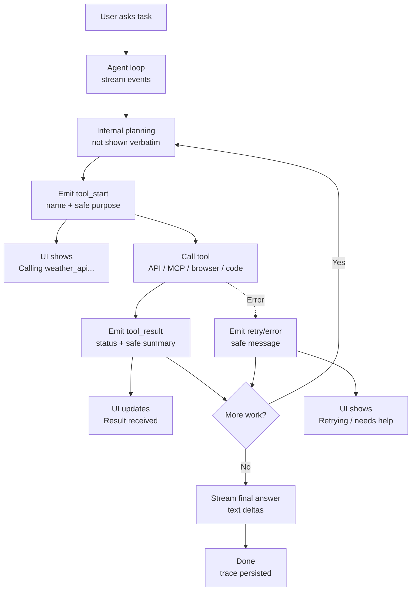

# Streaming With Tool Transparency Pattern


## Intro / Index

Streaming with tool transparency shows the user live progress while the agent works, including which tool is being called, what it is trying to do, and when the result comes back. It solves the problem of tool-using agents feeling like a silent black box during slow searches, API calls, browser actions, code execution, or multi-step workflows.

This is the catalog's third cross-cutting layer: Event-Driven/Async governs _when work runs_, Human-in-the-Loop governs _consent_, and this pattern governs _visibility_. The three compose - a streamed `approval_required` event is the natural delivery channel for a HITL checkpoint. It also completes the protocol trio: MCP standardizes agent-to-tool, A2A standardizes agent-to-agent, and AG-UI standardizes agent-to-user event streams.

## Description

The pattern separates user-visible progress events from private model reasoning and raw tool payloads. The agent or runtime emits structured events such as text deltas, tool-start, tool-result, retry, warning, and final-answer; the UI renders those events as a timeline without exposing secrets, credentials, hidden prompts, or untrusted tool output as instructions.

## Diagram



The user should see enough to understand what is happening and stop unsafe work, but not so much that private chain-of-thought, credentials, internal prompts, raw PII, or misleading tool text leaks into the UI.

## When to use / when to avoid

**Use it when**

- Tool calls can take more than a second or two and users need progress feedback.
- The agent calls external systems, browsers, code interpreters, MCP tools, Gateway tools, databases, or write APIs.
- Users need trust, auditability, or the ability to interrupt risky work.
- The workflow includes retries, fallbacks, long-running steps, or human checkpoints.
- You want operational traces and user-facing progress to share the same event model.

**Avoid it when**

- The task is a short single-shot response where progress UI adds noise.
- Tool names, parameters, or results contain sensitive information that cannot be safely summarized.
- The UI would expose hidden reasoning, security policy, credentials, prompts, or implementation details.
- Streaming infrastructure is not reliable enough to preserve event order and final state.
- The agent needs strict non-disclosure of intermediate investigative steps.

## Footprint

Streaming does not inherently change the model token bill; it changes when bytes reach the client and how many progress events the application emits. Tool transparency can add small orchestration overhead and UI traffic, but it often reduces perceived latency because users see useful progress before the final answer.

Rule of thumb:

```text
token_cost ~= normal_agent_tokens + optional_safe_summaries
network_events ~= text_deltas + tool_start_events + tool_result_events + retries
perceived_latency ~= time_to_first_event
completion_latency ~= full_agent_runtime
```

Example shape:

|Flow|Model calls|Token behavior|Latency behavior|
|---|--:|---|---|
|Stream final answer only|Same as baseline|No extra tool context|Better perceived latency after first token|
|Show tool start/result events|Same as baseline|Small event payloads outside model|User sees progress during tool waits|
|Generate safe tool summaries|+0 or +1 per summary strategy|May add summarization tokens|Safer UI, but extra work if summaries use the model|
|Long tool retry loop|Same or more, depending on retries|Retry context can grow|Transparency helps users understand delay|

**Worked example - where the cost actually is.** Take the catalog's 5-step ReAct run (~$0.06). Adding transparency events changes the model bill almost not at all: tool_start/tool_result events are metadata emitted outside the model, and even generating a 60-token safe summary for each of 5 tool results adds ~300 output tokens ~= **$0.005** at illustrative rates ($15 / 1M output). What changes is _perceived_ latency - time-to-first-event drops from ~18 seconds (full completion) to under a second - and the operational surface: a chatty run can emit hundreds of delta and status events, so the costs to watch are bandwidth, log volume, and trace storage, not tokens. Track tool-event counts separately from model tokens; a noisy UI may not change LLM cost but can dominate observability spend.

## AWS Mapping

|AWS tier|Supported in config?|What you do|
|---|---|---|
|**AgentCore Runtime + AG-UI server**|**Yes - the protocol-native fit.**|Deploy an AG-UI server to Runtime: agent-to-user interaction as a first-class protocol, with event streams over SSE (`/invocations`) or bidirectional WebSocket (`/ws`) on port 8080, SigV4/OAuth handled by the Runtime proxy. AG-UI standardizes exactly this pattern's event model - message deltas, tool activity, state - the way MCP standardizes tools and A2A standardizes peers. Use it instead of inventing a custom event schema when a standard helps.|
|**AgentCore Runtime + custom code**|**Yes - full control.**|Runtime `InvokeAgentRuntime` returns streaming responses, including `text/event-stream` when your agent emits SSE-style events. Use custom code to emit typed events such as `token`, `tool_start`, `tool_result`, `retry`, `approval_required`, and `final`, then render them in your app.|
|**AgentCore Harness**|**Yes, through managed stream events and traces.**|Harness owns the managed loop and emits structured streamed events for model output, tool activity, and orchestration. Use it when managed streaming is enough, then normalize events in the UI so users see tool progress without raw internals. Harness is public preview.|
|**Bedrock Agents**|**Partly.**|`InvokeAgent` supports streaming configuration for the final response and `enableTrace` for trace events. Traces can show the agent's steps, actions, knowledge-base lookups, and action results, but the app still decides what trace details are safe and useful to render to end users.|
|**AgentCore Gateway / MCP tools**|**Partly, as the tool boundary.**|Gateway and MCP calls provide tool names, schemas, status, and results that can feed transparency events. The agent app should redact parameters and summarize results before showing them to users.|
|**Step Functions / event-driven workflows**|**Partly, through execution status.**|Use workflow execution events, task status, and callback state to show long-running progress. This is useful for async jobs, but the UI needs a poll, push, or subscription layer to turn workflow state into user-facing updates.|

## Common failure modes

- **Chain-of-thought leakage:** the UI streams private reasoning instead of safe progress events. _Mitigation: emit typed progress events and never display hidden reasoning verbatim._
- **Secret leakage:** tool parameters or results include credentials, tokens, PII, tenant ids, or internal URLs. _Mitigation: redact by schema and policy before events leave the backend._
- **False precision:** the UI says a tool "verified" something when the tool only returned partial or stale data. _Mitigation: label statuses accurately: calling, returned, failed, partial, cached, or unverified._
- **Event/result mismatch:** the UI shows a tool call as successful, but the final answer ignores or contradicts it. _Mitigation: persist event ids and require final synthesis to cite or reconcile important observations._
- **Over-sharing tool internals:** users see noisy JSON, stack traces, or irrelevant implementation details. _Mitigation: render concise tool names, safe purpose, status, and summarized result._
- **Untrusted output injection:** raw tool output tells the UI or user to do something malicious. _Mitigation: treat tool output as data, sanitize it, and never render it as executable UI instructions._
- **Out-of-order events:** network buffering shows result before start, or old retries after final answer. _Mitigation: include sequence numbers, run ids, and terminal event handling._
- **Progress spam:** too many micro-events make the UI distracting and logs expensive. _Mitigation: coalesce deltas, debounce status updates, and keep detailed traces in observability tools._
- **No interrupt path:** the user can see a bad tool call happening but cannot stop it. _Mitigation: add cancellation, approval checkpoints, or disable controls for non-cancelable actions._

## Sources

- [AWS: Deploy AGUI servers in AgentCore Runtime](https://docs.aws.amazon.com/bedrock-agentcore/latest/devguide/runtime-agui.html)
- [AWS: InvokeAgent API reference](https://docs.aws.amazon.com/bedrock/latest/APIReference/API_agent-runtime_InvokeAgent.html)
- [AWS: Trace events in Amazon Bedrock Agents](https://docs.aws.amazon.com/bedrock/latest/userguide/trace-events.html)
- [AWS: Invoke an AgentCore Runtime agent](https://docs.aws.amazon.com/bedrock-agentcore/latest/devguide/runtime-invoke-agent.html)
- [AWS: AgentCore Harness](https://docs.aws.amazon.com/bedrock-agentcore/latest/devguide/harness.html)
- [AWS: Amazon Bedrock AgentCore Gateway](https://docs.aws.amazon.com/bedrock-agentcore/latest/devguide/gateway.html)
- [Model Context Protocol: Specification (2025-11-25)](https://modelcontextprotocol.io/specification/2025-11-25)