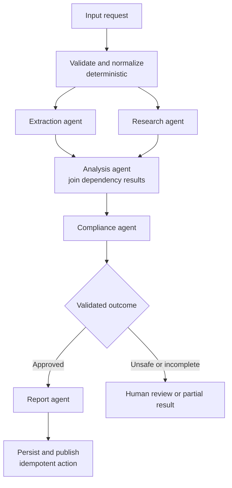

# Agent Workflow Pattern

> **Pattern family:** task-oriented multi-agent orchestration<br>
> **Status:** predictable and production-friendly when tasks, contracts, retries, and side effects are explicit

## Intro / Index

An agent workflow decomposes a known process into tasks, assigns each task to an agent or deterministic executor, and runs the tasks according to declared dependencies. Independent tasks can run concurrently; dependent tasks wait for their required inputs; outputs move forward through typed task contracts.

The defining idea is:

> Execution is agentic **inside a task**, but workflow scheduling is deterministic **between tasks**.

An agent may reason, use tools, and iterate while performing its bounded task. It does not invent arbitrary new workflow stages or choose an unrestricted peer. The workflow definition owns task order, fan-out, joins, retries, and terminal outcomes.

The essential properties are:

- **Task definitions:** each unit has an ID, objective, executor, inputs, output schema, limits, and side-effect policy.
- **Directed acyclic dependencies:** a task becomes ready only when its required predecessors satisfy the join policy.
- **Parallel scheduling:** independent ready tasks can run concurrently within quotas.
- **Forward information flow:** downstream tasks receive validated dependency outputs, not an implicit global conversation.
- **Per-task observability and recovery:** status, usage, artifacts, retries, and errors are attributable to one task.
- **Known completion:** the run ends at declared terminal tasks or a defined failure/escalation outcome.

The number of tasks is not the number of agents. One configured agent can execute several task types, or each task can use a different specialist, model, toolset, deployment, or deterministic function.

## Control flow



One execution proceeds as follows:

1. The workflow validates the request and creates a versioned run.
2. `Extraction` and `Research` become ready and run concurrently.
3. `Analysis` waits for both required results and receives a deterministic merge of their typed outputs.
4. `Compliance` validates the analysis against a schema and policy rubric.
5. Code routes approved work to `Report`; rejected or incomplete work takes an explicit fallback path.
6. A deterministic commit task performs external side effects with an idempotency key.

The canonical workflow is a DAG. Retries repeat a task under a fixed policy but do not create an open-ended agent collaboration cycle. If a reviewer must repeatedly send work back to a writer, use a bounded Graph or state-machine loop and make the exit condition visible.

## Task lifecycle and scheduler contract

A useful task lifecycle is:

```text
PENDING -> READY -> RUNNING -> COMPLETED
                         |-> FAILED -> RETRY_WAIT -> READY
                         |-> TIMED_OUT
                         |-> CANCELLED
PENDING -------------------------------> SKIPPED
```

Define these semantics before implementation:

- **Readiness:** all dependencies, any dependency, quorum, or time-bounded partial input.
- **Failure propagation:** fail the run, skip descendants, use a fallback, or continue with an explicitly partial result.
- **Retry policy:** distinguish transient infrastructure retry from semantic repair; cap both.
- **Cancellation:** stop queued tasks and propagate cooperative cancellation to running agents and tools.
- **Priority and concurrency:** schedule ready tasks without exceeding model quotas or downstream rate limits.
- **Terminal aggregation:** select the authoritative final output when several sink tasks exist.
- **Resume behavior:** decide whether completed tasks are reused from checkpoints or recomputed.

Validate the workflow at deployment time: task IDs must be unique, dependency targets must exist, the task graph must be acyclic, required inputs must be producible, schemas must be compatible, terminal tasks must be reachable, and every side effect must have a single owner.

## How it differs from nearby patterns

| Pattern | How work is selected | Topology | Best fit |
|---|---|---|---|
| **Agent workflow** | A scheduler runs predefined tasks from declared dependencies | Task DAG | Repeatable processes with sequential stages, parallel work, joins, and known outputs |
| **Graph Multi-Agent** | Developer-defined edges and conditions select nodes; bounded cycles may revisit them | DAG or cyclic graph | Conditional agent networks, feedback, nested patterns, and controlled dynamic routing |
| **Swarm** | The active peer chooses the next agent | Dynamic peer mesh | Exploratory collaboration where the useful route is unknown in advance |
| **Supervisor / Worker** | A supervisor model decomposes and delegates at runtime | Hierarchy or star | Dynamic routing, decomposition, and centralized synthesis |
| **Plan and Solve** | A model generates a task plan at runtime | Ephemeral plan | Novel tasks whose steps cannot be fully declared before investigation |
| **State machine with LLM nodes** | A durable process engine owns states and transitions | Explicit state machine | Multi-day work, callbacks, approvals, compensation, and cross-service audit requirements |

The categories overlap. A workflow DAG is a kind of graph, and Step Functions implements workflows as state machines. Use **agent workflow** when the design unit is a bounded task and its dependencies. Use **Graph Multi-Agent** when the design unit is an agent/node and its permitted communication path. Use **state machine** when durable business state and recovery semantics dominate.

## When to use / when to avoid

**Use it when**

- The process has known stages and stable dependencies.
- Different tasks need focused agents, models, tools, prompts, or permissions.
- Independent research, extraction, classification, or evaluation tasks can safely run concurrently.
- Each stage can expose a typed, testable output contract.
- Per-task retries, checkpoints, cost attribution, and audit history matter.
- A deterministic validator or human must approve the result before a side effect.
- The workload is batch-oriented or one run should move from start to finish without conversational peer negotiation.

**Avoid it when**

- One focused agent can complete the task without handoffs or repeated context packaging.
- The useful steps emerge only during investigation; a planner or bounded swarm may fit better.
- Tasks require repeated back-and-forth refinement; use a bounded graph rather than hiding cycles inside task retries.
- Every task needs the entire transcript and identical tools, so specialization adds no context or permission benefit.
- The process changes so frequently that the DAG becomes a brittle collection of exceptions.
- A lightweight in-process scheduler is being used for multi-day waits, human callbacks, or transactional recovery. Use a durable workflow engine.

## Task and context contracts

Treat each task as a versioned function even when an LLM performs it. A task definition should capture fields such as:

```json
{
  "task_id": "analyze_findings",
  "task_version": "3.1",
  "executor_ref": "agent://analysis/v7",
  "dependencies": ["extract_document", "research_sources"],
  "join_policy": "all_completed",
  "input_schema": "schema://analysis-input/2.0",
  "output_schema": "schema://analysis-result/3.0",
  "timeout_seconds": 180,
  "max_attempts": 2,
  "side_effects": "none"
}
```

A task packet should contain the original request ID, bounded objective, immutable user constraints, selected dependency results, authorized artifact references, trust/provenance labels, output schema, budget, deadline, and escalation conditions. Keep user identity, authorization claims, credentials, and budget counters in non-model state unless the agent must reason about a safe representation.

Do not pass the complete workflow transcript to every task. Each task should normally receive:

- the original goal and only the constraints it must obey;
- validated outputs from its declared dependencies;
- references to large immutable artifacts rather than copied content;
- relevant warnings, missing inputs, and provenance; and
- no results from unrelated parallel branches.

At a join, merge dependency results by stable task ID rather than completion order. Preserve source and task provenance, reject incompatible schema versions, represent missing parents explicitly, and deduplicate shared evidence before assembling the next prompt.

Task output should separate `status`, structured findings, evidence references, created artifacts, warnings, unresolved questions, and requested escalation. Never let free-form agent prose silently become workflow control data; parse and validate a constrained field before routing or acting.

## Token and latency footprint

Workflow cost is the sum of calls inside visited agent tasks; workflow latency follows the critical dependency path:

```text
model cost = sum(model calls for all visited agent tasks and retries)
wall-clock latency ~= longest dependency path + queue/orchestration overhead
```

Workflows avoid model-based routing calls and make the maximum task set known. Parallel branches can reduce elapsed time, but they do not reduce total tokens. Context can still snowball at joins if raw upstream transcripts are copied instead of passing compact results and artifact references.

**Worked example - two parallel preparation agents, then analysis, compliance, and reporting.** Validation and persistence are deterministic and use no model tokens. Assume illustrative pricing of $3 / 1M input tokens and $15 / 1M output tokens.

| Agent task | Model calls | Approx input tokens | Approx output tokens |
|---|---:|---:|---:|
| Extraction | 2 | 3,800 | 600 |
| Research | 3 | 5,200 | 800 |
| Analysis join | 2 | 4,800 | 700 |
| Compliance | 1 | 2,600 | 250 |
| Report | 2 | 4,200 | 700 |
| **Total** | **10** | **20,600** | **3,050** |

The illustrative model bill is about **$0.11 per approved run**: `$0.062` input plus `$0.046` output, before tools, orchestration, Runtime, storage, and network charges. If extraction takes 5 seconds and research takes 8 seconds in parallel, followed by analysis at 4 seconds, compliance at 2 seconds, and report at 4 seconds, the critical path is about **18 seconds**, compared with 23 seconds for serial execution.

Track cost and latency by workflow version, task, attempt, and terminal status. Report p50/p95 queue time, execution time, input/output tokens, retry amplification, skipped-branch savings, and cost per successful business outcome.

## AWS mapping

| AWS tier | Agent workflow support | What you do |
|---|---|---|
| **AWS Step Functions + AgentCore Harness** | **Yes - preferred configuration-first durable implementation.** | Use an `InvokeHarness` Task for each bounded agent step, and use Parallel/Map, Choice, Retry/Catch, separate callback/approval states, and execution history for workflow control. The optimized `InvokeHarness` integration itself is request-response only—it does not support `.sync` or task-token callbacks—returns the final assistant text plus aggregate usage/latency, and has a 15-minute Task-state maximum. Stopping the Step Functions execution does not stop a running Harness, so align timeouts and design explicit cancellation/side-effect controls. |
| **AWS Step Functions + AgentCore Runtime/AWS services** | **Yes - preferred for distributed custom agents and cross-service work.** | Invoke custom AgentCore runtimes through AWS SDK integration or an integration layer, mix them with Lambda and other AWS tasks, fan out with Map/Parallel, and keep large inputs/outputs in S3. Use this when agents are independently deployed or the process needs durable retries, long waits, human approval, or compensation. |
| **AgentCore Runtime + Strands/custom code** | **Yes - application-defined.** | Implement the task DAG inside one Runtime using direct agent calls, a core Strands Graph constrained to a DAG, the community `strands_tools.workflow` tool, or custom async scheduling. This fits bounded runs needing low-latency in-process coordination. Your code owns persistence, schema validation, cancellation, versioning, and side-effect safety; the community workflow tool is not an AgentCore-managed workflow service. |
| **Amazon Bedrock Flows** | **Yes - visual Bedrock-native flow.** | Connect prompt, knowledge-base, Lambda, condition, and Bedrock Agent nodes with typed inputs/outputs, versions, and aliases. This is useful for Bedrock-centered GenAI pipelines. Agent nodes reference Amazon Bedrock Agents Classic aliases, so new-customer availability of Agents Classic must be considered; use prompt/Lambda nodes or AgentCore-based orchestration where appropriate. |
| **AgentCore Harness alone** | **No multi-agent task DAG in Harness configuration.** | Harness owns one configured agent loop. Put several Harness invocations in Step Functions for a workflow, or export to Strands code when one Runtime should own the DAG. |
| **Amazon Bedrock Agents Classic multi-agent collaboration** | **No arbitrary workflow DAG.** | Its native supervisor chooses collaborators dynamically. Use it for supervisor/worker behavior, not for developer-declared task dependencies, joins, or commit semantics. |

**Rule of thumb:** use Step Functions + AgentCore Harness when you want AWS-managed agents as durable workflow steps. Use Step Functions + custom Runtime agents when each step needs custom code or independent deployment. Keep the workflow inside one AgentCore Runtime only when a bounded in-process run is sufficient and application-owned recovery is acceptable.

## Operational controls and evaluation

Set these controls before production traffic:

- **Immutable workflow versions:** capture task definitions, dependencies, prompts, model/tool versions, schemas, and policy code per run.
- **Per-task limits:** cap model iterations, tokens, wall time, tool calls, retries, and output size.
- **Global budgets:** constrain total concurrency, executions, tokens, cost, and elapsed time across the run.
- **Typed control fields:** route only on validated statuses, scores, and enums; keep free-form text as data.
- **Checkpointing:** persist successful task results and content-addressed artifact references before unlocking descendants.
- **Idempotency:** assign stable workflow/run/task/action keys and separate reasoning tasks from commit tasks.
- **Cancellation propagation:** stop queued descendants and ensure running agents and tools can observe cancellation.
- **Least privilege:** give each task executor only its required tools, data, role, and network access.
- **Trace correlation:** connect workflow, task, attempt, agent, model, tool, artifact, and side-effect spans.
- **Partial-result contract:** define when degraded output is acceptable and when the workflow must escalate or fail.

Evaluate task quality and system behavior. Useful tests include DAG validation, expected ready-task sets, parallelism on independent branches, join completeness, schema compatibility, context-bound preservation, per-task task success, retry and timeout injection, cancellation behavior, duplicate side-effect prevention, p50/p95 critical-path latency and cost, and comparison with a single-agent baseline.

## Common failure modes

- **Bad decomposition:** tasks are too broad, too small, or divided at boundaries that require constant context exchange. *Mitigation: split around stable typed artifacts and independently testable outcomes; merge tasks whose handoff cost exceeds specialization value.*
- **Implicit dependency:** two tasks appear independent but read or mutate the same state. *Mitigation: declare data and side-effect dependencies, use immutable inputs, and serialize conflicting writes.*
- **Join race:** a downstream task runs after the first parent even though it needs all results. *Mitigation: encode and test the join policy and represent missing parents explicitly.*
- **Context snowball:** every downstream task receives all upstream transcripts. *Mitigation: return compact typed results, offload large artifacts, and assemble only dependency-relevant context.*
- **Schema drift:** a producer changes its output and silently breaks consumers. *Mitigation: version schemas, validate at every edge, run contract tests, and deploy compatible producer/consumer versions.*
- **False determinism:** the DAG is fixed, but agent outputs remain stochastic and unvalidated. *Mitigation: use structured output, deterministic validators, evaluation thresholds, and explicit rejection paths.*
- **Semantic retry loop:** a bad answer is retried with the same prompt and evidence until the retry budget is exhausted. *Mitigation: distinguish transient retry from repair; change the inputs or route to another task/human.*
- **Duplicate side effects:** a retry sends the same email, creates another ticket, or repeats a payment. *Mitigation: isolate commit tasks, use idempotency keys and a durable ledger, and check before acting.*
- **Zombie agent task:** workflow cancellation or timeout leaves a nested agent running and incurring cost. *Mitigation: align nested timeouts, propagate cancellation where supported, make tools cooperative, and monitor orphaned executions.*
- **Fan-out overload:** a wide branch exceeds Bedrock quotas or downstream API limits. *Mitigation: cap concurrency, batch work, add backpressure, and use quota-aware retry with jitter.*
- **Over-fragmentation:** many agents repeat system prompts and common context for trivial steps. *Mitigation: use deterministic functions or one agent for adjacent work unless the boundary provides measurable value.*
- **No partial-failure policy:** one optional task failure blocks the entire run or disappears silently. *Mitigation: classify required versus optional tasks and define fail, skip, fallback, and partial-result semantics.*
- **Mutable artifact race:** downstream tasks read different versions of an intermediate file. *Mitigation: use immutable/content-addressed artifacts, explicit versions, checksums, and atomic publication.*

## Sources

- [Strands Agents: Agent Workflows](https://strandsagents.com/docs/user-guide/concepts/multi-agent/workflow/)
- [Strands Agents: Multi-agent pattern comparison](https://strandsagents.com/docs/user-guide/concepts/multi-agent/multi-agent-patterns/)
- [AWS: Multi-Agent collaboration patterns with Strands Agents and Amazon Nova](https://aws.amazon.com/blogs/machine-learning/multi-agent-collaboration-patterns-with-strands-agents-and-amazon-nova/)
- [AWS Step Functions: Invoke AgentCore Harness](https://docs.aws.amazon.com/step-functions/latest/dg/connect-bedrockagentcore.html)
- [AWS: Step Functions adds AgentCore service integrations](https://aws.amazon.com/about-aws/whats-new/2026/03/aws-step-functions-sdk-integrations/)
- [AWS: AgentCore Harness](https://docs.aws.amazon.com/bedrock-agentcore/latest/devguide/harness.html)
- [AWS: Host agents or tools with AgentCore Runtime](https://docs.aws.amazon.com/bedrock-agentcore/latest/devguide/agents-tools-runtime.html)
- [AWS: Build an end-to-end generative AI workflow with Bedrock Flows](https://docs.aws.amazon.com/bedrock/latest/userguide/flows.html)
- [AWS: Node types for Bedrock Flows](https://docs.aws.amazon.com/bedrock/latest/userguide/flows-nodes.html)
- [AWS: Scaling content review operations with a multi-agent workflow](https://aws.amazon.com/blogs/machine-learning/scaling-content-review-operations-with-multi-agent-workflow/)
