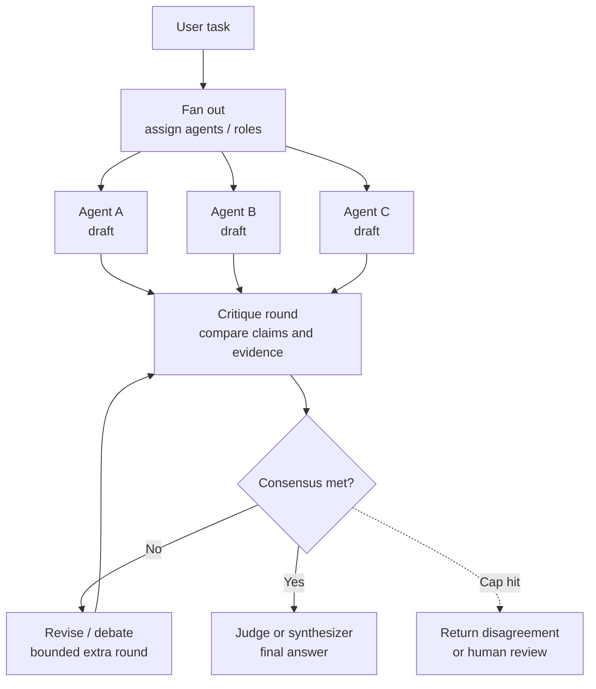

# Debate / Consensus Pattern

> **Pattern family:** multi-agent critique and convergence
> **Status:** useful but expensive; consensus is a signal, not proof

## Intro / Index

Debate / Consensus runs two or more agents over the same task, lets them critique or challenge each other's answers, and then selects or synthesizes a final answer once the group converges. It solves the problem of a single agent confidently missing an alternative interpretation, skipping evidence, or failing to notice defects in its own reasoning.

## Description

The pattern separates answer generation from adversarial review. Agents may have different roles, models, prompts, tools, or evidence slices; after one or more rounds, a judge, vote, rubric, or synthesis agent decides whether the answers agree enough to return a final result.

## Diagram



The important control is the stop condition. A practical debate has a fixed round limit, an explicit agreement threshold, and a fallback for unresolved disagreement.

## When to use / when to avoid

**Use it when**
- The task is high-value and benefits from independent viewpoints, such as architecture decisions, policy interpretation, incident analysis, or complex research synthesis.
- Different agents can bring real diversity: different prompts, tools, models, retrieved evidence, or domain roles.
- You need to expose uncertainty, disagreements, and tradeoffs before making a final recommendation.
- A judge or rubric can evaluate the competing claims against evidence.

**Avoid it when**
- The task is simple, deterministic, or already testable by code.
- All agents use the same model, same prompt, and same context; this often creates expensive agreement without real diversity.
- Latency or token budget is tight.
- The domain is safety-critical and consensus might be mistaken for correctness without external validation.
- There is no reliable judge, ground truth, tool check, or human escalation path.

## Footprint

Debate / Consensus is token-heavy because it multiplies model calls by the number of agents and debate rounds, then adds a judge or synthesis call. Latency depends on the topology: first drafts can run in parallel, but critique rounds are usually serial because each round depends on the previous agents' answers.

Rule of thumb:

```text
model_calls ~= agents * (draft_rounds + critique_rounds) + judge_calls
```

**Worked example - 3 agents, 2 debate rounds, 1 judge.** Assume each agent receives a 1,200-token shared task packet, writes a 500-token draft, then reads the other agents' drafts during critique. The judge reads the task plus all final positions.

| Phase | Calls | Approx input tokens / call | Approx output tokens / call | Total input | Total output |
|---|---:|---:|---:|---:|---:|
| Independent drafts | 3 | 1,200 | 500 | 3,600 | 1,500 |
| Critique round 1 | 3 | 2,200 | 350 | 6,600 | 1,050 |
| Critique round 2 | 3 | 3,250 | 300 | 9,750 | 900 |
| Judge / synthesis | 1 | 4,150 | 600 | 4,150 | 600 |
| **Total** | **10** |  |  | **24,100** | **4,050** |

At illustrative rates of **$3 / 1M input tokens** and **$15 / 1M output tokens**, the token bill is:

```text
input:  24,100 / 1,000,000 * $3  ~= $0.072
output:  4,050 / 1,000,000 * $15 ~= $0.061
total:                                ~$0.13 per run
```

A single-agent answer over the same 1,200-token task with a 700-token output would cost about **$0.014** at those rates, so this debate is roughly **9x** the token cost before tool calls, Runtime compute, or Gateway calls. If drafts run in parallel and each model call takes about 2 seconds, the wall-clock shape is roughly draft round 2s + critique round 1 2s + critique round 2 2s + judge 2s, plus orchestration overhead; if run serially, the same 10 calls can easily become 20+ seconds.

## AWS Mapping

| AWS tier | Supported in config? | What you do |
|---|---|---|
| **Bedrock Agents** | **No, not as a native debate/consensus pattern.** | Bedrock Agents can run a managed agent loop with action groups, knowledge bases, prompt templates, and traces. You can approximate a single-agent "consider alternatives before finalizing" behavior through prompts, but multi-agent debate, cross-agent critique, voting, and convergence logic are not a config switch. |
| **AgentCore Harness** | **Partly, for simple prompt-level critique; not for explicit multi-agent graphs.** | Harness lets you declare model, tools, instructions, and managed infrastructure, and the managed harness owns the loop. Use it for a single configured agent that performs a bounded self-check, or for simple role prompting, but do not treat it as a first-class multi-agent debate engine. Harness is public preview. |
| **AgentCore Runtime + custom code** | **Yes - preferred for real debate/consensus.** | Implement the graph in LangGraph, Strands, CrewAI, LlamaIndex, or custom code, then host it in Runtime. Runtime gives you secure serverless execution, session isolation, long-running workloads, streaming, observability, and protocol support, while your code owns fan-out, critique exchange, voting, judge prompts, stop criteria, retries, and human escalation. |

## Common failure modes

- **False consensus:** agents agree on the same wrong answer, especially when they share the same model, prompt, or retrieved context. *Mitigation: diversify prompts, models, tools, or evidence sources; require evidence-backed claims.*
- **Conformity / majority collapse:** minority correct answers are overwritten by the majority during debate. *Mitigation: preserve dissent, ask the judge to evaluate evidence rather than vote count, and surface unresolved disagreement.*
- **Judge bias:** the synthesizer rewards confident writing or longer answers instead of correctness. *Mitigation: use a rubric, require citations to observations, and keep the judge blind to agent names or prestige.*
- **Token blowup:** each round resends every agent's prior answer and critique. *Mitigation: cap rounds, summarize debate state, and keep only decision-relevant claims.*
- **Latency blowup:** parallel drafts become serial debate rounds and a final judge call. *Mitigation: run first-pass agents concurrently and use early stopping when agreement is already strong.*
- **Reasoning misalignment:** agents agree on the answer but for incompatible reasons. *Mitigation: require agents to state key assumptions and have the judge compare reasoning, not only final answers.*
- **Tool inconsistency:** agents call different tools or observe different data snapshots, then debate stale or incompatible facts. *Mitigation: share canonical observations or timestamp evidence.*
- **No exit path:** the system debates indefinitely or keeps polishing minor disagreements. *Mitigation: hard cap rounds and route unresolved cases to a final judge, user clarification, or human review.*

## Sources

- [AWS: Automate tasks in your application using AI agents](https://docs.aws.amazon.com/bedrock/latest/userguide/agents.html)
- [AWS: AgentCore Harness](https://docs.aws.amazon.com/bedrock-agentcore/latest/devguide/harness.html)
- [AWS: Host agent or tools with AgentCore Runtime](https://docs.aws.amazon.com/bedrock-agentcore/latest/devguide/agents-tools-runtime.html)
- [The Cost of Consensus: Isolated Self-Correction Prevails Over Unguided Homogeneous Multi-Agent Debate](https://arxiv.org/abs/2605.00914)
- [The Consistency Illusion: How Multi-Agent Debate Hides Reasoning Misalignment](https://arxiv.org/abs/2606.08457)
