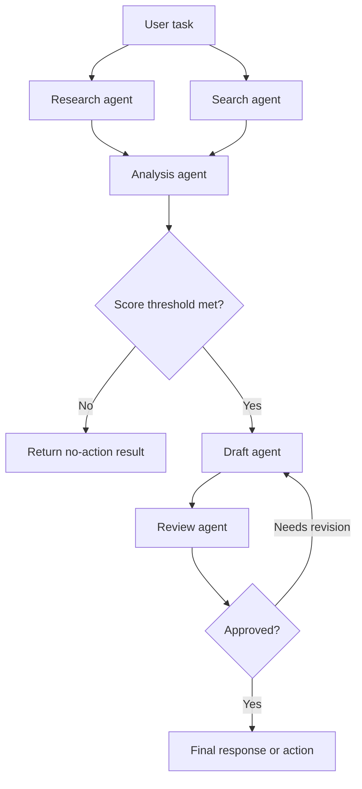

# Graph Multi-Agent Pattern

> **Pattern family:** structured multi-agent orchestration<br>
> **Status:** predictable and testable; cycles, joins, and conditional edges still need explicit safety semantics

## Intro / Index

A graph multi-agent system represents agents and other executors as nodes connected by directed edges. Developers define which nodes may run, their dependencies, and how outputs move through the system. The runtime then schedules ready nodes, runs independent branches concurrently when supported, evaluates conditional edges, and collects results at downstream nodes.

The graph makes the **allowed paths and dependencies explicit**. It does not make model outputs deterministic: an agent node can still return different content, and a condition based on that content can select a different valid path.

The essential properties are:

- **Nodes:** agents, deterministic functions, remote agents, or nested graphs and swarms.
- **Directed edges:** allowed transitions and data dependencies.
- **Entry points:** one or more nodes that receive the original task.
- **Fan-out and joins:** independent nodes can run in parallel; an aggregator can wait for their results.
- **Conditional traversal:** code decides whether an edge is active from validated state.
- **Optional cycles:** feedback and repair loops revisit nodes under bounded exit conditions.

## Control flow



This topology combines four useful graph behaviors:

1. `Research` and `Search` are independent entry nodes and can run concurrently.
2. `Analysis` is a join and should wait for both required results.
3. A deterministic score condition gates the expensive drafting branch.
4. The draft/review cycle allows repair but must have an execution cap and a terminal fallback.

An edge is both a control-flow and information-flow contract. Downstream nodes should receive the original task plus only the validated predecessor results they need—not the entire execution transcript by default.

## Execution semantics to define explicitly

Graph diagrams hide several decisions that become production bugs if left implicit:

- **Join policy:** wait for all required predecessors, any successful predecessor, a quorum, or a time-bounded partial set.
- **Failure policy:** fail fast, retry the node, skip its branch, use a fallback node, or continue with a partial result.
- **Conditional-edge policy:** define what happens when no condition matches or several conditions match.
- **Scheduling policy:** set concurrency limits, rate limits, priority, and fairness for ready nodes.
- **Revisit policy:** decide whether cyclic nodes reset their local state or refine the prior result.
- **Result propagation:** merge multiple parent results without relying on arrival order.
- **Terminal-result policy:** identify the authoritative sink when several terminal nodes can complete.

Validate the graph at build or deployment time: node IDs must be unique, edge endpoints must exist, required sinks must be reachable, joins must be satisfiable, and every permitted cycle must have a hard execution bound.

## How it differs from nearby patterns

| Pattern | Who controls routing? | Topology | Best fit |
|---|---|---|---|
| **Graph** | Developer-defined edges and conditions | Directed DAG or bounded cyclic graph | Known agent dependencies, parallel branches, policy gates, and controlled feedback |
| **Swarm** | The currently active peer agent | Dynamic peer mesh | Exploratory work where the useful specialist path emerges at runtime |
| **Supervisor / Worker** | A permanent supervisor agent | Hierarchy or star | Model-driven decomposition and centralized synthesis |
| **Workflow** | Workflow definition and task dependencies | Usually a task-oriented DAG | Repeatable pipelines with explicit task inputs and outputs |
| **State machine with LLM nodes** | Durable process engine | Explicit states and transitions | Business processes with waits, retries, approvals, compensation, and audit history |

These categories overlap. A supervisor system can be drawn as a graph, and a graph can implement a workflow. Use **multi-agent graph** when the main design concern is which agents exchange results; use **state machine** when the main concern is durable business state and transactional control. A fixed linear chain is technically a graph but is usually clearer to describe as a pipeline.

## When to use / when to avoid

**Use it when**

- The agent roles and valid communication paths are known before execution.
- Independent branches can run concurrently and later converge at an aggregator.
- A specialist or policy check must always run before a result or side effect is released.
- Different nodes require distinct models, tools, credentials, timeouts, or scaling policies.
- You need to constrain which agents can exchange data instead of sharing one swarm-wide context.
- The design benefits from nested components, such as a research swarm inside one bounded graph node.

**Avoid it when**

- One focused agent can solve the task without multiple model contexts and handoffs.
- The useful sequence cannot be anticipated without open-ended investigation; a bounded swarm or planner may fit better.
- The graph becomes a large decision tree encoding every phrasing or exception.
- Every node receives the full conversation and uses the same tools, so the boundaries provide no isolation or context savings.
- The process needs multi-day waits, compensation, durable human approval, or exactly-once side-effect coordination. Put the agent graph inside a durable workflow engine or use a state machine.
- There is no reliable schema or validation boundary between nodes.

## Node and edge contracts

Give each node a versioned, typed interface. For example, an analysis node can return:

```json
{
  "schema_version": "1.0",
  "status": "completed",
  "score": 82,
  "claims": [
    {
      "text": "Demand increased in the last 30 days.",
      "evidence_refs": ["artifact://research/signals-17"]
    }
  ],
  "warnings": [],
  "artifact_refs": ["artifact://analysis/result-42"]
}
```

Route on validated fields such as `status` and `score`, not on brittle substring searches over prose. Keep authorization context, tenant identity, feature flags, budget counters, and secrets in non-model invocation state. Large files should move through authorized artifact references rather than being copied into every downstream prompt.

For joins, define a deterministic merge contract. Sort results by stable node ID, preserve provenance, reject incompatible schema versions, and expose missing or failed parents explicitly. This prevents completion timing from changing the aggregator prompt and output.

## Token and latency footprint

A graph removes repeated model-based routing calls, but every visited agent node still owns a prompt and possibly a tool loop:

```text
model cost = sum(model calls inside visited agent nodes)
critical-path latency = longest dependency path, not the sum of every parallel branch
```

The graph's cost is predictable per path when retries and cycles are capped. Conditional edges can skip expensive branches, while fan-out may increase total token spend even when it reduces wall-clock latency.

**Worked example - two parallel entry agents, one analysis join, one report node.** Assume both entry agents use three model calls around retrieval tools, the two downstream agents use two calls each, and pricing is an illustrative $3 / 1M input tokens and $15 / 1M output tokens.

| Node | Model calls | Approx input tokens | Approx output tokens |
|---|---:|---:|---:|
| Research entry | 3 | 6,300 | 850 |
| Search entry | 3 | 5,700 | 750 |
| Analysis join | 2 | 5,200 | 700 |
| Report | 2 | 4,400 | 700 |
| **Total** | **10** | **21,600** | **3,000** |

The illustrative model bill is about **$0.11 per completed report**: `$0.065` input plus `$0.045` output, before tool, Runtime, storage, or network charges. If the two entry nodes take about 8 and 7 seconds, then analysis takes 5 seconds and report takes 4 seconds, critical-path latency is roughly **17 seconds**, versus about 24 seconds if all four nodes ran serially. When a condition skips the report, its calls and roughly $0.024 of model cost disappear.

Deep graphs still accumulate context at joins. Track per-node tokens, cache hits, queue time, execution time, retry count, and contribution to the critical path rather than reporting only graph-wide totals.

## AWS mapping

| AWS tier | Arbitrary multi-agent graph in configuration? | What you do |
|---|---|---|
| **Amazon Bedrock Agents Classic - multi-agent collaboration** | **No.** Its native topology is a supervisor associated with collaborator agents. That hierarchy can be represented as a graph conceptually, but developers cannot configure an arbitrary peer DAG, conditional edge, join, or cycle. |
| **Amazon Bedrock AgentCore Harness** | **No first-class graph topology.** Harness config defines a managed agent loop. Use separate harnesses as nodes in Step Functions for a configuration-first workflow, or export to Strands code and deploy to Runtime when you need an in-process graph. |
| **AgentCore Runtime + Strands Agents** | **Yes - preferred for an in-process agent graph.** Strands Graph supports DAGs and bounded cycles, entry points, conditional edges, parallel-ready nodes, shared invocation state, custom nodes, nested Graph/Swarm nodes, streamed events, execution limits, and remote A2A agents. Runtime supplies session isolation, scaling, identity, tracing, and long-running execution while your code owns topology semantics. |
| **AgentCore Runtime + another framework/custom code** | **Yes - code-defined.** Host LangGraph, CrewAI, or custom scheduling code. Use A2A when nodes are separately deployed or cross-framework, and make timeout, cancellation, checkpoint, and partial-failure behavior explicit. |
| **AWS Step Functions + Bedrock/AgentCore** | **Yes - as a durable distributed workflow graph.** Parallel and Map states can run agents concurrently; Choice states enforce code-defined routing; Retry/Catch, callbacks, and execution history handle operational control. Prefer this tier for long waits, human approval, cross-service work, and durable recovery rather than treating an in-memory agent graph as a workflow engine. |

**Rule of thumb:** use a Strands Graph on AgentCore Runtime when nodes collaborate within one bounded request or session. Use Step Functions around AgentCore agents when the graph is a durable business process. Bedrock Agents Classic is the managed choice only when its supervisor/collaborator hierarchy is the topology you actually want.

## Operational controls and evaluation

Set these controls before production traffic:

- **Graph versioning:** store the topology, node prompt/model/tool versions, schemas, and condition code with every execution.
- **Execution bounds:** cap total node executions, cycle visits, retries, wall time, per-node time, and model spend.
- **Deterministic gates:** validate structured outputs before conditions or side effects; define default and conflict branches.
- **Concurrency budgets:** limit fan-out against model quotas, tool rate limits, connection pools, and downstream capacity.
- **Checkpointing:** persist completed node results and artifact references so retries do not replay successful expensive work.
- **Idempotency:** give every side effect a stable execution and operation key.
- **Least privilege:** scope tools and data to each node and authorize every remote A2A call independently.
- **Trace correlation:** connect graph execution, node, model, tool, artifact, and remote-agent spans under one request ID.
- **Partial-result policy:** specify whether joins fail, degrade, or wait when one dependency times out.

Test structure as well as answer quality. Useful checks include topology validation, expected visited-node sets, branch confusion matrices, join completeness, cycle-exit rate, per-path task success, p50/p95 critical-path latency and cost, retry amplification, deterministic replay of non-LLM nodes, and failure injection for every node and edge.

## Common failure modes

- **Decorative graph:** nodes exist, but each receives the full history and repeats the same work. *Mitigation: give nodes narrow responsibilities, tools, and state slices; remove boundaries that add no value.*
- **Join races:** an aggregator runs after the first parent even though it requires all parents. *Mitigation: encode and test all-dependencies-complete semantics or a deliberate quorum/timeout policy.*
- **Non-deterministic merge order:** parallel results are concatenated by arrival time, changing downstream prompts. *Mitigation: merge by stable node ID with typed fields and preserved provenance.*
- **No matching branch:** every conditional edge returns false and the execution stalls or silently ends. *Mitigation: validate branch exhaustiveness and include an explicit fallback edge.*
- **Multiple matching branches:** conditions expected to be exclusive activate several side-effecting paths. *Mitigation: enforce mutual exclusion or document fan-out semantics before actions run.*
- **Unbounded feedback:** reviewer and writer revisit each other indefinitely. *Mitigation: cap executions per node and per cycle, carry a revision counter, and route exhausted cases to human review or a partial result.*
- **Prompt injection crossing an edge:** untrusted text from one node becomes instructions for a more privileged node. *Mitigation: pass typed data, preserve trust labels and provenance, sanitize content, and enforce authorization outside prompts.*
- **Failure amplification:** a high-fan-out node triggers retries across many descendants. *Mitigation: retry at the smallest safe boundary, cache successful parents, add circuit breakers, and budget retry concurrency.*
- **Schema drift:** one node deploys a new output shape that downstream nodes cannot parse. *Mitigation: version contracts, use compatibility tests, and deploy producers and consumers safely.*
- **Graph explosion:** special cases produce an unreadable topology with duplicated nodes and edges. *Mitigation: extract tested subgraphs, centralize policy conditions, and route genuinely novel work to a bounded agent or human.*
- **Exactly-once illusion:** graph retries duplicate emails, tickets, or payments. *Mitigation: use idempotency keys and a durable action ledger; orchestration success does not guarantee transactional uniqueness.*

## Sources

- [Strands Agents: Graph Multi-Agent Pattern](https://strandsagents.com/docs/user-guide/concepts/multi-agent/graph/)
- [AWS: Multi-Agent collaboration patterns with Strands Agents and Amazon Nova](https://aws.amazon.com/blogs/machine-learning/multi-agent-collaboration-patterns-with-strands-agents-and-amazon-nova/)
- [AWS: Multi-agent social intelligence with Strands Agents and Amazon Bedrock](https://aws.amazon.com/blogs/machine-learning/multi-agent-social-intelligence-with-strands-agents-and-amazon-bedrock/)
- [AWS: Host agents or tools with AgentCore Runtime](https://docs.aws.amazon.com/bedrock-agentcore/latest/devguide/agents-tools-runtime.html)
- [AWS: Use multi-agent collaboration with Amazon Bedrock Agents](https://docs.aws.amazon.com/bedrock/latest/userguide/agents-multi-agent-collaboration.html)
- [AWS: Step Functions adds AgentCore service integrations](https://aws.amazon.com/about-aws/whats-new/2026/03/aws-step-functions-sdk-integrations/)
- [AWS: Deploy A2A servers in AgentCore Runtime](https://docs.aws.amazon.com/bedrock-agentcore/latest/devguide/runtime-a2a.html)
