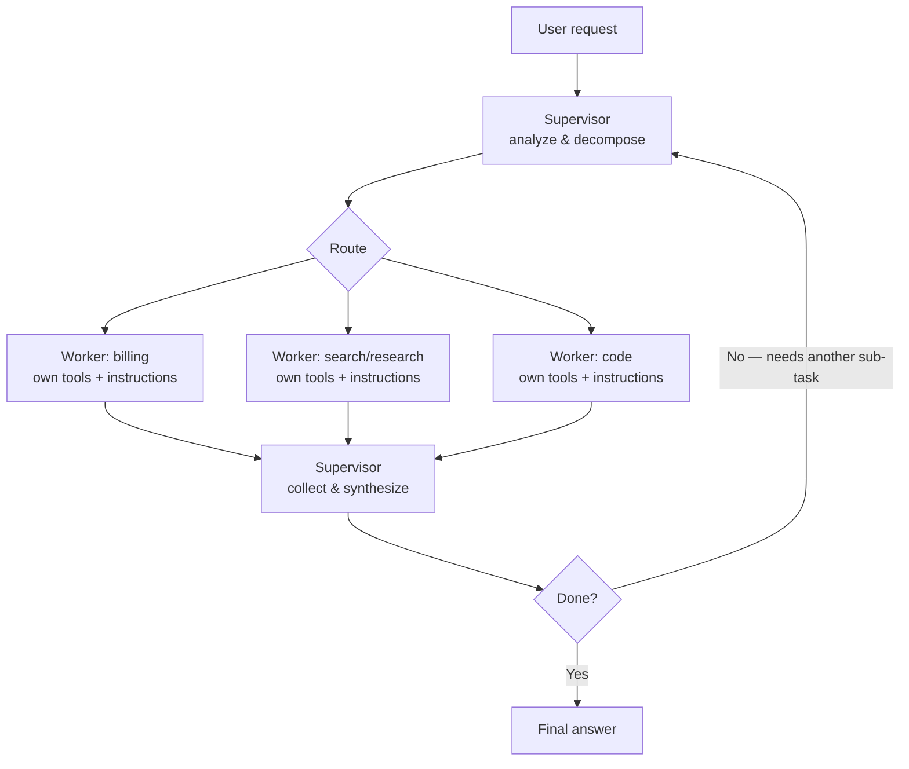

# Supervisor / Worker (router + specialists)

## Index

A supervisor agent receives the user's request, decides which specialist worker agent (or agents) should handle it, dispatches sub-tasks to them, and combines their results into the final answer. Each worker is a self-contained agent with its own instructions, tools, and possibly its own model — internally it usually runs ReAct, but the supervisor only sees its final output.

**Problem it solves.** A single agent with too many tools degrades — with 15+ tools the model picks wrong ones, instructions for different domains contaminate each other, and context fills with irrelevant schemas. Supervisor/worker splits the problem: each specialist sees only its own narrow toolset and instructions (so it's accurate within its domain), and the supervisor only solves the much easier problem of *who should handle this*. It also adds parallelism — independent sub-tasks fan out to workers concurrently — and lets you mix models (cheap model for routing, strong models where the work is hard).

## Control flow

The supervisor is the only agent that talks to the user; workers only talk to the supervisor. Independent sub-tasks dispatch **in parallel** (W1–W3 concurrently); dependent ones go in rounds — the supervisor reviews results and may dispatch again. Two flavors, and the distinction matters for cost:

- **Full supervision:** the supervisor decomposes, delegates, inspects results, and may iterate — it's an agent loop whose "tools" are other agents.
- **Routing:** for simple single-intent requests the supervisor just classifies and hands off; the chosen worker answers (near-)directly. Much cheaper — one routing decision instead of full orchestration. Production systems typically run routing by default and fall back to full supervision when no single intent fits.

## When to use / when to avoid

**Use it when**
- The workload spans **multiple distinct domains** — support requests that may be billing *or* technical *or* account questions; research that needs code *and* retrieval *and* analysis.
- A single agent's tool list has grown past ~10–15 tools and tool-selection accuracy is visibly dropping — splitting by domain restores it.
- Sub-tasks are **independent enough to parallelize** — fan out, then synthesize.
- You want **per-domain isolation**: different models, different permissions/credentials per worker, separately testable and replaceable specialists.
- Different request types deserve different cost: a cheap router in front, expensive specialists only when needed.

**Avoid it when**
- One domain, one toolset — a single ReAct agent is simpler, cheaper, and has no handoff loss. Don't build an org chart for one job.
- The "specialists" would all need the same context anyway — if every worker must read the whole conversation, you're paying the context bill N times for no isolation benefit.
- Tasks need tight step-by-step coupling between domains — chatty supervisor↔worker round-trips erase the parallelism win and add handoff errors. A single agent with more tools may genuinely beat a committee.
- Latency budget is tight and requests are simple — every hop through the supervisor adds a model call.

## Token & latency footprint

The defining characteristic: you pay a **coordination tax** — supervisor calls wrap every piece of real work, and each sub-task's instructions/results are paid for twice (once in the worker, once when the supervisor reads the result). In exchange, independent workers run **in parallel**, so wall-clock latency can *beat* a single serial agent even though total tokens are higher. Cost scales with `(supervisor calls) + Σ(worker runs)`; each worker run is itself a small ReAct-style bill.

**Worked example — the same 5-step task, restructured as 1 supervisor + 2 parallel workers.** Suppose the task decomposes into a research sub-task (3 tool steps) and a data sub-task (2 tool steps), independent of each other. Same assumptions as the other entries: ~1,000–1,500-token system prompts, ~300-token observations, ~150-token thoughts; illustrative $3 / 1M input, $15 / 1M output.

| Phase | LLM calls | Input tokens | Output tokens |
|-------|----------:|-------------:|--------------:|
| Supervisor: decompose & dispatch | 1 | 1,700 | 250 |
| Worker A: 3-step ReAct run       | 4 | ~8,200 | ~650 |
| Worker B: 2-step ReAct run       | 3 | ~5,100 | ~500 |
| Supervisor: synthesize           | 1 | 2,600 | 250 |

- **9 LLM calls**, **~17,600 input tokens**, **~1,650 output tokens** ≈ **$0.08 / run**.
- **vs the single-agent ReAct baseline on the same task (~$0.06):** ~30% more tokens — that's the coordination tax. The win is elsewhere:
- **Latency:** workers A and B run **concurrently**, so wall-clock ≈ supervisor (~2s) + max(worker A ~10s, worker B ~7s) + synthesize (~2s) ≈ **~14s** vs ~15–20s serial — and the gap widens as the fan-out grows. With 4 independent workers the single agent's time quadruples while the supervisor's barely moves.
- **The routing flavor inverts the math:** a simple single-intent request costs one small routing call (~$0.005) + one worker run — barely above single-agent cost, with all the isolation benefits. This is why production defaults to routing and reserves full supervision for genuinely multi-domain requests.
- **Failure tax to budget for:** if the supervisor mis-routes, you pay for the wrong worker's full run *plus* the re-dispatch.

## AWS mapping

AWS now has two distinct paths for this pattern. **Amazon Bedrock Agents Classic** retains a native supervisor/collaborator configuration for existing customers, while **Amazon Bedrock AgentCore** is the path AWS recommends for new agent development. Bedrock Agents Classic entered maintenance mode for new customers on July 30, 2026.

| AWS tier | Supervisor/worker support? | What you do |
|---|---|---|
| **Amazon Bedrock AgentCore Harness** | **Partly - managed agents-as-tools.** | Use a harness as the user-facing supervisor and expose narrow specialist agents as tools for simple delegation. Harness manages each agent loop, tools, memory, limits, and observability, but it does not provide the old `SUPERVISOR` / `SUPERVISOR_ROUTER` team switch. Move to Runtime code when you need dynamic decomposition, parallel fan-out, routing fallback, or custom result reconciliation. |
| **AgentCore Runtime + Strands Agents** | **Yes - preferred for the full pattern.** | Define the supervisor and workers in code with agents-as-tools, a graph, or another Strands multi-agent construct. Runtime supplies session isolation, scaling, tracing, and long-running execution. Deploy workers with the supervisor for a compact trust boundary, or separately behind MCP/A2A when they need independent scaling, ownership, credentials, or framework choice. |
| **AgentCore Runtime + another framework/custom code** | **Yes - code-defined.** | Host LangGraph, CrewAI, or custom routing and synthesis logic. Own dispatch policy, concurrency, timeouts, cancellation, retry budgets, context packaging, and partial-result behavior explicitly; use A2A for separately deployed agent services. |
| **Amazon Bedrock Agents Classic - multi-agent collaboration** | **Yes - native, for existing/allowlisted customers.** | Select `SUPERVISOR` for decomposition, collaborator invocation, and synthesis, or `SUPERVISOR_ROUTER` for lower-latency handoff to one collaborator. A supervisor can currently have at most **10** collaborators. Existing workloads continue to run, but the service is in maintenance mode, its model catalog is frozen, and AWS recommends migration to AgentCore. |
| **Bedrock Runtime + AWS orchestration services** | **You build the topology.** | Call Converse / InvokeModel from Lambda, containers, or Step Functions and implement classification, fan-out, queues, joins, and synthesis yourself. Use this only when deterministic workflow semantics or infrastructure integration matter more than a framework-provided agent abstraction. |

**Rule of thumb:** for a new AWS implementation, start with AgentCore Harness only when agents-as-tools covers the delegation shape; otherwise use Strands or another framework on AgentCore Runtime. Keep Bedrock Agents Classic multi-agent collaboration for an existing workload when its two managed modes still fit, but do not choose it as the foundation for a new system.

**Security note specific to this pattern:** a worker can relay indirect prompt injection through its result and influence the supervisor or a more privileged worker. Apply Guardrails or equivalent validation at every untrusted input and tool-output boundary, treat worker results as data rather than instructions, and authorize tools independently of the model's routing decision.

## Common failure modes

- **Mis-routing.** The supervisor sends the task to the wrong specialist — the worker flails or answers out of its domain, and you pay for the wasted run plus the retry. *Mitigation: crisp, mutually exclusive worker descriptions (the supervisor routes on these — they're load-bearing prompt text); a fallback/generalist worker; log and review routing decisions.*
- **Context loss at handoff.** The supervisor's sub-task summary drops a constraint the user stated, and the worker — who never saw the original request — can't know it's missing. The multi-agent version of a game of telephone. *Mitigation: pass the original request (or a faithful slice) alongside the sub-task; make workers state their assumptions in results.*
- **Supervisor bottleneck.** Every hop goes through one agent — its context fills with worker results, its latency gates everything, and at high fan-out it becomes the system's choke point. *Mitigation: payload referencing instead of inlining results; summarize worker outputs; go hierarchical before a single supervisor exceeds ~10 workers.*
- **Chatty coordination.** Dependent sub-tasks force many supervisor↔worker round-trips; the coordination tax compounds until a single agent would have been cheaper *and* faster. *Mitigation: decompose into genuinely independent sub-tasks; batch instructions per dispatch; use routing mode when there's nothing to coordinate.*
- **Conflicting worker outputs.** Two specialists return contradictory answers and the supervisor synthesizes both without noticing. *Mitigation: have the supervisor explicitly reconcile (or escalate) disagreements; structured result formats so conflicts are detectable.*
- **Duplicate work.** Overlapping sub-task definitions send two workers to fetch the same thing — double cost, possible inconsistency. *Mitigation: non-overlapping domain boundaries; share a result cache across workers within a run.*
- **Cascade failures.** One worker errors or hangs and the supervisor stalls the whole request waiting on it. *Mitigation: per-worker timeouts; partial-result synthesis ("here's what I could complete"); retry budget per worker.*
- **Prompt injection via a worker.** Untrusted content a worker processes manipulates it — or, through its results, the supervisor's next routing decision. *Mitigation: Guardrails on every agent that touches untrusted input; treat worker results as data, not instructions; least-privilege tools per worker.*

## Sources

- [AWS: Amazon Bedrock Agents Classic maintenance mode](https://docs.aws.amazon.com/bedrock/latest/userguide/agents-classic-maintenance-mode.html)
- [AWS: Create multi-agent collaboration in Bedrock Agents Classic](https://docs.aws.amazon.com/bedrock/latest/userguide/create-multi-agent-collaboration.html)
- [AWS: Amazon Bedrock AgentCore overview](https://docs.aws.amazon.com/bedrock-agentcore/latest/devguide/what-is-bedrock-agentcore.html)
- [AWS: Host agents or tools with AgentCore Runtime](https://docs.aws.amazon.com/bedrock-agentcore/latest/devguide/agents-tools-runtime.html)
- [AWS: Deploy A2A servers in AgentCore Runtime](https://docs.aws.amazon.com/bedrock-agentcore/latest/devguide/runtime-a2a.html)
- [AWS: Secure Bedrock agents against indirect prompt injection](https://aws.amazon.com/blogs/machine-learning/securing-amazon-bedrock-agents-a-guide-to-safeguarding-against-indirect-prompt-injections/)
