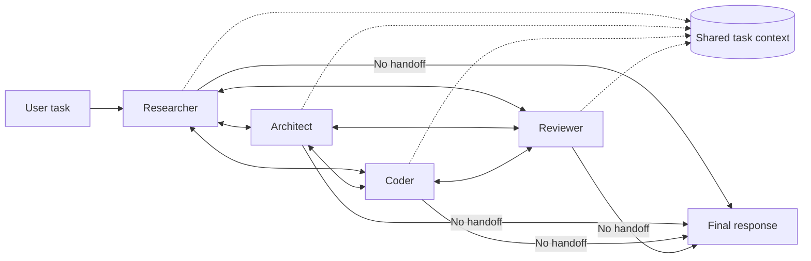

# Swarm Multi-Agent Pattern

> **Pattern family:** decentralized multi-agent orchestration<br>
> **Status:** flexible but non-deterministic; always bound handoffs, iterations, and time

## Intro / Index

A swarm is a team of peer agents that shares task context and transfers control directly between members. The active agent decides whether it can finish the task or which peer should work next; there is no permanent supervisor selecting every step. The pattern is useful when the best collaboration path cannot be known in advance and different specialists need to build on one another's work.

The essential properties are:

- **Peer-to-peer handoffs:** each agent can transfer control to another member based on the current state.
- **Shared working context:** later agents receive the original task, relevant prior work, and the handoff message.
- **Dynamic execution path:** the route emerges at runtime rather than following a developer-defined graph.
- **Local decisions, global result:** agents make routing decisions from their own role and the shared state.
- **Bounded autonomy:** step, handoff, repetition, and time limits keep the mesh from running indefinitely.

## Control flow



The mesh shows **allowed collaboration**, not simultaneous execution. In a handoff-based swarm, one agent normally has control at a time:

```text
researcher -> architect -> coder -> reviewer -> coder -> reviewer -> final
```

At each turn, the active agent:

1. Reads the task, handoff message, prior path, and shared knowledge.
2. Performs work with its own prompt, model, and least-privilege tools.
3. Either returns the final answer or selects a peer and supplies a focused handoff message plus structured context.
4. Stops when an agent finishes or a configured safety limit is reached.

If the requirement is parallel fan-out, add an explicit parallel step inside the design or use a graph or supervisor/worker topology. A peer mesh by itself does not guarantee concurrency.

## How it differs from nearby patterns

| Pattern | Who chooses the next agent? | Typical information flow | Best fit |
|---|---|---|---|
| **Swarm** | The currently active peer | Dynamic peer-to-peer handoffs with shared working context | Open-ended work where the useful specialist sequence emerges during execution |
| **Supervisor / Worker** | A permanent supervisor | Workers report through the supervisor | Predictable domain routing, centralized policy, and parallel decomposition |
| **Debate / Consensus** | A fixed protocol or judge | Multiple answers, critiques, then a vote or synthesis | Comparing independent positions and exposing disagreement |
| **Agent graph / workflow** | Developer-defined edges and conditions | Explicit transitions | Regulated or repeatable processes that need deterministic routing |

A pipeline that always runs `researcher -> analyst -> writer` is a workflow, even if its components are called a swarm. In a true swarm, the analyst can decide that more research is needed, the writer can request review, and the route can change for another request.

## When to use / when to avoid

**Use it when**

- The task is exploratory and the correct sequence of specialists is difficult to define before execution.
- Specialists need to refine, repair, or extend one another's intermediate work.
- There are several valid collaboration paths, and forcing all requests through one supervisor would create a bottleneck.
- Shared context is valuable: every participating agent is allowed to see the task and prior contributions.
- The outcome is important enough to justify multiple agent turns, but the workflow is not stable enough to encode as a graph.

**Avoid it when**

- The process must follow a fixed approval order, audit rule, or data boundary. Use a graph or state machine.
- A single agent with a focused toolset can solve the task. A swarm adds routing calls, context growth, and new failure modes.
- Work divides cleanly into independent parallel sub-tasks. Supervisor/worker fan-out is usually simpler and faster.
- Agents are not authorized to share the same context. Shared working memory can violate least-privilege boundaries even when tool credentials are separate.
- Latency and spend must be predictable. An emergent path has a wider cost distribution than a fixed workflow.
- There is no objective completion condition, iteration cap, or useful fallback when the swarm times out.

## State, handoffs, and completion contract

Treat a handoff as a typed interface, not an informal chat message. A production handoff should contain at least:

```json
{
  "target_agent": "reviewer",
  "task": "Check the proposed API for authorization and data-leak risks.",
  "completed_work": ["Endpoint design", "IAM assumptions"],
  "artifacts": ["s3://example-run/design-v3.json"],
  "open_questions": ["Should tenant IDs come from JWT claims only?"],
  "success_criteria": ["List blocking findings", "Return approve or revise"]
}
```

Keep large artifacts out of the model transcript; pass references with integrity and authorization checks. Separate model-visible collaboration context from non-model invocation state such as tenant identity, credentials, budget counters, and policy decisions.

Define completion in code as well as prompts. Useful terminal outcomes include `COMPLETED`, `PARTIAL`, `FAILED`, `TIMED_OUT`, `MAX_STEPS`, and `HUMAN_REVIEW_REQUIRED`. The orchestrator should preserve the path, final active agent, stop reason, accumulated usage, and any unresolved work.

## Token and latency footprint

A handoff swarm pays for both the work and the growing collaboration history. The cost is approximately:

```text
total model calls = sum of model/tool-loop calls in every agent activation
total input tokens = sum(system prompt + task + accumulated context + tool results per call)
```

The route is usually serial, so wall-clock latency grows with every activation. Unlike supervisor fan-out, adding more peers does not automatically reduce elapsed time.

**Worked example - four peers, six activations, five handoffs.** Assume each activation uses two model calls around one tool step, context grows at every handoff, and pricing is an illustrative $3 / 1M input tokens and $15 / 1M output tokens.

| Activation | Model calls | Approx input tokens | Approx output tokens |
|---|---:|---:|---:|
| Researcher | 2 | 3,200 | 800 |
| Architect | 2 | 4,200 | 800 |
| Coder - first pass | 2 | 5,400 | 900 |
| Reviewer - first pass | 2 | 6,400 | 700 |
| Coder - revision | 2 | 7,400 | 900 |
| Reviewer - final | 2 | 8,800 | 700 |
| **Total** | **12** | **35,400** | **4,800** |

The illustrative model bill is about **$0.18 per run**: `$0.106` input plus `$0.072` output, before tool, Runtime, storage, or network charges. At roughly 2-4 seconds per activation, the serial path is about 12-24 seconds plus tool time. A ping-pong loop adds both latency and increasingly expensive context, which is why the median is not enough: track p95 handoffs, tokens, time, and cost per successful task.

## AWS mapping

| AWS tier | Swarm in configuration? | What you do |
|---|---|---|
| **Amazon Bedrock Agents Classic - multi-agent collaboration** | **No.** Its native collaboration model is centralized: a supervisor plans and routes work to collaborator agents. It implements supervisor/worker, not a decentralized peer swarm. Bedrock Agents Classic entered maintenance mode for new customers on July 30, 2026; existing customers can continue using it. |
| **Amazon Bedrock AgentCore Harness** | **No first-class swarm topology.** Harness config declares a managed agent loop, tools, skills, model, and environment. When the collaboration logic exceeds configuration, export to Strands code and deploy it to AgentCore Runtime. |
| **AgentCore Runtime + Strands Agents** | **Yes - preferred AWS implementation.** Strands provides a `Swarm` orchestrator with autonomous handoffs, shared context/state, streamed handoff events, accumulated usage, step and handoff limits, total and per-node timeouts, and repetitive-handoff detection. Host the code in AgentCore Runtime for session isolation, scaling, tracing, long-running execution, and HTTP, MCP, or A2A protocol support. |
| **AgentCore Runtime + another framework/custom code** | **Yes - code-defined.** Implement peer selection, state, persistence, cancellation, and termination in LangGraph, CrewAI, or custom code. Use A2A when peers are separately deployed or cross-framework, and use a shared store only for state every peer is authorized to access. |

**Rule of thumb:** on AWS, implement new swarms as code on AgentCore Runtime. Use Strands when its handoff semantics fit; use an explicit graph when routing or policy must be deterministic. Do not label Bedrock Agents Classic multi-agent collaboration as a swarm merely because it contains several agents—the permanent supervisor changes the control topology.

## Operational controls and evaluation

Set these controls before production traffic:

- **Maximum handoffs and activations:** the hard upper bound on model work.
- **Total and per-agent timeouts:** plus cooperative cancellation for long-running tools.
- **Repetitive-handoff detection:** stop `A -> B -> A -> B` and low-diversity cycles.
- **Budget ceiling:** stop or downgrade models before exceeding the request's token or currency budget.
- **Allowed handoff policy:** enforce which agents and tenant contexts may communicate; do not rely only on prompt instructions.
- **Idempotency and side-effect ownership:** retries and revisits must not repeat payments, notifications, or writes.
- **Trace correlation:** capture the original request ID, agent path, handoff reason, tool calls, shared-state versions, stop reason, and usage.
- **Fallback:** return a partial result, switch to a bounded supervisor, or request human review when the swarm cannot converge.

Evaluate the topology, not just the final prose. A useful test set measures task success, unnecessary-agent rate, route stability, repeated-handoff rate, completion-reason distribution, context size, p50/p95 latency and cost, tool-policy violations, and performance after injecting one failing or compromised peer.

## Common failure modes

- **Ping-pong handoffs:** two agents repeatedly send the task back because neither owns completion. *Mitigation: distinct role and completion descriptions, repetitive-handoff detection, per-edge counters, and a terminal fallback.*
- **Premature completion:** a peer returns a plausible final answer without involving a required specialist. *Mitigation: code-enforced gates for mandatory checks and use a graph when the check is non-negotiable.*
- **Everyone delegates:** agents describe their role too narrowly and hand off without doing useful work. *Mitigation: require each handoff to include completed work and a concrete reason the target is better suited.*
- **Context snowball:** every peer receives an ever-growing transcript and repeated tool output. *Mitigation: structured shared state, artifact references, deduplication, and periodic decision-focused compaction.*
- **Stale or conflicting shared state:** peers overwrite conclusions or act on different artifact versions. *Mitigation: versioned records, single-writer fields, provenance, compare-and-swap updates, and explicit conflict resolution.*
- **Emergent route instability:** small prompt changes cause very different paths, latency, and results. *Mitigation: route regression tests, constrained allowed edges, stable agent descriptions, and a graph for mature paths.*
- **Lateral prompt injection:** untrusted content handled by one peer enters shared context and influences every later peer. *Mitigation: treat contributions as untrusted data, preserve provenance, sanitize tool content, apply Guardrails at each trust boundary, and enforce tool authorization outside the model.*
- **Privilege amplification:** a low-trust agent hands attacker-controlled instructions to a peer with stronger tools. *Mitigation: authorize each action against user and agent identity, minimize credentials, and never let a handoff grant privileges.*
- **Duplicate side effects:** a revisited agent repeats an external write. *Mitigation: idempotency keys, durable action ledger, read-before-write checks, and one explicit owner for each side effect.*
- **Timeout without a useful result:** the framework stops safely but discards good partial work. *Mitigation: checkpoint contributions after every activation and synthesize a clearly labeled partial response on bounded exits.*

## Sources

- [Strands Agents: Swarm Multi-Agent Pattern](https://strandsagents.com/docs/user-guide/concepts/multi-agent/swarm/)
- [AWS: Multi-Agent collaboration patterns with Strands Agents and Amazon Nova](https://aws.amazon.com/blogs/machine-learning/multi-agent-collaboration-patterns-with-strands-agents-and-amazon-nova/)
- [AWS: How Amazon Bedrock AgentCore Runtime works](https://docs.aws.amazon.com/bedrock-agentcore/latest/devguide/runtime-how-it-works.html)
- [AWS: AgentCore Harness](https://docs.aws.amazon.com/bedrock-agentcore/latest/devguide/harness.html)
- [AWS: Use multi-agent collaboration with Amazon Bedrock Agents](https://docs.aws.amazon.com/bedrock/latest/userguide/agents-multi-agent-collaboration.html)
- [AWS: Deploy A2A servers in AgentCore Runtime](https://docs.aws.amazon.com/bedrock-agentcore/latest/devguide/runtime-a2a.html)
