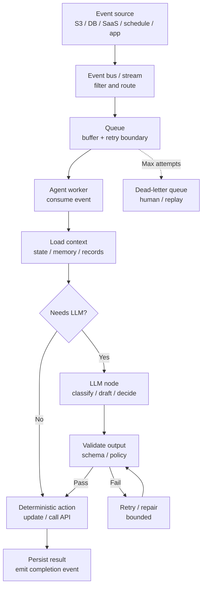

## Intro / Index

Event-Driven / Async agents react to events from queues, streams, schedules, webhooks, or application state changes instead of waiting for a direct request-response call from a user. It solves the problem of agent work being too slow, bursty, long-running, or loosely coupled for an interactive HTTP request.

## Description

The pattern splits "something happened" from "an agent must handle it." Producers emit events, infrastructure routes or buffers them, and one or more agent workers consume those events, perform model/tool work, then publish results, update state, or emit follow-up events.

Unlike the other entries in this catalog, this pattern does not define the agent's inner loop - it defines *when and how work runs*. The worker's interior can be any other pattern: a single LLM node, a state machine, a bounded ReAct agent, or a supervisor. Event-driven is the delivery and lifecycle wrapper around them.

## Diagram



The key design choice is the event contract: the payload should contain enough identity, correlation, and idempotency data for the agent to resume work safely, without assuming a live client is waiting.

## When to use / when to avoid

**Use it when**
- Work can outlive a user request, such as report generation, document review, ticket triage, enrichment, monitoring, or follow-up actions.
- Events arrive in bursts and need buffering, backpressure, retries, and dead-letter handling.
- Producers and consumers should be decoupled so the agent can evolve without blocking the source system.
- The same event should trigger multiple consumers, such as an agent, analytics pipeline, and audit logger.
- You need scheduled, delayed, or lifecycle-triggered agent work.

**Avoid it when**
- The user needs an immediate conversational answer in the same interaction.
- The task requires tight turn-by-turn clarification before work can begin.
- Event ordering, deduplication, or exactly-once side effects cannot be designed safely.
- The system has no durable state store for progress, results, and correlation ids.
- Operators cannot monitor queues, retries, dead letters, and partial failures.

## Footprint

Event-driven systems do not reduce the token cost of a given LLM call, but they change when and how the cost is paid. They can absorb bursts, run work in the background, and skip model calls entirely for events that deterministic filters can handle.

Rule of thumb:

```text
token_cost ~= events_processed * llm_nodes_per_event * avg_tokens_per_node
latency_to_user ~= acknowledgement_latency
completion_latency ~= queue_delay + worker_runtime + downstream_calls
```

Example shape:

| Event path | Model calls | Token behavior | Latency behavior |
|---|---:|---|---|
| Filtered out by rules | 0 | No model tokens | Event is acknowledged quickly |
| Classify then route | 1 | Small, bounded classifier prompt | Completion waits for queue + one model call |
| Enrich, draft, validate | 2-3 | Bounded by per-node prompt contracts | Background latency may be seconds to minutes |
| Retry / repair path | +1 or more | Cost grows with attempts | User sees delayed completion, not blocked request |

**Worked example - why per-event-type metering matters.** A system ingests 10,000 ticket events per day. Rules filter out 70% with zero model calls. The remaining 3,000 get a classify call (600 input / 10 output tokens); 500 of those continue to an enrich + draft path (3,200 input / 550 output tokens per event). At illustrative rates of **$3 / 1M input tokens** and **$15 / 1M output tokens**:

```text
classify path:  3,000 * (600 in + 10 out)    ~= 1.80M in + 0.03M out ~= $5.85 / day
draft path:       500 * (3,200 in + 550 out) ~= 1.60M in + 0.28M out ~= $8.93 / day
total:                                                                  ~$14.78 / day
```

The "cheap" classifier path costs nearly as much as the "expensive" drafting path purely on volume - and if the rules filter degrades from 70% to 40%, the classifier bill doubles overnight while no single event looks expensive. The FinOps trick is to meter per event type, not only per agent: a high-volume low-value event with one small classifier call can dominate the daily bill simply because it fires thousands of times. Volume, not per-call size, is this pattern's cost axis - which also makes it the entry where a cheap small model on the high-volume node pays off most.

## AWS Mapping

| AWS tier                                               | Supported in config?                                                   | What you do                                                                                                                                                                                                                                                                                                                                                                                                                                                                                                                                                                                                                                                                                                                                                                                                                                                                      |
| ------------------------------------------------------ | ---------------------------------------------------------------------- | -------------------------------------------------------------------------------------------------------------------------------------------------------------------------------------------------------------------------------------------------------------------------------------------------------------------------------------------------------------------------------------------------------------------------------------------------------------------------------------------------------------------------------------------------------------------------------------------------------------------------------------------------------------------------------------------------------------------------------------------------------------------------------------------------------------------------------------------------------------------------------- |
| **EventBridge / SQS / SNS / Step Functions + Bedrock** | **Yes - AWS-native event and workflow plumbing.**                      | Use EventBridge for routing (and EventBridge Scheduler for scheduled or delayed agent work), Pipes for source-to-target integrations and enrichment, SQS for durable buffering and dead-letter queues, SNS for fanout, Step Functions for stateful async workflows, and Bedrock model calls where only a bounded model step is needed.                                                                                                                                                                                                                                                                                                                                                                                                                                                                                                                                           |
| **AgentCore Runtime + custom code**                    | **Yes - preferred when the agent worker owns complex async behavior.** | Host the event consumer or worker logic in Runtime or invoke Runtime from queue/workflow consumers. Runtime supports async natively: respond to the caller immediately, continue processing in the background, and report status via the `/ping` health endpoint (`Healthy` vs `HealthyBusy`; the SDK's `add_async_task` / `complete_async_task` manage this automatically). Lifecycle limits to design around: sessions idle for 15 minutes are terminated, max session duration is 8 hours, and synchronous processing that exceeds the runtime's default request timeout (~60s) is treated as failure and silently retried - so either offload long work to SQS/Step Functions and acknowledge immediately, or keep the session alive with `HEALTHY_BUSY` pings. Your code owns event parsing, idempotency, checkpointing, progress updates, retries, and result publication. |
| **Bedrock Agents**                                     | **Partly, as the agent target; not as the event backbone.**            | Bedrock Agents can perform the managed agent work once invoked, but event ingestion, filtering, buffering, retries, and dead-letter handling usually live in EventBridge, SQS, SNS, Lambda, Step Functions, or application code. Use this when a managed agent is sufficient and the surrounding async plumbing is simple.                                                                                                                                                                                                                                                                                                                                                                                                                                                                                                                                                       |
| **AgentCore Harness**                                  | **Partly, as a managed agent loop behind an event consumer.**          | Harness can run the configured agent behavior after your consumer invokes it. Put EventBridge, SQS, Lambda, Step Functions, or another worker in front when the trigger is an event rather than an interactive user call. Harness is public preview.                                                                                                                                                                                                                                                                                                                                                                                                                                                                                                                                                                                                                             |

## Common failure modes

- **Duplicate processing:** standard queues and event buses may deliver more than once, and retries can repeat work. *Mitigation: use idempotency keys, dedupe tables, and side-effect guards.*
- **Lost correlation:** the result cannot be tied back to the originating user, ticket, object, or workflow. *Mitigation: require correlation ids, tenant ids, source ids, and trace ids in every event.*
- **Poison messages:** one malformed or semantically impossible event retries until it burns cost. *Mitigation: validate early, cap retries, and send failed events to a dead-letter queue with enough context for replay.*
- **Backlog surprise:** burst traffic builds a queue and completions arrive much later than users expect. *Mitigation: monitor queue age, worker concurrency, and event-specific SLAs.*
- **Out-of-order effects:** newer events are processed before older events and overwrite state. *Mitigation: use version checks, sequence numbers, FIFO where needed, or conflict-aware writes.*
- **Unbounded fanout:** one event triggers many agents or follow-up events and multiplies token spend. *Mitigation: define routing rules, event budgets, and loop-prevention markers.*
- **Stale context:** the event payload references data that changed by the time the agent handles it. *Mitigation: load fresh authoritative state at processing time and record the observed version.*
- **Silent async failure:** the user got an immediate acknowledgement, but the background work failed later with no notification. *Mitigation: publish completion and failure events, store durable job status, and alert on failed terminal states.*
- **Blocked health checks:** long-running work blocks the same thread that must report liveness - on AgentCore Runtime this manifests as silent session termination or repeated invisible retries, since a blocked entrypoint also blocks the `/ping` endpoint. *Mitigation: run blocking work in background tasks/threads, keep health endpoints responsive, and emit `HEALTHY_BUSY` while background work runs.*

## Sources

- [AWS: What is Amazon EventBridge?](https://docs.aws.amazon.com/eventbridge/latest/userguide/eb-what-is.html)
- [AWS: What is Amazon SQS?](https://docs.aws.amazon.com/AWSSimpleQueueService/latest/SQSDeveloperGuide/welcome.html)
- [AWS: Handle asynchronous and long running agents with AgentCore Runtime](https://docs.aws.amazon.com/bedrock-agentcore/latest/devguide/runtime-long-run.html)
- [AWS: Troubleshoot AgentCore Runtime](https://docs.aws.amazon.com/bedrock-agentcore/latest/devguide/runtime-troubleshooting.html)
- [AWS: Host agent or tools with AgentCore Runtime](https://docs.aws.amazon.com/bedrock-agentcore/latest/devguide/agents-tools-runtime.html)
- [AWS: Automate tasks in your application using AI agents](https://docs.aws.amazon.com/bedrock/latest/userguide/agents.html)
- [AWS: AgentCore Harness](https://docs.aws.amazon.com/bedrock-agentcore/latest/devguide/harness.html)