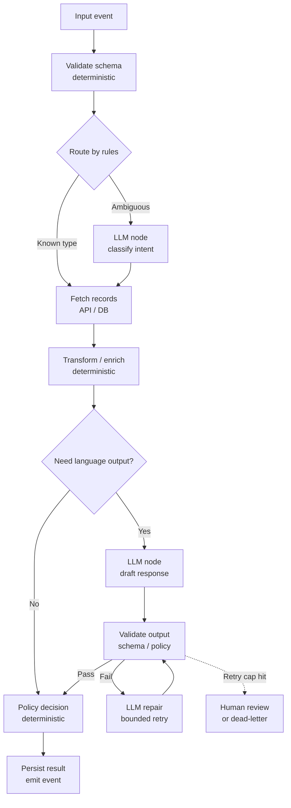

# State Machine With LLM Nodes Pattern


## Intro / Index

State Machine With LLM Nodes defines the workflow as a deterministic graph where most transitions are controlled by code, rules, or workflow configuration, and only selected nodes call an LLM. It solves the problem of open-ended agent loops being hard to audit, test, retry, and constrain when the business process itself is already known.

## Description

The pattern treats the LLM as one kind of task inside a larger workflow, not as the owner of the whole workflow. A state machine, DAG, or graph runtime decides which step runs next, while LLM nodes handle bounded tasks such as classification, extraction, drafting, summarization, tool-argument generation, or exception handling.

## Diagram



The graph is explicit: allowed states, transitions, retries, timeouts, and terminal failures are defined ahead of time. The LLM can influence local content or classification, but it does not get unrestricted authority to invent new workflow steps.

Example
![[Pasted image 20260616081735.png]]

A **User** sends a request to the **State Manager**, which reads its **YAML Config** (bottom) to know all the states and transitions, then routes work to one of three **Workflows**. Each workflow is a sequence of **Nodes** (single steps — a model call, tool call, or check): Workflow 1 has 3, Workflow 2 has 4, Workflow 3 has 2.

Following the arrows as one possible run: State Manager → **Workflow 2** (runs its 4 nodes) → hands off to **Workflow 3** → returns to the State Manager → State Manager dispatches **Workflow 1** → loops back to the State Manager to decide what's next. Control keeps returning to the center after each workflow so the manager can pick the next transition based on updated state — that's the loop arrows you see going back to it.

The one idea to take away: the State Manager is a stateful router, and every route it can take is declared in that YAML file, not decided by the model.
## When to use / when to avoid

**Use it when**

- The process has known stages, approvals, SLAs, audit requirements, or compliance boundaries.
- Only a few steps need language understanding or generation.
- You need deterministic retries, compensation, idempotency, and clear failure states.
- Multiple systems must be orchestrated in a predictable order.
- You want to test most of the workflow without calling a model.

**Avoid it when**

- The task path is genuinely unknown until the agent investigates; ReAct or a planner/executor may fit better.
- The graph would become a giant brittle decision tree trying to encode every possible conversation.
- The user expects exploratory, conversational autonomy rather than process execution.
- Each node needs the full conversation context and free-form reasoning, which can make the graph mostly decorative.
- You cannot define reliable validation or handoff behavior around LLM outputs.

## Footprint

The token footprint is usually lower and more predictable than a fully agentic loop because only LLM nodes call the model. Deterministic nodes add orchestration latency and infrastructure cost, but they do not consume model tokens.

Rule of thumb:

```text
token_cost ~= sum(tokens for LLM nodes actually visited)
latency ~= deterministic_step_latency + serial_LLM_latency - parallelizable_branches
```

Compared with ReAct, the graph avoids repeatedly resending a growing Thought/Action/Observation trace at every step. The main cost risk is poor state design: if every LLM node receives the entire workflow history instead of a compact state slice, the graph can lose its cost advantage. A related engine-level trap: workflow engines cap inter-state payloads (Step Functions: 256 KB), so pass S3 references between states rather than full documents or long model outputs.

Example shape:

|Workflow shape|Model calls|Token behavior|Latency behavior|
|---|--:|---|---|
|Rules-only happy path|0|No model tokens|Fast; orchestration and service calls only|
|Classification + final draft|2|Bounded by two prompt contracts|Two model round-trips, often serial|
|Classify + extract + draft + repair|4|Predictable upper bound if retries are capped|Serial unless independent branches can fan out|

**Worked example - the classify + extract + draft path (3 LLM nodes visited, no repair).** Assume a 900-token classify prompt returning a ~10-token enum, a 1,400-token extraction prompt returning ~150 structured tokens, and a 1,800-token drafting prompt returning ~400 tokens. At illustrative rates of **$3 / 1M input tokens** and **$15 / 1M output tokens**:

```text
input:  (900 + 1,400 + 1,800) = 4,100 / 1,000,000 * $3  ~= $0.012
output: (10 + 150 + 400)      =   560 / 1,000,000 * $15 ~= $0.008
total:                                                      ~$0.02 per run
```

Two properties matter more than the number. First, the classify node can run on a much cheaper model than the drafting node, pushing the bill lower - per-node model selection is unique to this pattern. Second, unlike an agent, this cost has **no variance**: the same path costs the same every run, and the worst case (repair branch taken, retries capped) is a known constant, not a distribution. A ReAct agent handling the same triage runs roughly 3x this cost with high variance.

For a production workflow, the important FinOps control is to log per-node token usage and correlate it with the state-machine execution id. That lets you see whether cost is concentrated in classification, extraction, drafting, repair, or retry paths.

## AWS Mapping

| AWS tier                            | Supported in config?                                                           | What you do                                                                                                                                                                                                                                                                                                                                                                                                                                                                                                                                                                                                      |
| ----------------------------------- | ------------------------------------------------------------------------------ | ---------------------------------------------------------------------------------------------------------------------------------------------------------------------------------------------------------------------------------------------------------------------------------------------------------------------------------------------------------------------------------------------------------------------------------------------------------------------------------------------------------------------------------------------------------------------------------------------------------------- |
| **Step Functions + Bedrock**        | **Yes - explicit AWS state machine; the canonical fit.**                       | Define the workflow in Amazon States Language and use Task states for deterministic service calls, Lambda functions, and Amazon Bedrock `InvokeModel` calls (optimized integration, no Lambda glue needed). Parallel and distributed-map states give fan-out; wait states give human approval; execution history gives audit. Since March 2026, Step Functions also integrates **Bedrock AgentCore**: a workflow node can invoke an entire agent runtime with built-in retries, or run multiple agents in parallel via Map states - so a bounded ReAct agent can live inside one box of the deterministic graph. |
| **Amazon Bedrock Flows**            | **Yes - the GenAI-native config option.**                                      | A visual node-based builder scoped to the Bedrock ecosystem: prompt nodes, knowledge-base nodes, condition nodes, Lambda nodes. Fastest path for pure prompt-chains and RAG pipelines. Fall back to Step Functions when the flow needs multi-hour waits, cross-service integrations, strict idempotency, or heavyweight retry/catch semantics.                                                                                                                                                                                                                                                                   |
| **Bedrock Agents**                  | **Partly, but not as an explicit state machine.**                              | Bedrock Agents provide a managed agent loop with instructions, action groups, knowledge bases, prompt templates, and traces. Use them when the agent can own orchestration; use a separate workflow engine when you need explicit state transitions, compensation, or hard process boundaries.                                                                                                                                                                                                                                                                                                                   |
| **AgentCore Harness**               | **Partly, for managed loop behavior; not for arbitrary deterministic graphs.** | Harness owns the configured agent loop and can call tools under instructions, but it is not a general Step Functions-style workflow definition. Use Harness when managed agent orchestration is enough; place Harness behind Step Functions or another orchestrator when the business process must own control flow. Harness is public preview.                                                                                                                                                                                                                                                                  |
| **AgentCore Runtime + custom code** | **Yes - full graph control in code.**                                          | Host a LangGraph, Strands, CrewAI, LlamaIndex, or custom state-machine service in Runtime. Use this when you need graph-level state, streaming, custom checkpointing, human-in-the-loop, cross-provider models, advanced agent state, or logic that is awkward to express in Step Functions.                                                                                                                                                                                                                                                                                                                     |

**Rule of thumb:** prompt-chain or RAG pipeline that never leaves Bedrock - Flows. Anything with durability, human waits, transactions, or other AWS services on the path - Step Functions with Bedrock nodes called directly. Need exploration inside one step - a Step Functions node invoking an AgentCore agent, capped and budgeted: deterministic graph outside, bounded agent inside.

## Common failure modes

- **LLM leakage into control flow:** a model output silently determines a transition without validation. _Mitigation: route only on validated enums, scores, or structured outputs with fallback states._
- **Brittle graph explosion:** the workflow grows into hundreds of special-case branches. _Mitigation: keep deterministic branches for business invariants and isolate ambiguity inside bounded LLM nodes._
- **State bloat:** each LLM node receives the entire execution history. _Mitigation: pass only the node-specific state slice, source excerpts, and required schema._
- **Invalid structured output:** the model returns JSON that does not match the contract. _Mitigation: use schema validation, constrained decoding when available, and a bounded repair branch._
- **Retry storms:** a failing LLM node or downstream API loops through expensive retries. _Mitigation: separate transient retries from semantic repair, cap attempts, and dead-letter unresolved executions._
- **Lost idempotency:** retries repeat side effects such as sending emails, creating tickets, or charging accounts. _Mitigation: put side effects behind idempotency keys and commit only after validation._
- **Poor observability:** traces show workflow states but not the prompt, model, token usage, or validation failures for each LLM node. _Mitigation: log node-level prompts, model ids, usage, outputs, validation results, and execution ids with appropriate redaction._
- **Over-constrained language work:** the graph forces a deterministic path even when the task needs exploration. _Mitigation: route exploratory cases to a planner, ReAct agent (e.g., an AgentCore node), human review, or a separate subgraph._

## Sources

- [AWS: What is Step Functions?](https://docs.aws.amazon.com/step-functions/latest/dg/welcome.html)
- [AWS: Invoke and customize Amazon Bedrock models with Step Functions](https://docs.aws.amazon.com/step-functions/latest/dg/connect-bedrock.html)
- [AWS: Step Functions adds 28 service integrations including Amazon Bedrock AgentCore (Mar 2026)](https://aws.amazon.com/about-aws/whats-new/2026/03/aws-step-functions-sdk-integrations)
- [aws-samples: Serverless prompt chaining - Step Functions vs Bedrock Flows](https://github.com/aws-samples/amazon-bedrock-serverless-prompt-chaining)
- [AWS: Automate tasks in your application using AI agents](https://docs.aws.amazon.com/bedrock/latest/userguide/agents.html)
- [AWS: AgentCore Harness](https://docs.aws.amazon.com/bedrock-agentcore/latest/devguide/harness.html)
- [AWS: Host agent or tools with AgentCore Runtime](https://docs.aws.amazon.com/bedrock-agentcore/latest/devguide/agents-tools-runtime.html)
- [LangGraph overview](https://docs.langchain.com/oss/python/langgraph/overview)