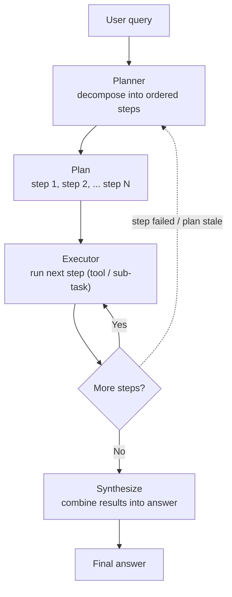

# Plan-and-Solve (plan → execute)

## Index

Plan-and-Solve runs in two phases: a **planning** pass decomposes the task into a complete, ordered list of sub-steps _before any tool executes_, then an **execution** pass works through that plan step by step (or in parallel where steps are independent). The plan is committed before any action runs, so unlike ReAct the agent doesn't re-reason from scratch at every step.

**Problem it solves.** ReAct's step-by-step re-reasoning is wasteful and slow when the task is actually predictable — you pay for a full model call and re-send the whole trace just to rediscover an order you could have written down at the start. Plan-and-Solve makes that decision once: it produces an explicit, reviewable plan, lets independent steps run in parallel, and (in its decoupled ReWOO form) avoids re-feeding every observation back into the reasoning — cutting both token cost and latency on decomposable work.

## Control flow

The planner runs **once** to produce the whole plan. The executor then runs each step — and steps that don't depend on each other can run **in parallel**, not just serially. The dotted edge is the key variant: **plan-and-execute** loops back to re-plan when a step fails or the plan goes stale; **ReWOO** omits that loop entirely and never feeds observations back into the planner, which is exactly where its token savings come from.

## When to use / when to avoid

**Use it when**

- The task decomposes cleanly into sub-steps you can name upfront: multi-part research, a report with known sections, a multi-hop question.
- Steps are independent and can fan out in parallel — batch lookups, parallel API calls.
- You want an explicit plan to **review, approve, or gate on** before anything executes (human-in-the-loop, high-stakes actions).
- You're cost- or latency-sensitive _and_ the path is predictable enough that per-step re-reasoning is pure overhead.

**Avoid it when**

- The right next step genuinely depends on what the last step returned — exploratory research, debugging. Use **ReAct**.
- The task is 1–2 steps; a planning pass is just overhead — go single-shot or ReAct.
- The environment is noisy enough that any upfront plan is wrong by step 2 — a rigid executor won't notice. Use ReAct, or add aggressive re-planning (which erodes the cost advantage).
- The planner can't actually decompose the goal well (vague or open-ended tasks) — a bad plan dooms everything downstream.

## Token & latency footprint

The defining characteristic: one upfront planning call, then execution that — in the decoupled (ReWOO) form — does **not** re-send a growing trace, so token cost is roughly **linear** in steps instead of ReAct's quadratic. Latency: the planning call sits on the critical path, but independent execution steps **parallelize**, so wall-clock can fall well below ReAct's serial sum.

There's a fork, and it decides everything:

- **ReWOO-style (no re-planning, observations not fed back):** cheapest — plan once, execute, synthesize once. ~Linear.
- **Plan-and-execute with re-planning:** if you re-plan after _every_ step you pay planning **and** execution context each time and can end up **more** expensive than ReAct. The savings only show up if re-planning is rare.

**Worked example — the same 5-step task as the ReAct entry**, modeled as the decoupled / ReWOO-style variant (the favorable case). In pure ReWOO there are only **two** LLM calls regardless of step count: the **Planner** writes the full plan (with tool calls + variable wiring), a non-LLM **Worker** runs all the tools, and the **Solver** does one final call to combine results.

|Phase|LLM call?|Input tokens|Output tokens|
|---|---|--:|--:|
|Plan (planner)|Yes|1,600|250|
|Execute steps 1–5|No — tools only|—|—|
|Synthesize (solver)|Yes|2,350|200|

- **2 LLM calls**, **~3,950 input tokens**, **~450 output tokens** total. _(Solver input = small system prompt + query + plan + the five ~300-token observations.)_
- At the same illustrative $3 / 1M input and $15 / 1M output: ≈ **$0.02 per run**.
- **vs ReAct on the identical task (~$0.06, 6 calls):** roughly **3× cheaper and 3× fewer round-trips.**
- **Latency:** planner (~2s) + tool executions (5 × ~1s, but independent ones run in parallel → ~1–2s wall-clock) + solver (~2s) ≈ **~5–7s**, vs ReAct's ~15–20s serial.
- **The catch:** swap to the re-planning variant and the math inverts — a planner-sized call per step plus accumulating context can push past ReAct's bill. The cost story is entirely about how decoupled you keep it.

## AWS mapping

The asymmetry to remember: on AWS, **ReAct is the path of least resistance and Plan-and-Solve is always _some_ extra build.**

|AWS tier|Plan-and-Solve in config?|What you do|
|---|---|---|
|**Bedrock Agents** (fully managed)|**No — not the default (ReAct is).** But it's an explicitly supported _Custom Orchestration_ strategy.|Implement the planner/executor logic in a Custom Orchestration **Lambda**. AWS names "Plan and Solve" (alongside Tree-of-Thought and SOP) as a supported custom strategy — you trade the zero-code default for plan-first control.|
|**Bedrock AgentCore Harness** (managed harness, preview)|**Partly — via a code-defined harness.**|The default managed harness runs a ReAct-style loop; a plan-then-execute flow is a **code-defined harness** (e.g., a Strands multi-step graph) on the same managed infra — microVM isolation, persistent state. Still public preview, same four launch regions.|
|**Runtime + custom code**|**Yes — you build it.**|Implement planner + executor yourself on AgentCore **Runtime** or raw Bedrock **Converse / InvokeModel**, or use a framework's plan-and-execute / ReWOO construct (LangGraph, LlamaIndex, Strands). Most control, most code.|

**Rule of thumb:** because every tier charges you at least a Custom Orchestration Lambda (or code-defined orchestration) to get plan-first behavior, only take it on when the task is decomposable enough that the planning win — lower cost, parallelism, a reviewable plan — pays for the added build.

## Common failure modes

- **Wrong plan dooms execution.** The planner's single upfront pass is a single point of failure — mis-decompose the task and every downstream step inherits the error, while a rigid executor won't catch it. _Mitigation: validate/critique the plan before executing; gate high-stakes plans on human approval._
- **Plan goes stale (rigidity).** Reality diverges from the plan's assumptions mid-run, but a pure executor keeps following the now-wrong steps. _Mitigation: add a re-planning trigger on step failure or anomaly — at the cost of some efficiency._
- **Lost adaptivity (ReWOO specifically).** Decoupling observations from reasoning is what makes ReWOO cheap, but it means the agent literally cannot react to what a tool returned. _Mitigation: don't use the decoupled form when step N+1 depends on step N's result — that's ReAct's job._
- **Re-planning cost spiral.** Re-plan too eagerly and you pay planner + executor costs repeatedly, losing the token advantage and sometimes landing worse than ReAct. _Mitigation: re-plan only on failure, not every step._
- **Synthesis drops context.** The final solver step has to fuse all step outputs and can lose or contradict intermediate results, especially with many steps. _Mitigation: structured, parseable intermediate results; keep the step count bounded._
- **Over-decomposition.** The planner shatters a simple task into too many micro-steps, adding coordination overhead and latency for no benefit. _Mitigation: prompt for the minimal viable plan; cap step count._
- **Planner/executor capability mismatch.** A weak executor following a strong planner's steps (or vice versa) misexecutes or misreads them. _Mitigation: match model capability to role; keep step instructions self-contained._