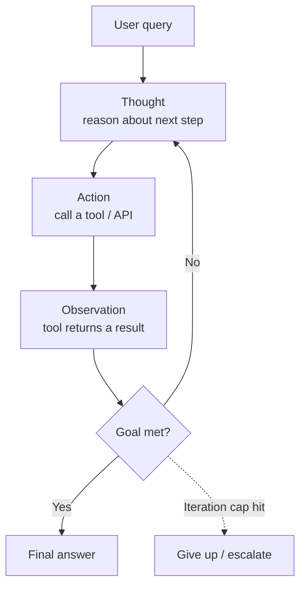

## Index

ReAct runs an agent as a loop that alternates between _reasoning_ about what to do next and _acting_ on that decision by calling a tool, then feeds the tool's result back in as the next observation. It keeps thinking → acting → observing until the model decides it has enough to give a final answer.

**Problem it solves.** A bare LLM can reason but can't take actions or see fresh information; a hard-coded tool pipeline can act but can't change its steps based on what it finds. ReAct closes both gaps: the model picks its own next action at runtime from what previous actions returned, so the path adapts to the task instead of being fixed in advance.

## Control flow

Each loop is **one full model call**. The entire Thought/Action/Observation history is re-sent on every iteration, because the model needs the prior context to decide the next step. The loop is inherently **sequential** — step N+1 can't start until step N's observation comes back.

## When to use / when to avoid

**Use it when**

- The task needs external information or side effects: search, calculators, DB lookups, API calls, code execution.
- Steps are _interdependent_ — you can't know step 3 until you see the result of step 2.
- The path isn't known upfront and has to adapt to intermediate results.
- You want an interpretable, debuggable reasoning trace ("why did it call that?").

**Avoid it when**

- It's single-shot Q&A with no tools — a plain completion is cheaper and faster.
- You're on a latency-sensitive or high-throughput path — every step is a serial round-trip.
- The plan _is_ knowable upfront. Use **Plan-and-Execute** or **ReWOO** instead; they decide the steps once and skip the per-step re-reasoning, cutting model calls substantially.
- You need parallel actions — vanilla ReAct is strictly serial and won't fan out.
- The task is long-horizon and prone to looping or context bloat without heavy guardrails.

## Token & latency footprint

The defining cost characteristic: **context grows on every step**, so token spend scales roughly **quadratically** with the number of steps (each new step re-reads everything before it). Latency scales **linearly** with steps and is serial — N steps means N model round-trips plus N tool calls, no overlap.

**Worked example — a 5-step task.** Assume a ~1,500-token system prompt + tool schema (re-sent each call), a ~100-token query, ~150 output tokens per Thought+Action, and ~300-token observations.

|Step|Input tokens (context sent)|Output (thought+action)|Observation added|
|---|--:|--:|--:|
|1|1,600|150|300|
|2|2,050|150|300|
|3|2,500|150|300|
|4|2,950|150|300|
|5|3,400|150|300|
|Final|3,850|200|—|

- **6 model calls**, **~16,350 input tokens**, **~950 output tokens** total.
- At illustrative rates of $3 / 1M input and $15 / 1M output: ≈ **$0.06 per run**. _(Rates vary by model and provider — substitute your own.)_
- A no-tool single-shot baseline for the same query (~1,600 in / 200 out) costs ≈ $0.008 — so this ReAct run is roughly **8× the token bill**.
- **Latency:** ~6 serial model calls (~1.5–2.5s each) + 5 tool calls (~0.5–2s each) ≈ **~15–20s wall-clock** typical. Harder tasks that need more steps get more expensive _and_ slower on both axes at once.

## AWS mapping

The pattern lines up cleanly with AWS's three agent tiers, in increasing order of control and effort. (Note: ReAct is the _baseline_ loop, so every tier supports it — the question is how much you build.)

| AWS tier | ReAct supported in config? | What you do |
|---|---|---|
| **Amazon Bedrock Agents** | **Yes — default orchestration is ReAct-style.** | Provide instructions and action groups, usually backed by OpenAPI/function schemas and Lambda or return-control execution. AWS manages the default reason-and-action orchestration loop, prompt construction, tool invocation, and state. If you need a different strategy such as Plan-and-Solve, ReWOO, or Tree-of-Thought, implement it with a Custom Orchestration Lambda rather than treating it as a built-in toggle. |
| **Amazon Bedrock AgentCore Harness** | **Yes — managed, configuration-first ReAct-style harness.** | Declare the model, tools, skills, and instructions as configuration. Harness manages the orchestration layer, per-session isolated runtime, tool connections, memory, identity, networking, and observability. It can connect to AgentCore Gateway, MCP servers, built-in Browser, Code Interpreter, and other supported tool surfaces. As of June 17, 2026, AgentCore Harness is generally available in commercial AWS Regions where AgentCore is available; check the supported-regions table before deployment. |
| **AgentCore Runtime + custom code** | **Not by itself — Runtime hosts your loop.** | Deploy your own agent code to AgentCore Runtime. Your code can implement ReAct directly or use a framework such as Strands, LangGraph, CrewAI, LlamaIndex, or another agent framework. Runtime gives you isolated per-session compute, lifecycle controls, and invocation endpoints, but your code owns the reasoning loop, prompts, tool routing, retries, and state transitions. |

**Rule of thumb:** start at Bedrock Agents if a managed ReAct loop is all you need; reach for Harness when you want managed infra but more flexibility (and can tolerate preview status); drop to Runtime + custom code only when you need orchestration logic the managed tiers won't express.

## Common failure modes

- **Non-termination / looping.** The model repeats the same Thought→Action without converging and never emits a final answer. _Mitigation: hard max-iteration cap + a fallback "give up / escalate" branch._
- **Context-window bloat.** Long traces — especially verbose JSON observations — fill the window and crowd out the original task. _Mitigation: truncate or summarize observations before re-injecting; cap observation size._
- **Hallucinated or malformed actions.** The model invents a tool that doesn't exist or emits arguments that don't parse. _Mitigation: strict schema validation + a structured retry that feeds the error back as an observation._
- **Observation misread.** The model ignores or misinterprets a tool result and proceeds on a wrong assumption.
- **Error cascade.** One bad early observation poisons the whole trace; vanilla ReAct has no backtracking. _Mitigation: add a reflection/critique step or a Reflexion-style retry._
- **Tool thrashing.** Redundant repeated calls (e.g., searching the same query twice) that burn tokens and latency. _Mitigation: cache observations within a run._
- **Cost/latency blowup.** Because tokens grow quadratically and calls are serial, a "stuck" agent gets expensive and slow simultaneously — the failure is felt on the bill, not just in output quality.