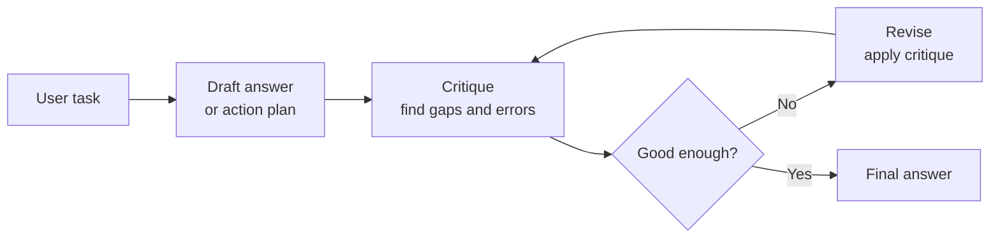

# Reflection / Self-Critique Pattern

> **Pattern family:** answer improvement and verification
> **Status:** common quality-control wrapper

## Intro / Index

Reflection asks the model to critique its own draft, identify defects, and revise the answer before returning it. It solves the problem of agents producing plausible first drafts that contain missing requirements, weak reasoning, tool-result mistakes, or unsupported claims.

## Description

The pattern separates generation from review: one pass creates a candidate answer or action plan, and a later pass checks it against the task, evidence, constraints, and quality rubric. The reflection step can be done by the same model, a stronger judge model, a second agent, or an automated evaluator.

## Diagram

The loop should have a small iteration cap. Reflection is a quality-control pass, not an excuse for unbounded self-talk.

## When to use / when to avoid

**Use it when**
- The output is high-value, user-facing, or easy to get subtly wrong.
- The agent must check a draft against explicit requirements, sources, tests, or a rubric.
- You need a final answer that reconciles several intermediate findings.
- Tool observations may be noisy and need a second pass before synthesis.

**Avoid it when**
- The task is simple, deterministic, or already validated by tests.
- Latency is more important than polish.
- The critique has no evidence or rubric to compare against.
- The model is likely to rationalize its own answer instead of finding real defects.

## Footprint

Reflection adds at least one extra model call after the draft. A common shape is draft → critique → revise, which costs roughly two to three model calls and resends the draft plus relevant evidence into the critique and revision calls.

Latency is serial because the critique depends on the draft and the revision depends on the critique. Token cost is usually linear in the number of reflection rounds, but it can grow quickly if each critique includes long traces, tool outputs, or source documents.

## AWS Mapping

| AWS tier | Supported in config? | What you do |
|---|---|---|
| **Bedrock Agents** | **Partly.** Managed agents expose orchestration prompts and traces, but reflection is not a dedicated pattern switch. | Prompt the agent to check its answer before finalizing, or add a follow-up validation action group when the critique needs external checks. |
| **AgentCore Harness** | **Partly — prompt/config-level reflection.** Harness can run a bounded self-check or critique step when it is expressed through instructions and managed tools, but it is not the right place to describe an explicit code-defined `generate -> critique -> revise` graph. | Use Harness when a simple final-answer review or tool-backed validation step is enough and you do not need custom control flow. Harness is public preview. |
| **AgentCore Runtime + custom code** | **Yes — full control.** | Implement an explicit `generate -> critique -> revise` workflow with draft, critique, judge, retry, stop, and human-review conditions in LangGraph, Strands, CrewAI, LlamaIndex, or custom code. Use Runtime when critique needs branching, multiple judge models, scoring thresholds, human review, or retries. |

## Common failure modes

- **Rubber-stamp critique:** the model says the draft is fine without meaningful inspection. *Mitigation: require concrete defects or cite the exact requirement checked.*
- **Self-confirmation bias:** the same model repeats its original assumptions. *Mitigation: use a separate judge model, stricter rubric, or tool-backed checks.*
- **Over-correction:** revision makes the answer longer, vaguer, or less useful. *Mitigation: constrain the revision to only fix identified defects.*
- **Infinite polishing:** the agent keeps finding minor issues and never stops. *Mitigation: cap reflection rounds and define "good enough" criteria.*
- **Evidence drift:** the critique introduces claims not supported by sources or tool outputs. *Mitigation: require every critique item to reference the draft, task, or observation it is based on.*
- **Hidden cost:** review calls re-send large context and can double or triple cost. *Mitigation: summarize evidence and critique only decision-relevant material.*

## Sources

- [AWS: Automate tasks in your application using AI agents](https://docs.aws.amazon.com/bedrock/latest/userguide/agents.html)
- [AWS: AgentCore harness](https://docs.aws.amazon.com/bedrock-agentcore/latest/devguide/harness.html)
- [AWS: Host agent or tools with AgentCore Runtime](https://docs.aws.amazon.com/bedrock-agentcore/latest/devguide/agents-tools-runtime.html)
- [AWS: AgentCore Evaluations](https://docs.aws.amazon.com/bedrock-agentcore/latest/devguide/evaluations.html)
