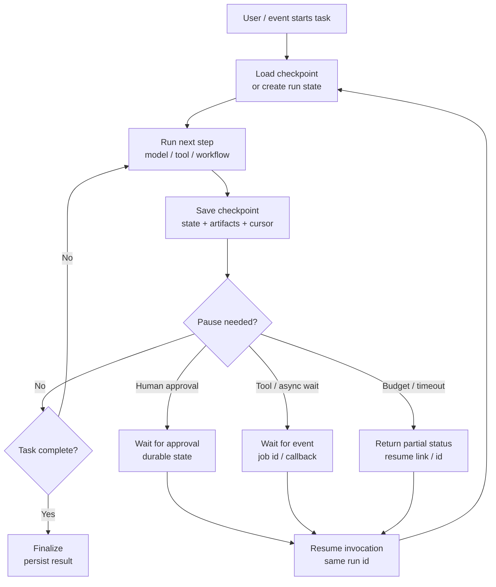

# Resumable / Pausable Pattern

> **Pattern family:** durable agent state and continuation
> **Status:** required for long-running, interruptible, and approval-heavy workflows

## Intro / Index

Resumable / Pausable agents preserve enough state that work can stop, wait, fail, or move to the background, then continue later without starting from scratch. It solves the problem of agent runs being tied to one fragile request, browser tab, runtime process, or model context window.

## Description

The pattern separates live execution from durable progress. The agent records checkpoints such as the current step, user goal, tool observations, pending approvals, artifacts, retries, and next action; a later invocation reloads that state and resumes from a known boundary.

## Diagram



The checkpoint should be a compact, explicit state object, not just the entire chat transcript. Good checkpoints say what has been done, what evidence was used, what is pending, and exactly where execution may safely continue.

## When to use / when to avoid

**Use it when**
- Work can take longer than a request, tab, session, or user attention span.
- The workflow includes human approval, external callbacks, scheduled waits, retries, or background processing.
- Tool calls create artifacts that should not be recomputed.
- Users need "come back later" behavior with a run id, job id, or conversation id.
- You need robust recovery after process restarts, throttling, timeouts, or deployment changes.

**Avoid it when**
- The task is short, cheap, read-only, and safe to rerun.
- Reconstructing state would be more complex than restarting.
- Intermediate state contains sensitive data you cannot store safely.
- The agent's next step cannot be made deterministic enough to resume safely.
- You do not have a clear idempotency and versioning strategy for side effects.

## Footprint

Resumability usually adds storage, serialization, validation, and occasional summarization cost. It can reduce token cost for long tasks by reloading compact state instead of replaying a full transcript, but bad checkpoint design can do the opposite if every resume injects all prior logs into the model.

Rule of thumb:

```text
resume_tokens ~= compact_state + relevant_artifacts + next_step_prompt
storage_cost ~= checkpoint_size * versions_retained * retention_period
latency ~= load_checkpoint + validate_state + next_step_runtime
```

Example shape:

| Flow | Model calls | Token behavior | Latency behavior |
|---|---:|---|---|
| Same-session continuation | Same as baseline | Uses recent context or session state | Fast if session is still warm |
| Durable checkpoint resume | +0 or +1 | Compact state replaces full replay | Adds state load and validation |
| Human approval pause | +1 or more | Approval decision re-enters context | Human wait dominates wall-clock |
| Failed run recovery | Variable | Avoids recomputing completed steps | Faster than full restart if artifacts are reusable |

For FinOps, resumability is useful when it prevents repeated expensive tool calls or long model traces. It becomes costly when checkpoints store oversized transcripts, duplicate artifacts, or trigger repeated "summarize state" calls after every tiny step.

## AWS Mapping

| AWS tier | Supported in config? | What you do |
|---|---|---|
| **Bedrock Agents** | **Partly, through session state and application-owned continuation.** | Use the same `sessionId` to continue a conversation, and use `sessionState` / `returnControlInvocationResults` when your application needs to carry action results back into the agent. Durable workflow checkpoints still belong in your app, database, or workflow engine. |
| **AgentCore Harness** | **Partly, through managed stateful sessions and memory.** | Harness sessions are stateful and can use memory/filesystem support, but explicit pause/resume semantics for business workflows should still be modeled by your application, Step Functions, or custom orchestration. Harness is public preview. |
| **AgentCore Runtime + custom code** | **Yes - full control.** | Use `runtimeSessionId` for same-session continuity and implement durable checkpoints in DynamoDB, S3, a database, LangGraph checkpointers, or framework state. Runtime also supports asynchronous and long-running work; use durable state rather than assuming a live request remains open. |
| **AgentCore Memory** | **Partly, for conversational and extracted context.** | Use short-term memory for session context and long-term memory for durable facts, preferences, summaries, or cross-session context. Do not treat memory alone as a full workflow checkpoint unless it records exact step state, pending actions, and artifacts. |
| **Step Functions / event-driven workflows** | **Yes - strongest AWS-native durable pause/resume.** | Use workflow execution state, callbacks, task tokens, retries, and wait states when pauses may last minutes, hours, or days. Let the workflow own the durable state and invoke agents or model calls at specific steps. |

## Common failure modes

- **Transcript-as-state:** the system stores only the chat log and expects the model to infer progress later. *Mitigation: save explicit fields for current step, completed steps, pending actions, artifacts, and next allowed transitions.*
- **Non-idempotent resume:** resuming repeats a side effect such as sending an email, creating a ticket, or charging a card. *Mitigation: record side-effect ids, use idempotency keys, and resume after commit boundaries.*
- **Stale checkpoint:** policies, prompts, tools, or data changed after the checkpoint was written. *Mitigation: version checkpoints and revalidate preconditions on resume.*
- **Oversized state:** every observation and artifact is injected back into the model. *Mitigation: store artifacts separately and load only decision-relevant summaries or slices.*
- **Lost pending work:** the user sees "resume later" but the background job id or callback token was not persisted. *Mitigation: checkpoint wait handles before returning control.*
- **Ambiguous ownership:** both the agent and workflow engine think they own progress. *Mitigation: define one system of record for run state and have the other read from it.*
- **Partial failure confusion:** some tools succeeded before a crash, but the checkpoint says the step failed. *Mitigation: write checkpoints around atomic phases and reconcile tool-side records on resume.*
- **Security drift:** a resumed run uses a different user, tenant, or permission context than the original. *Mitigation: bind checkpoints to requester, tenant, authorization scope, and expiry.*
- **No cleanup:** abandoned runs accumulate state, artifacts, and locks. *Mitigation: set retention policies, terminal states, and cleanup jobs.*

## Sources

- [AWS: InvokeAgent API reference](https://docs.aws.amazon.com/bedrock/latest/APIReference/API_agent-runtime_InvokeAgent.html)
- [AWS: Invoke an AgentCore Runtime agent](https://docs.aws.amazon.com/bedrock-agentcore/latest/devguide/runtime-invoke-agent.html)
- [AWS: Handle asynchronous and long running agents with AgentCore Runtime](https://docs.aws.amazon.com/bedrock-agentcore/latest/devguide/runtime-long-run.html)
- [AWS: Add memory to your Amazon Bedrock AgentCore agent](https://docs.aws.amazon.com/bedrock-agentcore/latest/devguide/memory.html)
- [AWS: AgentCore Harness](https://docs.aws.amazon.com/bedrock-agentcore/latest/devguide/harness.html)
- [AWS Step Functions: Service integration patterns](https://docs.aws.amazon.com/step-functions/latest/dg/connect-to-resource.html)
