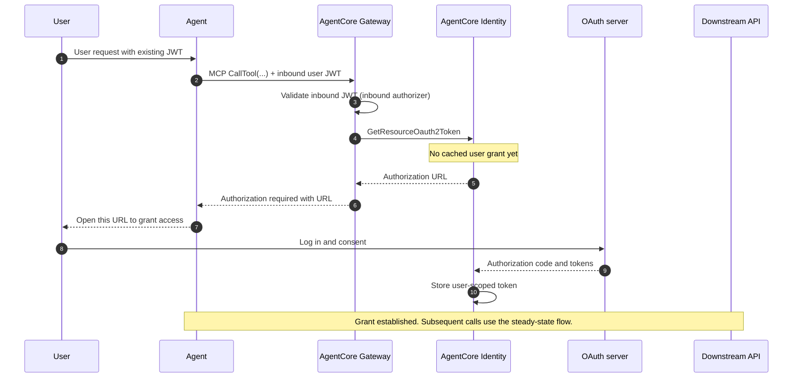
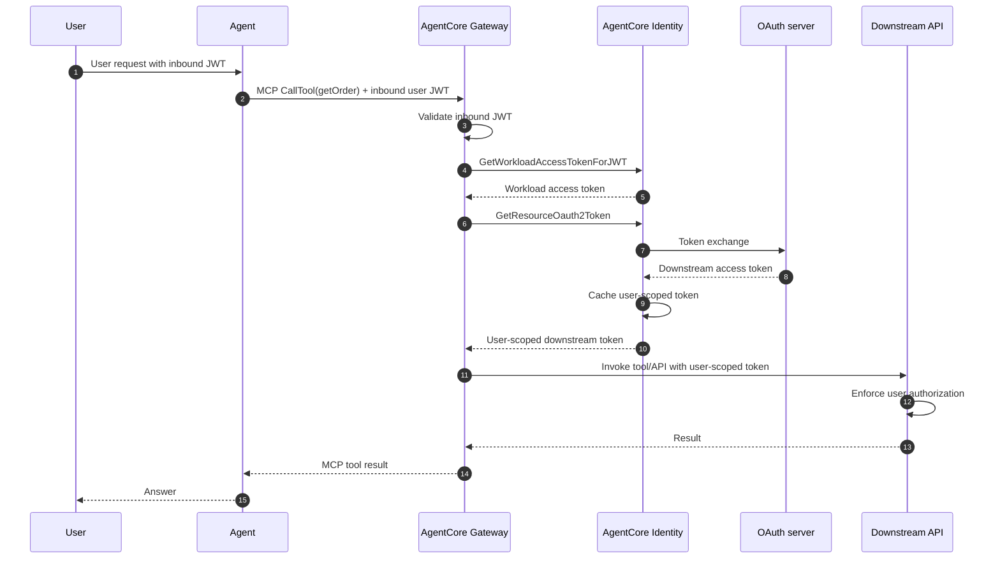

# AgentCore Gateway vs. Self-Hosted MCP


## TL;DR

- **Gateway's real, hard-to-replicate value is the dual-sided managed auth** —
  especially outbound **OAuth 2LO / 3LO / on-behalf-of token exchange** with an
  encrypted, per-user **Token Vault**. Rebuilding that securely yourself is the
  most expensive part to get right.
- **Secondary value:** built-in **semantic tool selection** across many tools,
  **composition** of many tool backends behind one MCP endpoint, HTTP/A2A/model
  routing through the same Gateway boundary, a **fully managed serverless** data
  plane, and 1-click SaaS integrations.
- **Self-hosted MCP (Lambda/ECS) wins on** portability/no-lock-in, full control
  over logic and latency, transparency/maturity, and **cost at high volume**
  (compute-only vs. Gateway's per-operation + per-search + per-tool-indexed
  charges).
- **They are not strictly either/or.** AgentCore **Identity** can be used in
  front of a *self-hosted* MCP server, and a self-hosted MCP server can itself
  be a **Gateway target**. You can mix.
- **No first-class semantic-version registry exists for Gateway tool
  contracts.** Configuration bundles are versioned, but they version agent
  dynamic configuration, not incompatible tool APIs. See
  [§3.5](#35-versioning--the-honest-answer).

---

## 1. What AgentCore Gateway is

Gateway is a fully managed boundary for agentic traffic: tools, other agents,
HTTP services, and model/inference endpoints. For tools, it converts **APIs,
Lambda functions, Smithy models, managed connectors, and existing MCP servers**
into Model Context Protocol (MCP)-compatible tools exposed through a Gateway MCP
endpoint. For agent/HTTP/model traffic, it can also route requests through HTTP
targets without translating them into the MCP tool catalog. AWS describes
Gateway as providing both ingress authentication and egress authentication in a
fully managed service.

AWS lists six **key capabilities**; summarized here with the tool-vs-HTTP
boundary made explicit:

| Capability | What it does |
| --- | --- |
| **Security Guard** | Manages OAuth authorization so only valid users/agents reach tools. |
| **Translation** | Converts MCP requests into API calls / Lambda invocations; you don't manage protocol integration or version support. |
| **Composition** | Combines multiple APIs, functions, tools, agents, and model providers behind one managed Gateway boundary. MCP tool targets appear through the MCP endpoint; HTTP targets are path-routed. |
| **Secure Credential Exchange** | Injects the right credential per tool, so tools with different auth work seamlessly. |
| **Semantic Tool Selection** | Lets agents search across tools to find the right ones, so they can use thousands of tools while minimizing prompt size and latency. |
| **Infrastructure Manager** | Serverless, with built-in observability and auditing; no infra to manage. |

---

## 2. What AgentCore Identity is (and why it matters here)

Gateway's auth is powered by **AgentCore Identity**, which has two halves:

- **Inbound Auth** — authenticates the *caller* (agent/app) to the Gateway,
  tool, or runtime. Options: **IAM SigV4** or **JWT bearer** (OAuth from your
  IdP). A runtime/gateway uses one or the other, not both at once.
- **Outbound Auth** — authenticates the *Gateway* to the downstream resource.
  Options: gateway service role (IAM/SigV4), caller IAM credentials (FAS),
  **OAuth** (client-credentials 2LO, authorization-code 3LO, **token-exchange
  OBO**), token passthrough, or API key.

The **Token Vault** stores OAuth access tokens, OAuth client credentials, and
API keys, encrypted at rest and in transit (backed by AWS Secrets Manager).
Crucially for delegation: "agents are restricted to accessing [user-specific
tokens] solely on behalf of the associated user, maintaining least privilege
and proper delegation mechanisms." That is the core of "**a token scoped to the
user, not a shared service credential**." The exact downstream claims, scopes,
and audience are still decided by the configured identity provider or
authorization server.

---

## 3. How Gateway works

### 3.1 Targets and tool registration

A Gateway has one or more **targets**. Supported target types (from the
outbound-auth matrix in the AWS docs): **Lambda function**, **OpenAPI schema**,
**Smithy schema**, **MCP server**, **API Gateway stage**, and **AgentCore
Runtime (HTTP)**. Gateway also supports HTTP passthrough targets for A2A,
external MCP, inference, and custom HTTP services; these are routed through the
Gateway but are not automatically merged into the MCP tool catalog. There are
also 1-click **integration templates** (Salesforce, Slack, Jira, Asana,
Zendesk).

Tools are registered in one of two ways:

1. **Static tool schema** — you supply the schema directly via the
   `mcpToolSchema` field on `CreateGatewayTarget` / `UpdateGatewayTarget`.
   Gateway parses and caches the tool definitions. *(This is what this repo
   does — see the `tool_schema` with `inline_payloads` in
   [`gateway/__main__.py`](../../infrastructure/pulumi/gateway/__main__.py).)*
2. **Dynamic tool discovery** — for MCP-server targets, Gateway performs the
   MCP handshake (via `SynchronizeGatewayTargets`) and indexes the server's
   advertised tools, prompts, resources, and resource templates. `ListingMode`
   can be `DYNAMIC` (discover at invoke time) or `DEFAULT` (synchronize and
   cache/index the catalog). A target with a static `mcpToolSchema` cannot be
   synchronized until that static schema is removed.

#### Concrete example tool registration (pseudo-config)

This mirrors this repo's Open-Meteo tools, expressed as a `CreateGatewayTarget`
**pseudo-config** (not full code):

```yaml
# Register a Lambda-backed target exposing two tools with a STATIC schema.
create_gateway_target:
  gateway_identifier: open-meteo-gateway
  name: open-meteo-tools

  # OUTBOUND auth: Gateway signs the Lambda invoke with its service role (SigV4).
  # (Lambda targets support ONLY the gateway service role — no OAuth/OBO here.)
  credential_provider_configuration:
    gateway_iam_role: {}

  target_configuration:
    mcp:
      lambda:
        lambda_arn: arn:aws:lambda:eu-central-1:…:function:benchma-open-meteo-tools
        tool_schema:                       # ← static mcpToolSchema
          inline_payloads:
            - name: getForecast
              description: Current weather/forecast from Open-Meteo by lat/long.
              input_schema:
                type: object
                required: [latitude, longitude]
                properties:
                  latitude:  { type: number }
                  longitude: { type: number }
                  forecast_days: { type: integer }
                  timezone: { type: string }
            - name: searchLocation
              description: Resolve a place name to coordinates (Open-Meteo geocoding).
              input_schema:
                type: object
                required: [name]
                properties:
                  name:  { type: string }
                  count: { type: integer }
```

For an **OAuth-protected** downstream (e.g. an OpenAPI target hitting a SaaS
API on behalf of a user), the outbound block changes to reference an OAuth
credential provider instead — which is what unlocks 3LO / OBO:

**2LO** ("two-legged OAuth"): Agent acts as itself, using its own client
credentials. There is no signed-in user involved. Example: a weather agent calls
an internal company API using the agent's own service identity.

**3LO** ("three-legged OAuth"): Agent acts with permission granted by the user.
The user signs in and consents, then the agent gets a token it can use for that
user's allowed resources. Example: a calendar agent asks the user to sign in,
the user approves access, and the agent can read or create calendar events for
that user.

**OBO**: Agent exchanges an existing user token to act for that user against a
specific downstream API. The agent does not forward the original token directly.
Instead, it exchanges that token for a **new token designed specifically for the
downstream service**.

Short version: **2LO = app/service identity**; **3LO = user consent +
user-scoped access**; **OBO = exchange an existing user token for a
downstream-specific token**.

```yaml
  # OUTBOUND auth for an OpenAPI/MCP-server target with delegated user access:
  credential_provider_configuration:
    oauth:
      credential_provider_arn: arn:aws:bedrock-agentcore:…:token-vault/…/oauth2credentialprovider/salesforce
      scopes: [ "api", "refresh_token" ]
      flow: ON_BEHALF_OF_TOKEN_EXCHANGE   # or AUTHORIZATION_CODE (3LO)
```

### 3.2 Composition and routing — one boundary, different surfaces

Gateway "combines multiple tool sources—from APIs to Lambda functions—into one
unified interface" for MCP tools, and it can also front HTTP/A2A/model traffic
through routed HTTP targets. Two senses of "federation" are accurate here:

- **Many backends → one endpoint.** Several targets (Lambda + OpenAPI + Smithy +
  other MCP servers) are exposed through one MCP tool catalog. AWS calls this
  **Composition**. External HTTP/A2A/model targets use path routing instead of
  becoming tools in `tools/list`.
- **One endpoint → many agents.** Any number of agents/frameworks (CrewAI,
  LangGraph, LlamaIndex, Strands) can point at the same Gateway endpoint and
  share the same tools and auth posture.

> Terminology caveat: AWS does not market this as "federation." There is a
> separate, **preview** **AWS Agent Registry** for discovering/managing agents,
> tools, and resources — distinct from Gateway's composition.

### 3.3 Semantic tool selection

Gateway exposes a built-in search tool, `x_amz_bedrock_agentcore_search`, so an
agent can retrieve only the most relevant tools for the current task instead of
being handed the full catalog. AWS's stated rationale: avoid "tool overload"
(too many tools → hallucinations / wrong tool / inefficiency) and keep prompts
small and latency low. Self-hosting this means building your own tool-retrieval
(embeddings + ranking) layer.

### 3.4 Inbound vs. outbound auth (the matrix that actually governs behavior)

Outbound options are **target-type dependent**. This condensed table is the
single most important accuracy check when planning an integration (derived from
the AWS outbound-auth matrix):

| Target type | Service role (IAM) | Caller IAM | OAuth 2LO | OAuth 3LO | OBO exchange | Passthrough | API key |
| --- | --- | --- | --- | --- | --- | --- | --- |
| Lambda function | ✅ | — | — | — | — | — | — |
| API Gateway stage | ✅ | — | — | — | — | — | ✅ |
| MCP server | ✅ | — | ✅ | ✅ | ✅ | — | ✅ |
| OpenAPI schema | ✅ | — | ✅ | ✅ | ✅ | — | ✅ |
| Smithy schema | ✅ | — | ✅ | — | — | — | — |
| AgentCore Runtime (HTTP) | ✅ | ✅ | ✅ | — | — | ✅ | — |

**Read this carefully:** the delegated OAuth flows (3LO, OBO) exist only for
**MCP-server** and **OpenAPI** targets. A **Lambda** target — what this repo
uses — can use **only** the gateway service role. So "Gateway gives you OBO" is
true *in general* but **not for a Lambda tool**.

### 3.5 Versioning — the honest answer

**There is no documented first-class semantic-version registry for Gateway tool
contracts.** What actually exists:

- **Protocol** version handling is abstracted by the **Translation** capability
  (you don't manage MCP protocol versions) — but that is *protocol* version, not
  *tool* version.
- **Gateway target contracts** change through target updates
  (`UpdateGatewayTarget`) and, for synchronized MCP-server targets,
  `SynchronizeGatewayTargets`. For breaking changes, publish a parallel target
  or versioned tool name (`hr_v1___getBenefitsSummary`,
  `hr_v2___getBenefitsSummary`) rather than silently replacing the old
  contract.
- **Configuration bundles** are real immutable versions, but they version an
  agent's dynamic configuration: prompts, model IDs, tool descriptions, feature
  flags, and other runtime key-value settings. Gateway rules can pin or
  A/B-route bundle versions and HTTP targets. That is useful for rollout, but
  it is **not** a substitute for versioning an incompatible tool API.
- In this repo, Gateway target change management lives in **Pulumi**
  (declarative IaC): tool-schema changes are diffed and applied via `pulumi up`,
  and history lives in Git + Pulumi state.
- If you need true side-by-side tool versions (e.g. `getForecast` v1 and v2),
  you implement it yourself — distinct tool names, distinct targets, or distinct
  gateways. Gateway does not do it for you.

Do not let a checklist item ("document versioning") pressure you into
documenting a feature that isn't there. The truthful statement is: *versioning
is your responsibility, typically via IaC plus parallel targets/names for
breaking contracts; Gateway configuration bundles version agent configuration,
not tool contracts.*

---

## 4. How Identity supports delegated OAuth (2LO / 3LO / OBO)

Three outbound OAuth patterns, increasing in delegation fidelity:

- **2-legged (client credentials / M2M)** — the agent acts as *itself*. The
  token represents the application, **not** a user. This **is** a "shared
  service credential" and is the thing delegated flows are meant to replace.
- **3-legged (authorization code)** — the user **consents** in a browser; the
  agent receives a token **scoped to that user**, cached per-user in the Token
  Vault. First use prompts an **authorization URL**; later calls reuse/refresh.
- **On-behalf-of (token exchange)** — the Gateway exchanges the inbound user
  token for a **new, audience-scoped** downstream token. The AWS OBO
  documentation describes the exchanged token as carrying both the agent's
  identity and the original caller's identity, enabling **fine-grained,
  zero-trust authorization at every hop** without re-prompting for consent.
  The same doc ties the flow to **RFC 8693** (token exchange) or **RFC 7523**
  (JWT bearer grant), configured per provider. See
  [On-behalf-of token exchange with AgentCore Identity](https://docs.aws.amazon.com/bedrock-agentcore/latest/devguide/on-behalf-of-token-exchange.html).

Key runtime APIs (from the AWS docs):

- `GetWorkloadAccessTokenForJWT(user_token)` → a **workload access token** that
  carries the inbound user token as its subject.
- `GetResourceOauth2Token(provider, oauth2Flow=ON_BEHALF_OF_TOKEN_EXCHANGE | …,
  scopes, workloadIdentityToken)` → the **user-scoped downstream access token**
  (or, for first-time 3LO, an **authorization URL** for consent).
- `GetResourceApiKey(...)` → an API key from the vault for API-key targets.

The Gateway service role needs `bedrock-agentcore:GetWorkloadAccessToken` and
`bedrock-agentcore:GetResourceOauth2Token` (plus `secretsmanager:GetSecretValue`
for the vault-backed secret) — verbatim from the outbound-auth IAM policy in the
docs.

---

## 5. Sequence diagrams of a delegated tool call

Two diagrams, because "delegated" has two phases: establishing the user grant
(3LO consent) and then using it on every call (OBO exchange).

### 5.1 First-time delegation — 3-legged OAuth consent


**Example**
1. Alice signs into the company assistant.
2. Alice says, “Read my calendar.”
3. The assistant does not yet have calendar permission.
4. Alice is shown a Google consent page.
5. Alice approves calendar access.
6. Alice’s calendar token is stored.
7. The assistant retries the calendar request.
8. Google returns Alice’s events.


### 5.2 Steady-state delegated call — on-behalf-of token exchange



The unambiguous point: this is **not** the same as silently substituting a
single shared service credential for every user. In the OBO pattern, AgentCore
Identity requests a downstream token using the inbound user token as the
subject and the configured agent/workload credential as the actor/client
context. The identity provider or authorization server makes the final decision
about the resulting claims, scopes, and audience, and `R` must still validate
and authorize that token.

### Simple OBO example

Alice is already signed in to her company assistant.

```text
1. Alice says:
   "Show me my latest payslip."

2. Alice's login token proves:
   "This user is Alice."
```

But that token is meant for the assistant, not the HR API.

```text
Alice's token -> valid for Company Assistant
Alice's token -> not valid for HR API
```

AgentCore Identity exchanges it:

```text
Alice's existing token
+
HR Agent's identity
        ↓
New HR API token
```

The new token says something like:

```text
User: Alice
Agent: HR Assistant
Allowed action: Read payslips
Audience: HR API
```

Gateway then calls the HR API:

```text
Gateway -> HR API:
"Get Alice's latest payslip"
+ new HR token
```

The HR API checks the token and returns only Alice's payslip.

```text
HR API -> Gateway -> Agent -> Alice
```

### The important point

The agent does **not** send Alice's original token directly to the HR API.

```text
Original Alice token
        ↓ exchanged
New token specifically for HR API
```

There is normally no new consent screen because Alice is already authenticated
and the company's authorization server has been configured to allow this
exchange.

---

## 6. Gateway vs. self-hosted MCP on Lambda/ECS

### What Gateway gives you that a hand-built MCP server does not (for free)

1. **Managed dual-sided auth.** Inbound JWT/IAM **and** outbound OAuth
   **2LO/3LO/OBO**, token refresh, consent handling, and an encrypted per-user
   **Token Vault**. This is the single biggest build-vs-buy delta: a correct,
   audited, per-user token store with OBO token exchange is security-critical
   work you'd otherwise own end-to-end.
2. **Semantic tool selection** (`x_amz_bedrock_agentcore_search`) without
   building your own tool-RAG.
3. **Composition + protocol translation** — many tool backends (Lambda,
   OpenAPI, Smithy, other MCP servers) as one MCP catalog; MCP↔API/Lambda
   translation handled for you. HTTP/A2A/model targets are governed and routed
   through Gateway, but they are not automatically aggregated into `tools/list`.
4. **Fully managed serverless data plane** — no servers to scale/patch;
   built-in observability and auditing for the Gateway boundary. Keep
   target-side telemetry for business execution and data-access evidence.
5. **1-click SaaS integrations** (Salesforce, Slack, Jira, Asana, Zendesk).

### What self-hosted MCP (Lambda/ECS) keeps that Gateway takes away

1. **Portability / no lock-in.** A standard MCP server runs anywhere — any
   cloud, on-prem, or local. Gateway is AWS-only with a proprietary control
   plane.
2. **Cost at scale.** Lambda/ECS is **compute-only**; Gateway bills per **MCP
   operation** (`ListTools`/`CallTool`/`Ping`), per **search query**, and per
   **tool indexed** (see [§8](#8-cost-honesty)). High call volume can make
   self-hosting materially cheaper; low/bursty volume favors Gateway's no-idle
   model.
3. **Full control** of logic, statefulness, custom protocols, libraries, and
   latency tuning — not constrained to Gateway's target abstractions.
4. **Transparency & maturity.** You can debug the whole path; you depend on the
   open MCP spec and your own battle-tested stack rather than a 2025-era managed
   service with evolving features, quotas, and regional availability.
5. **No new managed-service quotas** to fight.

### Important nuance: not strictly either/or

- **AgentCore Identity is usable on its own.** You can self-host an MCP server
  on ECS/Lambda **and** call AgentCore Identity for outbound OAuth/OBO — you do
  not have to adopt Gateway to get the Token Vault and delegated flows.
- **A self-hosted MCP server can be a Gateway target.** Gateway can front your
  own MCP server as an aggregated MCP-server target (with IAM, OAuth 2LO/3LO/OBO,
  or API-key outbound auth), so you can add Gateway's auth + semantic search *in
  front of* existing infrastructure. If you instead register it as an HTTP
  passthrough target, Gateway routes to it directly and it will not participate
  in MCP aggregation or semantic tool search.

---

## 7. Decision guidance

### Choose **Gateway** when…

- You need **delegated, per-user downstream access** (3LO/OBO) to OAuth-
  protected APIs or MCP servers and don't want to build/operate a secure
  per-user token vault and token-exchange broker yourself.
- You're **committed to AWS** and want a fully managed, serverless tool plane
  with built-in observability/auditing and **no infra to run**.
- You have **many tools** and want **semantic tool selection** to avoid tool
  overload without building retrieval yourself.
- You want to **unify multiple backends** (APIs + Lambda + other MCP servers)
  behind one MCP endpoint shared by multiple agents/frameworks.
- You want **1-click SaaS integrations** (Salesforce, Slack, Jira, …).
- Your call volume is **low or bursty**, so per-operation pricing beats paying
  for idle compute.

### Choose **self-hosted MCP (Lambda/ECS)** when…

- **Portability / multi-cloud / on-prem / local-dev parity** or avoiding AWS
  lock-in matters.
- You expect **high, sustained call volume** where compute-only cost beats
  per-operation Gateway charges.
- You need **full control** over tool logic, statefulness, custom protocols,
  libraries, or aggressive latency tuning.
- Your downstreams use **IAM/SigV4 or simple API keys** and you don't need
  3LO/OBO — the managed-auth advantage largely evaporates (this is exactly this
  repo's Open-Meteo/Lambda case).
- You want a **transparent, debuggable** stack on the open MCP spec without
  depending on a young managed service's feature/region/quota roadmap.
- You can still get strong auth via **API Gateway + Cognito/OAuth + Lambda
  authorizers**, and optionally bolt on **AgentCore Identity** for outbound
  OAuth without taking Gateway.

---

## 8. Cost honesty

Gateway is **not free**. AWS bills it per **MCP operation** (`ListTools`,
`CallTool`, `Ping`), per **search query**, and per **tool indexed** for
semantic search. The official pricing page on 15 July 2026 lists Gateway at
**$0.005 per 1,000 API invocations**, **$0.025 per 1,000 Search API
invocations**, and **$0.02 per 100 tools indexed per month**, plus the cost of
underlying targets (Lambda, ECS, SaaS APIs, data transfer, etc.). AgentCore
Identity is listed as no additional charge when used through AgentCore Runtime
or Gateway; outside those paths it is billed per successful token/API-key
request. A self-hosted MCP server on Lambda/ECS pays for its own compute,
requests, network, storage, and any identity/security components you add. Run
your own volume through both models before deciding — neither is universally
cheaper.

---

## 9. How this maps to this repo

- The Gateway exposes the original **Open-Meteo Lambda target** (static tool
  schema, IAM outbound) plus optional **MCP-server targets** declared in
  [`infrastructure/pulumi/gateway/__main__.py`](../../infrastructure/pulumi/gateway/__main__.py):
  - **mcp-tools** — `opensource/mcp-tools` hosted on AgentCore Runtime (MCP
    protocol), Gateway outbound **IAM**. The Runtime serves the full tool set
    including weather (`ENABLE_WEATHER_TOOLS=true`); Gateway prefixes tool
    names per target, so it coexists with the Open-Meteo Lambda target.
  - **booking / aerodatabox / air-scraper** — RapidAPI MCP via API Gateway HTTP
    proxies that inject `x-api-host`, while AgentCore Identity **API-key
    credential providers** inject `x-api-key` (Gateway can only attach one
    API-key header per target).
  - **geoapify** — direct MCP-server target with an API-key credential provider.
- Both the **Harness** and the **custom Runtime** discover these tools through
  the same Gateway (`allowed_tools=["*"]` / `list_tools_sync()`); no per-agent
  MCP client list is required on the AWS path. After `pulumi up`, verify the
  catalog with
  [`infrastructure/scripts/smoke_gateway_tools.py`](../../infrastructure/scripts/smoke_gateway_tools.py)
  (SigV4 `list_tools_sync()` against `GATEWAY_URL`, with `EXPECT_*` flags per
  attached target).
- This still exercises Gateway **composition / translation / managed infra** and
  now also **API-key outbound auth** for MCP-server targets. It does **not** yet
  use delegated OAuth (3LO/OBO).
- If a future tool needs **per-user** access to an OAuth-protected SaaS API,
  that's the moment Gateway earns its keep: switch to an **OpenAPI** (or
  MCP-server) target with an **OAuth credential provider** and the OBO flow in
  [§5.2](#52-steady-state-delegated-call--on-behalf-of-token-exchange).
- The open-source compose stack still talks to these MCP servers **directly**
  (see `opensource/agents/custom/service.py`); the Gateway path is the AWS
  harness/runtime composition layer.

---

## Sources

- [AgentCore Gateway overview & key capabilities](https://docs.aws.amazon.com/bedrock-agentcore/latest/devguide/gateway.html)
- [MCP targets and aggregation mode](https://docs.aws.amazon.com/bedrock-agentcore/latest/devguide/gateway-targets-mcp.html)
- [MCP server targets (static schema vs. dynamic discovery)](https://docs.aws.amazon.com/bedrock-agentcore/latest/devguide/gateway-target-MCPservers.html)
- [Set up outbound authorization for your gateway (target/auth matrix)](https://docs.aws.amazon.com/bedrock-agentcore/latest/devguide/gateway-outbound-auth.html)
- [On-behalf-of token exchange with AgentCore Identity (APIs, RFC 8693/7523)](https://docs.aws.amazon.com/bedrock-agentcore/latest/devguide/on-behalf-of-token-exchange.html)
- [Inbound & Outbound Auth (runtime OAuth)](https://docs.aws.amazon.com/bedrock-agentcore/latest/devguide/runtime-oauth.html)
- [Introducing AgentCore Gateway (launch blog)](https://aws.amazon.com/blogs/machine-learning/introducing-amazon-bedrock-agentcore-gateway-transforming-enterprise-ai-agent-tool-development/)
- [Introducing AgentCore Identity (launch blog)](https://aws.amazon.com/blogs/machine-learning/introducing-amazon-bedrock-agentcore-identity-securing-agentic-ai-at-scale/)
- [Connecting MCP servers to Gateway using Authorization Code flow](https://aws.amazon.com/blogs/machine-learning/connecting-mcp-servers-to-amazon-bedrock-agentcore-gateway-using-authorization-code-flow/)
- [AgentCore pricing](https://aws.amazon.com/bedrock/agentcore/pricing/) · [AgentCore quotas](https://docs.aws.amazon.com/bedrock-agentcore/latest/devguide/bedrock-agentcore-limits.html)
- [AWS Agent Registry (preview)](https://docs.aws.amazon.com/bedrock-agentcore/latest/devguide/registry.html)
- [HTTP passthrough targets](https://docs.aws.amazon.com/bedrock-agentcore/latest/devguide/gateway-target-http-passthrough.html)
- [Tool naming](https://docs.aws.amazon.com/bedrock-agentcore/latest/devguide/gateway-tool-naming.html)
- [Configuration bundles](https://docs.aws.amazon.com/bedrock-agentcore/latest/devguide/configuration-bundles.html) · [Gateway rules](https://docs.aws.amazon.com/bedrock-agentcore/latest/devguide/gateway-rules.html)
- This repo's Gateway program: [`infrastructure/pulumi/gateway/__main__.py`](../../infrastructure/pulumi/gateway/__main__.py)
