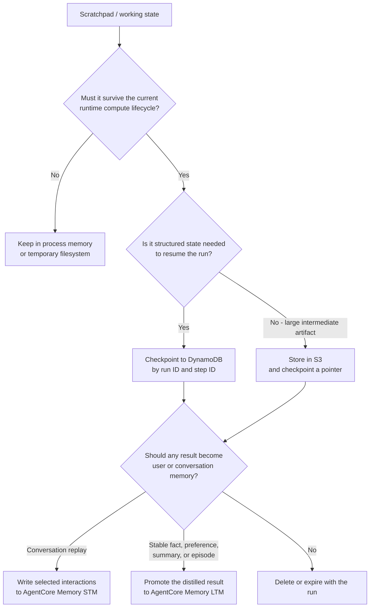
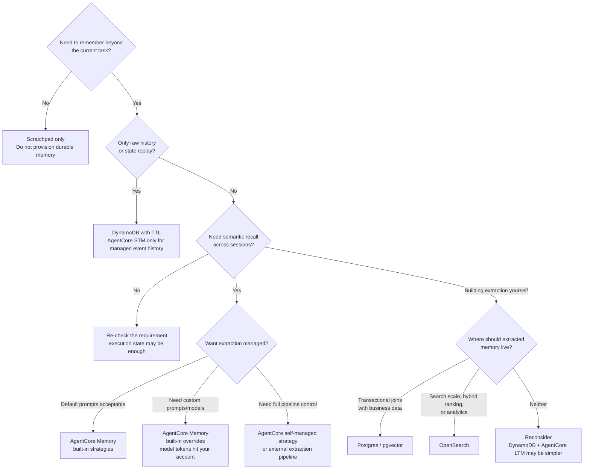
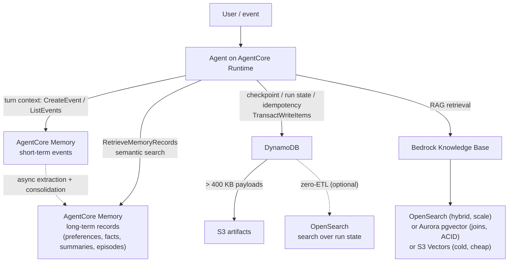

# Choosing a Memory & State Store: AgentCore Memory vs DynamoDB vs OpenSearch vs Postgres/pgvector


## Intro / Index

Agent state needs are routinely collapsed into one "memory" bucket. They are not the same job.

1. **Conversational memory** — what the agent should remember about users and conversations → AgentCore Memory.
2. **Execution state** — checkpoints, run status, idempotency, things you look up by key → DynamoDB.
3. **Knowledge retrieval** — corpora you search semantically → OpenSearch or Postgres/pgvector (a decision based on scale, operational ownership, and data co-location, not a capability war).
4. **Working state / scratchpad** — temporary plans, partial results, tool outputs, loop counters, intermediate decisions, cursors, and other loop state used while an agent is completing a task. Keep it in the runtime while the run is active; checkpoint the structured parts to DynamoDB when the run must survive interruption.

A common production architecture composes multiple categories. The decision is almost never "which one," it is "which job does this piece of state belong to."

## Decision at a glance

| Store | Job it is built for | Retrieval model | Disqualifying gap |
|---|---|---|---|
| **AgentCore Memory** | Session events + extracted user facts, preferences, summaries, episodes across sessions [2](https://docs.aws.amazon.com/bedrock-agentcore/latest/devguide/memory-types.html) | Key/list access to raw events; semantic search over extracted records (`RetrieveMemoryRecords`) [2](https://docs.aws.amazon.com/bedrock-agentcore/latest/devguide/memory-types.html) | Not a general database; long-term extraction is asynchronous [2](https://docs.aws.amazon.com/bedrock-agentcore/latest/devguide/memory-types.html); events expire after at most 365 days [5](https://docs.aws.amazon.com/bedrock-agentcore-control/latest/APIReference/API_CreateMemory.html) |
| **DynamoDB** | Durable execution state: checkpoints, run status, idempotency keys, approval waits | Key-value lookup, "single-digit millisecond performance" [7](https://aws.amazon.com/dynamodb/) | No native vector or full-text search — one managed AWS path is zero-ETL replication into OpenSearch [12](https://docs.aws.amazon.com/amazondynamodb/latest/developerguide/OpenSearchIngestionForDynamoDB.html) [13](https://aws.amazon.com/blogs/database/vector-search-for-amazon-dynamodb-with-zero-etl-for-amazon-opensearch-service/); 400 KB item cap [8](https://docs.aws.amazon.com/amazondynamodb/latest/developerguide/HowItWorks.NamingRulesDataTypes.html) |
| **OpenSearch** | Knowledge retrieval at scale: RAG corpora, hybrid BM25 + kNN, faceting, analytics [15](https://docs.opensearch.org/latest/vector-search/ai-search/hybrid-search/index/) | Full-text, vector, and hybrid search | Minimum capacity cost and operational overhead; first classic Serverless production capacity pool generally establishes a 2-OCU minimum [14](https://aws.amazon.com/opensearch-service/pricing/) |
| **Postgres/pgvector** | Vectors co-located with relational data: joins, ACID, one database to run [18](https://docs.aws.amazon.com/AmazonRDS/latest/AuroraUserGuide/AuroraPostgreSQL.VectorDB.html) | SQL + HNSW/IVFFlat similarity search [18](https://docs.aws.amazon.com/AmazonRDS/latest/AuroraUserGuide/AuroraPostgreSQL.VectorDB.html) [19](https://aws.amazon.com/about-aws/whats-new/2023/10/amazon-rds-postgresql-pgvector-hnsw-indexing/) | You own scaling and tuning; no managed hybrid-ranking pipeline like OpenSearch's normalization processor [15](https://docs.opensearch.org/latest/vector-search/ai-search/hybrid-search/index/) |
| **Runtime / DynamoDB / S3** | Working state and scratchpads: temporary plans, partial results, tool outputs, loop counters, intermediate decisions | In-process reads while active; keyed checkpoint lookup when durable | Not user memory by default; do not persist raw hidden reasoning |

Four questions that resolve most cases:

1. **Is it memory about a user or a conversation?** → AgentCore Memory.
2. **Is it execution state you look up by a known key?** → DynamoDB.
3. **Is it knowledge you search semantically?** → pgvector when the corpus is moderate or must join with relational data; OpenSearch when scale, hybrid ranking, or query throughput demands it; S3 Vectors when queries are infrequent and cost dominates (see [Adjacent options](#adjacent-options-worth-knowing)).
4. **Is it temporary working state for this run?** → runtime-local memory/filesystem while active; DynamoDB checkpoint plus S3 pointers when it must survive interruption.

---

## Scratchpads: transient working state

AgentCore Memory does not define "scratchpad" as a separate memory type; its managed abstractions are short-term event history and asynchronously extracted long-term records [2](https://docs.aws.amazon.com/bedrock-agentcore/latest/devguide/memory-types.html). A scratchpad is the agent's working set for one task or run. Typical contents include:

- the current plan and next step;
- completed and pending tool calls;
- partial calculations or extracted fields;
- retrieval snippets selected for the current task;
- iteration counters, cursors, and retry state;
- concise decision records needed to resume execution.

A scratchpad is not automatically conversational memory or long-term user memory. Its storage depends on how long it must survive.



### Runtime-local scratchpads

AgentCore Runtime preserves process memory and filesystem state between invocations routed to the same active session. That context is tied to ephemeral compute: by default, data in memory or written to disk persists only for the compute lifecycle, and the microVM is terminated after session completion [24](https://docs.aws.amazon.com/bedrock-agentcore/latest/devguide/runtime-sessions.html). Session storage can preserve configured filesystem data across stop and resume cycles, but it should not replace an explicit database checkpoint for transactional run state [24](https://docs.aws.amazon.com/bedrock-agentcore/latest/devguide/runtime-sessions.html).

Use runtime-local state when losing the scratchpad would merely require recomputing the current step.

### Durable scratchpads

Use DynamoDB when losing the scratchpad could duplicate a side effect, lose a human approval, or force an expensive workflow to restart. Model the scratchpad as explicit state rather than an opaque transcript, for example:

```json
{
  "run_id": "run-123",
  "checkpoint_version": 7,
  "status": "WAITING_FOR_APPROVAL",
  "current_step": "submit_order",
  "completed_steps": ["validate", "price"],
  "pending_action": {
    "type": "place_order",
    "idempotency_key": "order-456"
  },
  "artifact_uri": "s3://agent-artifacts/run-123/result.json",
  "expires_at": 1784000000
}
```

Large tool results and documents belong in S3, with only identifiers, hashes, status, and resume metadata stored in DynamoDB.

Graph frameworks may call this a checkpoint or thread state rather than a scratchpad. LangGraph, for example, distinguishes thread-scoped graph checkpoints from cross-thread long-term stores; that maps closely to DynamoDB execution checkpoints versus AgentCore long-term memory [25](https://docs.langchain.com/oss/python/langgraph/persistence).

### Do not persist raw hidden reasoning

Do not design the scratchpad as a permanent log of unrestricted model chain-of-thought. Persist the operational information needed for recovery and audit instead:

- plans and selected actions;
- tool inputs and outputs;
- source references;
- validation results;
- concise decision summaries;
- state transitions and idempotency keys.

This produces a smaller, safer, and more deterministic resume contract than replaying an unstructured reasoning transcript.

### Promotion rule

Scratchpad entries should be promoted deliberately:

| Scratchpad result | Destination |
|---|---|
| Needed only for the active calculation | Runtime memory |
| Needed to resume after interruption | DynamoDB checkpoint |
| Large intermediate output | S3 plus DynamoDB pointer |
| User-visible conversation turn | AgentCore Memory STM |
| Stable preference, fact, summary, or episode | AgentCore Memory LTM |
| Reusable document or searchable knowledge | Knowledge store |

The key boundary is: **scratchpads describe what the agent is doing now; memory describes what the agent should remember later.**

## AgentCore Memory

### What it actually is

AgentCore Memory is a fully managed service with two cooperating layers [1](https://docs.aws.amazon.com/bedrock-agentcore/latest/devguide/memory.html) [2](https://docs.aws.amazon.com/bedrock-agentcore/latest/devguide/memory-types.html):

- **Short-term memory (STM):** raw interactions stored as *events* via `CreateEvent`, associated with a session through `sessionId` (yours or system-generated). Retrieval is by enumeration and lookup: `ListSessions`, `ListEvents`, `GetEvent`. Events can carry key-value *event metadata* for filtered retrieval — but AWS warns metadata "is not meant to store sensitive content, as it is not encrypted with customer managed key." [2](https://docs.aws.amazon.com/bedrock-agentcore/latest/devguide/memory-types.html)
- **Long-term memory (LTM):** structured *memory records* extracted from events. Per AWS: "Long-term memory generation is an asynchronous process that runs in the background" comprising two operations, **extraction** (pull insights from raw interactions) and **consolidation** (merge new insights with existing records). [2](https://docs.aws.amazon.com/bedrock-agentcore/latest/devguide/memory-types.html) Records are retrieved via `GetMemoryRecord`, `ListMemoryRecords`, or `RetrieveMemoryRecords` — the last "performs a semantic search to find memory records that are most relevant to the query." [2](https://docs.aws.amazon.com/bedrock-agentcore/latest/devguide/memory-types.html)

### Operational model: retention, retrieval, and scope

| Question | Short-term memory | Long-term memory |
|---|---|---|
| What is stored? | Raw events: user turns, assistant turns, tool results, and metadata your agent writes. | Extracted records: preferences, facts, session summaries, and episodes produced by configured strategies. |
| Primary scope | `actorId` + `sessionId`: one actor inside one conversation/session. | Strategy namespace, usually templated with `{actorId}` and optionally `{sessionId}`. |
| Retrieval path | Event-log reads: list sessions/events, get an event, then choose the prompt window yourself. | Record retrieval: list/get known records, or semantic search with `RetrieveMemoryRecords`. |
| Retention model | `eventExpiryDuration` at memory creation/update; raw events expire and the cap is 365 days [5](https://docs.aws.amazon.com/bedrock-agentcore-control/latest/APIReference/API_CreateMemory.html). | Records are not controlled by `eventExpiryDuration`; delete them explicitly with `DeleteMemoryRecord` when they should no longer be retained [23](https://docs.aws.amazon.com/bedrock-agentcore/latest/APIReference/API_DeleteMemoryRecord.html). |
| Consistency expectation | Good for recent conversation replay, but still an external service call. | Eventually available: extraction and consolidation are asynchronous [2](https://docs.aws.amazon.com/bedrock-agentcore/latest/devguide/memory-types.html). |
| Best fit | "What did we just say in this session?" and session resume windows. | "What should I remember about this actor across sessions?" |

Treat `actorId` as the user, tenant user, or agent/user pair that owns the memory. Treat `sessionId` as a single conversation or run. For per-user recall across many sessions, namespace long-term records under the actor, for example `/strategy/{memoryStrategyId}/actor/{actorId}/`. For session summaries or audit-style reconstruction, include the session, for example `/strategy/{memoryStrategyId}/actor/{actorId}/session/{sessionId}/`. Avoid global `/` namespaces unless the memory is intentionally shared across actors.

### Extraction strategies (verified list)

Four built-in strategies, plus customization [3](https://docs.aws.amazon.com/bedrock-agentcore/latest/devguide/long-term-configuring-built-in-strategies.html):

| Strategy | API name | What it extracts |
|---|---|---|
| User preferences | `userPreferenceMemoryStrategy` | Preferences, choices, styles — a persistent per-user profile |
| Semantic | `semanticMemoryStrategy` | Factual information and contextual knowledge (entities, events, details) |
| Session summaries | `summaryMemoryStrategy` | Condensed running summaries of a session's topics and decisions |
| Episodic | `episodicMemoryStrategy` | Structured episodes (scenario, intent, thoughts, actions, outcomes, artifacts) with cross-episode *reflection* to extract broader behavioral insights |

Built-in strategies can be overridden, and fully **self-managed** strategies exist — the API exposes `selfManagedConfiguration` with trigger conditions and payload delivery to your own S3 bucket/SNS topic, meaning your own pipeline does the extraction [5](https://docs.aws.amazon.com/bedrock-agentcore-control/latest/APIReference/API_CreateMemory.html). Self-managed extraction bills LTM storage at the lower rate but "you may incur additional charges for the model usage in your account." [6](https://aws.amazon.com/bedrock/agentcore/pricing/)

### Isolation: namespaces + IAM

Long-term records are scoped to hierarchical namespaces built from template variables `{actorId}`, `{sessionId}`, and `{memoryStrategyId}` — e.g. `/strategy/{memoryStrategyId}/actor/{actorId}/session/{sessionId}/`, with coarser granularities up to global `/` [4](https://docs.aws.amazon.com/bedrock-agentcore/latest/devguide/specify-long-term-memory-organization.html). Critically for multi-tenant agents, IAM policies can restrict `RetrieveMemoryRecords` using the `bedrock-agentcore:namespace` (exact) and `bedrock-agentcore:namespacePath` (hierarchy) condition keys [4](https://docs.aws.amazon.com/bedrock-agentcore/latest/devguide/specify-long-term-memory-organization.html) — tenant isolation is enforceable at the authorization layer, not just in application code.

### Hard limits and pricing

- `eventExpiryDuration` is **required** at memory creation: minimum 3, maximum 365 (days) [5](https://docs.aws.amazon.com/bedrock-agentcore-control/latest/APIReference/API_CreateMemory.html). STM is not permanent storage; anything needed past a year must live in LTM records or elsewhere.
- Pricing [6](https://aws.amazon.com/bedrock/agentcore/pricing/): **$0.25 per 1,000 new events** (STM); LTM storage **$0.75 per 1,000 records/month** for built-in strategies or **$0.25 per 1,000 records/month** for built-in-with-override / self-managed; retrieval **$0.50 per 1,000 memory record retrievals**. LTM storage is "billed hourly assuming a 31 day month." [6](https://aws.amazon.com/bedrock/agentcore/pricing/)
- Works with "a variety of SDKs and agent frameworks." [1](https://docs.aws.amazon.com/bedrock-agentcore/latest/devguide/memory.html)

### Use it when / avoid it when

**Use it when**
- The state is *what the agent knows about the user or conversation*: preferences, facts, session summaries, cross-session continuity.
- You want extraction, consolidation, embedding, and semantic retrieval as a managed pipeline instead of building one.
- You need per-tenant memory isolation enforceable in IAM [4](https://docs.aws.amazon.com/bedrock-agentcore/latest/devguide/specify-long-term-memory-organization.html).
- You want a managed memory service without operating a separate database or vector pipeline.

**Avoid it when**
- You need read-your-own-write within a turn: extraction is asynchronous [2](https://docs.aws.amazon.com/bedrock-agentcore/latest/devguide/memory-types.html), so a fact from the current exchange is not reliably retrievable seconds later. Turn-critical state belongs in STM events or DynamoDB.
- The data is arbitrary application state, transactional records, or a document corpus — there are no ad-hoc queries, joins, or aggregations.
- Raw history must be retained beyond 365 days [5](https://docs.aws.amazon.com/bedrock-agentcore-control/latest/APIReference/API_CreateMemory.html) — archive events to S3 or a database.

### Decision tree: managed vs self-managed memory



Two override signals trump the tree: a hard data-residency or schema-ownership requirement pushes self-managed regardless of convenience; a very small team with little operations budget pushes managed regardless of unit price.

---

## DynamoDB

### What it actually is

A serverless key-value/document database that AWS positions as delivering "single-digit millisecond performance" [7](https://aws.amazon.com/dynamodb/), with no practical limit on table size ("Tables are unconstrained in terms of the number of items or the number of bytes") [22](https://docs.aws.amazon.com/amazondynamodb/latest/developerguide/ServiceQuotas.html). In an agentic system it is the backbone of the [Resumable / Pausable Pattern](Resumable%20pausable%20pattern.md): checkpoints, run-state machines (`run_id → status`), pending human approvals, idempotency records, tool-result caches.

### Verified properties that matter for agent state

- **400 KB maximum item size** (attribute names + values) [8](https://docs.aws.amazon.com/amazondynamodb/latest/developerguide/HowItWorks.NamingRulesDataTypes.html). Large checkpoints and tool outputs go to S3 with a pointer in the item.
- **TTL deletion is free in the source Region and approximate:** expired items are deleted "without consuming write throughput," but only "within a few days of their expiration time" [9](https://docs.aws.amazon.com/amazondynamodb/latest/developerguide/TTL.html). Expired-but-not-yet-deleted items still appear in reads — filter them out in queries, and never use TTL as a security control. With Global Tables, replicated TTL deletes consume replicated write capacity in replica Regions and incur charges [9](https://docs.aws.amazon.com/amazondynamodb/latest/developerguide/TTL.html).
- **Transactions:** `TransactWriteItems` groups up to 100 write actions across tables, all-or-nothing, aggregate size ≤ 4 MB, with serializable isolation against individual `GetItem`, `PutItem`, `UpdateItem`, and `DeleteItem` operations in the source Region; multi-item nontransactional reads and Global Table replicas have weaker guarantees [10](https://docs.aws.amazon.com/amazondynamodb/latest/developerguide/transaction-apis.html). A `ClientRequestToken` is a 10-minute retry-idempotency mechanism for transactional checkpoint commits; durable conditional state transitions are still needed to prevent duplicate execution outside that window [10](https://docs.aws.amazon.com/amazondynamodb/latest/developerguide/transaction-apis.html). Cost note: DynamoDB "performs two underlying reads or writes of every item in the transaction: one to prepare the transaction and one to commit" [10](https://docs.aws.amazon.com/amazondynamodb/latest/developerguide/transaction-apis.html), so transactional checkpoints cost ~2× the capacity of plain writes.
- **`ConditionCheck` / condition expressions** in transactions support the "resume must not repeat a side effect" mitigations from the resumable pattern [10](https://docs.aws.amazon.com/amazondynamodb/latest/developerguide/transaction-apis.html).
- **No native vector or full-text search.** One managed AWS path is the zero-ETL integration with OpenSearch Service (GA), which replicates a table via point-in-time-recovery export to S3 for the initial snapshot plus DynamoDB Streams for ongoing changes, and enables "full-text search, fuzzy search, auto-complete, and vector search" on the replicated data [12](https://docs.aws.amazon.com/amazondynamodb/latest/developerguide/OpenSearchIngestionForDynamoDB.html) [13](https://aws.amazon.com/blogs/database/vector-search-for-amazon-dynamodb-with-zero-etl-for-amazon-opensearch-service/). The search happens in OpenSearch, not DynamoDB.

### Pricing shape (us-east-1, on-demand) [11](https://aws.amazon.com/dynamodb/pricing/on-demand/)

$0.625 per million write request units, $0.125 per million read request units, $0.25/GB-month storage (first 25 GB free). For checkpoint workloads this means cost scales with write frequency and checkpoint size (a WRU covers 1 KB of write), not with idle time — there is no floor.

### Use it when / avoid it when

**Use it when**
- State is looked up by a known key: run id, session id, idempotency key, approval token.
- You need conditional writes and transactions to prevent duplicate state transitions during resume; external side effects require their own idempotency controls [10](https://docs.aws.amazon.com/amazondynamodb/latest/developerguide/transaction-apis.html).
- State is ephemeral by design — TTL cleans up abandoned runs without source-Region write throughput, with Global Tables replica charges if replicated [9](https://docs.aws.amazon.com/amazondynamodb/latest/developerguide/TTL.html).

**Avoid it when**
- The question is "find things *like* this" — no native semantic or full-text search [12](https://docs.aws.amazon.com/amazondynamodb/latest/developerguide/OpenSearchIngestionForDynamoDB.html).
- Single records exceed 400 KB without an S3 offload design [8](https://docs.aws.amazon.com/amazondynamodb/latest/developerguide/HowItWorks.NamingRulesDataTypes.html).
- You need relational queries, joins, or aggregations over the state.

---

## OpenSearch

### What it actually is

A search and analytics engine (managed clusters or Serverless) whose vector capability comes with the full search stack around it: lexical BM25 scoring, k-NN vector search, and — the differentiator — **hybrid search**, introduced in OpenSearch 2.11, that can merge lexical and semantic results through a search pipeline [15](https://docs.opensearch.org/latest/vector-search/ai-search/hybrid-search/index/). The normalization processor, introduced in OpenSearch 2.10, normalizes and combines document scores from multiple query clauses [15](https://docs.opensearch.org/latest/vector-search/ai-search/hybrid-search/index/). OpenSearch Serverless supports neural/hybrid search through remotely hosted models via connectors [16](https://docs.aws.amazon.com/opensearch-service/latest/developerguide/serverless-configure-neural-search.html).

### Verified properties that matter for agents

- **Bedrock Knowledge Bases:** both OpenSearch Serverless and OpenSearch Managed are supported vector stores; KB requires the `faiss` engine ("**nmslib** is not supported") and managed clusters need engine version 2.13+ for k-NN indexes (2.16+ for binary vectors) [17](https://docs.aws.amazon.com/bedrock/latest/userguide/knowledge-base-setup.html). OpenSearch Serverless and Managed are "the only vector stores that support storing binary vectors" for KB [17](https://docs.aws.amazon.com/bedrock/latest/userguide/knowledge-base-setup.html).
- **Serverless pricing (us-east-1):** $0.24 per OCU-hour; an OCU is ~6 GB RAM plus corresponding vCPU [14](https://aws.amazon.com/opensearch-service/pricing/). For classic collections, the first production capacity pool generally establishes a **2-OCU** minimum (0.5 indexing + 0.5 search, each with HA redundancy); compatible collections may share that capacity, while vector collections use a separate capacity pool. Classic dev/test has a **1-OCU** option without redundancy; managed storage is $0.02/GB-month [14](https://aws.amazon.com/opensearch-service/pricing/). *Derived:* a dedicated classic production pool at 2 × $0.24 × 730 h is ≈ **$350/month before storing a single useful vector**; dev/test ≈ $175/month.
- **NextGen collections** change this economics: "No minimum OCU requirement — Indexing and Search OCUs scale to zero after 10 minutes of inactivity" [14](https://aws.amazon.com/opensearch-service/pricing/). If your account/region has NextGen collections, the idle-cost argument against Serverless weakens considerably — verify which collection type you're actually provisioning.

### Use it when / avoid it when

**Use it when**
- Retrieval quality is the product: hybrid lexical-plus-vector ranking can outperform pure vector retrieval when the corpus benefits from both exact-term and semantic matching; validate this with a representative relevance evaluation [15](https://docs.opensearch.org/latest/vector-search/ai-search/hybrid-search/index/).
- The corpus or query throughput outgrows a single Postgres instance, or you need faceting/aggregations/analytics on the same data.
- You need binary vector embeddings with Bedrock KB [17](https://docs.aws.amazon.com/bedrock/latest/userguide/knowledge-base-setup.html).
- You want searchability over DynamoDB state without building a pipeline — zero-ETL [12](https://docs.aws.amazon.com/amazondynamodb/latest/developerguide/OpenSearchIngestionForDynamoDB.html).

**Avoid it when**
- The corpus fits comfortably in Postgres and you'd be paying a dedicated classic production capacity pool of ~2 OCUs to hold it [14](https://aws.amazon.com/opensearch-service/pricing/).
- Nobody on the team will own index mappings, collection sizing, and relevance tuning.
- Queries are rare and latency-tolerant — S3 Vectors exists for exactly that profile (below).

---

## Postgres / pgvector (Aurora & RDS)

### What it actually is

The `pgvector` extension adds vector types and similarity search to PostgreSQL. On AWS it is supported on both Aurora PostgreSQL and RDS for PostgreSQL [18](https://docs.aws.amazon.com/AmazonRDS/latest/AuroraUserGuide/AuroraPostgreSQL.VectorDB.html) [19](https://aws.amazon.com/about-aws/whats-new/2023/10/amazon-rds-postgresql-pgvector-hnsw-indexing/). RDS for PostgreSQL supports pgvector 0.8.0 on the documented engine versions [19](https://aws.amazon.com/about-aws/whats-new/2023/10/amazon-rds-postgresql-pgvector-hnsw-indexing/). Its structural advantage is *location*: embeddings live in the same ACID database as your relational data, so a retrieval query can JOIN against customers, permissions, or products, and a row plus its embedding can change in one transaction.

### Verified properties that matter for agents

- **Bedrock Knowledge Bases support** with specific requirements [17](https://docs.aws.amazon.com/bedrock/latest/userguide/knowledge-base-setup.html) [18](https://docs.aws.amazon.com/AmazonRDS/latest/AuroraUserGuide/AuroraPostgreSQL.VectorDB.html): Aurora PostgreSQL 12.16 / 13.12 / 14.9 / 15.4 / 16.1 or higher; pgvector ≥ 0.5.0; **RDS Data API enabled**; credentials in Secrets Manager; the cluster must be in the same account as the KB. AWS's reference schema uses an HNSW index with `vector_cosine_ops` plus GIN indexes for text and `jsonb` metadata [18](https://docs.aws.amazon.com/AmazonRDS/latest/AuroraUserGuide/AuroraPostgreSQL.VectorDB.html). A quick-create flow can provision the Aurora KB for you [18](https://docs.aws.amazon.com/AmazonRDS/latest/AuroraUserGuide/AuroraPostgreSQL.VectorDB.html).
- **Metadata-filter correctness gotcha:** with selective metadata filters, filtering is applied *after* the HNSW scan and "can return fewer results than expected"; AWS recommends enabling HNSW iterative index scans (`hnsw.iterative_scan = 'relaxed_order'`), which requires pgvector 0.8.0+ [17](https://docs.aws.amazon.com/bedrock/latest/userguide/knowledge-base-setup.html).
- **Performance levers:** AWS recommends `ef_construction = 256` with pgvector ≥ 0.6.0 parallel index builds [18](https://docs.aws.amazon.com/AmazonRDS/latest/AuroraUserGuide/AuroraPostgreSQL.VectorDB.html). In AWS's Aurora benchmark, Optimized Reads with HNSW delivered up to 20× higher queries per second than IVFFlat, and up to 9× versus an equivalent instance without Optimized Reads [20](https://aws.amazon.com/blogs/database/accelerate-generative-ai-workloads-on-amazon-aurora-with-optimized-reads-and-pgvector/).
- **Hybrid search:** the KB reference schema includes a `to_tsvector` GIN index used for hybrid retrieval [18](https://docs.aws.amazon.com/AmazonRDS/latest/AuroraUserGuide/AuroraPostgreSQL.VectorDB.html), but score fusion is up to the caller — there is no managed equivalent of OpenSearch's normalization processor.

### Use it when / avoid it when

**Use it when**
- Retrieval must respect relational facts — tenant boundaries, entitlements, product joins — enforced in SQL, not re-implemented as vector-store metadata.
- Embeddings and business data should change transactionally together.
- You already operate Postgres and running one fewer system beats best-in-class search.

**Avoid it when**
- You need managed hybrid ranking, faceting, or search analytics — that's OpenSearch [15](https://docs.opensearch.org/latest/vector-search/ai-search/hybrid-search/index/).
- Nobody will own index parameters, `iterative_scan` settings [17](https://docs.aws.amazon.com/bedrock/latest/userguide/knowledge-base-setup.html), and instance sizing as the corpus grows.
- The workload is infrequent bulk semantic lookup where a database instance idles between queries — S3 Vectors is purpose-built for that.

---

## Adjacent options worth knowing

- **S3 Vectors** — GA since December 2025: up to 2 billion vectors per index, 10,000 indexes per bucket, in 14 regions; AWS claims up to 90% lower total cost versus specialized vector databases, with sub-second latency for infrequent queries and ~100 ms when queried frequently [21](https://aws.amazon.com/about-aws/whats-new/2025/12/amazon-s3-vectors-generally-available/). It is a supported Bedrock KB store, "best suited for infrequent query workloads"; float32 embeddings only (no binary), and with KB it allows up to 1 KB of custom metadata and 35 metadata keys per vector [17](https://docs.aws.amazon.com/bedrock/latest/userguide/knowledge-base-setup.html). For large, relatively cold RAG corpora, S3 Vectors can be materially cheaper than dedicated OpenSearch capacity or an otherwise-idle database; calculate costs for the actual vector size and query pattern. Standalone S3 Vectors is not a lexical hybrid-search engine.
- **Neptune Analytics (GraphRAG)** — supported KB store when retrieval should follow graph structure rather than pure similarity [17](https://docs.aws.amazon.com/bedrock/latest/userguide/knowledge-base-setup.html).
- **Third-party KB stores** — Pinecone, Redis Enterprise Cloud, and MongoDB Atlas are also supported by Bedrock KB if you're already invested there [17](https://docs.aws.amazon.com/bedrock/latest/userguide/knowledge-base-setup.html).

## Composition blueprint



One job per store: conversation → Memory, execution → DynamoDB, knowledge → the vector store your scale and query pattern justify.

## Common failure modes

- **Long-term memory as read-your-own-write state:** extraction is asynchronous [2](https://docs.aws.amazon.com/bedrock-agentcore/latest/devguide/memory-types.html); a preference stated this turn is not reliably retrievable this turn. *Mitigation: turn-critical state goes in STM events or DynamoDB; treat LTM as eventually consistent.*
- **Checkpoint exceeds 400 KB:** DynamoDB rejects the write mid-run [8](https://docs.aws.amazon.com/amazondynamodb/latest/developerguide/HowItWorks.NamingRulesDataTypes.html). *Mitigation: artifacts to S3, pointer in the item; validate checkpoint size in tests.*
- **TTL treated as deletion SLA:** expired items linger "within a few days" and still appear in reads [9](https://docs.aws.amazon.com/amazondynamodb/latest/developerguide/TTL.html). *Mitigation: filter on the expiry attribute at read time; use explicit deletes for compliance-driven removal.*
- **Semantic search bolted onto DynamoDB:** scans plus in-app similarity, or an unmaintained sync into a vector store. *Mitigation: use a managed zero-ETL OpenSearch integration [12](https://docs.aws.amazon.com/amazondynamodb/latest/developerguide/OpenSearchIngestionForDynamoDB.html) or put the corpus in a real vector store from the start.*
- **OpenSearch Serverless for a tiny corpus:** a dedicated classic production capacity pool's 2-OCU floor [14](https://aws.amazon.com/opensearch-service/pricing/) can dwarf the workload. *Mitigation: NextGen collections (scale-to-zero) [14](https://aws.amazon.com/opensearch-service/pricing/), shared classic capacity where appropriate, pgvector, or S3 Vectors.*
- **pgvector metadata filters silently under-returning:** selective filters applied post-scan return fewer results than `k` [17](https://docs.aws.amazon.com/bedrock/latest/userguide/knowledge-base-setup.html). *Mitigation: pgvector 0.8.0+, `hnsw.iterative_scan = 'relaxed_order'` [17](https://docs.aws.amazon.com/bedrock/latest/userguide/knowledge-base-setup.html).*
- **Sensitive data in event metadata:** it is not encrypted with a customer managed key [2](https://docs.aws.amazon.com/bedrock-agentcore/latest/devguide/memory-types.html). *Mitigation: sensitive content in event payloads or elsewhere; metadata for routing keys only.*
- **Cross-tenant memory leakage:** retrieval over a shared namespace. *Mitigation: per-actor namespace templates plus IAM `bedrock-agentcore:namespace` / `namespacePath` conditions [4](https://docs.aws.amazon.com/bedrock-agentcore/latest/devguide/specify-long-term-memory-organization.html).*
- **Raw-event history silently expiring:** `eventExpiryDuration` caps at 365 days [5](https://docs.aws.amazon.com/bedrock-agentcore-control/latest/APIReference/API_CreateMemory.html). *Mitigation: archive events needed longer to S3; rely on LTM records for durable insights.*

## Cost and quota considerations

Costs and quotas follow the job each store is doing. Do not compare only storage price; include write frequency, retrieval frequency, extraction work, index capacity, and operational limits.

| Area | Main cost driver | Quota / limit to check | Practical lever |
|---|---|---|---|
| AgentCore Memory STM | New events written per turn or tool result | `CreateEvent` throughput, event payload size, `eventExpiryDuration` max 365 days | Store selected events, not every scratchpad detail |
| AgentCore Memory LTM | Stored memory records plus retrieval calls | Strategy count, extraction latency, `RetrieveMemoryRecords` throughput | Retrieve on demand; delete stale records |
| Built-in override / self-managed extraction | Your model calls plus LTM storage | Bedrock model quotas and extraction pipeline limits | Use overrides only when default extraction is not good enough |
| DynamoDB checkpoints | Writes, reads, item size, transactional writes | 400 KB item cap, table/account throughput, TTL behavior | Keep checkpoints compact; put large outputs in S3 |
| S3 artifacts | Object storage, request volume, lifecycle duration | Object size, bucket policy, lifecycle/retention rules | Store big tool outputs in S3 and keep only pointers in DynamoDB |
| OpenSearch | OCU/instance capacity, storage, query/index load | OCU pool, index count, shard/index design, service quotas | Use it when hybrid search/analytics justify the floor |
| Postgres / pgvector | Database instance/storage plus index maintenance | Connections, memory, index build time, vector index settings | Use when vector search must join with relational data |

Design rule: **measure the operation count you will actually create**. A cheap per-record store can become expensive if every turn writes multiple records and retrieves on every prompt; an expensive search service can be justified if it replaces poor retrieval quality at scale.

## Cost snapshot (us-east-1, checked 2026-07-13)

| Store | Published price | Floor when idle |
|---|---|---|
| AgentCore Memory | $0.25/1k events; $0.75 (built-in) or $0.25 (custom/self-managed)/1k LTM records/mo; $0.50/1k retrievals [6](https://aws.amazon.com/bedrock/agentcore/pricing/) | None beyond stored records |
| DynamoDB on-demand | $0.625/M writes, $0.125/M reads, $0.25/GB-mo (25 GB free) [11](https://aws.amazon.com/dynamodb/pricing/on-demand/) | None beyond storage |
| OpenSearch Serverless | $0.24/OCU-hr, $0.02/GB-mo storage [14](https://aws.amazon.com/opensearch-service/pricing/) | Classic: first prod capacity pool generally starts at 2 OCUs; dev-test can start at 1 OCU (*derived:* ≈$350 / ≈$175 per month for dedicated continuous capacity); NextGen: scales to zero after 10 min idle [14](https://aws.amazon.com/opensearch-service/pricing/) |
| Aurora/RDS pgvector | Instance/storage pricing of the database itself | The DB instance (unless Aurora Serverless v2 / scale-to-zero configurations) |
| S3 Vectors | Pay-per-use storage + queries; AWS claims up to 90% cheaper than specialized vector DBs [21](https://aws.amazon.com/about-aws/whats-new/2025/12/amazon-s3-vectors-generally-available/) | None beyond storage |

For FinOps treatment of the compute running the agent itself, see [Cost and FinOps](../../Cost%20and%20FinOps.md) — same rule applies here: publish measured telemetry, not assumed traffic models.

## Sources

- [1](https://docs.aws.amazon.com/bedrock-agentcore/latest/devguide/memory.html) [AWS: Add memory to your Amazon Bedrock AgentCore agent](https://docs.aws.amazon.com/bedrock-agentcore/latest/devguide/memory.html)
- [2](https://docs.aws.amazon.com/bedrock-agentcore/latest/devguide/memory-types.html) [AWS: AgentCore Memory types (short-term and long-term)](https://docs.aws.amazon.com/bedrock-agentcore/latest/devguide/memory-types.html)
- [3](https://docs.aws.amazon.com/bedrock-agentcore/latest/devguide/long-term-configuring-built-in-strategies.html) [AWS: Configure built-in memory strategies](https://docs.aws.amazon.com/bedrock-agentcore/latest/devguide/long-term-configuring-built-in-strategies.html)
- [4](https://docs.aws.amazon.com/bedrock-agentcore/latest/devguide/specify-long-term-memory-organization.html) [AWS: Specify long-term memory organization with namespaces](https://docs.aws.amazon.com/bedrock-agentcore/latest/devguide/specify-long-term-memory-organization.html)
- [5](https://docs.aws.amazon.com/bedrock-agentcore-control/latest/APIReference/API_CreateMemory.html) [AWS: AgentCore CreateMemory API reference](https://docs.aws.amazon.com/bedrock-agentcore-control/latest/APIReference/API_CreateMemory.html)
- [6](https://aws.amazon.com/bedrock/agentcore/pricing/) [AWS: Amazon Bedrock AgentCore pricing](https://aws.amazon.com/bedrock/agentcore/pricing/)
- [7](https://aws.amazon.com/dynamodb/) [AWS: Amazon DynamoDB product page](https://aws.amazon.com/dynamodb/)
- [8](https://docs.aws.amazon.com/amazondynamodb/latest/developerguide/HowItWorks.NamingRulesDataTypes.html) [AWS: DynamoDB supported data types and naming rules (400 KB item limit)](https://docs.aws.amazon.com/amazondynamodb/latest/developerguide/HowItWorks.NamingRulesDataTypes.html)
- [9](https://docs.aws.amazon.com/amazondynamodb/latest/developerguide/TTL.html) [AWS: Using time to live (TTL) in DynamoDB](https://docs.aws.amazon.com/amazondynamodb/latest/developerguide/TTL.html)
- [10](https://docs.aws.amazon.com/amazondynamodb/latest/developerguide/transaction-apis.html) [AWS: DynamoDB transactions — how it works](https://docs.aws.amazon.com/amazondynamodb/latest/developerguide/transaction-apis.html)
- [11](https://aws.amazon.com/dynamodb/pricing/on-demand/) [AWS: DynamoDB on-demand pricing](https://aws.amazon.com/dynamodb/pricing/on-demand/)
- [12](https://docs.aws.amazon.com/amazondynamodb/latest/developerguide/OpenSearchIngestionForDynamoDB.html) [AWS: DynamoDB zero-ETL integration with Amazon OpenSearch Service](https://docs.aws.amazon.com/amazondynamodb/latest/developerguide/OpenSearchIngestionForDynamoDB.html)
- [13](https://aws.amazon.com/blogs/database/vector-search-for-amazon-dynamodb-with-zero-etl-for-amazon-opensearch-service/) [AWS blog: Vector search for Amazon DynamoDB with zero-ETL for Amazon OpenSearch Service](https://aws.amazon.com/blogs/database/vector-search-for-amazon-dynamodb-with-zero-etl-for-amazon-opensearch-service/)
- [14](https://aws.amazon.com/opensearch-service/pricing/) [AWS: Amazon OpenSearch Service pricing (Serverless OCUs)](https://aws.amazon.com/opensearch-service/pricing/)
- [15](https://docs.opensearch.org/latest/vector-search/ai-search/hybrid-search/index/) [OpenSearch documentation: Hybrid search](https://docs.opensearch.org/latest/vector-search/ai-search/hybrid-search/index/)
- [16](https://docs.aws.amazon.com/opensearch-service/latest/developerguide/serverless-configure-neural-search.html) [AWS: Configure neural search and hybrid search on OpenSearch Serverless](https://docs.aws.amazon.com/opensearch-service/latest/developerguide/serverless-configure-neural-search.html)
- [17](https://docs.aws.amazon.com/bedrock/latest/userguide/knowledge-base-setup.html) [AWS: Prerequisites for using a vector store for a Bedrock knowledge base](https://docs.aws.amazon.com/bedrock/latest/userguide/knowledge-base-setup.html)
- [18](https://docs.aws.amazon.com/AmazonRDS/latest/AuroraUserGuide/AuroraPostgreSQL.VectorDB.html) [AWS: Using Aurora PostgreSQL as a Knowledge Base for Amazon Bedrock](https://docs.aws.amazon.com/AmazonRDS/latest/AuroraUserGuide/AuroraPostgreSQL.VectorDB.html)
- [19](https://aws.amazon.com/about-aws/whats-new/2023/10/amazon-rds-postgresql-pgvector-hnsw-indexing/) [AWS what's new: RDS for PostgreSQL pgvector 0.5.0 with HNSW](https://aws.amazon.com/about-aws/whats-new/2023/10/amazon-rds-postgresql-pgvector-hnsw-indexing/) · [pgvector 0.8.0 on RDS](https://aws.amazon.com/about-aws/whats-new/2024/11/amazon-rds-for-postgresql-pgvector-080/)
- [20](https://aws.amazon.com/blogs/database/accelerate-generative-ai-workloads-on-amazon-aurora-with-optimized-reads-and-pgvector/) [AWS blog: Improve generative AI workloads on Aurora with Optimized Reads and pgvector](https://aws.amazon.com/blogs/database/accelerate-generative-ai-workloads-on-amazon-aurora-with-optimized-reads-and-pgvector/)
- [21](https://aws.amazon.com/about-aws/whats-new/2025/12/amazon-s3-vectors-generally-available/) [AWS what's new: Amazon S3 Vectors generally available](https://aws.amazon.com/about-aws/whats-new/2025/12/amazon-s3-vectors-generally-available/) · [AWS blog: S3 Vectors GA](https://aws.amazon.com/blogs/aws/amazon-s3-vectors-now-generally-available-with-increased-scale-and-performance/)
- [22](https://docs.aws.amazon.com/amazondynamodb/latest/developerguide/ServiceQuotas.html) [AWS: DynamoDB service quotas](https://docs.aws.amazon.com/amazondynamodb/latest/developerguide/ServiceQuotas.html)
- [23](https://docs.aws.amazon.com/bedrock-agentcore/latest/APIReference/API_DeleteMemoryRecord.html) [AWS: AgentCore DeleteMemoryRecord API reference](https://docs.aws.amazon.com/bedrock-agentcore/latest/APIReference/API_DeleteMemoryRecord.html)
- [24](https://docs.aws.amazon.com/bedrock-agentcore/latest/devguide/runtime-sessions.html) [AWS: Use isolated sessions for agents](https://docs.aws.amazon.com/bedrock-agentcore/latest/devguide/runtime-sessions.html)
- [25](https://docs.langchain.com/oss/python/langgraph/persistence) [LangGraph documentation: Persistence](https://docs.langchain.com/oss/python/langgraph/persistence)
