# AI Infrastructure for LLM Inference: GPUs, vLLM, llm-d and Kubernetes

## 1. Introduction

Running large language models in production is not only a machine-learning problem. It is also a hardware, memory-management and distributed-systems problem.

A production LLM stack has to solve several challenges at once:

* fit large model weights into accelerator memory;
* process prompts efficiently;
* generate tokens with low latency;
* serve many users on the same GPUs;
* manage KV-cache memory;
* scale models across multiple GPUs;
* route requests intelligently across multiple model servers;
* orchestrate the complete infrastructure reliably.

A useful way to understand the stack is as a set of layers, each solving a
different class of problem:

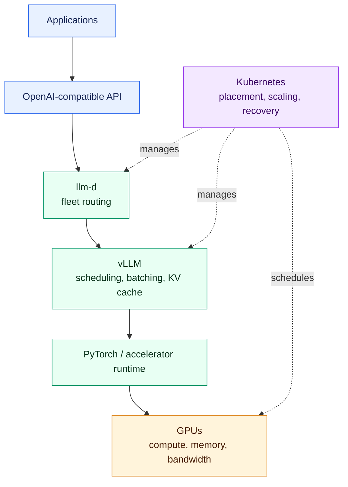

Each new layer appears because the previous layer alone is insufficient once the system grows.

---

# 2. An LLM Is Fundamentally a Large Collection of Weights

A large language model consists of a model architecture and a very large collection of numerical parameters, or weights.

These weights are stored as files and must be loaded into memory during inference.

A simplified execution flow is:

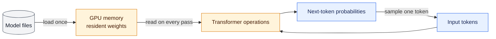

Large models contain billions of parameters, which creates two immediate infrastructure requirements:

1. enough memory to store the model;
2. enough computational capacity to execute the required matrix operations.

For example, a 70-billion-parameter model requires a very large amount of memory even before accounting for runtime overhead and KV cache.

This makes GPU memory one of the first constraints in LLM infrastructure.

---

# 3. Why GPUs Are Used

Transformer inference involves a huge number of mathematical operations that can be executed in parallel.

GPUs are well suited to this workload because they contain very large numbers of parallel processing units.

A CPU is optimized for relatively few powerful cores, while a GPU provides
many execution units suited to parallel matrix operations:

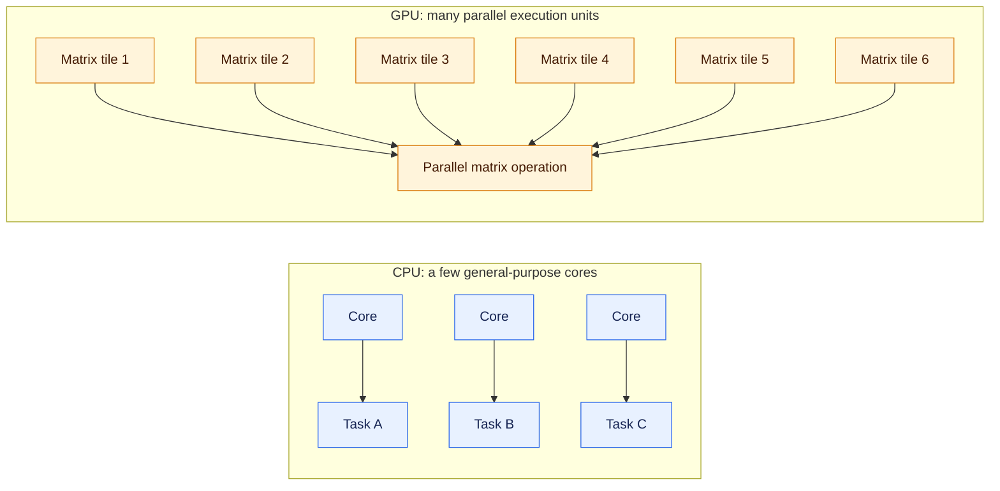

However, raw computational capability is not enough to evaluate an accelerator for LLM inference.

Three hardware characteristics are particularly important.

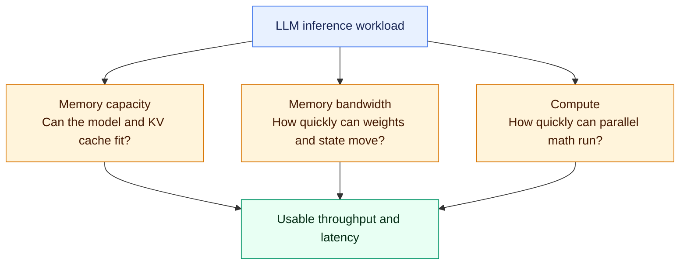

---

# 4. The Three Core GPU Characteristics

## 4.1 Memory Capacity

The first question is:

> How much VRAM or HBM does the accelerator have?

Memory capacity determines:

* whether a model can fit;
* which precision or quantization can be used;
* how much memory remains for runtime state;
* how much KV cache can be stored;
* how many simultaneous sequences can be active.

At a simplified level:

$$
GPU\ Memory =
Model\ Weights +
KV\ Cache +
Runtime\ Overhead
$$

This makes memory capacity directly related to both model compatibility and concurrency.

---

## 4.2 Memory Bandwidth

Memory bandwidth describes how quickly data can be moved from GPU memory to the compute units.

This is particularly important during token generation.

The model weights remain resident in GPU memory, but generating each new output token requires repeatedly reading large portions of those weights.

As a result, decode performance is often strongly influenced by:

> **memory bandwidth**

rather than only peak compute.

---

## 4.3 Compute Performance

Compute capability is often expressed using metrics such as:

* TFLOPS;
* BF16 performance;
* FP16 performance;
* FP8 performance;
* FP4 performance.

Compute becomes particularly important when processing large input prompts because many prompt tokens can be processed in parallel.

Therefore, a useful GPU comparison should always consider:

> **memory capacity + memory bandwidth + compute**

rather than only theoretical TFLOPS.

---

# 5. Why PyTorch Alone Is Not Enough for Production Serving

At the simplest level, a model can be loaded using PyTorch and executed directly on a GPU.

```text
Model
  ↓
PyTorch
  ↓
GPU
  ↓
Inference
```

This is sufficient for experimentation and development.

Production systems introduce a different challenge:

```text
User 1
User 2
User 3
User 4
...
User N
   ↓
same model
   ↓
same GPU infrastructure
```

The serving layer must now manage:

* many simultaneous requests;
* request queues;
* streaming;
* dynamic batching;
* KV-cache allocation;
* GPU memory;
* scheduling;
* throughput;
* latency.

This creates the need for a dedicated LLM model server.

---

# 6. vLLM as the Model-Serving Layer

vLLM is designed to serve large language models efficiently on accelerators.

It sits between the application and the underlying PyTorch/GPU execution stack.

Conceptually, vLLM turns low-level model execution into a multi-user serving
system:

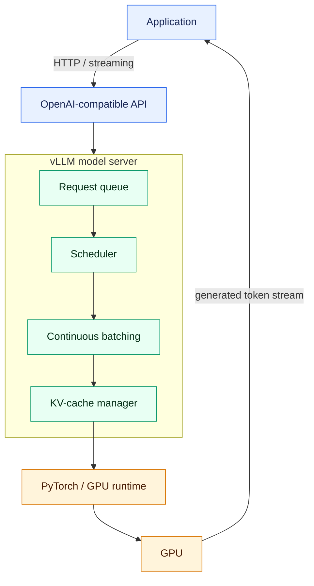

vLLM provides functionality such as:

* persistent model loading;
* request scheduling;
* efficient batching;
* KV-cache management;
* streaming output;
* OpenAI-compatible serving APIs.

Its purpose is not merely to execute a model, but to use expensive accelerator resources efficiently while handling many simultaneous sequences.

---

# 7. Token Generation Creates Two Different Workloads

Large language models generate text autoregressively.

They do not generate the entire response at once.

Instead:

```text
Token 1
   ↓
Token 2
   ↓
Token 3
   ↓
Token 4
   ↓
...
```

This creates two very different phases of inference:

1. **Prefill**
2. **Decode**

These phases stress hardware differently.

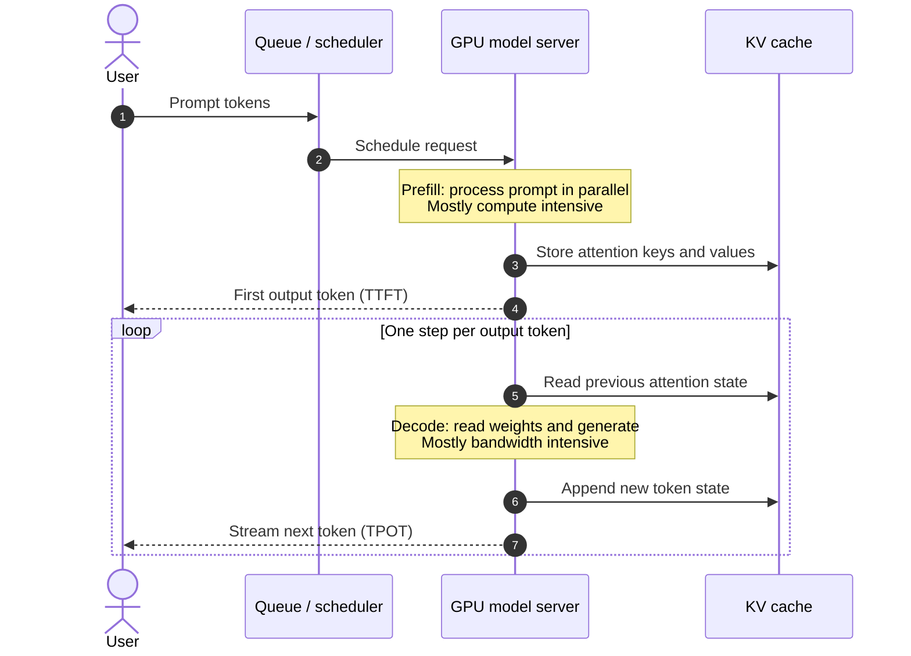

---

# 8. Prefill

During prefill, the model processes the full input prompt.

The prompt may contain:

```text
System prompt
+
Conversation history
+
RAG context
+
Documents
+
User question
```

Many input tokens can be processed in parallel.

Prefill is therefore generally more:

> **compute intensive**

than decode.

At the end of prefill, the model produces the first output token.

This corresponds to the main user-visible metric:

## TTFT — Time to First Token

$$
TTFT =
Time\ of\ first\ generated\ token
-
Request\ start
$$

TTFT includes more than pure prefill compute in a production system. It can also include:

* queue time;
* routing time;
* scheduling;
* network latency.

But prompt processing is a major component.

Long prompts therefore tend to increase TTFT.

---

# 9. Decode

After the first token is generated, the model enters the decode phase.

The output is produced sequentially:

```text
token 1
→ token 2
→ token 3
→ token 4
→ ...
```

Each generation step requires another pass through the model.

The model weights do not need to be reloaded from storage; they remain in GPU memory.

However, the GPU must repeatedly access those model weights from HBM or VRAM.

For a 200-token response, the model performs roughly 200 sequential generation steps.

This is why decode can become strongly:

> **memory-bandwidth bound**

The key metric is:

## TPOT — Time Per Output Token

A TPOT of:

$$
20ms
$$

corresponds approximately to:

$$
1000/20 = 50
$$

or around:

> **50 generated tokens per second**

The distinction can therefore be summarized as:

| Phase   | Main activity          | Main hardware pressure | Main UX metric |
| ------- | ---------------------- | ---------------------- | -------------- |
| Prefill | Process prompt         | Compute                | TTFT           |
| Decode  | Generate output tokens | Memory bandwidth       | TPOT           |

Initially both phases normally run on the same GPU resources.

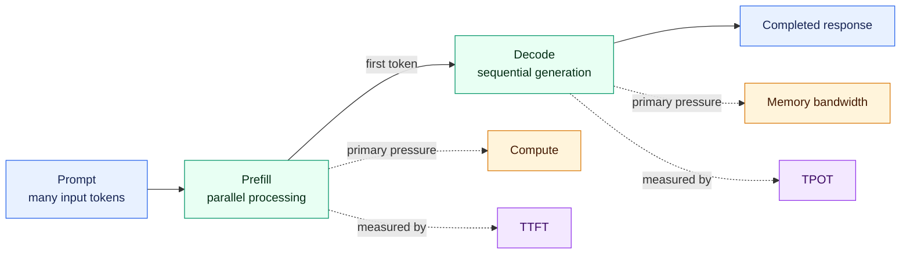

---

# 10. Why KV Cache Is Necessary

Without caching, each newly generated token would require recomputing information about all previous input and output tokens.

That would be extremely inefficient.

During transformer execution, the model calculates Key and Value representations for attention.

These representations can be saved.

The saved state is called:

> **KV cache**

Conceptually, the cache is reused and extended on every decode step:


The KV cache eliminates large amounts of repeated computation.

But it introduces another constraint:

> **KV cache consumes GPU memory.**

The cache is created during prefill and grows as additional output tokens are generated.

---

# 11. KV Cache Connects Context Length to Concurrency

Longer contexts require larger KV caches.

Therefore:


This creates an important relationship:

> **Context length ↔ GPU memory ↔ concurrent serving capacity**

For example, 100 requests with short 2K contexts are a very different workload from 100 requests with 50K contexts.

This is why “number of users” cannot be evaluated without understanding prompt and context lengths.

---

# 12. Prefix Caching

Many production requests share a common beginning.

For example:

```text
Corporate system prompt
+
security instructions
+
same large knowledge document
+
user-specific question
```

A second request may contain the same prefix but a different question.

Without prefix caching, the shared portion is processed repeatedly.

With prefix caching:

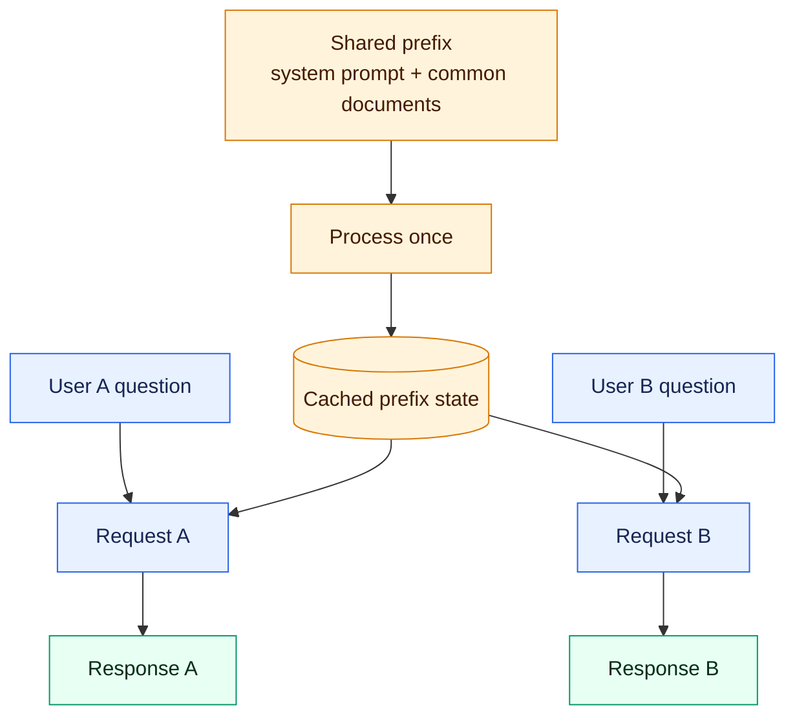

This can reduce repeated prefill computation and improve TTFT.

However, it introduces a distributed-inference problem:

> **cache locality matters.**

If one model server already contains the relevant cached prefix, routing the related request to another server may force the system to recompute the same work.

---

# 13. One GPU Serving Many Users

Serving requests sequentially wastes GPU parallelism.

Instead of:

```text
User A
  ↓
GPU
  ↓
finish

User B
  ↓
GPU
```

multiple active sequences can be processed together:

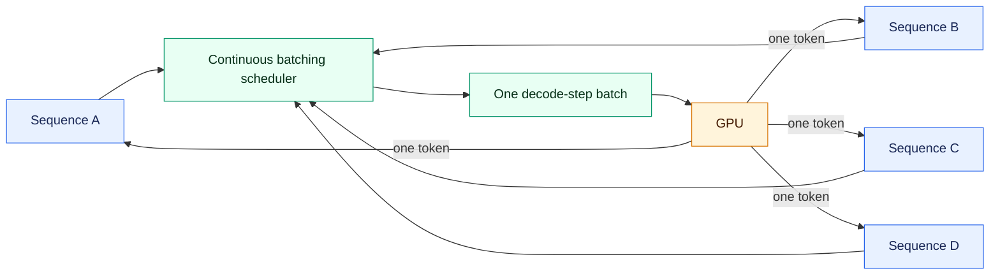

This is batching.

Batching increases:

> **throughput**

because one model execution step can contribute to multiple users simultaneously.

This is a major reason why dedicated inference servers such as vLLM outperform simplistic one-request-at-a-time model execution.

---

# 14. Why Batching Eventually Stops Scaling

Batching improves throughput, but it cannot scale indefinitely.

Every additional active sequence consumes KV-cache memory.

A GPU's memory therefore contains something approximately like:

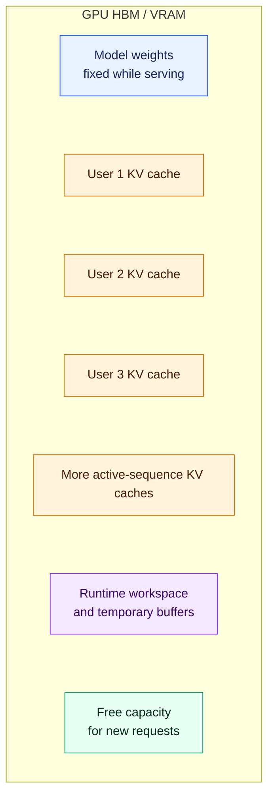

Eventually the remaining memory is exhausted.

This means a GPU can become capacity constrained by memory even if it still has theoretical compute capacity available.

Therefore:

> **Memory capacity determines how many active sequences can coexist.**

This is one of the most important practical limits in LLM serving.

---

# 15. Scaling Beyond One GPU

Large models may not fit into one accelerator.

The model then needs to be distributed across several GPUs.

Conceptually, a single logical model server can shard one model over several
tightly connected GPUs:

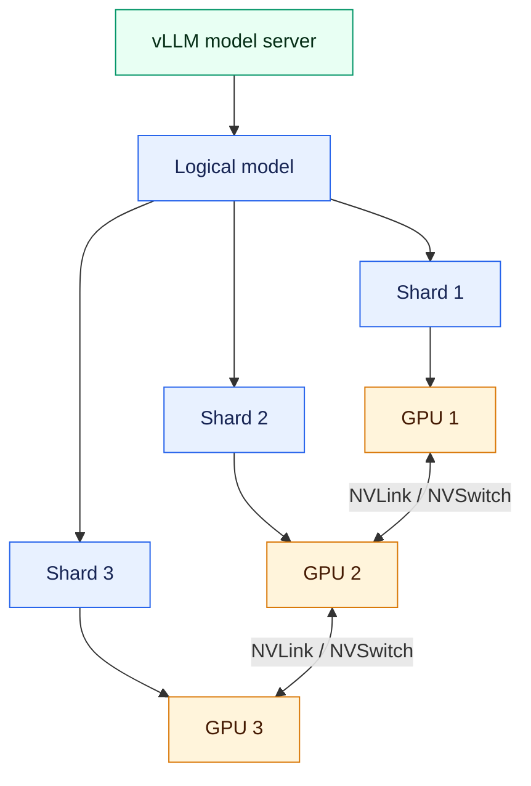

This is commonly implemented using different forms of parallelism or sharding.

Within a single server, technologies such as:

> **NVLink / NVSwitch**

provide high-bandwidth GPU-to-GPU communication.

This makes tightly coupled multi-GPU inference possible.

However, distributed execution introduces communication overhead.

The faster the model requires GPUs to exchange data, the more important the accelerator interconnect becomes.

---

# 16. Scaling Across Servers

When the model or workload extends across several physical machines, the problem becomes even more complex.

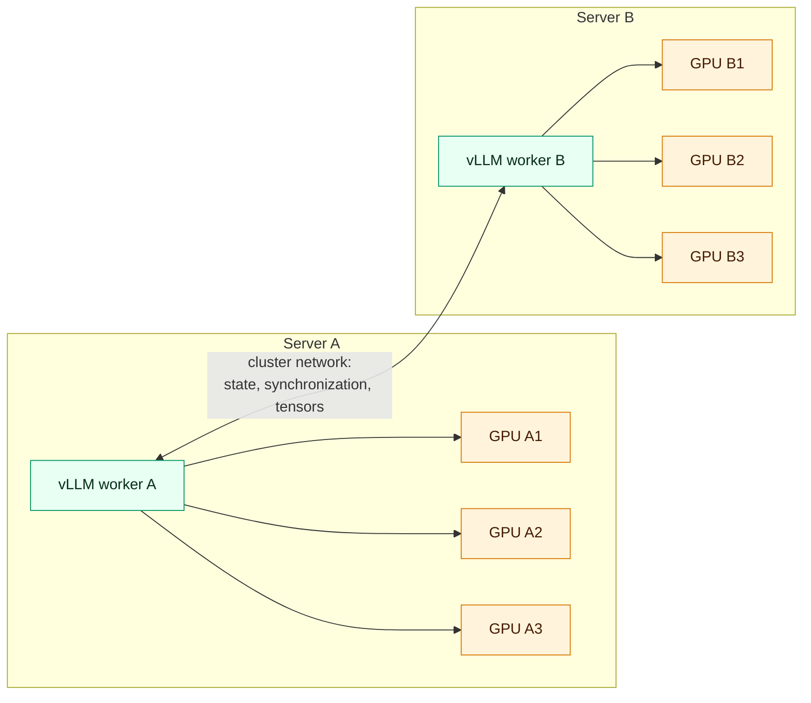

The system must now manage:

* network communication;
* model placement;
* distributed state;
* GPU topology;
* synchronization;
* routing;
* failures.

The logical model server may therefore represent multiple GPUs and multiple physical nodes.

At this point, conventional web-serving assumptions begin to break down.

---

# 17. Why Traditional Load Balancing Is Insufficient

A conventional load balancer may distribute requests using:

```text
Round robin
```

For example:

```text
Request 1 → Server A
Request 2 → Server B
Request 3 → Server C
Request 4 → Server A
```

This works reasonably well when application instances are stateless and equivalent.

LLM servers are not equivalent at every moment.

Each server may have:

* different queue depth;
* different active batches;
* different available KV-cache capacity;
* different prefixes already cached;
* different current GPU utilization;
* different memory pressure.

A routing decision therefore directly affects infrastructure efficiency.

---

# 18. Wrong Routing Can Waste Expensive GPU Capacity

Several important consequences follow.

## Wrong routing wastes GPU work

If a server already contains useful cached context but the next related request is sent somewhere else, the computation may need to be repeated.

## Memory caps the number of users

Even if compute remains available, KV-cache pressure can prevent additional requests from being admitted.

## Cached work creates locality

A follow-up request may be cheaper on a server that already contains relevant cached state.

## Every generated token repeatedly accesses model weights

Decode performance therefore remains heavily dependent on memory bandwidth.

## Model weights already consume a large part of memory

For large models there may be relatively little memory left for concurrent sequences.

These properties make routing part of the inference optimization problem rather than just a networking function.

---

# 19. llm-d as the Distributed Inference Layer

vLLM primarily solves:

> **How do we efficiently serve a model within an inference server?**

llm-d addresses the next problem:

> **How do we efficiently operate and route requests across a distributed fleet of LLM servers?**

Conceptually:

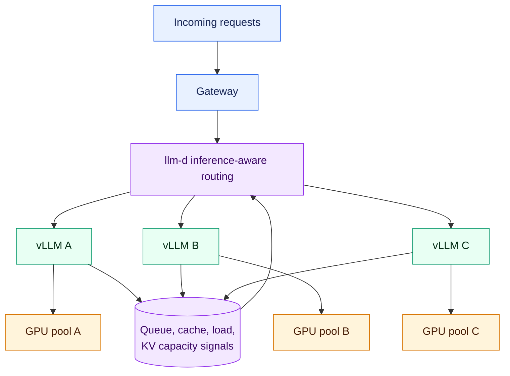

llm-d provides LLM-specific orchestration and routing intelligence beyond what a conventional HTTP load balancer normally understands.

---

# 20. What an LLM-Aware Router Can Consider

Instead of only asking:

> Which server is next?

an inference-aware router can consider several signals.

### Cache locality

Does a backend already contain a relevant prefix or cached state?

### Queue depth

How much work is already waiting?

### Current load

Which model server is less saturated?

### KV-cache pressure

Does the backend have enough remaining cache capacity?

### Expected request cost

Is this a short conversational request or a very large prompt?

Routing can therefore conceptually work like:

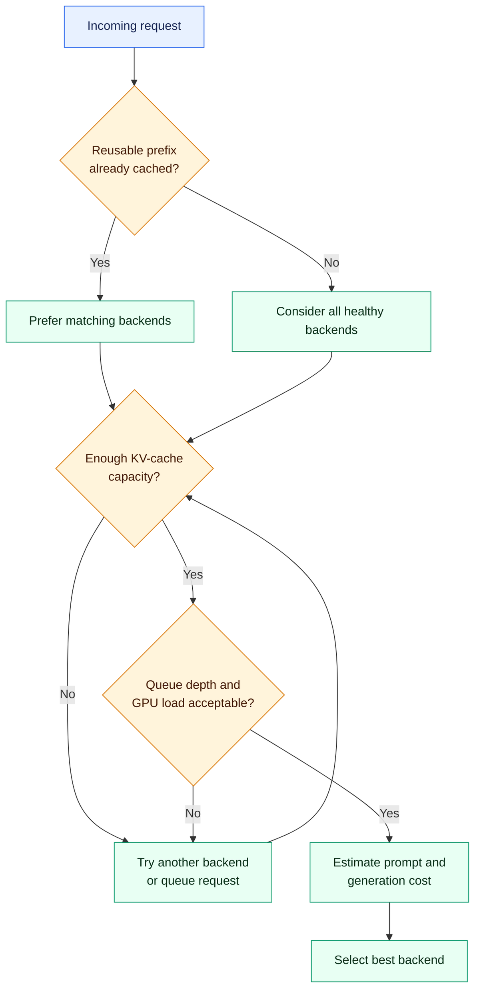

This can reduce unnecessary recomputation and improve effective accelerator utilization.

---

# 21. Well-Lit Paths

llm-d uses the concept of **well-lit paths** for common distributed inference architectures.

The aim is to provide tested patterns for known optimization problems rather than requiring every organization to assemble a distributed serving architecture from scratch.

Relevant examples include:

* intelligent inference routing;
* prefix-cache-aware routing;
* prefill/decode disaggregation;
* distributed inference;
* KV-cache optimization;
* multi-GPU serving.

The idea is to provide a known architectural path for recurring infrastructure problems.

---

# 22. Prefill/Decode Disaggregation

Prefill and decode have different hardware characteristics:

```text
Prefill
→ compute intensive

Decode
→ memory-bandwidth intensive
```

A distributed infrastructure can therefore separate them.

Instead of:

```text
Same GPU pool
├── prefill
└── decode
```

the architecture can become:

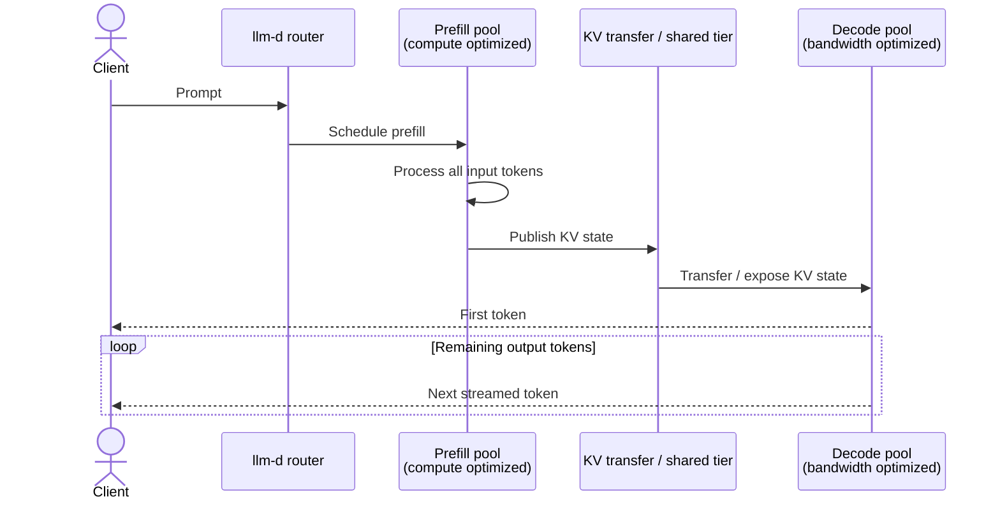

This makes it possible to scale the two phases independently.

For workloads with very large prompts and short answers:

> more prefill capacity may be required.

For workloads with long generated answers:

> more decode capacity may be required.

This is particularly useful when workloads have strongly different prefill/decode characteristics.

---

# 23. Why Kubernetes Becomes Necessary

Once a system contains:

* many GPU nodes;
* many model servers;
* distributed models;
* routing;
* caches;
* scaling;
* failures;
* resource allocation;

it becomes a cluster-management problem.

Kubernetes acts as the infrastructure control plane.

Conceptually:

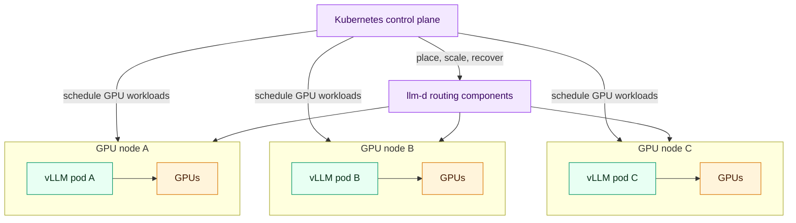

Kubernetes provides capabilities such as:

* scheduling;
* deployment;
* restart and recovery;
* resource allocation;
* scaling;
* lifecycle management.

The responsibilities become:

> **vLLM:** efficient inference inside the model server.

> **llm-d:** intelligent distributed inference across model servers.

> **Kubernetes:** orchestration and management of the underlying infrastructure.

---

# 24. Complete Infrastructure Progression

The overall architecture can be understood as a progression in which each
step exposes the next constraint:


Each layer solves a limitation created by the previous stage.

---

# 25. The Four Main Bottlenecks

The system can be summarized through four main bottlenecks.

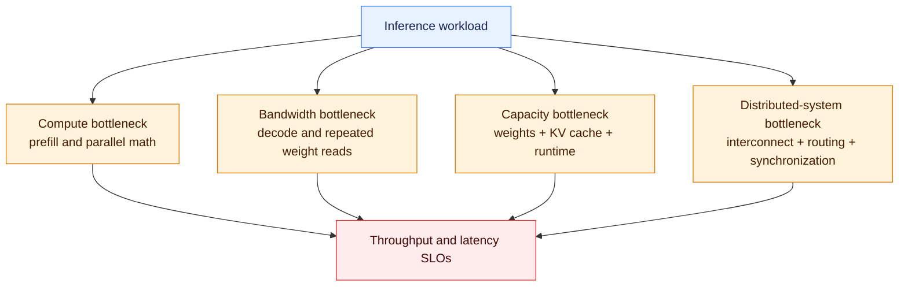

## Compute Bottleneck

Most visible during prefill.

Relevant characteristics:

* Tensor Core performance;
* BF16/FP8/FP4 compute;
* batching efficiency.

---

## Memory-Bandwidth Bottleneck

Particularly important during decode.

Relevant characteristic:

* HBM/GDDR bandwidth.

---

## Memory-Capacity Bottleneck

Driven by:

```text
Model weights
+
KV caches
+
runtime overhead
```

Relevant characteristic:

* total accelerator memory.

---

## Distributed-System Bottleneck

Appears when scaling across:

* multiple GPUs;
* multiple nodes;
* multiple model servers.

Relevant factors:

* interconnect;
* network;
* cache locality;
* routing;
* scheduling;
* synchronization.

---

# 26. Important Metrics

The architecture naturally suggests several benchmark metrics.

## User Experience

### TTFT

Time until the first generated token.

### TPOT

Time required for each generated output token.

### End-to-end latency

Total time until the response is complete.

---

## Capacity

### Output tokens per second

Aggregate generation capacity.

### Concurrent sequences

Number of active inference sequences.

### Requests per second

Useful, but should never be interpreted without token lengths.

---

## Memory

### Model memory

Memory occupied by weights.

### KV-cache utilization

Memory consumed by active inference state.

### Prefix-cache hit rate

Percentage of reusable prefixes successfully reused.

---

## Infrastructure

### GPU utilization

Percentage of accelerator compute being used.

### GPU memory utilization

Pressure on VRAM/HBM.

### Queue depth

Number of requests waiting.

### Routing efficiency

Whether requests are sent to appropriate model servers.

---

# 27. Capacity Is More Than GPU Compute

A useful conceptual equation is:

$$
UsefulCapacity
=
f(
Compute,
MemoryCapacity,
MemoryBandwidth,
ModelSize,
ContextLength,
KVCache,
Batching,
Routing,
Caching,
Interconnect
)
$$

Therefore:

$$
UsefulCapacity \neq PeakTFLOPS
$$

A GPU with higher theoretical compute can still perform poorly for a particular LLM workload if:

* memory bandwidth is limiting;
* the model barely fits;
* KV cache is too small;
* interconnect is slow;
* batching is inefficient;
* routing destroys cache locality.

---

# 28. Implications for User Capacity

The number of users a system can support depends on more than model size.

A simplified memory limit is:

$$
AvailableMemory =
TotalGPUmemory -
ModelWeights -
RuntimeOverhead
$$

The remaining space determines possible KV-cache capacity.

Then:

$$
MemoryConcurrency
\approx
\frac{AvailableKVCapacity}
{KVRequirementPerActiveSequence}
$$

But this is only a theoretical maximum.

Production capacity must also satisfy latency targets.

Therefore:

$$
ProductionConcurrency
=
min(
MemoryLimit,
ComputeLimit,
LatencyLimit
)
$$

A system may technically fit 200 active sequences into memory but only support 80 while maintaining acceptable TTFT and TPOT.

---

# 29. Context Length Must Be Included in Capacity Planning

Two deployments with the same number of users can produce completely different load.

Example:

```text
100 users
×
2K-token context
```

is very different from:

```text
100 users
×
50K-token context
```

Therefore a capacity estimate should always include at least:

* model;
* precision;
* input-token distribution;
* output-token distribution;
* concurrency;
* request rate;
* TTFT requirement;
* TPOT requirement.

Without these variables, “number of supported users” is not a meaningful infrastructure metric.

---

# 30. Practical Benchmarking Approach

A practical benchmark derived from this architecture should progress in stages.

```mermaid
flowchart LR
    S1[1. Single GPU<br/>establish baseline] --> S2[2. Raise concurrency<br/>find saturation]
    S2 --> S3[3. Raise context length<br/>measure KV pressure]
    S3 --> S4[4. Multi-GPU<br/>measure scaling efficiency]
    S4 --> S5[5. Multiple servers<br/>measure fleet throughput]
    S5 --> S6[6. Round robin<br/>routing baseline]
    S6 --> S7[7. LLM-aware routing<br/>measure cache and load gains]
    S7 --> S8[8. Disaggregate<br/>test independent scaling]

    classDef baseline fill:#e8f1ff,stroke:#2563eb,color:#172554
    classDef scale fill:#fff4db,stroke:#d97706,color:#451a03
    classDef optimize fill:#e8fff3,stroke:#059669,color:#052e16
    class S1,S2,S3 baseline
    class S4,S5 scale
    class S6,S7,S8 optimize
```

### Stage 1 — Single Model, Single GPU

Measure:

```text
TTFT
TPOT
output tokens/sec
GPU utilization
VRAM utilization
```

### Stage 2 — Increase Concurrency

Run:

```text
1
2
4
8
16
32
64
128
...
```

Observe where:

* throughput saturates;
* KV cache fills;
* TTFT increases;
* TPOT deteriorates.

### Stage 3 — Increase Context Length

Test:

```text
2K
8K
32K
128K
```

Measure the impact on:

* TTFT;
* KV-cache use;
* concurrency.

### Stage 4 — Multi-GPU

Measure:

* scaling efficiency;
* interconnect overhead;
* throughput.

### Stage 5 — Multiple Model Servers

Establish total cluster throughput.

### Stage 6 — Conventional Routing

Use round-robin as a baseline.

### Stage 7 — LLM-Aware Routing

Introduce:

* cache awareness;
* queue awareness;
* load awareness;
* KV-capacity awareness.

### Stage 8 — Prefill/Decode Disaggregation

Evaluate whether separating the two workloads increases usable throughput or improves latency for the target workload.

---

# 31. Division of Responsibilities

| Infrastructure problem             | Main component      |
| ---------------------------------- | ------------------- |
| Load transformer/model             | PyTorch/runtime     |
| Keep model resident                | vLLM                |
| Expose inference API               | vLLM                |
| Dynamic batching                   | vLLM                |
| KV-cache management                | vLLM                |
| Prefix reuse                       | inference runtime   |
| Model distribution across GPUs     | distributed runtime |
| Manage model-server fleet          | Kubernetes          |
| LLM-aware routing                  | llm-d               |
| Preserve cache locality            | llm-d               |
| Distributed inference optimization | llm-d               |
| Infrastructure lifecycle           | Kubernetes          |
| Restart / rescheduling             | Kubernetes          |

A useful simplification is:

> **vLLM optimizes inference inside a model server.**

> **llm-d optimizes inference across model servers.**

> **Kubernetes manages the infrastructure on which those servers run.**

---

# 32. Final Architectural View

The complete stack can be represented as:

```mermaid
flowchart TB
    USERS[Applications and users] --> API[OpenAI-compatible API / gateway]
    API --> ROUTER[llm-d inference-aware router]

    ROUTER --> A
    ROUTER --> B
    ROUTER --> C

    subgraph FLEET[Distributed inference fleet]
        direction LR
        subgraph A[vLLM server A]
            QA[Scheduler + batching] --> KA[(KV cache A)]
            KA --> GA[GPU group A]
        end
        subgraph B[vLLM server B]
            QB[Scheduler + batching] --> KB[(KV cache B)]
            KB --> GB[GPU group B]
        end
        subgraph C[vLLM server C]
            QC[Scheduler + batching] --> KC[(KV cache C)]
            KC --> GC[GPU group C]
        end
    end

    A & B & C -. queue, load, cache,<br/>and capacity signals .-> ROUTER
    K8S[Kubernetes control plane] -. deploys, schedules,<br/>scales, and recovers .-> ROUTER
    K8S -. manages .-> FLEET

    subgraph HARDWARE[What constrains each GPU group]
        COMP[Compute<br/>prefill]
        MEM[Memory capacity<br/>weights + KV cache]
        BW[Memory bandwidth<br/>decode]
    end
    HARDWARE -. determines usable capacity .-> FLEET

    classDef edge fill:#e8f1ff,stroke:#2563eb,color:#172554
    classDef route fill:#f3e8ff,stroke:#9333ea,color:#3b0764
    classDef serve fill:#e8fff3,stroke:#059669,color:#052e16
    classDef gpu fill:#fff4db,stroke:#d97706,color:#451a03
    class USERS,API edge
    class ROUTER,K8S route
    class QA,QB,QC,KA,KB,KC serve
    class GA,GB,GC,COMP,MEM,BW gpu
```

---

# Conclusion

Efficient LLM infrastructure depends on much more than selecting a powerful GPU.

The complete problem combines:

* accelerator compute;
* memory capacity;
* memory bandwidth;
* model size;
* prompt length;
* KV-cache management;
* batching;
* multi-GPU communication;
* cache locality;
* distributed routing;
* Kubernetes orchestration.

The progression from PyTorch to vLLM, and from vLLM to llm-d, reflects increasing infrastructure complexity.

A simple model can be loaded directly with a machine-learning framework.

A production model requires an inference server.

A large multi-user deployment requires batching and efficient KV-cache management.

A large model may require multiple GPUs.

A fleet of model servers requires intelligent LLM-aware routing.

At cluster scale, Kubernetes provides the orchestration layer underneath the complete system.

The most important practical lesson is therefore:

> **Production LLM performance is determined by how efficiently the infrastructure moves model weights, manages inference state, shares GPU resources and routes work across the cluster—not merely by the theoretical compute performance of the accelerator.**

## Source

KodeKloud, **“AI Infrastructure Explained (GPUs, vLLM, and LLM-D)”**
YouTube, 2026.
https://www.youtube.com/watch?v=hBzUokVYQkI
