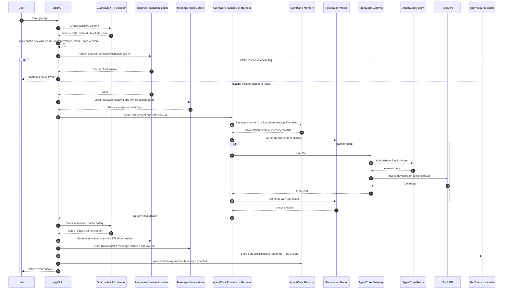
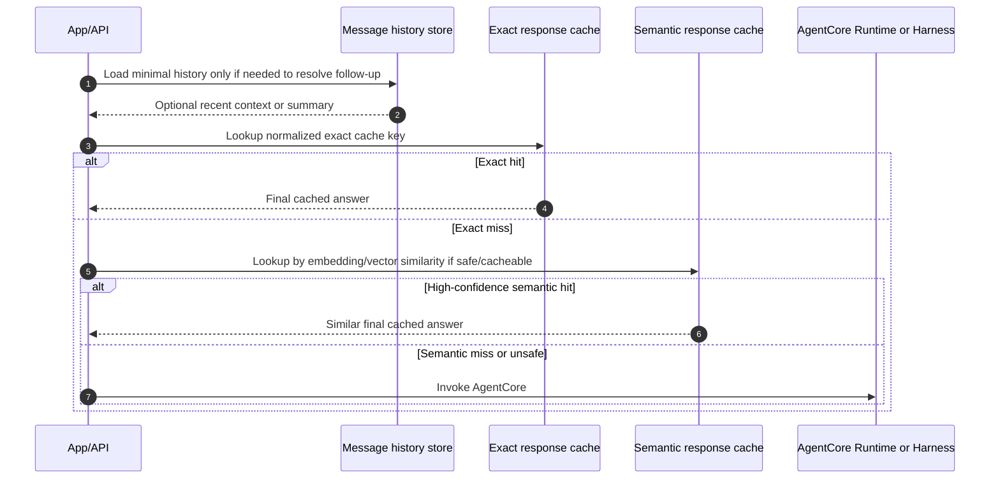
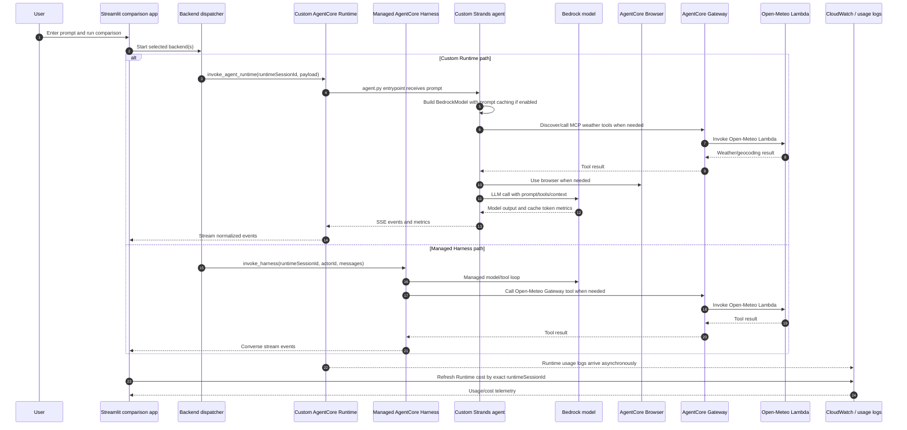
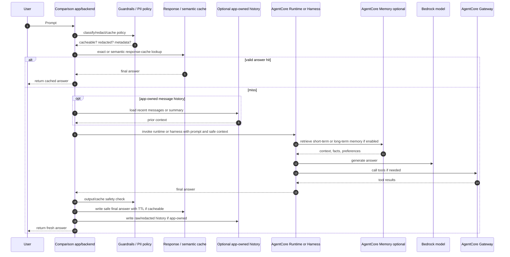

# AgentCore, Memory, And Cache Flow

This note explains the relationship between an application-side cache, AgentCore Runtime or Harness, AgentCore Memory, Gateway, Policy, Guardrails, and prompt caching.

The short version:

```text
Response cache answers: "Do we already have the final answer?"
Message history answers: "What did the user and assistant say before?"
AgentCore Memory answers: "What context or learned facts should the agent remember?"
Prompt caching answers: "Can the model/provider reuse repeated prompt-prefix work?"
AgentCore Gateway answers: "How does the agent reach tools?"
AgentCore Policy answers: "Is this tool call allowed?"
Bedrock Guardrails / app filters answer: "Is this content safe to store, send, or return?"
```

These layers are related, but they are not interchangeable.

---

# 1. General Relationship

## Application Side

The application is the traffic controller. It receives the user message, applies security and cache policy, checks any external cache, invokes AgentCore when needed, and stores safe outputs afterward.

Application-owned pieces can include:

```text
response cache / semantic cache
message history store
tool-result cache
PII detection and cache policy
tenant/user namespace rules
cache key construction
TTL and invalidation rules
```

If an application-side response cache has a valid hit, the app can return the cached answer directly and skip AgentCore and the LLM.

## AgentCore Runtime Or Harness

AgentCore is where the agent runs when there is no valid response-cache hit.

There are two common forms:

```text
AgentCore Runtime
    -> hosts custom agent code
    -> your framework/code owns the loop

AgentCore Harness
    -> managed agent loop
    -> AWS-managed orchestration from configuration
```

In both cases, the agent may call a model, use tools, read memory, and emit traces.

## AgentCore Memory

AgentCore Memory is context storage, not a completed-answer cache.

Do not treat AgentCore Memory as the response cache layer. It should not be the place where the application stores previous final answers and checks whether it can skip AgentCore or the LLM. Use an application-owned response cache, semantic cache, or tool/resource cache for that.

```text
Short-term memory
    -> raw session events and conversation history
    -> useful for multi-turn continuity

Long-term memory
    -> extracted facts, preferences, summaries, and insights
    -> useful across sessions
```

Memory can help the agent answer better, but the agent normally still calls the LLM to generate a fresh response. A memory retrieval is not the same as a response-cache hit.

## AgentCore Memory Versus Other AWS Storage

AgentCore Memory is different from normal AWS storage because it is built for agent context and memory extraction, not just storing bytes or returning cached values.

| Layer | Best Use | What Makes It Different |
|---|---|---|
| AgentCore Memory | Agent context, short-term events, long-term facts/preferences/summaries | Managed memory semantics: `CreateEvent`, `ListEvents`, `RetrieveMemoryRecords`, memory strategies, actor/session/namespace scoping. |
| DynamoDB | Raw chat transcript, session state, checkpoints, audit-friendly records | Cheap and direct key-value/document storage. It stores exactly what your app writes; it does not extract preferences or summaries for you. |
| ElastiCache / Redis / Valkey | Fast response cache, semantic cache index/result store, short-lived session cache | Optimized for low-latency cache hits and TTL. A hit can return a stored final answer and skip AgentCore/LLM. |
| OpenSearch / OpenSearch Serverless | Search-heavy memory or semantic cache with keyword + vector retrieval | Strong search engine behavior, filters, ranking, analytics, and vector search at scale. You still own extraction and cache correctness. |
| MemoryDB | Durable Redis-compatible low-latency data with vector/search use cases | Useful when Redis-style speed matters but data should be more durable than a pure cache. |
| S3 | Large artifacts, logs, files, transcripts, exported evidence | Cheap object storage. Good for files and audit artifacts, not low-latency conversational recall by itself. |
| Relational DB / Postgres / pgvector | Business records plus memory/search that must join transactionally | Useful when memory must sit beside orders, tickets, users, permissions, and SQL business data. |

The practical difference:

```text
External DB/cache:
    stores what the application writes
    can return exact values or cached final answers
    can skip AgentCore/LLM when the cached answer is valid

AgentCore Memory:
    stores events and extracted memory records
    helps build context for the agent
    usually still leads to an LLM call for the final answer
```

## AgentCore Memory Semantic Strategy Versus DIY Semantic Retrieval

Semantic retrieval is not unique to AgentCore Memory. Other stores can also search by meaning if the application stores embeddings and runs vector similarity search.

Examples:

```text
OpenSearch / OpenSearch Serverless:
    vector or hybrid search over documents, prompts, answers, or memory-like records

ElastiCache / Redis / Valkey:
    low-latency semantic response cache or short-lived vector/index lookup

Postgres / pgvector:
    semantic search beside relational business data

Custom vector database:
    semantic retrieval with application-owned schemas and ranking logic
```

The difference is what is managed for you.

```text
AgentCore Memory:
    manages the agent-memory lifecycle
    captures raw events
    stores short-term session history
    extracts long-term memories asynchronously
    consolidates facts, preferences, and summaries
    retrieves relevant memory records semantically
    returns memory/context for the agent to use

Other DBs:
    provide storage, indexing, TTL, search, or vector similarity
    do not automatically know what an agent memory is
    do not automatically extract preferences or summaries
    do not automatically consolidate duplicate or evolving memories
    require the application to build the memory pipeline
```

So the decision is not:

```text
Can this system do semantic search?
```

Many systems can. The better decision is:

```text
Do we need managed agent memory, or do we need app-owned storage/search/cache?
```

| Need | Prefer | Why |
|---|---|---|
| Remember user preferences, facts, and summaries across sessions | AgentCore Memory | It is built around agent memory strategies and semantic memory retrieval. |
| Return a previous final answer for a similar prompt | ElastiCache / Redis / Valkey / external semantic cache | It can sit before AgentCore and skip Runtime/LLM on a safe cache hit. |
| Search documents or knowledge-base chunks | OpenSearch / vector DB / RAG store | The goal is retrieval over source documents, not personal agent memory. |
| Keep exact transcript for UI, audit, export, deletion, or compliance | DynamoDB / relational DB / S3 | The app needs deterministic ownership of the raw record. |
| Join memory-like records with business tables and permissions | Relational DB / Postgres / pgvector | SQL and transactional joins may matter more than managed agent memory. |

If you use another database for agent memory, you own the missing pieces:

```text
event schema
session and actor namespace design
embedding generation
summary extraction
preference/fact extraction
deduplication and consolidation
retention and deletion policy
retrieval thresholds
prompt-injection rules
monitoring and evaluation
```

Do not duplicate the same raw conversation history in both DynamoDB and AgentCore Memory unless there is a clear reason.

A clean split is:

```text
DynamoDB / app database:
    raw transcript
    UI chat history
    audit/compliance records
    deletion and retention workflows

AgentCore Memory:
    extracted user preferences
    durable facts
    summaries
    cross-session agent context
```

Example:

```text
Raw transcript in DynamoDB:
    User said: "I prefer window seats."

Long-term memory in AgentCore Memory:
    Preference: user prefers window seats.
```

That is not a duplicate. It is raw evidence in one system and extracted agent context in another.

## External DB / Cache

An external DB/cache can play multiple roles:

```text
Response cache
    -> stores final answers
    -> can skip AgentCore/LLM on hit

Semantic cache
    -> stores final answers plus embeddings
    -> can skip AgentCore/LLM when a similar-enough prompt is safe to reuse

Message history store
    -> stores raw or redacted chat transcript
    -> usually does not skip LLM; it provides context
    -> AWS examples: DynamoDB, Amazon RDS/Aurora, S3, ElastiCache, OpenSearch
    -> AgentCore short-term memory can be an alternative history source, but not a response cache

Tool/resource cache
    -> stores API/tool/retrieval results
    -> can skip downstream tool calls, but not necessarily the LLM
```

This is why a DB cache can bypass the LLM, while AgentCore Memory usually feeds context into the LLM.

## Guardrails And Policy

Guardrails and policy are different controls:

```text
Bedrock Guardrails / PII filters
    -> inspect message content
    -> detect or mask PII, secrets, unsafe content, prompt attacks

Application cache policy
    -> decides whether to cache raw text, redacted text, metadata only, or nothing

AgentCore Policy
    -> deterministic authorization for Gateway tool calls
    -> checks whether a tool call/action/input is allowed
```

The LLM should not be the final authority for cache safety. The backend should enforce deterministic rules.

---

# 2. General Sequence Diagram

This is the recommended architecture when adding ElastiCache/DynamoDB-style caching in front of AgentCore.



Key point:

```text
Cache hit path:
    prompt -> response/semantic cache -> return previous final answer
    no AgentCore invocation
    no LLM call

Message-history path:
    prompt -> message history store -> prior messages or summary
    app still invokes AgentCore/LLM with that context

AgentCore Memory path:
    prompt -> AgentCore Memory -> context returned
    agent still calls LLM to generate the answer
```

Important clarification:

```text
The message history store is drawn separately from the response cache on purpose.

Response / semantic cache:
    stores final answers
    can skip AgentCore and the LLM

Message history store:
    stores prior messages or summaries
    provides context for follow-up questions
    does not return the final answer by itself
    normally still leads to an AgentCore/LLM call

AgentCore Memory:
    stores short-term events and long-term extracted memories
    retrieves agent context
    normally still leads to an AgentCore/LLM call
```

## Message History Ownership Choice

Steps 9-11 in the diagram only apply when the application owns message history.

If the application owns the transcript:

```text
App/API -> Message history store:
    load recent messages or summary

Message history store -> App/API:
    prior context

App/API -> AgentCore:
    invoke with prompt plus app-loaded context
```

This is useful when the app needs exact transcript control:

```text
UI chat history
audit/export/delete workflows
custom retention
tenant governance
cache-key construction before AgentCore
conversation analytics
```

AWS examples for an app-owned message history store:

| AWS option | Good fit | Notes |
|---|---|---|
| DynamoDB | Most app-owned chat history and session records | Common default for conversation_id + timestamp access patterns, tenant scoping, TTL, and simple scale. |
| Amazon RDS / Aurora PostgreSQL | Chat history that must join with users, tickets, orders, permissions, or other relational data | Useful when SQL joins and transactions matter. |
| Amazon S3 | Long-term transcript archive, exports, compliance evidence, offline analytics | Better for cheap durable storage than low-latency per-turn chat recall. |
| ElastiCache / Redis / Valkey | Very recent conversation context or short-lived session cache | Good for low-latency hot context with TTL, but usually not the source of truth. |
| OpenSearch | Searchable transcripts and support/debug search | Good when operators need keyword/vector search over many conversations. |
| AgentCore short-term memory | Agent-managed session events | Good when AgentCore Memory is the chosen conversation-continuity layer, but it is usually not the UI transcript database or app source of truth. |

Important distinction:

```text
AgentCore short-term memory can store and retrieve conversation events.
The application can query those events and display them if it chooses.

But for a production user-facing chat history, an app-owned store is usually the cleaner source of truth:
    DynamoDB
    RDS / Aurora
    S3 archive plus a hot DB

Use an app-owned store when the UI needs:
    exact display format
    pagination
    message edits/deletes
    export/delete requests
    audit/compliance workflows
    tenant-level access rules

Use AgentCore short-term memory for:
    agent continuity
    session event recall
    feeding long-term memory extraction
```

If AgentCore short-term memory owns the session history, the app does not need to load the history from an external store before invocation.

The flow becomes:

```text
App/API -> AgentCore:
    invoke with prompt plus actorId/sessionId

AgentCore / agent -> AgentCore Memory:
    load short-term events

AgentCore Memory -> AgentCore / agent:
    prior conversation events

AgentCore / agent -> LLM:
    generate answer with memory context
```

So the external message-history step is optional. Use it only when message history is app-owned. If AgentCore Memory is the chosen session-history layer, let AgentCore retrieve short-term memory inside the agent path.

## Cache Lookup Detail

Inside the general "response or semantic cache" step, a production app should usually check cheaper and safer cache layers before more expensive semantic lookup.



This detail is separated from the main diagram because the exact implementation can vary. The rule of thumb is:

```text
exact response cache first
semantic response cache second
AgentCore only after both miss or are unsafe to reuse
```

---

# 3. Our Repo Today

Current repo behavior is narrower than the general target architecture.

In this repository today:

```text
Implemented:
    -> Managed AgentCore Harness invocation
    -> Custom AgentCore Runtime invocation
    -> AgentCore Gateway tools for Open-Meteo
    -> AgentCore Browser
    -> provider-side prompt caching in the custom runtime
    -> token/cache metrics display
    -> Runtime usage-log retrieval for cost display

Not currently implemented:
    -> external response cache
    -> semantic final-answer cache
    -> message-history DB cache
    -> tool-result cache
    -> AgentCore Memory for these comparison runs
    -> Bedrock Guardrails runtime checks in the app path
```

Evidence in this repo:

```text
apps/comparison/backends/runtime.py
    -> calls invoke_agent_runtime(...)

apps/comparison/backends/harness.py
    -> calls invoke_harness(...)

agents/custom/agent.py
    -> builds the Strands agent
    -> passes cache_config, cache_prompt, and cache_tools when prompt caching is enabled
    -> calls agent(prompt)

infrastructure/gateway/deploy.py
    -> updates the managed harness with memory={}
    -> comment says benchmark mode is stateless

docs/mapping.md
    -> says Memory is deliberately disabled and both agents are stateless
```

The current app does not check ElastiCache or DynamoDB before invoking AgentCore. So in the current repo flow, every comparison run invokes the managed harness and/or custom runtime.

---

# 4. Current Repo Sequence Diagram



What is missing from this current sequence:

```text
No "check response cache before AgentCore" step.
No "return cached answer and skip AgentCore" step.
No AgentCore Memory read/write step for these stateless comparison runs.
No app-side Guardrails check before cache write, because there is no app-side cache write yet.
```

---

# 5. If We Add ElastiCache / DB Caching To This Repo Later

The natural insertion point is before AgentCore invocation in the app/backend layer.

Possible insertion points:

```text
apps/comparison/backends/runtime.py
    -> custom-runtime-only cache check before invoke_agent_runtime(...)

apps/comparison/backends/harness.py
    -> managed-harness-only cache check before invoke_harness(...)

apps/comparison/backends/dispatcher.py
    -> shared cache check before either backend is called

apps/comparison/components/comparison.py
    -> UI-level experiment cache, but this is less clean for production logic
```

Recommended general shape:

```text
1. Normalize prompt.
2. Run PII/guardrail checks.
3. Build cache key:
       tenant/user scope
       normalized prompt or embedding
       model id
       prompt version
       tool version
       data-source version
       safety flags
4. Check exact or semantic response cache.
5. If hit and valid:
       return cached final answer
       skip AgentCore
6. If miss:
       invoke AgentCore Runtime/Harness
       collect final answer
       store answer only if cache policy allows it
```

Future sequence:



---

# 6. Cache Versus Memory Decision Table

| Question | Use this layer | Why |
|---|---|---|
| Do we already have the final answer and is it still valid? | Response cache / semantic cache | Can skip AgentCore and the LLM. |
| What did this user say earlier in this thread? | Message history store or AgentCore short-term memory | Provides conversation continuity. |
| What durable fact/preference should the agent remember across sessions? | AgentCore long-term memory | Stores extracted summaries, preferences, and semantic facts. |
| Can the model reuse repeated prompt-prefix work? | Provider prompt caching | Reduces input processing cost/latency but still calls the model. |
| Can we avoid calling the same external API/tool again? | Tool/resource cache | Avoids downstream Gateway/tool/API calls. |
| Is this tool call allowed? | AgentCore Policy with Gateway | Deterministic authorization at the tool boundary. |
| Is this content sensitive or unsafe to store/return? | Guardrails plus app cache policy | Detects sensitive content; app enforces storage decision. |

---

# 7. Practical Rules

Use response/semantic cache before AgentCore only for answers that are safe to reuse.

```text
Good candidates:
    public FAQ answers
    stable documentation answers
    deterministic support-policy answers
    weather/geocoding answers with short TTL and proper time bucket

Bad candidates:
    private user-specific answers
    answers containing PII
    payments, orders, account updates
    medical/legal/financial high-impact advice
    anything where permissions or source data changed
```

Use AgentCore Memory when the agent needs context, not when you simply want to skip the model.

```text
Memory hit:
    retrieve context
    call LLM
    generate answer

Response-cache hit:
    retrieve final answer
    return answer
    skip LLM
```

Use AgentCore Policy for tool access, not for cache correctness.

```text
Policy can block:
    tool not allowed
    action not allowed
    input does not satisfy rule

Policy does not decide:
    whether a previous final answer is still fresh
    whether a semantic hit is truly answer-equivalent
    whether cache TTL is appropriate
```

Use Guardrails and deterministic app rules before storing sensitive messages.

```text
Guardrails / detectors:
    find PII, secrets, unsafe content

App cache policy:
    cache raw
    cache redacted
    cache tokenized
    cache metadata only
    do not cache
```

---

# 8. Sources

- [AWS: Amazon Bedrock AgentCore overview](https://docs.aws.amazon.com/bedrock-agentcore/latest/devguide/what-is-bedrock-agentcore.html)
- [AWS: Host agents or tools with AgentCore Runtime](https://docs.aws.amazon.com/bedrock-agentcore/latest/devguide/agents-tools-runtime.html)
- [AWS: AgentCore Harness](https://docs.aws.amazon.com/bedrock-agentcore/latest/devguide/harness.html)
- [AWS: AgentCore Memory types](https://docs.aws.amazon.com/bedrock-agentcore/latest/devguide/memory-types.html)
- [AWS: AgentCore Memory customer support scenario](https://docs.aws.amazon.com/bedrock-agentcore/latest/devguide/memory-customer-scenario.html)
- [AWS: AgentCore Gateway](https://docs.aws.amazon.com/bedrock-agentcore/latest/devguide/gateway.html)
- [AWS: Policy in AgentCore](https://docs.aws.amazon.com/bedrock-agentcore/latest/devguide/policy.html)
- [AWS: ElastiCache caching strategies](https://docs.aws.amazon.com/AmazonElastiCache/latest/dg/Strategies.html)
- [AWS: OpenSearch k-NN search](https://docs.aws.amazon.com/opensearch-service/latest/developerguide/knn.html)
- [AWS: Bedrock Guardrails sensitive information filters](https://docs.aws.amazon.com/bedrock/latest/userguide/guardrails-sensitive-filters.html)
