# Benchmarking BullSequana Systems: Methods, Metrics and Published Results

*September 18, 2026 - @Mostapha*

> Data snapshot: published system lists and sources available in June 2026.
> Derived values and approximate planning figures are identified as such.

## Summary

Benchmarking BullSequana hardware requires proving four layers in order:
components, the network, standard system benchmarks, and the real workloads for
which the machine was purchased.

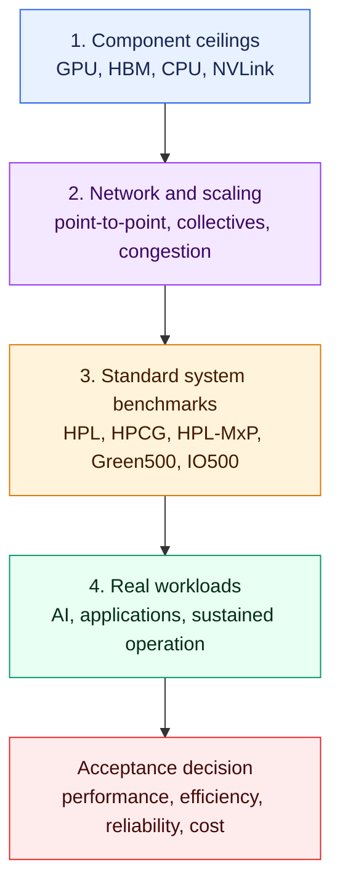

The public record shows that BullSequana XH3000 GH200 systems perform strongly
on HPL and energy efficiency. It currently says much less about AI training at
scale, so buyers must validate their own workloads.

### What Published Results Show

- **HPL:** Approximately 42.5 TFLOP/s per GH200 superchip from ROMEO-2025
  (~232 superchips) through JUPITER (~23,500). JUPITER's 1.000 EFLOP/s makes it
  Europe's first exascale system.
- **Energy:** BullSequana XH3000 systems occupy the first three places in the
  June 2026 Green500, led by KAIROS at 73.28 GFLOP/s/W.
- **HPCG:** Bull systems sit mid-pack among GH200 systems, at approximately
  0.46-0.56 TFLOP/s per superchip. HPCG does not distinguish Bull on its own.
- **Mixed precision:** JUPITER reaches 7.92 EFLOP/s on HPL-MxP, ranked fifth.
- **AI:** Bull did not submit to MLPerf Training v6.0, leaving no public
  like-for-like training comparison.
- **Enterprise:** The eight-socket BullSequana SH81 reports 20,231 SAP HANA BWH
  Phase 2 query executions per hour.

Bull's differentiation must be demonstrated rather than assumed in four areas:

1. inter-node scaling, because each GPU has far less bandwidth to the network
   than to neighboring GPUs inside its node;
2. sustained performance under warm-water cooling;
3. facility-level energy efficiency;
4. reliability at scale.

The RFP section turns these areas into 15 measurable acceptance KPIs.

---

## BullSequana Families and Benchmark Scope

BullSequana is built by Bull, an independent company wholly owned by the French
State since March 31, 2026. It was previously part of Atos Group's Eviden brand,
which is why some TOP500 material refers to "Eviden's BullSequana XH3000" while
listing Bull as the manufacturer.

The correct benchmark depends on the product family and intended workload.

| Family | What it is | Benchmarks that matter |
|---|---|---|
| BullSequana XH3000 | Direct-liquid-cooled supercomputer with CPU or GPU blades, including GH200, H100, and MI300A; BXI or InfiniBand | HPL, HPCG, HPL-MxP, Green500, application suites, and AI training at scale |
| BullSequana XH3500 | Next generation, fanless direct liquid cooling, in-rack CDU, CPUs/GPUs, and several interconnects; basis of Alice Recoque | Same as XH3000, with greater emphasis on AI training and inference |
| BullSequana XH2000 | Previous-generation direct-liquid-cooled platform, including Leonardo and JUWELS Booster | HPL, HPCG, and applications |
| BullSequana AI / X400 | Rack-mounted GPU and HPC servers | Per-node AI tests and GPU microbenchmarks |
| BullSequana SH | Scale-up enterprise server with up to 16 CPUs | SAP HANA BWH and database benchmarks |
| BXI V3 | Bull's HPC and AI interconnect | MPI and collective tests with OSU, NCCL, or RCCL |

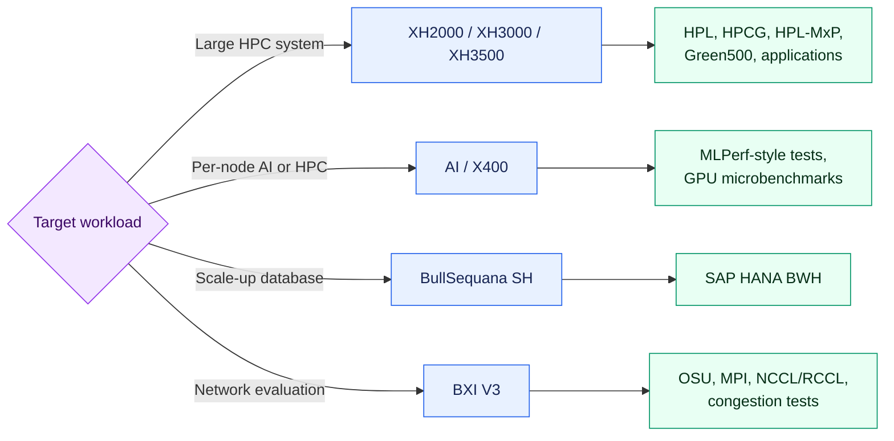

### The XH3000 GH200 Node

A BullSequana XH3000 GH200 node is not an eight-GPU DGX-style system. On
JUPITER, one node contains four GH200 superchips and four 200 Gb/s InfiniBand
NDR200 adapters. Two nodes occupy one blade.

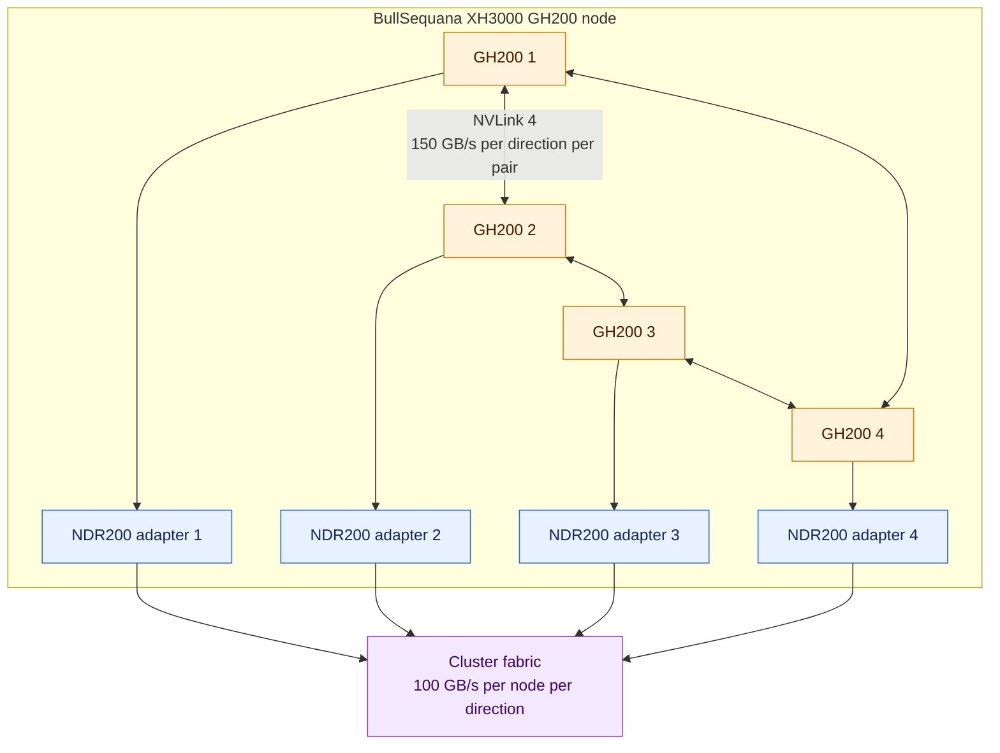

Each GPU has up to 450 GB/s per direction to its node neighbors but only about
25 GB/s to the external network. This 18:1 difference is central to scaling
behavior.

---

## Step 1: Theoretical Peak (Rpeak)

Rpeak is a paper calculation: accelerator count multiplied by the stated peak
FP64 rate per accelerator, plus CPU peak. For GH200, choosing tensor-core or
vector-unit peak changes the answer by roughly 2x, so the convention must be
stated.

| Component | FP64 peak | Basis |
|---|---:|---|
| H100 GPU in GH200, tensor cores | 67 TFLOP/s | NVIDIA GH200 data sheet |
| H100 GPU in GH200, vector units | 34 TFLOP/s | Same data sheet |
| Grace CPU, 72 cores | ~3.46 TFLOP/s | 72 cores x 3.0 GHz x 16 FP64 FLOP/cycle |

The general estimate is:

$$
R_{peak}
\approx
N_{GH200} \times (P_{GPU} + P_{CPU})
$$

ROMEO-2025 has approximately 232 GH200 superchips, derived from 47,328 listed
TOP500 cores divided by 204 cores per superchip: 72 Grace cores plus 132 GPU
streaming multiprocessors.

$$
R_{peak}
\approx
232 \times (67 + 3.46)\ \text{TFLOP/s}
\approx 16.35\ \text{PFLOP/s}
$$

TOP500 lists 16.32 PFLOP/s. The GH200 module is configurable between 450 W and
1,000 W, so systems using the same chip can sustain different clocks.

### Why Rpeak Can Mislead

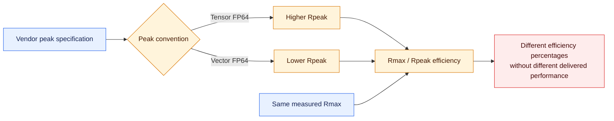

Rpeak conventions vary between sites. ROMEO-2025's Rpeak was restated from
11.20 to 16.32 PFLOP/s without a change in Rmax. Therefore, compare measured
Rmax per accelerator rather than Rmax/Rpeak percentages across systems.

---

## Step 2: HPL and TOP500

HPL solves one large dense linear system, $Ax=b$, using FP64 LU factorization.
The matrix is sized to occupy most system memory, and the best measured rate is
reported as Rmax.

BullSequana XH3000 GH200 systems deliver approximately 42.5 TFLOP/s of HPL per
superchip at both small and exascale size.

| System | Interconnect | GH200, derived | Rmax | Listed Rpeak | Listed efficiency | Rmax/GH200 | TOP500 rank, Jun. 2026 |
|---|---|---:|---:|---:|---:|---:|---:|
| JUPITER Booster | Quad-rail IB NDR200 | ~23,536 | 1,000.00 PFLOP/s | 1,226.28 PFLOP/s | 81.5% | 42.5 TFLOP/s | 5 |
| CEA-HE | Quad-rail BXI v2 | ~2,688 | 90.79 PFLOP/s | 171.26 PFLOP/s | 53.0% | 33.8 TFLOP/s | 29 |
| ROMEO-2025 | Quad-rail IB NDR200 | ~232 | 9.86 PFLOP/s | 16.32 PFLOP/s | 60.4% | 42.5 TFLOP/s | 192 |
| Alps, HPE comparison | Slingshot-11 | ~10,400 | 434.90 PFLOP/s | 574.84 PFLOP/s | 75.7% | 41.8 TFLOP/s | 10 |

GH200 counts are derived from TOP500 core counts at 204 cores per superchip.

The results show:

- **Same delivered performance, different listed efficiency.** JUPITER and
  ROMEO-2025 both achieve 42.5 TFLOP/s per superchip even though their listed
  Rmax/Rpeak percentages are 81.5% and 60.4%.
- **Excellent HPL scaling.** Increasing scale by roughly 100x produces no
  measurable HPL loss per chip. HPL is also one of the easiest workloads to
  scale.
- **A CEA-HE gap that needs investigation.** Its result is about 20% lower per
  chip and uses a different software and interconnect stack. The cause cannot
  be assigned to BXI alone.
- **Published results evolve.** Systems may grow, be retuned, or have reporting
  conventions revised between lists.

JUPITER is the largest BullSequana installation and Europe's first exascale
system. HPL remains a ceiling rather than an application forecast: it is
compute-bound, heavily uses FP64 tensor cores, and places comparatively little
stress on the network.

---

## Step 3: HPCG and HPL-MxP

These benchmarks expose behavior hidden by HPL.

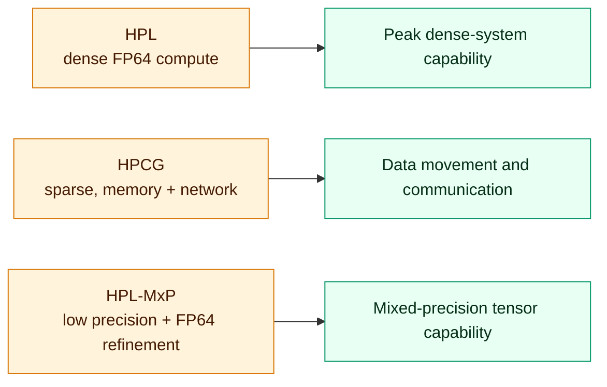

### HPCG: Memory- and Network-Bound

HPCG uses a sparse conjugate-gradient solver. It is constrained by memory
bandwidth and neighbor communication rather than tensor-core throughput.

| System | Vendor and interconnect | GH200, derived | HPCG | HPCG/GH200 | HPCG as % of HPL |
|---|---|---:|---:|---:|---:|
| Discovery 6 | HPE, Slingshot-11 | ~3,952 | 2,580.06 TFLOP/s | 0.65 TFLOP/s | 1.57% |
| Miyabi-G | Supermicro/Fujitsu, IB NDR200 | ~1,088 | 645.13 TFLOP/s | 0.59 TFLOP/s | 1.38% |
| ROMEO-2025 | Bull, IB NDR200 | ~232 | 130.46 TFLOP/s | 0.56 TFLOP/s | 1.32% |
| DAEDALUS | HPE, Slingshot-11 | ~2,016 | 1,132.05 TFLOP/s | 0.56 TFLOP/s | 1.32% |
| CEA-HE | Bull, BXI v2 | ~2,688 | 1,228.00 TFLOP/s | 0.46 TFLOP/s | 1.35% |
| Shaheen III GPU | HPE, Slingshot-11 | ~2,816 | 1,205.84 TFLOP/s | 0.43 TFLOP/s | 0.98% |
| Alps | HPE, Slingshot-11 | ~10,400 | 3,671.32 TFLOP/s | 0.35 TFLOP/s | 0.84% |

BullSequana GH200 systems sit in the middle of the GH200 field. HPCG reflects
the complete machine, MPI stack, problem size, and tuning effort, not only the
chassis or interconnect vendor. JUPITER had not submitted an HPCG result in the
June 2026 list.

### HPL-MxP: Mixed Precision

HPL-MxP factorizes a dense system using FP16, BF16, or FP8, then refines the
solution to FP64 accuracy. It is a useful proxy for exploiting AI tensor cores.

- JUPITER reaches 7.92 EFLOP/s, rank 5, or 7.9x its HPL result.
- El Capitan reaches 16.7 EFLOP/s, a 9.6x speedup.
- The B200-based CHIE-4 reaches a 24.4x speedup, reflecting stronger
  low-precision units in Blackwell-generation hardware.

An AI-focused procurement should request HPL-MxP alongside HPL.

---

## Step 4: Energy Efficiency and Green500

BullSequana XH3000 GH200 systems occupy the top three places in the June 2026
Green500. This is the strongest public evidence that Bull's node and cooling
design adds value beyond the common NVIDIA silicon.

Green500 efficiency is:

$$
\text{energy efficiency}
=
\frac{\text{HPL Rmax}}{\text{average run power}}
$$

ROMEO-2025 submitted a separate energy-optimized run:

$$
\text{TOP500 run:}\quad
9{,}860\ \text{TFLOP/s} / 160.16\ \text{kW}
\approx 61.6\ \text{GFLOP/s/W}
$$

$$
\text{Green500 run:}\quad
8{,}410\ \text{TFLOP/s} / 118.64\ \text{kW}
\approx 70.9\ \text{GFLOP/s/W}
$$

The optimized run trades approximately 15% of performance for 26% less power.

| System | Vendor and accelerator | Green500 rank | GFLOP/s/W |
|---|---|---:|---:|
| KAIROS | Bull XH3000, GH200 | 1 | 73.28 |
| ROMEO-2025 | Bull XH3000, GH200 | 2 | 70.91 |
| Levante GPU extension | Bull XH3000, GH200 | 3 | 69.43 |
| Isambard-AI phase 1 | HPE Cray EX254n, GH200 | 4 | 68.84 |
| AMD Ouranos | Bull XH3000, MI300A | 9 | 66.46 |
| JUPITER Booster | Bull XH3000, GH200 | Outside top 10 | ~63.3, derived |
| Alps | HPE Cray EX254n, GH200 | Outside top 10 | ~61.0, derived |
| CEA-HE | Bull XH3000, GH200, BXI v2 | Outside top 10 | ~51.3, derived |

Three cautions apply:

1. **System size matters.** Efficiency generally falls as systems grow, which
   favors a 46 kW system such as KAIROS over a 15.8 MW system such as JUPITER.
2. **Measurement rigor differs.** Level 1 meters part of a system for part of a
   run; Levels 2 and 3 impose stronger coverage. Compare like with like.
3. **Green500 measures IT power.** It does not capture facility PUE or heat
   reuse, where warm-water cooling may provide additional value.

Procurements should request PUE at the proposed inlet-water temperature as a
separate KPI.

---

## Step 5: Component Microbenchmarks

Before measuring a complete system, verify that each component approaches its
data-sheet ceiling. On a quad-GH200 node, those ceilings differ from an
eight-GPU NVSwitch system.

| Component | Typical tool | Ceiling on a quad-GH200 node |
|---|---|---|
| GPU compute | cuBLAS/cuBLASLt GEMM, single-GPU HPL | 67 TFLOP/s FP64 tensor; 990 TFLOP/s BF16; 1,979 TFLOP/s FP8 dense |
| GPU HBM | BabelStream or GPU STREAM | 4 TB/s with 96 GB HBM3 or 4.9 TB/s with 144 GB HBM3e |
| CPU LPDDR5X | STREAM with OpenMP | ~500 GB/s |
| CPU to GPU, NVLink-C2C | `nvbandwidth`, `gh_benchmark` | 450 GB/s per direction |
| GPU to GPU, NVLink 4 | `nvbandwidth`, `nccl-tests` | 150 GB/s per direction per pair; 450 GB/s per GPU total |
| Node to network | `ib_write_bw`, OSU bandwidth | 4 x 200 Gb/s NDR200 = 100 GB/s per node per direction, or 25 GB/s per GPU |

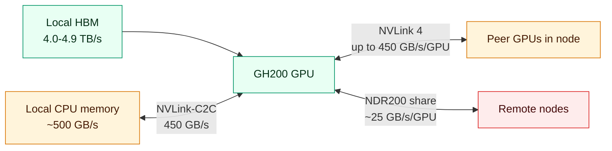

This hierarchy explains why a workload can perform well within one node and
lose efficiency immediately after crossing the network.

### NCCL Correction

The earlier draft used an eight-GPU node and an estimated 760 GB/s NCCL result.
A BullSequana GH200 node has four GPUs. Each Hopper GPU has 18 NVLink 4 links at
25 GB/s, or 450 GB/s per direction in total. Since NCCL `busbw` is designed to
reflect the hardware bottleneck, single-node all-reduce should remain below
approximately 450 GB/s. Record a measured value instead of predicting one.

Independent studies of the same quad-GH200 design show two placement lessons:

- **Placement matters more than memory type.** Collectives slow sharply when
  buffers reside in another superchip's CPU memory. Pin each rank to its local
  superchip before benchmarking.
- **Mixed paths lose efficiency.** Transfers crossing both NVLink-C2C and
  NVLink stayed below 60% of theoretical bandwidth, while GPU reads from local
  CPU memory reached 93%.

---

## Step 6: Interconnect and Scaling

The network is where systems using identical GPUs can diverge most. BullSequana
systems use either NVIDIA InfiniBand or Bull's BXI fabric.

| Fabric | Where used | What to know |
|---|---|---|
| Quad-rail NVIDIA InfiniBand NDR200 | JUPITER, ROMEO-2025, KAIROS, Levante GPU | JUPITER uses DragonFly+: 25 booster groups, fat tree within groups, and more than 11,000 global 400 Gb/s links |
| Quad-rail BXI v2 | CEA-HE | Bull's previous-generation fabric, historically used at CEA |
| BXI V3 | Current product | Ethernet-native with RDMA, atomics, SmartNIC MPI/NCCL/RCCL offload, and congestion management |

Claims that conventional networks leave GPUs idle or that offload removes that
idle time are vendor claims until reproduced on the proposed workload.

### What to Run

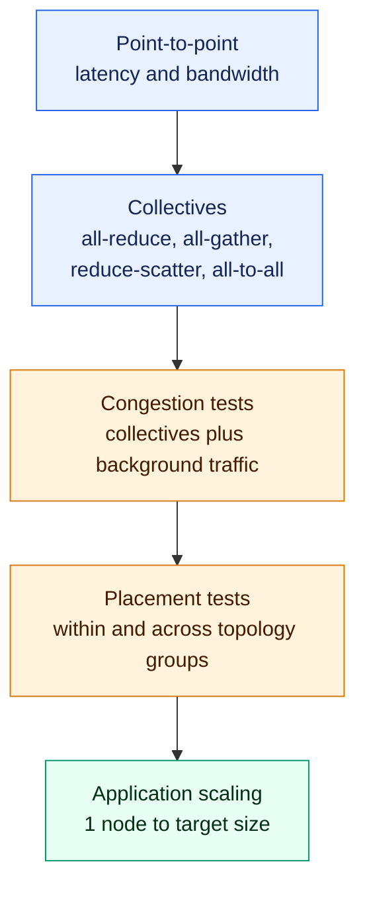

- **Point-to-point:** Use OSU microbenchmarks or `ib_write_bw` with GPU buffers.
  Report latency in microseconds and bandwidth in GB/s.
- **Collectives:** Run `nccl-tests` for all-reduce, all-gather,
  reduce-scatter, and all-to-all from one to $N$ nodes. Include message sizes
  from 8 bytes to several gigabytes. Use OSU MPI collectives for HPC codes.
- **Congestion:** Repeat collectives with background traffic, for example using
  GPCNeT. Production systems are rarely empty.
- **Placement:** Compare jobs within one DragonFly+ group with jobs spread
  across groups. Test adaptive routing and SHARP independently.

### Scaling Efficiency

Start with one BullSequana GH200 node, meaning four GPUs, and double toward the
target scale.

For a fixed problem, strong-scaling efficiency is:

$$
E_{strong}(N)
=
\frac{T_{base} \times N_{base}}
{T_N \times N}
$$

For a problem that grows with system size, weak-scaling efficiency is:

$$
E_{weak}(N)
=
\frac{T_{base}}{T_N}
$$

For AI training throughput:

$$
E_{throughput}(N)
=
\frac{\operatorname{throughput}_N}
{\operatorname{throughput}_{base} \times N/N_{base}}
$$

Illustrative example only: if four GPUs process 100 units/s and 256 GPUs
process 5,400 units/s, then:

$$
E = \frac{5{,}400}{100 \times 64} \approx 84\%
$$

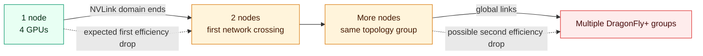

A claim such as "1,000 GPUs" has little meaning without the complete scaling
curve. Given the 18:1 difference between intra-node and external bandwidth per
GPU, expect one efficiency drop when leaving a node and another when leaving a
topology group.

---

## Step 7: Storage and I/O

Storage may be procured separately, but it must be benchmarked from the compute
nodes. JUPITER's main contract included a 21 PB usable flash scratch tier based
on IBM Storage Scale and 40 ESS 3500 units, designed for over 2 TB/s write and
3 TB/s read. Its disk and tape tiers were separate procurements.

IO500 is the standard storage benchmark. Each phase uses a 300-second stonewall
so caches cannot make a brief run look representative.

| Phase | Access pattern | What it represents |
|---|---|---|
| `ior-easy` write/read | One aligned file per process, streaming | Best-case bandwidth in GiB/s |
| `ior-hard` write/read | One shared file with interleaved 47,008-byte records | Worst-case bandwidth |
| `mdtest-easy` | Create, stat, and delete files in one directory per process | Best-case metadata rate in kIOPS |
| `mdtest-hard` | 3,901-byte files in one shared directory | Worst-case metadata rate |
| `find` | Scan all created files for a pattern | Namespace-search speed |

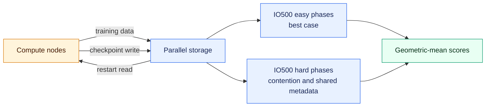

Bandwidth, metadata, and overall IO500 scores are geometric means, so a single
weak phase materially lowers the total. Always examine the hard phases; easy
write bandwidth can exceed hard write by 100x on the same machine.

For AI systems, add:

- **MLPerf Storage:** Determine whether storage can feed training without
  starving accelerators.
- **Checkpoint time:** Measure full write and restart-read time for the largest
  intended training job. Every checkpoint minute is a minute of idle GPUs.

---

## Step 8: AI Training and Inference

For AI buyers, time-to-train and tokens per second matter more than nominal
PFLOP/s. Use MLPerf for comparability and the buyer's own models for relevance.

### MLPerf

MLPerf Training measures wall-clock time to train a reference model to a fixed
quality target under peer-reviewed rules. Version 6.0 added two
mixture-of-experts workloads:

- DeepSeek V3: 671B parameters, 37B active per token;
- GPT-OSS 20B: 21B parameters, 3.6B active per token.

The round included 95 systems from 24 organizations, with 60% using multiple
nodes. Bull was not among the submitters, whereas HPE, Dell, Fujitsu, and
Supermicro were. There is therefore no public MLPerf Training v6.0 result for a
like-for-like BullSequana comparison.

In a procurement, require bidders to run named closed-division MLPerf workloads
on the offered configuration under the official rules. MLPerf Inference applies
the same principle to serving scenarios with fixed accuracy and latency
constraints.

### Representative Workloads

Illustrative Llama scaling and inference values from earlier drafts should not
be treated as evidence. Use a measurement template and populate it from actual
runs.

| KPI | Training | Inference |
|---|---|---|
| Headline throughput | Total and per-GPU tokens/s | Output tokens/s while meeting latency targets |
| Efficiency | Model FLOPs utilization against 990 TFLOP/s BF16 dense per GH200 | Tokens per joule |
| Latency | Step time and variance | TTFT, TPOT, p95, and p99 |
| Scale | Efficiency from four GPUs upward | Maximum concurrency within the latency SLO |
| Reliability | Goodput including checkpoints and restarts | Error rate and tail latency under sustained load |
| Cost | Time and energy for a fixed token budget | Energy per million tokens served |

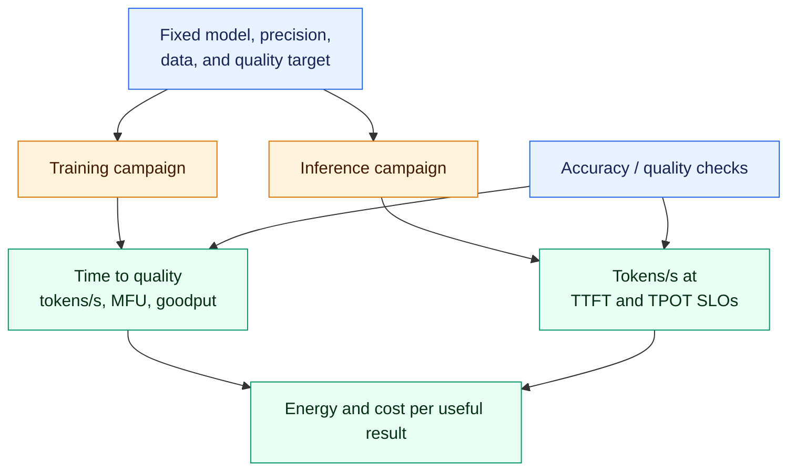

### GH200 Memory Implications

A GH200 superchip with 96 GB HBM3 cannot hold a 70B model in BF16, which needs
approximately 140 GB for weights alone. At least two GPUs are required. FP8
weights need approximately 70 GB and fit on one GPU, but leave limited HBM for
KV cache and runtime state.

The Grace CPU's LPDDR5X memory can hold overflow KV state and is accessible over
NVLink-C2C at up to 450 GB/s. Benchmark inference both with and without this
offload path because capacity gains may come with transfer latency.

GH200 is a Hopper-generation part. A 2026 AI procurement should also compare
Blackwell-class offers. CHIE-4's 24.4x HPL-MxP/HPL ratio versus JUPITER's 7.9x
shows the effect of newer low-precision units, although real AI workloads remain
the final test.

---

## Step 9: Applications, Sustained Load and Reliability

### Application Suites

The JUPITER Benchmark Suite is a strong template because it was developed for
the procurement of the largest BullSequana installation. It combines synthetic
and application benchmarks with build, run, and evaluation instructions. It is
open source and runs through JUBE, which supports reproducible workflows.

Other useful application collections include the Unified European Application
Benchmark Suite and SPEChpc 2021. Every campaign should also include the
buyer's three most important production codes at realistic problem sizes.

### Sustained Performance and Cooling

Cooling performance must be measured, not inferred. GH200 power is configurable
from 450 W to 1,000 W, so sustained clocks depend on power limits and cooling.

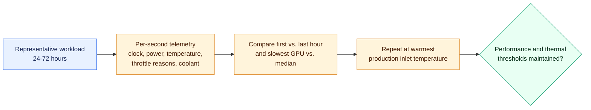

Recommended procedure:

1. Run a representative workload for 24-72 hours.
2. Log each GPU's SM clock, power, temperature, and throttle reasons every
   second with NVIDIA DCGM or `nvidia-smi`.
3. Log coolant inlet and outlet temperatures.
4. Compare the first hour with the last and the slowest GPU with the median.
   In synchronous jobs, the slowest GPU sets the pace.
5. Repeat at the warmest inlet temperature planned for production, because
   warm-water operation enables free cooling and heat reuse.

### Reliability and Goodput

At scale, failures can cost more useful throughput than small performance
differences. During a multi-week acceptance run, track:

- node and GPU failure rates;
- job interruptions per 1,000 node-hours;
- checkpoint restart time;
- service availability;
- successful work completed per unit of wall time.

For AI training:

$$
\text{goodput}
=
\frac{\text{wall time spent making useful progress}}
{\text{total wall time}}
$$

Goodput includes the cost of checkpointing, failures, restarts, and idle time;
raw tokens per second does not.

---

## BullSequana SH: SAP HANA, Not FLOPS

Bull reports that an eight-socket BullSequana SH81 with Intel Xeon 6 processors
reached 20,231 query executions per hour in Phase 2 of SAP HANA BWH. Bull also
states that the SH81 nearly doubles the prior SH80 and provides four times the
minimum required for an SAP HANA class-L system.

BWH has three phases, and Phase 2 alone is insufficient for comparison.

| Phase | What it measures | Question answered |
|---|---|---|
| 1: Data load | Loading, aggregation, transformation, and persistence | How quickly can the system ingest and persist large volumes? |
| 2: Query throughput | Many simple queries in parallel for one hour | What is peak sustained throughput at full load? |
| 3: Complex queries | Complex queries executed one at a time | How fast is single-stream, largely single-threaded work? |

Core count, clock rate, memory capacity and bandwidth, scale-up design, and
storage performance all contribute. Compare results only when they use the same
BWH data-set class and are certified in SAP's benchmark directory.

The general rule applies to every BullSequana family: benchmark the system
against the workload it was designed to execute.

---

## Running BullSequana Against a Competitor

A fair comparison normalizes results per accelerator, per kW, and per euro. It
also turns bid values into acceptance thresholds that must be reproduced on the
delivered system.

The closest like-for-like comparison for a GH200 BullSequana XH3000 is HPE's
Cray EX254n because both use quad-GH200 nodes. NVIDIA DGX uses eight GPUs and
NVSwitch, so comparisons should be made per GPU rather than per node.

### Fifteen KPIs for an RFP

| # | KPI | Unit | How to measure |
|---:|---|---|---|
| 1 | HPL per accelerator | TFLOP/s/GPU | Full-system HPL; Rmax divided by accelerator count |
| 2 | HPL-MxP | EFLOP/s and speedup over HPL | Official HPL-MxP rules |
| 3 | HPCG per accelerator | TFLOP/s/GPU | Full-system HPCG |
| 4 | Energy efficiency | GFLOP/s/W | Green500 method, Level 2 or better |
| 5 | Facility overhead | PUE at stated inlet temperature | Meter at site for 30 days |
| 6 | GPU memory bandwidth | TB/s/GPU | BabelStream on all GPUs; report the slowest |
| 7 | Intra-node collective bandwidth | GB/s `busbw` | `nccl-tests all_reduce` on one node |
| 8 | Inter-node bandwidth and latency | GB/s `busbw`; microseconds | NCCL and OSU from 2 to $N$ nodes with background traffic |
| 9 | Scaling efficiency | % at 64, 256, and 1,024 GPUs | Target LLM or application from a one-node baseline |
| 10 | AI training throughput | Tokens/s/GPU; MFU | Named model, precision, and sequence length |
| 11 | AI inference | Tokens/s at TTFT/TPOT targets | Named model, concurrency, and latency SLO |
| 12 | Application suite | Time to solution per code | JUPITER-style suite including buyer applications |
| 13 | Storage | IO500 scores and checkpoint time | Run from compute nodes at full scale |
| 14 | Sustained performance | First-to-last-hour drop and slowest-GPU spread | 24-72 hour run with telemetry |
| 15 | Reliability | Availability and interruptions per 1,000 node-hours | Multi-week acceptance run |

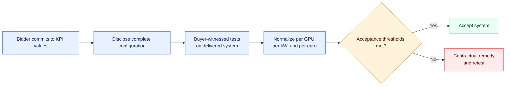

### Rules That Keep Results Honest

1. **Commit, then reproduce.** Bid values become acceptance thresholds, with
   remedies if the delivered system misses them.
2. **Disclose every setting.** Record power caps, clocks, firmware, compiler,
   library and container versions, and numerical precision.
3. **Fix the problem definition.** Use the same model, data, sequence length,
   batch size, and accuracy target for every bidder.
4. **Report distributions.** Provide median and spread from at least five runs,
   excluding warm-up. One favorable run is not a result.
5. **Witness the tests.** Run critical tests through the buyer's queue or with
   buyer staff present, and retain raw logs.
6. **Normalize fairly.** Report per accelerator, per kW, and per euro of total
   cost of ownership, not merely per rack or node.

---

## Corrections to the Original Draft

The original structure and main argument were sound. Most corrections involve
numbers removed from context or a node design borrowed from DGX systems.

| Original claim | Correction | Section |
|---|---|---|
| ROMEO-2025 reached ~60% of theoretical peak | Its Rpeak was restated from 11.20 to 16.32 PFLOP/s, changing 88% to 60% with identical Rmax. It matches JUPITER at 42.5 TFLOP/s/GH200. | Steps 1-2 |
| ROMEO-2025 efficiency was ~61.6 GFLOP/s/W | That is the TOP500 run. The official energy-optimized Green500 result is 70.91 GFLOP/s/W. | Step 4 |
| CEA-HE is "much larger" | It is larger than ROMEO-2025, but JUPITER is the largest BullSequana system and Europe's first exascale machine. | Step 2 |
| Example used 128 GH200 superchips | No cited system has 128. ROMEO-2025 has ~232; always state whether peak uses 67 tensor or 34 vector TFLOP/s. | Step 1 |
| Node had eight H100 GPUs and 760 GB/s | The BullSequana GH200 node has four GPUs and four NDR200 adapters. Hopper NVLink provides up to 450 GB/s per GPU per direction, bounding `busbw`. | Step 5 |
| HPCG isolates Bull engineering | HPCG per GH200 is similar across vendors and measures the full hardware/software stack. | Step 3 |
| GPU thermal example assumed 700 W | GH200 is configurable from 450 W to 1,000 W. Cooling behavior must be measured. | Step 9 |
| Scaling, Llama training, and inference tables contained results | Those values were illustrative. They are replaced by formulas and templates requiring measured data. | Steps 6 and 8 |
| Manufacturer named Bull without context | Bull has been independent and French-State-owned since March 31, 2026; it was formerly part of Atos/Eviden. | Product families |
| SH81 achieved 20,231 queries/hour | Confirmed for SAP HANA BWH Phase 2. Phases 1 and 3 must also be reported. | BullSequana SH |
| CEA-HE HPCG was 1,228 TFLOP/s | Confirmed in the June 2026 HPCG list. | Step 3 |

New material includes HPL-MxP, detailed IO500 methodology, MLPerf submission
status, the JUPITER Benchmark Suite, BXI V3, reliability and goodput, benchmark
integrity rules, and the 15-KPI RFP table.

---

## Sources

All published figures were checked against the following source set in
September 2026. GH200 counts, per-chip results, and efficiency ratios marked as
derived were calculated from those sources.

- TOP500: ROMEO-2025 system page.
- TOP500: CEA-HE system page.
- TOP500: JUPITER Booster system page.
- TOP500: June 2026 highlights for TOP500, Green500, HPCG, and HPL-MxP.
- TOP500: HPCG list, June 2026.
- NVIDIA: GH200 Grace Hopper Superchip data sheet.
- ParTec: JUPITER technical overview.
- Fusco et al., ETH Zurich, CSCS, and NVIDIA: *Understanding Data Movement on
  the Grace Hopper Superchip*.
- `nccl-tests`: performance and `busbw` definitions.
- Bull: French State finalizes the acquisition of Bull.
- Bull: BullSequana XH3500.
- Bull: BXI V3 interconnect.
- Bull: SAP HANA BWH records on BullSequana SH81.
- LLNL ATS-6 benchmarks: IO500.
- MLCommons: MLPerf Training v6.0 results release.
- Juelich Supercomputing Centre: JUPITER Benchmark Suite.
