## Executive Summary

LLM inference can become expensive and slow when applications repeatedly process identical or semantically similar requests. AWS describes caching as a way to reduce redundant model invocations, improve latency, increase throughput, and make outputs more consistent. 

The main architectural decision is:

```text
What exactly are you caching?
```

There are four related caching layers:

```text
Prompt caching
    -> cache reusable prompt prefixes inside the model/provider layer

Message history caching
    -> store conversation turns in your application/session layer

Tool/resource caching
    -> cache tool outputs, API responses, retrieved resources, or files

Request-response caching
    -> cache complete request/response pairs in your application/data layer
```

---

# 1. High-Level LLM Caching Architecture

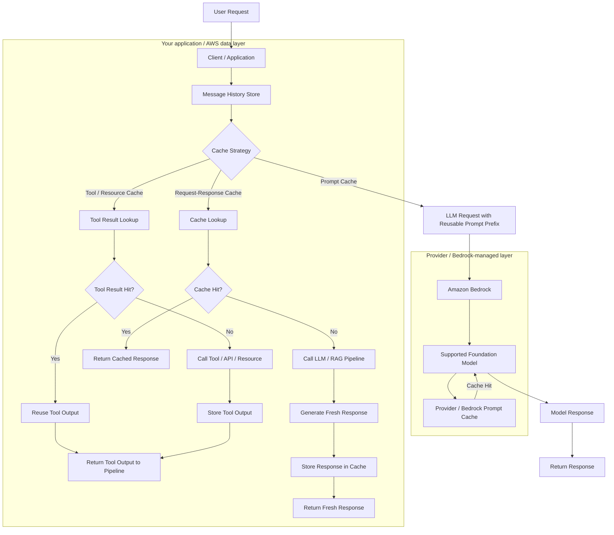

---

# 2. Main Caching Layers

## Prompt Caching

Prompt caching stores reusable prompt prefixes used across multiple model calls.

AWS describes prompt caching on Amazon Bedrock as an optional feature for supported models that can reduce inference latency and input token cost when repeated prompt prefixes are reused. :contentReference[oaicite:2]{index=2}

```text
Reusable prompt prefix
    -> system prompt
    -> persona definition
    -> few-shot examples
    -> static instructions
    -> repeated long context
    -> repeated RAG documents
```

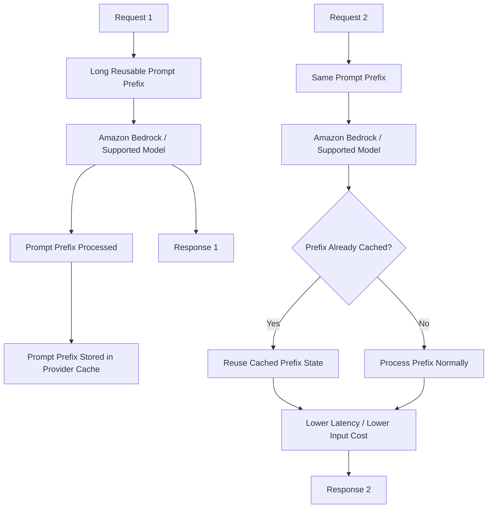

### Mental Model

```text
Prompt cache
    = provider-side optimization

It avoids recomputing repeated prompt prefixes.
It does not usually replace the full LLM call.
It reduces input processing cost and latency.
```

---

## Message History Caching

Message history caching stores the conversation turns for a user, session, or thread so the application can rebuild the relevant chat context before each model call.

This is different from prompt caching, tool/resource caching, and request-response caching:

```text
Prompt caching
    -> provider reuses stable prompt-prefix tokens

Message history caching
    -> application remembers prior user/assistant turns

Tool/resource caching
    -> application reuses a tool result or external resource read

Request-response caching
    -> application reuses a finished answer
```

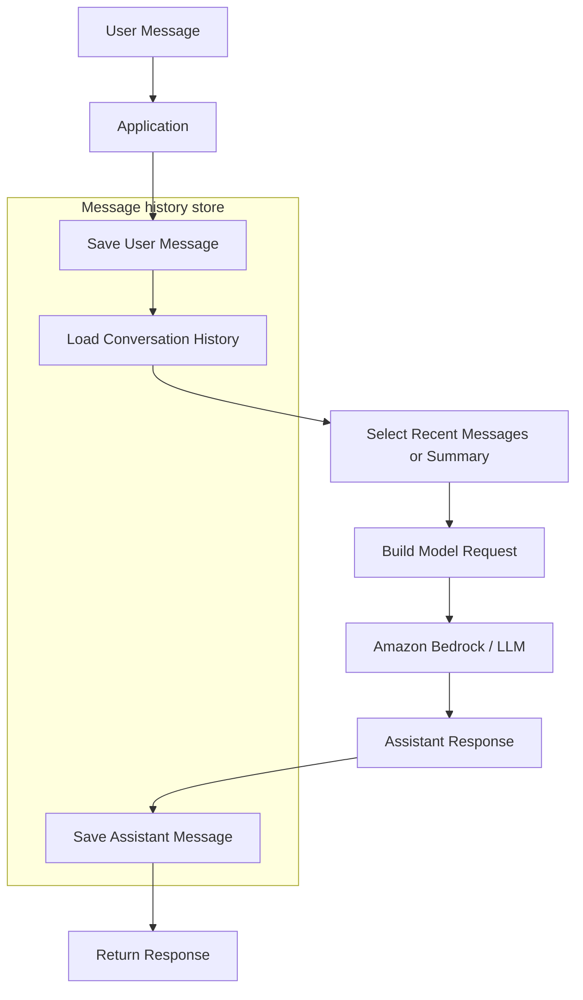

Typical stored shape:

```text
conversation_id = "tenant-123:user-456:thread-789"

messages = [
    {"role": "user", "content": "What is prompt caching?", "created_at": "..."},
    {"role": "assistant", "content": "Prompt caching reuses stable prompt prefixes.", "created_at": "..."}
]
```

## Where Message History Can Live

```text
Redis / ElastiCache
    -> fast, good for short-lived sessions, use TTL

DynamoDB
    -> durable, good for long-lived chat history and audit-friendly access patterns

Relational database
    -> useful when conversation data belongs with existing application records

Browser/session memory
    -> simple, but disappears when the local session ends
```

## Message History Retrieval Pattern

```text
1. User sends a message.
2. Application saves the user message.
3. Application loads prior messages for the same conversation_id.
4. Application selects a safe amount of context:
       - last N messages
       - summary of older messages + recent messages
       - only messages relevant to the current task
5. Application sends that context plus the new message to the model.
6. Application saves the assistant response.
```

Message history should not grow without limits. Long conversations usually need truncation, summarization, or retrieval over prior messages.

## Sensitive Message Handling

Message history often contains private user data. It should be treated as sensitive application data, not as a harmless performance cache.

Example raw message:

```text
User: My email is sarah@example.com, my account number is 123456,
and I need help with my loan payment.
```

Do not put that exact text into a shared cache or broad log stream if the application does not need it there. A safer stored version could be:

```text
User: My email is {EMAIL}, my account number is {ACCOUNT_ID},
and I need help with my loan payment.
```

Or tokenize the sensitive values:

```text
sarah@example.com -> pii_token_email_abc123
123456 -> pii_token_account_xyz789
```

Then keep the token-to-real-value mapping in a protected store with stricter access control, not in the general chat cache.

```text
If messages contain PII, secrets, credentials, health data, financial data,
or tenant-private business data:
    -> minimize what is stored
    -> redact or tokenize sensitive fields when possible
    -> encrypt the store
    -> use short TTLs where appropriate
    -> namespace by tenant/user/conversation
    -> avoid global semantic caches
    -> avoid logging raw prompts and raw messages
```

For highly sensitive content, the safest cache decision may be:

```text
do not cache the raw message
```

For example:

```text
Do not cache:
    "My password is ..."
    "My card number is ..."
    "Here is my medical diagnosis ..."

Cache safer metadata instead:
    conversation_id
    message_type = "payment_support"
    pii_detected = true
    raw_message_cached = false
```

---

## Tool / Resource Caching

Tool/resource caching stores the result of an expensive or repeated tool call so the agent does not fetch the same resource again.

It is an application/tool-side cache. It is not the same as provider prompt caching, even when the cached tool output later appears inside the model prompt.

```text
User asks a question
    ↓
Agent decides to call a tool
    ↓
Tool/resource cache lookup
    ↓
If hit:
    reuse cached tool result

If miss:
    call tool/API/resource
    store result with TTL and metadata
    return result to agent
```

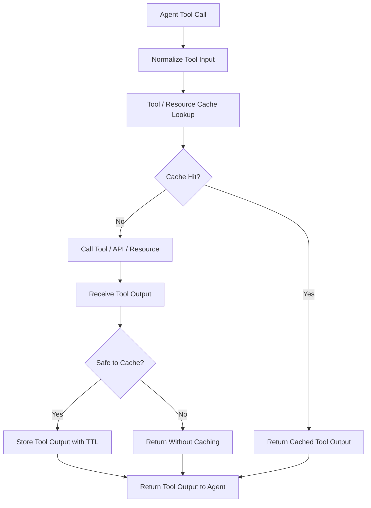

Examples:

```text
weather API response for a city and time bucket
geocoding lookup for a location name
inventory or pricing read with short TTL
retrieved document chunks
web page HTML or extracted markdown
browser screenshot or page snapshot
tool catalog/schema fetches, when stable
large resource read or generated file metadata
```

Good cache key shape:

```text
tool_cache_key =
    tool_name
    + normalized_tool_input
    + tenant/user permission scope
    + resource version, ETag, or timestamp bucket
    + tool schema version
    + prompt/model version if the output depends on them
```

## Tool / Resource Cache Safety

Only cache idempotent reads by default.

```text
Safe candidates:
    -> read weather
    -> read product details
    -> retrieve document chunks
    -> geocode a location
    -> fetch a public web page

Usually unsafe to cache as a reusable result:
    -> submit payment
    -> create order
    -> update ticket
    -> send email
    -> write to CRM
    -> any permission-sensitive result without user/tenant scoping
```

Tool/resource caching helps reduce:

```text
Gateway/tool calls
external API calls
RAG retrieval calls
browser/page-fetch work
agent runtime duration
latency
```

But it creates a freshness risk. Use short TTLs for changing resources and invalidate when the underlying data changes.

---

## Request-Response Caching

Request-response caching stores previously generated answers and returns them directly when the same or similar request appears again. AWS describes this as storing request/response pairs so subsequent matching requests can be answered without reprocessing the request. :contentReference[oaicite:3]{index=3}

```text
User question
    ↓
Cache lookup
    ↓
If hit:
    return cached answer
    skip LLM call

If miss:
    call LLM
    store answer
    return answer
```

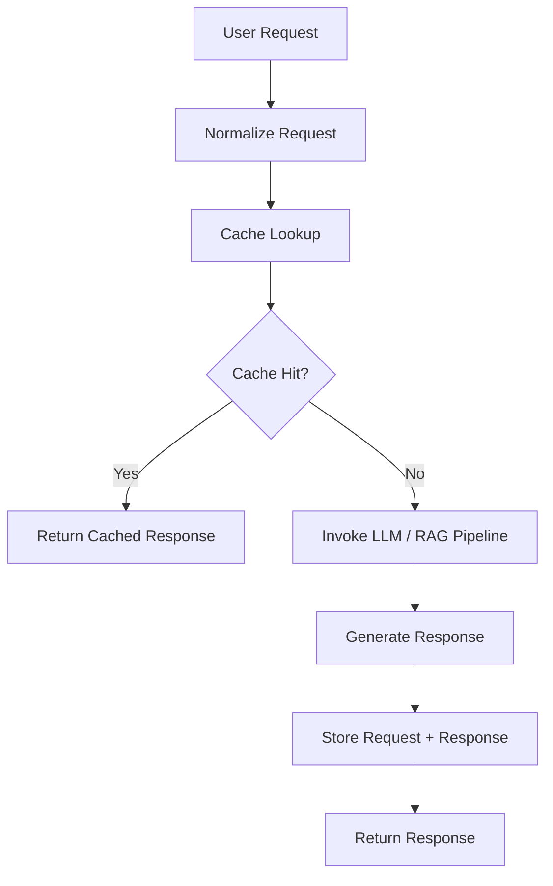

### Mental Model

```text
Request-response cache
    = application-side optimization

It can fully bypass:
    - LLM inference
    - RAG retrieval
    - tool calls
    - downstream processing
```

---

# 3. Prompt Cache vs Message History Cache vs Tool Cache vs Response Cache

| Dimension | Prompt Caching | Message History Caching | Tool / Resource Caching | Request-Response Caching |
|---|---|---|---|---|
| Cached object | Prompt prefix / model input prefix | User and assistant conversation turns | Tool outputs, API responses, retrieved resources | Full request and generated response |
| Location | Provider / Bedrock model layer | Your application, session store, or database | Tool wrapper, application, cache, or data layer | Your application or database layer |
| Cache hit result | Model skips recomputing prefix | Application can reconstruct conversation context | Agent reuses tool output instead of calling downstream system | Application skips LLM call entirely |
| Best for | Long repeated instructions, examples, context | Multi-turn conversations and continuity | Repeated reads from tools, APIs, RAG, browser, files | Repeated questions, FAQs, deterministic outputs |
| Control over invalidation | Limited / provider-defined | Full application control | Full application control | Full application control |
| Typical benefit | Lower input-token cost and latency | Better continuity without relying on model memory | Fewer tool calls, lower latency, shorter agent sessions | Lowest latency and largest cost reduction for hits |
| Risk | Prefix must match supported cache behavior | PII exposure, excessive context growth, stale conversation state | Stale external data, unsafe reuse of permission-sensitive results | Stale or wrong responses if invalidation is weak |

---

# 4. Request-Response Cache Types

AWS describes several ways to implement request-response caching, including in-memory, disk-based, and external database-backed caches. :contentReference[oaicite:4]{index=4}

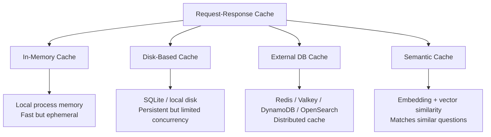

---

# 5. In-Memory Cache

In-memory caching stores cached responses in memory for very fast access.

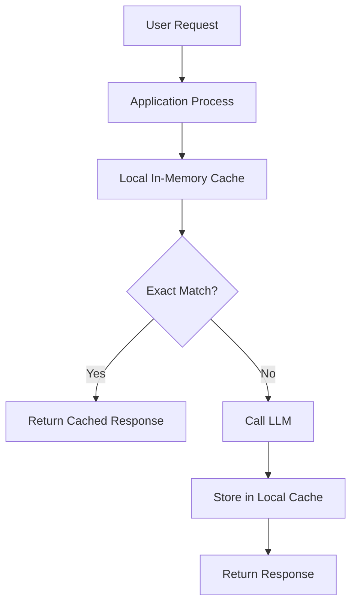

## Best For

```text
development
experimentation
single-process applications
short-lived repeated calls
```

## Limitations

```text
not shared across servers
lost when process restarts
not ideal for distributed production workloads
```

---

# 6. Disk-Based Cache

Disk-based caching stores prompt-response pairs on local disk, for example with SQLite.

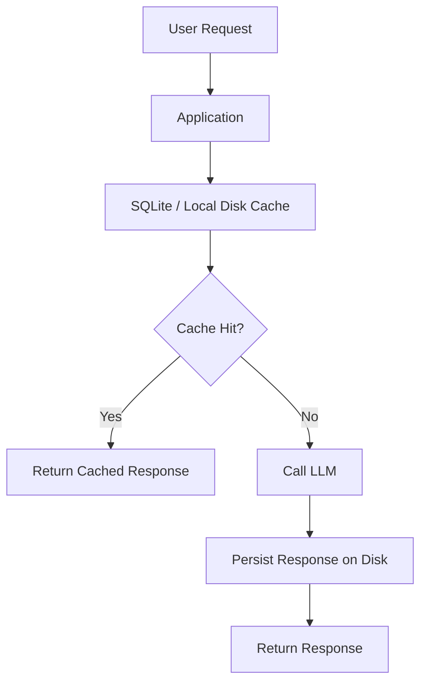

## Best For

```text
single-user tools
moderate traffic
local applications
small-scale prototypes
```

## Limitations

```text
disk I/O overhead
locking contention
weaker fit for high concurrency
not ideal for horizontally scaled services
```

---

# 7. External Database Cache

For distributed production systems, AWS recommends external cache/database layers when multiple machines, processes, or threads need shared access to cached data. The blog mentions options such as Amazon ElastiCache for Redis OSS and Valkey, Amazon OpenSearch Service, and Amazon DynamoDB.       

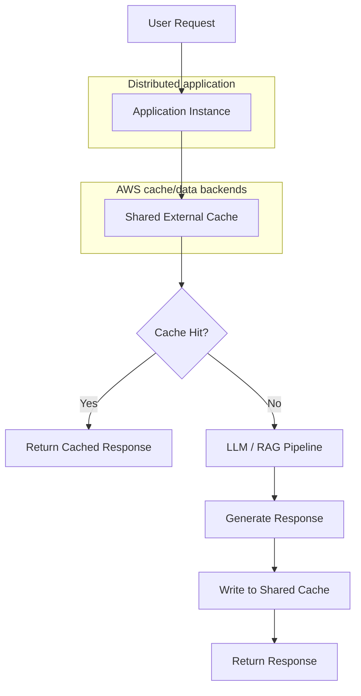

## Possible Backends

```text
Amazon ElastiCache for Redis OSS / Valkey
Amazon MemoryDB
Amazon DynamoDB
Amazon OpenSearch Service
Amazon OpenSearch Serverless
SQLite for smaller local use cases
```

---

# 8. Semantic Cache Architecture

Semantic caching stores embeddings of user requests and retrieves cached responses based on vector similarity, not only exact string matching. AWS notes that semantic caching can increase hit rates for natural language applications, but adds embedding computation overhead and requires careful similarity thresholds. :contentReference[oaicite:6]{index=6}

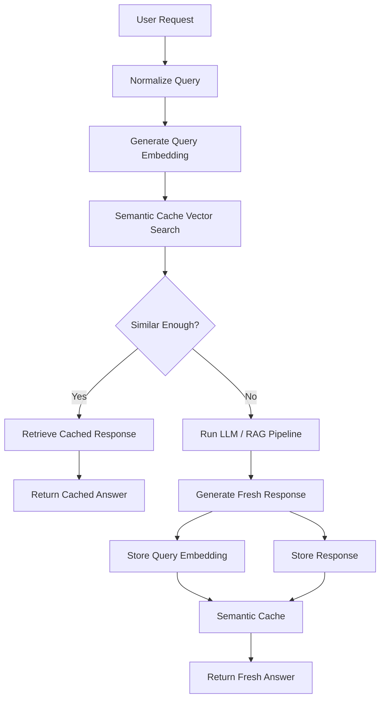

## Semantic Cache Key

```text
cache key
    = embedding(query)
    + tenant/domain namespace
    + model/config version
    + optional metadata filters
```

## Similarity Decision

```text
If similarity_score >= threshold:
    return cached response

Else:
    call LLM/RAG pipeline
```

## Main Risk

```text
A semantically similar query is not always answer-equivalent.
```

Example:

```text
"What is the refund policy for EU customers?"
"What is the refund policy for US customers?"
```

These are semantically close, but may require different answers.

---

# 9. Multilayer Caching Architecture

AWS recommends that caching is not necessarily an either-or decision. Multiple caching approaches can be combined in a layered design. :contentReference[oaicite:7]{index=7}

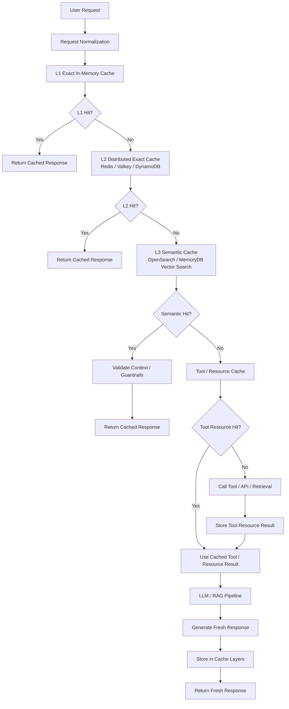

## Example Layering

```text
L1 cache
    -> local memory
    -> exact repeated calls
    -> fastest but ephemeral

L2 cache
    -> Redis / Valkey / DynamoDB
    -> shared exact cache
    -> good for distributed systems

L3 semantic cache
    -> OpenSearch / MemoryDB vector search
    -> similar natural-language queries
    -> higher hit rate but requires validation

Tool/resource cache
    -> Redis / Valkey / DynamoDB / S3 / tool-local cache
    -> repeated tool outputs, API responses, and retrieved resources
    -> lowers tool calls, retrieval load, and agent session duration

Prompt cache
    -> Bedrock/provider model layer
    -> repeated prompt prefixes
    -> lower token cost and latency
```

---

# 10. Caching with RAG

Caching can be applied before, inside, or after a RAG pipeline.

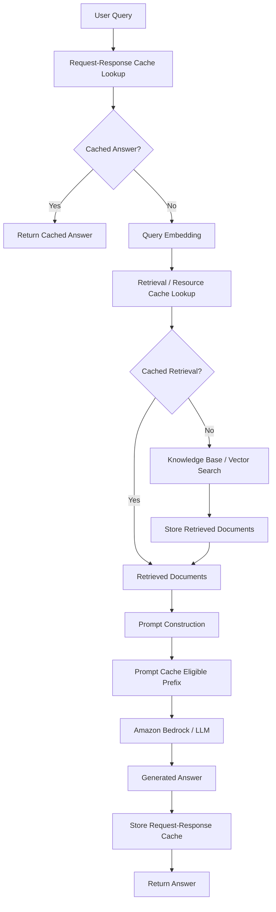

## RAG Cache Placement

| Cache Layer | Placement | Purpose |
|---|---|---|
| Request-response cache | Before retrieval | Avoid retrieval and LLM entirely |
| Embedding cache | Before vector search | Avoid recomputing query embeddings |
| Retrieval cache | Before or after vector search | Reuse retrieved document sets |
| Tool/resource cache | Around tools, APIs, browser fetches, files, or resource reads | Avoid repeated downstream calls |
| Prompt cache | During model invocation | Reuse static prompt prefixes |
| Response cache | After generation | Reuse final answers |

---

# 11. Cache Invalidation Strategies

Caching improves performance, but stale data can create incorrect answers. AWS highlights cache invalidation and expiration as key mechanisms for maintaining freshness and integrity. :contentReference[oaicite:8]{index=8}

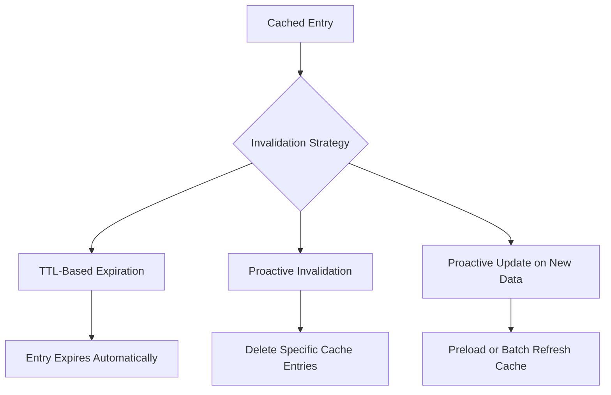

---

## TTL-Based Invalidation

TTL means every cache entry has an expiration time.

```text
cache_entry = {
    query,
    response,
    created_at,
    expires_at
}
```

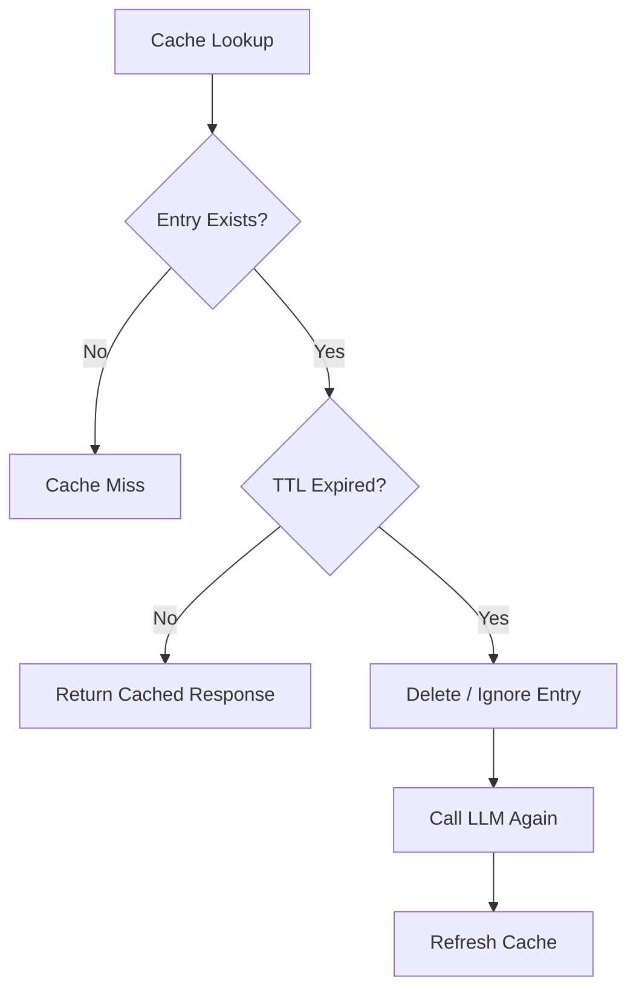

## TTL Guidance

```text
rapidly changing data
    -> short TTL, minutes

moderately changing data
    -> TTL, hours

static reference data
    -> longer TTL, days
```

AWS also recommends adding jitter to TTL values to avoid many popular entries expiring at exactly the same time and creating a burst of backend LLM traffic. :contentReference[oaicite:9]{index=9}

```text
effective_ttl = base_ttl + random_jitter
```

---

## Proactive Invalidation

Proactive invalidation deletes selected cache entries when source data changes.

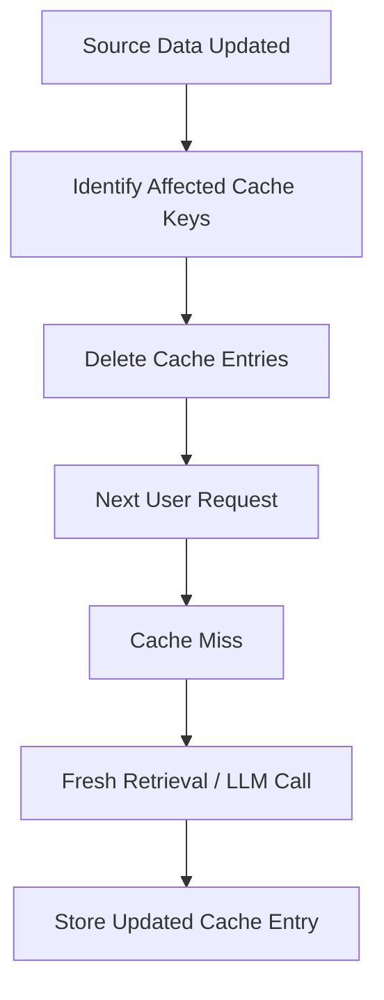

## Examples

```text
knowledge base document updated
policy changed
cached answer found to be wrong
sensitive data accidentally cached
model prompt version changed
tool schema or resource version changed
downstream API data changed
```

---

## Proactive Update on New Data

Instead of waiting for a miss, cache entries can be precomputed or refreshed after new source data arrives.

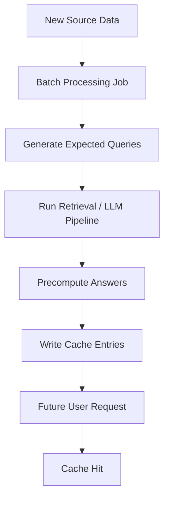

## Best For

```text
frequently asked questions
high-traffic support intents
known product or policy updates
regional customer-service knowledge
```

---

# 12. Guardrails and Cache Safety

AWS emphasizes that guardrails and validation are especially important because cached data persists and may be reused across future requests. :contentReference[oaicite:10]{index=10}

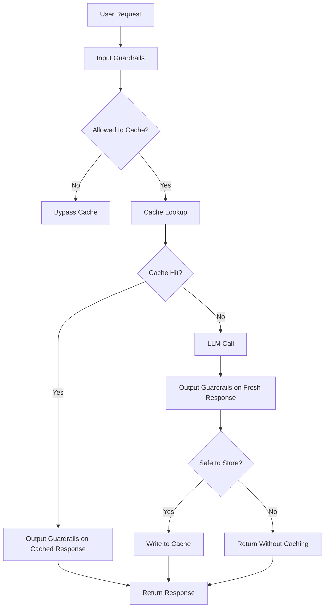

## Do Not Cache Without Controls

```text
PII
secrets
credentials
private customer data
regulated data
tenant-specific sensitive answers
unsafe model outputs
unvalidated tool results
```

---

# 13. Context-Specific Cache Segregation

For multi-domain or multi-tenant systems, similar questions can require different answers depending on context. AWS recommends segregating cache entries by domain context using namespaces, indices, or partitions. :contentReference[oaicite:11]{index=11}

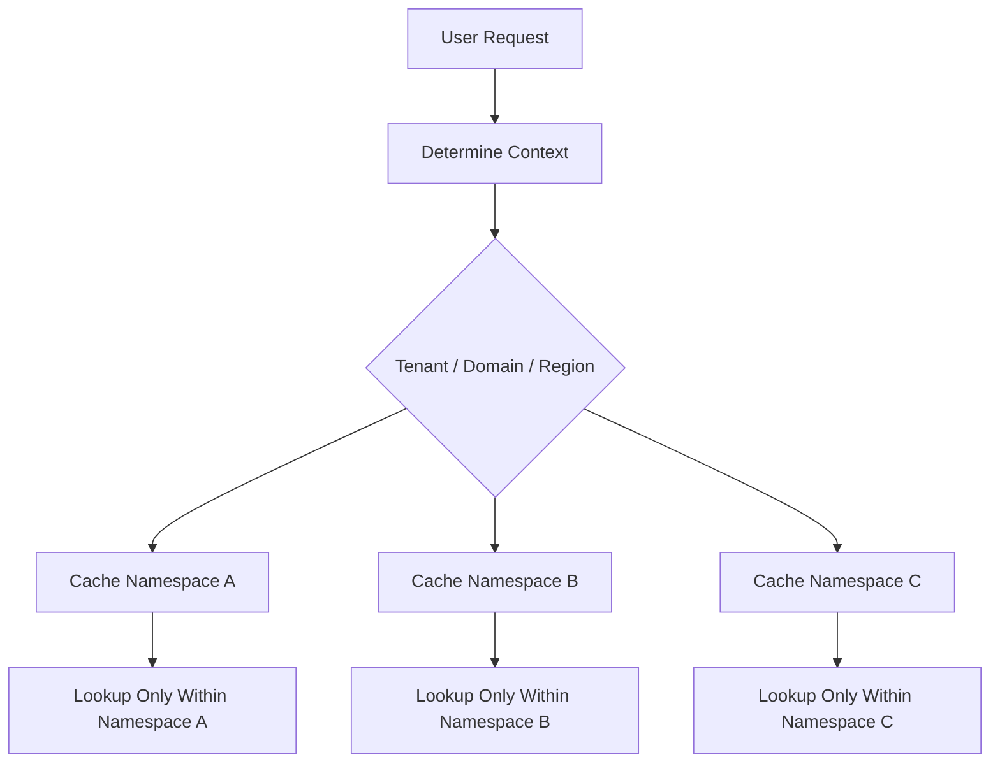

## Cache Namespace Design

```text
cache_namespace =
    tenant_id
    + application_id
    + region
    + language
    + knowledge_base_version
    + model_id
    + prompt_version
```

This prevents cross-contamination such as:

```text
same question
different customer
different answer
```

---

# 14. Production Cache Metadata

A production LLM cache entry should not store only the query and answer.

```text
cache_entry = {
    "cache_key": "...",
    "query": "...",
    "query_embedding": [...],
    "response": "...",
    "tool_outputs": [...],
    "tool_versions": [...],
    "model_id": "...",
    "prompt_version": "...",
    "temperature": 0.0,
    "tenant_id": "...",
    "domain": "...",
    "source_document_versions": [...],
    "created_at": "...",
    "expires_at": "...",
    "similarity_threshold": 0.92,
    "guardrail_status": "passed"
}
```


---

# 15. When to Use Each Strategy

| Use Case | Recommended Cache |
|---|---|
| Long repeated system prompt | Prompt cache |
| Multi-turn conversation continuity | Message history cache |
| Repeated tool/API/resource reads | Tool/resource cache |
| Repeated exact user questions | Exact request-response cache |
| Similar natural-language questions | Semantic cache |
| Development/testing repeated calls | Local in-memory cache |
| Single-user local app | SQLite cache |
| Distributed production app | Redis / Valkey / DynamoDB / OpenSearch |
| RAG over stable documents | Retrieval/tool-resource cache + response cache + prompt cache |
| RAG over frequently changing data | Short TTL + proactive invalidation |
| Multi-tenant assistant | Namespace-isolated cache |

---

# 16. Cost and Latency Impact

## Cache Hit Path

```text
User request
    ↓
Cache lookup
    ↓
Return cached response
```

Expected behavior:

```text
lowest latency
lowest model cost when response cache hits
no LLM invocation for request-response or semantic response cache hit
no downstream tool/API call for tool-resource cache hit
```

## Cache Miss Path

```text
User request
    ↓
Cache lookup
    ↓
LLM / RAG pipeline
    ↓
Store result
    ↓
Return response
```

Expected behavior:

```text
normal latency
normal model cost
cache populated for future reuse
```

AWS notes that effective caching can reduce redundant API calls, improve response times, increase scalability, and improve consistency. :contentReference[oaicite:12]{index=12}

---

# 17. Best-Practice Checklist

```text
Use prompt caching for long repeated prefixes.
Use message history caching for multi-turn conversation continuity.
Use tool/resource caching for repeated idempotent reads.
Use request-response caching for repeated stable answers.
Use semantic caching only with strong thresholds and validation.
Separate cache namespaces by tenant, domain, region, language, and model version.
Add TTLs to all cache entries.
Add TTL jitter to avoid synchronized cache expiry.
Invalidate cache entries when source data changes.
Do not cache raw PII, secrets, credentials, or unsafe outputs.
Do not cache side-effecting tool calls as reusable results.
Run guardrails before reading from and writing to cache.
Track cache hit rate, miss rate, latency, stale-hit rate, and cost savings.
Only add caching where hit rate justifies complexity.
```

AWS gives a practical heuristic: if caching cannot apply to at least about 60% of system calls, the added complexity may outweigh the benefit. :contentReference[oaicite:13]{index=13}

---

# 18. Final Mental Model

```text
Prompt cache
    = provider-side cache
    = reduces repeated prompt-prefix processing
    = still usually involves model invocation

Message history cache
    = application-side conversation store
    = remembers prior user and assistant turns
    = rebuilds context for future model calls
    = should be scoped, encrypted, limited, and filtered for sensitive data

Tool/resource cache
    = application-side or tool-side cache
    = reuses idempotent tool outputs, API responses, retrieved docs, or files
    = reduces downstream calls and agent runtime duration
    = needs TTL, permission scope, and resource-version invalidation

Exact response cache
    = application-side cache
    = returns answer for identical requests
    = can skip LLM completely

Semantic response cache
    = application-side vector cache
    = returns answer for similar requests
    = requires thresholding and validation

Cache invalidation
    = freshness control
    = TTL + proactive deletion + proactive refresh

Cache segregation
    = safety boundary
    = tenant/domain/model/prompt/version isolation
```

---

# 19. One-Line Summary

```text
For LLM applications on AWS, prompt caching reduces repeated input processing,
message history caching preserves multi-turn continuity, tool/resource caching
avoids repeated downstream reads, and request-response caching can bypass the
LLM entirely; the best production design usually combines these layers with
TTLs, guardrails, semantic validation, and context-specific cache namespaces.
```
---

## Sources

**Prompt caching (layer 1)**

- [Amazon Bedrock: Prompt caching](https://docs.aws.amazon.com/bedrock/latest/userguide/prompt-caching.html)
- [Amazon Bedrock: Prompt caching model support](https://docs.aws.amazon.com/bedrock/latest/userguide/prompt-caching.html#prompt-caching-model-support)
- [AWS blog: Effectively use prompt caching on Amazon Bedrock](https://aws.amazon.com/blogs/machine-learning/effectively-use-prompt-caching-on-amazon-bedrock/)
- [Anthropic: Prompt caching](https://platform.claude.com/docs/en/build-with-claude/prompt-caching)

**Message history and agent memory (layer 2)**

- [AgentCore: Memory](https://docs.aws.amazon.com/bedrock-agentcore/latest/devguide/memory.html)
- [AgentCore: Memory types](https://docs.aws.amazon.com/bedrock-agentcore/latest/devguide/memory-types.html)
- [AgentCore: Organizing long-term memory](https://docs.aws.amazon.com/bedrock-agentcore/latest/devguide/specify-long-term-memory-organization.html)
- [DynamoDB: Time to Live (TTL)](https://docs.aws.amazon.com/amazondynamodb/latest/developerguide/TTL.html)
- [DynamoDB: Transaction APIs](https://docs.aws.amazon.com/amazondynamodb/latest/developerguide/transaction-apis.html)

**Tool/resource and request-response caching (layers 3–4)**

- [ElastiCache: Caching strategies](https://docs.aws.amazon.com/AmazonElastiCache/latest/dg/Strategies.html)
- [DynamoDB: Service quotas](https://docs.aws.amazon.com/amazondynamodb/latest/developerguide/ServiceQuotas.html)

**Semantic caching**

- [Announcing vector search for Amazon ElastiCache](https://aws.amazon.com/about-aws/whats-new/2025/10/amazon-elasticache-vector-search/)
- [AWS blog: Lower cost and latency for AI using ElastiCache as a semantic cache with Amazon Bedrock](https://aws.amazon.com/blogs/database/lower-cost-and-latency-for-ai-using-amazon-elasticache-as-a-semantic-cache-with-amazon-bedrock/)
- [OpenSearch Service: k-NN search](https://docs.aws.amazon.com/opensearch-service/latest/developerguide/knn.html)
- [Amazon S3 Vectors is generally available](https://aws.amazon.com/about-aws/whats-new/2025/12/amazon-s3-vectors-generally-available/)

**Caching with RAG**

- [Amazon Bedrock: Knowledge bases](https://docs.aws.amazon.com/bedrock/latest/userguide/knowledge-base.html)
- [Amazon Bedrock: Set up a knowledge base](https://docs.aws.amazon.com/bedrock/latest/userguide/knowledge-base-setup.html)
- [OpenSearch: Hybrid search](https://docs.opensearch.org/latest/vector-search/ai-search/hybrid-search/index/)

**Guardrails and cache safety**

- [Amazon Bedrock: Guardrails](https://docs.aws.amazon.com/bedrock/latest/userguide/guardrails.html)
- [Amazon Bedrock: Sensitive information filters](https://docs.aws.amazon.com/bedrock/latest/userguide/guardrails-sensitive-filters.html)
- [Amazon Bedrock: Contextual grounding check](https://docs.aws.amazon.com/bedrock/latest/userguide/guardrails-contextual-grounding-check.html)
- [Amazon Bedrock: Use the independent Guardrails API](https://docs.aws.amazon.com/bedrock/latest/userguide/guardrails-use-independent-api.html)

**Cost**

- [Amazon Bedrock AgentCore pricing](https://aws.amazon.com/bedrock/agentcore/pricing/)
- [DynamoDB on-demand pricing](https://aws.amazon.com/dynamodb/pricing/on-demand/)
- [Amazon OpenSearch Service pricing](https://aws.amazon.com/opensearch-service/pricing/)

---

## Related

- [Prompt Cache Architecture](Prompt%20Cache%20Architecture.md) — deep dive on the prompt-caching layer described in section 2
- [Caching: Prompt, Semantic, and Tool-Resource](Caching_prompt_semantic_tool_resource.md) — condensed decision guide across the same layers
- [AgentCore cache and memory sequence](AgentCore_cache_memory_sequence.md) — how the caching and memory calls interleave at runtime
- [RAG on AWS Architecture](../other/RAG_on_AWS_Architecture.md) — the retrieval pipeline that section 10 layers caching onto
