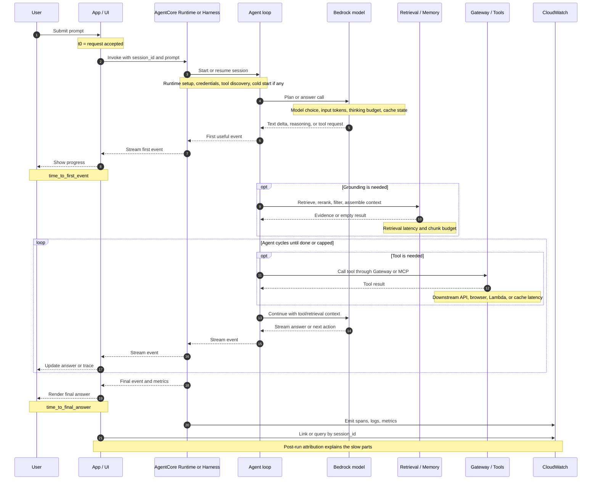

# Latency: Sources and End-to-End Measurement

> [!summary]
> Latency is the wall-clock time a user waits for an agent run. In agentic systems it is not only model speed: model choice, token volume, tool round-trips, retrieval, browser work, retries, orchestration, runtime cold start, and streaming behavior all contribute. Measure it end to end first, then break it down by model, tools, retrieval, runtime, and UI perception.

## Definition

Latency is the time between the application accepting a user request and the application delivering the response state the user cares about.

For agentic systems, use three latency numbers instead of one:

| Metric | Meaning | Why it matters |
|---|---|---|
| Time to first event | Time until the UI receives the first useful stream event, token, tool status, or acknowledgement | Measures perceived responsiveness |
| Time to final answer | Time until the final model answer is complete | Measures chat usability |
| End-to-end task duration | Time until all agent work, tools, background actions, and persistence are complete | Measures workflow throughput and cost exposure |

The simplest equation is:

```text
end_to_end_latency =
  app_overhead
+ runtime_start_or_session_setup
+ model_planning_and_inference
+ tool_round_trips
+ retrieval_or_memory_reads
+ retries_or_repair_calls
+ output_streaming_time
+ post_processing_and_persistence
```

The important habit is to measure the whole run first, then attribute the slow parts. A fast model can still produce a slow agent if it calls tools serially, retrieves too many documents, browses slow pages, or loops.

## Latency Sequence Diagram

Read this from top to bottom as one user request. The first important checkpoint is `time_to_first_event`, when the user sees progress. The second is `time_to_final_answer`, when the answer is complete. Everything between those two checkpoints is where model choice, retrieval, tool round-trips, retries, and streaming behavior add latency.



## Why It Matters

Latency is where quality, cost, and user trust meet.

- **User experience:** a correct answer can still feel broken if the screen is silent for too long.
- **Throughput:** long sessions occupy runtime capacity, memory, browser sessions, tool quotas, and downstream API capacity.
- **Cost:** slow runs often mean more model turns, tool calls, retries, runtime duration, and observability volume.
- **Reliability:** tail latency usually reveals hidden dependency failures, timeouts, throttling, or agent loops.
- **Architecture comparison:** Managed Harness and Custom Runtime are only comparable if latency is captured with the same start/stop boundaries.

Latency should be segmented by workflow. A weather lookup, browser research task, RAG answer, and multi-tool troubleshooting run have different normal ranges. One global average hides the cases users actually complain about.

## Which Use Cases It Bites First

| Use case | First latency source | Why it bites |
|---|---|---|
| ReAct-style tool loops | Serial model/tool cycles | Each step waits for the previous model call and tool result |
| Browser agents | Page load, DOM waits, screenshots, extraction | External websites are unpredictable and often slower than model inference |
| RAG over large corpora | Retrieval, reranking, context assembly | The agent waits before the model can produce the grounded answer |
| Multi-agent or agent-as-tool workflows | Handoffs and nested agent loops | One user request can trigger another full agent run |
| Structured output with repair | Validation retry calls | A bad JSON/schema output adds another model call |
| Long-context chat | Prompt processing and output streaming | The model re-reads growing context and generates tokens sequentially |
| High-volume support or FAQ | Tail latency and cache miss rate | p95/p99 matters more than the typical happy path |
| Human approval workflows | Human wait time | The model may be fast, but the business task is blocked |

## Latency By Agentic Pattern

Different agentic patterns change latency by changing how many model calls happen, whether work is serial or parallel, whether tools run inside the critical path, whether another agent is delegated to, and whether the user waits for the whole task or only for an acknowledgement.

| Agentic pattern | Latency shape | Why latency changes | Main controls |
|---|---|---|---|
| State machine with LLM nodes | Predictable when the path is bounded | Deterministic steps add orchestration latency, but only selected nodes call the model | Log per-node latency, parallelize branches, cap repair retries |
| Plan-and-Solve | Often faster than ReAct when the plan is knowable | Pays a planning call, then executes known subtasks; independent subtasks may run in parallel | Use when the task can be decomposed upfront, parallelize independent subtasks, avoid re-planning every step |
| ReAct | Serial and often slow | Each step is model call -> tool call -> observation -> next model call; context grows each step | Cap cycles, cache tool observations, prune trace, use ReAct only when the path is not knowable upfront |
| A2A agent-to-agent | Adds network, protocol, and delegated-agent runtime | Delegated agent has its own task lifecycle, tools, memory, streaming, or polling | Use only when peer-agent semantics are needed; stream progress; require budgets and cancellation |
| Reflection / self-critique | Serial extra model calls | Draft, critique, and revision depend on each other | Use only where quality gain justifies delay, cap rounds, use smaller judge where acceptable |
| Human-in-the-loop checkpoint | Human wait dominates wall-clock time | The model may be fast, but the business approval window can take minutes, hours, or days | Persist checkpoint state, render exact action, support async resume |
| Event-driven / async | Low user-visible acknowledgement, variable completion latency | Work moves out of the request path into queues/workers | Separate acknowledgement latency from completion latency, monitor queue delay and worker runtime |

For the current repo, treat the human-in-the-loop row as a pattern-level warning rather than a measured comparison-app path. The local comparison flow measures interactive agent/runtime latency; durable human approval would need application or workflow state and should be measured as separate acknowledgement, pending-approval, and completion intervals.

A typical ordering among agentic patterns for interactive completion latency:

```text
bounded state machine or planned workflow
< serial ReAct / multi-tool loop
< A2A delegation
< reflection / self-critique
< human approval or long async completion
```

This is a typical interactive completion-latency ordering, not a benchmark guarantee; model choice, context size, parallelism, tool latency, retries, throttling, and async acknowledgement can change the order. Response caches, direct LLM calls, RAG pipelines, MCP tool wiring, provider prompt caching, debate, streaming, and resumability are important mechanisms or broader workflow patterns, but they are not part of this core agentic-pattern set.

It is also not a quality ranking. Slower patterns may be the right choice when the task needs tools, memory, evidence, approval, or independent review. The health check should compare latency against task success, not only against speed.

## Sources Of Latency

### Model Choice

Model choice affects:

- Time to first token
- Output token generation speed
- Reasoning or thinking time
- Supported latency optimization modes
- Prompt-cache behavior
- Maximum output and context limits

Large reasoning models are valuable when the task needs deep planning, but they should not be the default for every internal step. Classifiers, routers, formatters, and short extraction tasks can often use a smaller or faster model if evaluation shows quality is still acceptable.

Health-check signal:

```text
same scenario + same prompt shape + different model_id
compare p50/p90 latency, task success, token usage, tool calls
```

Do not pick a faster model only from a stopwatch. It must still pass the quality gate for the workflow.

### Tool Round-Trips

Tool latency includes:

- Model deciding to call the tool
- Gateway or MCP round-trip
- Tool backend execution
- Downstream API latency
- Tool result serialization
- Follow-up model call to interpret the result

For serial agents:

```text
tool_loop_latency ~= sum(model_call_i + tool_call_i)
```

For independent tools that can run concurrently:

```text
parallel_tool_latency ~= max(tool_call_i) + followup_model_call
```

In this repo today, the custom Runtime path uses Strands with `SequentialToolExecutor`, so measured tool-loop latency should be treated as serial. The parallel formula is a design option, not the current default: it applies only when the application or agent framework fans out independent tool calls, waits for all results, and sends the combined results back to the model. It does not apply when tool calls depend on each other, such as finding a location before requesting a weather forecast, or when a browser task must navigate step by step.

The largest win is often not making the tool faster. It is removing unnecessary tool calls, caching safe tool results, or making deterministic steps application-owned instead of asking the model to rediscover them.

### Retrieval And Memory

Retrieval latency includes:

- Query rewriting or decomposition
- Embedding or lexical search
- Vector/database read
- Reranking
- Permission filtering
- Context assembly
- Additional model calls for agentic retrieval or sufficiency checks

Retrieval improves answer quality only when it brings useful evidence. It hurts latency when it is called unconditionally, fetches too many chunks, reranks oversized candidate sets, or inserts stale/irrelevant context that makes the final model call slower.

Useful retrieval controls:

- Retrieve only for intents that need grounding.
- Cap retrieved chunks and context tokens.
- Track retrieval time separately from model time.
- Cache safe, stable retrieval results by tenant, query, corpus version, and permission scope.
- Record empty retrieval and low-confidence retrieval as first-class outcomes.

### Context And Output Size

Input tokens slow prompt processing; output tokens slow streaming completion because generated tokens arrive sequentially.

Common causes:

- Long system prompts
- Full conversation history
- Large tool schemas
- Large tool results
- Retrieved documents copied verbatim
- Verbose final answers
- Hidden intermediate summaries

Prompt caching can reduce repeated prefix processing for supported Bedrock models, but it does not skip the model call and it does not help if the stable prefix keeps changing before the cache checkpoint.

The AWS Well-Architected Generative AI Lens frames prompt caching as both a cost and latency practice: cache frequently reused prompt components, verify model-specific cache requirements, monitor cache hit/miss behavior, and balance cache write cost against later cache-read savings. This helps most when the workload has long, repeated context such as static instructions, tool definitions, few-shot examples, or uploaded document content reused across turns.

### Runtime And Orchestration

Runtime latency includes:

- Cold start or first-use setup
- Credential resolution
- Container or process initialization
- MCP/Gateway client setup
- Tool discovery such as `ListTools`
- Thread or queue coordination
- Stream parsing and UI rendering

In this repository, the comparison app already invokes Managed and Custom architectures concurrently, so comparison latency is not simply Managed plus Custom. Inside each architecture, the agent loop can still be serial.

### Retries, Repairs, And Fallbacks

Retries are sometimes necessary, but they should be visible:

```text
final_latency =
  first_attempt_latency
+ retry_count * retry_latency
+ fallback_latency
```

If retries are hidden, latency looks random. Track retry reason, retry count, fallback model, validation failure, and timeout separately.

## How To Measure End To End

Start with application-owned timing around the user request. Then add spans for each major stage.

Minimum run record:

```text
session_id
architecture: harness | runtime
workflow_or_scenario
model_id
started_at
first_event_at
completed_at
elapsed_seconds
time_to_first_event_seconds
tool_calls
tool_names
cycles
retrieval_calls
retrieval_elapsed_seconds
inputTokens
cacheReadInputTokens
cacheWriteInputTokens
outputTokens
runtime_session_id
cloudwatch_trace_link
status: success | error | timeout | cancelled
```

Recommended timing boundaries:

| Boundary | Start | Stop | Owner |
|---|---|---|---|
| User-visible request | User clicks submit or API receives request | Final answer rendered or returned | Application |
| Time to first event | Same request start | First stream event shown to user | Application |
| Model call | Provider request sent | Provider response complete | Model client/framework |
| Tool call | Tool request emitted | Tool result received | Agent framework/tool wrapper |
| Retrieval | Retrieval decision made | Context assembled | Retriever or application |
| Runtime session | Runtime invocation starts | Runtime stream closes | AgentCore Runtime/Harness plus app |
| Post-run usage | Run completes | Delayed usage logs fetched | CloudWatch/app |

For health checks, calculate percentiles per workflow and architecture:

```text
p50_latency
p90_latency
p99_latency
time_to_first_event_p90
tool_call_count_p90
cycle_count_p90
timeout_rate
error_rate
```

Use p90 and p99 because agent latency usually has a long tail. The slowest cases are often the ones with extra tool calls, slow websites, bad retrieval, validation repair, or retries.

## AWS Option Vs Do-It-Yourself

| Dimension | AWS-managed option | Do-it-yourself option |
|---|---|---|
| Agent hosting and session traces | AgentCore Runtime/Harness with CloudWatch-backed observability and app session correlation | Run the agent in Lambda, ECS, Kubernetes, or another host and build trace correlation yourself |
| Agent observability | AgentCore Observability emits CloudWatch metrics, logs, and OpenTelemetry-compatible traces for latency, duration, tokens, errors, and workflow steps | Instrument every model call, tool call, retriever, queue, and UI stream with your own OpenTelemetry/log schema |
| Model latency mode | Amazon Bedrock latency-optimized inference for supported models and Regions when `performanceConfig.latency` is set to `optimized` | Route to different providers/models, provision inference, self-host, or build a custom model router |
| Prompt-prefix latency | Amazon Bedrock prompt caching for supported models and APIs | Manually manage provider-specific cache controls or self-host prefix/KV caching |
| Retrieval | Amazon Bedrock Knowledge Bases, including managed ingestion, indexing, retrieval, reranking, and AgentCore Gateway integration for managed knowledge bases | Own chunking, embedding, vector store, reranking, permission filters, query planning, and retrieval telemetry |
| Tool access | AgentCore Gateway centralizes MCP/API access and tool discovery | Build MCP servers, auth, retries, throttling, caching, and operation metrics yourself |
| End-to-end dashboards | CloudWatch plus application session IDs and trace links | Build dashboards, percentile aggregation, alerting, and run drill-down from raw logs |
| Tail-latency controls | Bedrock quotas, model settings, Runtime/Harness limits, CloudWatch alarms, prompt caching, managed retrieval options | Application-owned timeouts, circuit breakers, queues, concurrency, retries, cache layers, and fallback routing |

Practical recommendation for this project:

```text
Use AWS-managed telemetry as the source of trace/span data.
Keep application-owned run timing and normalized health-check metrics.
```

The application should always know when the user request started, when the first event arrived, and when the final answer completed. CloudWatch/AgentCore should then explain what happened inside the run.

## Validation Questions

Use these in the project health-check before presenting or deploying a new AgentCore workflow:

1. **Do we record end-to-end latency, time to first event, and final-answer latency for every run?**
   A single elapsed number is useful, but it does not tell whether the user saw progress quickly.

2. **Can we break latency down by model time, tool time, retrieval time, and app/runtime overhead?**
   If not, the team can see that a run is slow but cannot tell whether to change the model, cache a tool, tune retrieval, or fix orchestration.

3. **Do we track p50, p90, and p99 latency per workflow and architecture?**
   Averages hide tail problems. The health-check should separate simple lookup, RAG, browser, and multi-tool scenarios.

4. **Are tool calls and cycles capped and visible?**
   The health-check should warn when `tool_calls`, `cycles`, or retry counts exceed the workflow envelope.

5. **Does each retrieval path report retrieval count, elapsed time, returned chunk count, and empty-result rate?**
   Retrieval should be measured as its own stage, not buried inside model latency.

6. **Can we compare latency against quality for each model choice?**
   A faster model is acceptable only when success, correctness, tool trajectory, and safety still pass.

7. **Do repeated warm-cache runs show lower prompt-side latency or cache-read tokens when prompt caching is expected?**
   If caching is enabled but there are no cache reads, check prefix stability, token minimums, TTL, and dynamic content before the checkpoint.

8. **Are timeout, retry, and fallback reasons logged as structured fields?**
   Tail latency should explain itself through `timeout`, `retry_count`, `retry_reason`, `fallback_model`, or dependency error fields.

9. **Do CloudWatch traces link back to the same application `session_id` shown in the UI?**
   Without correlation, operational debugging becomes guesswork.

10. **Does the health-check fail or warn when p90/p99 latency regresses beyond the agreed envelope?**
    Latency should be part of the release gate, not only a dashboard someone checks later.

Minimum health-check gate:

| Check | Pass condition |
|---|---|
| End-to-end timing present | Every completed run has `started_at`, `completed_at`, `elapsed_seconds`, and `status`. |
| First-event timing present | Streaming paths record time to first useful event. Non-streaming paths explicitly mark it not applicable. |
| Stage attribution present | Model, tool, retrieval, and retry/cycle counts are present or explicitly unsupported for that path. |
| Tail latency bounded | p90 and p99 stay within the workflow envelope for each architecture. |
| Correlation works | The UI/session record links to the corresponding AgentCore/CloudWatch trace or query. |

## Project Notes

- The comparison app already measures elapsed time for Managed Harness and Custom Runtime invocations.
- The comparison app already runs Managed and Custom agents concurrently for side-by-side comparison.
- The app already displays latency, tool calls, cycles, token usage, cache read/write tokens, and CloudWatch session links.
- The Custom Runtime emits typed streaming events for text, reasoning, tool start, tool end, errors, and metrics.
- The Custom Runtime currently uses a sequential tool executor, so independent tool parallelism is not yet an implemented optimization inside one Custom agent run.
- Prompt caching is already toggleable for the Custom agent and visible through cache read/write token metrics.
- Semantic final-answer caching and tool-result caching are not currently implemented and should stay out of architecture benchmarks unless the run is explicitly labeled as cache-enabled.

## Sources

- [Amazon Bedrock prompt caching](https://docs.aws.amazon.com/bedrock/latest/userguide/prompt-caching.html)
- [AWS Well-Architected Generative AI Lens: Implement prompt caching to reduce token costs](https://docs.aws.amazon.com/wellarchitected/latest/generative-ai-lens/gencost03-bp03.html)
- [Amazon Bedrock latency-optimized inference](https://docs.aws.amazon.com/bedrock/latest/userguide/latency-optimized-inference.html)
- [Amazon Bedrock Knowledge Bases](https://docs.aws.amazon.com/bedrock/latest/userguide/knowledge-base.html)
- [AgentCore Observability overview](https://docs.aws.amazon.com/bedrock-agentcore/latest/devguide/observability.html)
- [Token Consumption: Measure, Predict, and Catch Surprises](24_Token_consumption_measure_predict_surprises.md)
- [Caching: Prompt, Semantic, and Tool-Resource](08_Caching_prompt_semantic_tool_resource.md)
- [ReAct Pattern](../Agentic%20Patterns/Agent%20reasoning/React%20pattern.md)
- [Plan-and-Solve Pattern](../Agentic%20Patterns/Agent%20reasoning/Plan%20%26%20solve%20pattern.md)
- [State Machine With LLM Nodes Pattern](../Agentic%20Patterns/Agent%20reasoning/State%20machine%20with%20LLM%20nodes.md)
- [Streaming With Tool Transparency Pattern](../Agentic%20Patterns/Agent%20reasoning/Streaming%20with%20tool%20transparency%20pattern.md)
- [Human-in-the-Loop Checkpoint Pattern](../Agentic%20Patterns/Agent%20reasoning/Human-in-the-loop%20checkpoint%20pattern.md)
- [The Art of Fast Agents: 17 Strategies to Fix Latency](https://medium.com/google-cloud/the-art-of-fast-agents-14-strategies-to-fix-latency-07a1e1dfebf9) -.
- [Agentic AI and the Latency Challenge: Balancing Autonomy with Real-Time Performance](https://medium.com/@anilsilblr/agentic-ai-and-the-latency-challenge-balancing-autonomy-with-real-time-performance-602085bfcf7a) 
