# Managed and Custom Agent Architecture

> [!summary]
> The comparison application has one shared Streamlit UI and one shared model
> router, but two execution backends. The Managed path invokes an AWS AgentCore
> Harness whose agent loop is operated by AWS. The Custom path invokes an
> AgentCore Runtime container in which this repository builds and runs a
> Strands agent. The ARN selects the deployed Harness or Runtime resource. The
> per-request `model_tier` drives model selection, while `model_id` reports the
> exact foundation model used.

## 1. Scope

This document explains:

- the common UI and model-routing path;
- the architecture of the Managed AgentCore Harness;
- the architecture of the Custom AgentCore Runtime;
- the request and streaming sequence for both paths;
- how the same session can use different models on different prompts;
- the relationships and responsibilities of the main files;
- the difference between deployment-time and request-time configuration.

The diagrams describe the implementation currently present in this repository.

## 2. System overview

The UI sends every comparison prompt to both architectures concurrently. The
router runs once before that fan-out, which keeps the model decision consistent
between Managed and Custom for the same comparison turn.

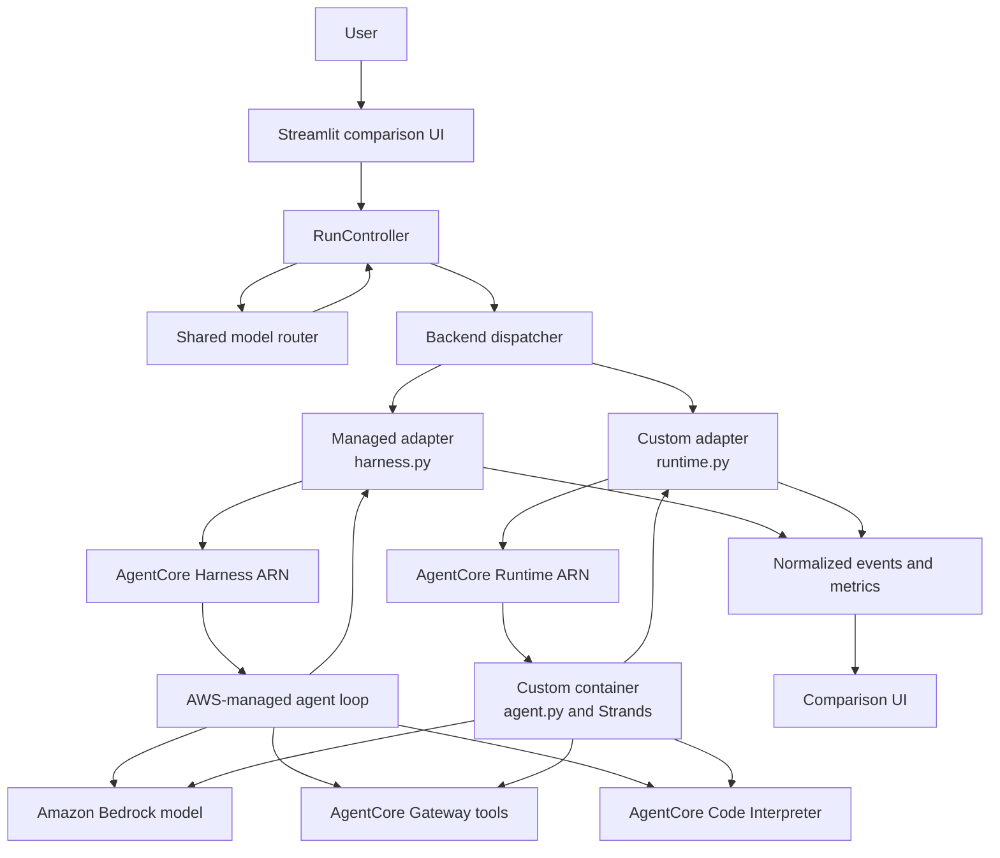

The common path has four stages:

1. `app.py` collects the prompt and UI options.
2. `model_router.py` chooses `cheap` or `strong`.
3. `run_controller.py` starts both backends with the same routing result.
4. Each backend applies the result in the way supported by its architecture.

## 3. The ARN does not identify the foundation model

The application uses two different identifiers for two different purposes:

| Identifier | Meaning | Lifetime |
|---|---|---|
| Harness ARN | Which Managed Harness receives the request | Deployment/resource lifetime |
| Runtime ARN | Which Custom Runtime receives the request | Deployment/resource lifetime |
| `model_tier` | Logical route: `cheap` or `strong` | One prompt/agent turn |
| `model_id` | Exact Bedrock foundation model | One prompt/agent turn |
| `model_route_reason` | Why the router made the choice | One prompt/agent turn |
| `runtimeSessionId` | Conversation/runtime session correlation | Multiple turns |

Consequently, the same ARN can use more than one model over time:

```text
Harness ARN H + prompt 1 -> Haiku
Harness ARN H + prompt 2 -> Sonnet

Runtime ARN R + prompt 1 -> Haiku
Runtime ARN R + prompt 2 -> Sonnet
```

The UI should display the model returned in execution metadata. It must not try
to infer the model from the ARN.

## 4. Shared model-routing layer

### 4.1 Router position

The router is part of the UI application. It is not deployed inside the Managed
Harness and is not part of the Custom Runtime container.

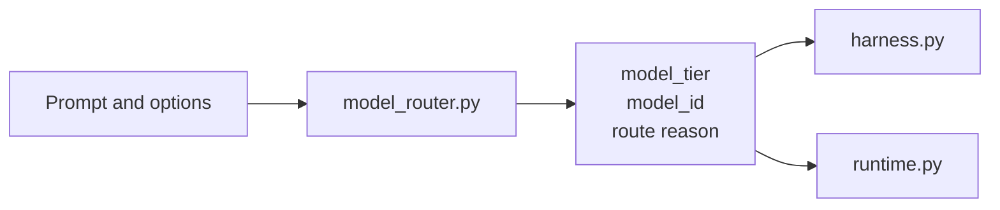

`RunController.start()` schedules `routed_options(prompt, options)` in a
background worker. The returned
dictionary contains:

```json
{
  "model_tier": "cheap",
  "model_id": "eu.anthropic.claude-haiku-4-5-20251001-v1:0",
  "model_route_reason": "LiteLLM Auto Router scored SIMPLE (-0.150) and selected cheap"
}
```

### 4.2 Current decision logic

In `auto` mode, every prompt is scored by LiteLLM's
`auto_router/complexity_router` in route-only mode. The scorer is local: no
classifier model call, no trained artifact. There are no keyword, upload,
thinking, or prompt-length routing gates of our own.

```text
Explicit Economy mode              -> cheap
Explicit Quality mode              -> strong
Auto                               -> complexity score -> tier -> cheap/strong
Router failure/unknown model group -> strong fail-safe
```

The default tier policy sends only `SIMPLE` to the economy model; `MEDIUM`,
`COMPLEX`, and `REASONING` all go to the strong model. `COMPLEXITY_TIERS` and
`COMPLEXITY_TIER_BOUNDARIES` override the policy and the score boundaries. The
prompt is scored without either architecture's system prompt, so both receive the
same decision.

Economy and Quality are explicit user overrides. They are not automatic routing
rules.

### 4.3 Fan-out rule

`RunController.start()` creates one worker for each item in `ARCHITECTURES` and
passes the same enriched `options` to both workers. The workers can receive
different conversation prompt text, but they receive the same selected tier for
the current comparison run.

## 5. Managed agent architecture

### 5.1 Managed schema

In the Managed architecture, this repository supplies configuration and an
invocation adapter. AWS owns the deployed Harness execution environment and the
agent loop.

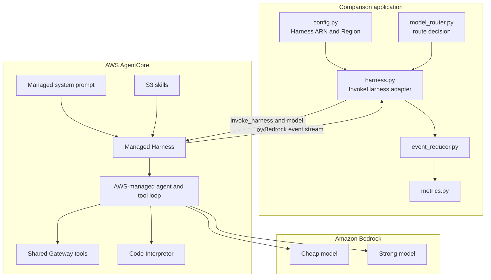

### 5.2 Deployment-time definition

`infrastructure/pulumi/managed_agent/__main__.py` creates or imports the
AgentCore Harness. It configures:

- the default Bedrock model;
- the system prompt from `agents/managed/system-prompt.md`;
- S3-hosted skills;
- the shared AgentCore Gateway;
- AgentCore Code Interpreter;
- optional AgentCore Browser;
- execution role and IAM policies;
- maximum iterations, timeout and truncation behavior.

The model in Pulumi is a default model. At request time, `harness.py` can provide
a model override without creating a new Harness.

### 5.3 Request-time responsibility of `harness.py`

`apps/comparison/backends/harness.py` does not implement the agent. It is a
client-side adapter with these responsibilities:

1. Read `model_tier` from the router options.
2. Map `cheap` to `HARNESS_CHEAP_MODEL_ID` and `strong` to `HARNESS_MODEL_ID`.
3. Build the `model.bedrockModelConfig` invocation override.
4. Call `client.invoke_harness()` using the configured Harness ARN.
5. Parse the AWS event stream.
6. Normalize text, reasoning, tool and token-usage events.
7. Emit metrics including the applied `model_id`, tier and route reason.

The decisive mapping is conceptually:

```python
if options["model_tier"] == "cheap":
    selected_model = HARNESS_CHEAP_MODEL_ID
else:
    selected_model = HARNESS_MODEL_ID

client.invoke_harness(
    harnessArn=config["arn"],
    model={"bedrockModelConfig": {"modelId": selected_model}},
    # messages, actor and session omitted
)
```

The ARN chooses the Harness. `modelId` chooses the foundation model for this
invocation.

## 6. Custom agent architecture

### 6.1 Custom schema

In the Custom architecture, AWS hosts the Runtime, but the repository owns the
container code and therefore owns the Strands agent construction and agent loop.

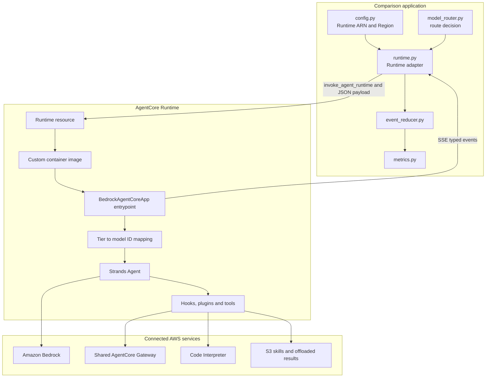

### 6.2 Deployment-time definition

`infrastructure/pulumi/custom_agent/__main__.py` deploys an AgentCore Runtime
using a container image. It supplies environment variables including:

```text
BEDROCK_MODEL_ID        -> strong/default model
BEDROCK_CHEAP_MODEL_ID  -> cheap model
GATEWAY_URL             -> shared Gateway endpoint
SKILLS_S3_BUCKET        -> shared skills storage
OFFLOAD_BUCKET          -> large tool-result storage
```

The Pulumi program also creates or configures the ECR repository, Runtime IAM
permissions, Code Interpreter access, skills access and optional tracing.

### 6.3 Request-time responsibility of `runtime.py`

`apps/comparison/backends/runtime.py` is the client-side adapter. It:

1. Builds a JSON payload containing the prompt and router decision.
2. Calls `invoke_agent_runtime()` using the Runtime ARN.
3. Parses the Runtime's SSE event stream.
4. For an old container image, labels missing model metadata as a legacy strong
   execution rather than incorrectly claiming the cheap model was used.
5. Places normalized events on the controller queue.

Example payload:

```json
{
  "prompt": "What is the capital of France?",
  "enable_caching": true,
  "enable_thinking": false,
  "model_tier": "cheap",
  "model_route_reason": "LiteLLM Auto Router scored SIMPLE (-0.150) and selected cheap"
}
```

### 6.4 Request-time responsibility of `agents/custom/agent.py`

Inside the container, `agent.py` owns the actual agent implementation. Its
entrypoint:

1. Reads `model_tier` from the Runtime payload.
2. Resolves the exact environment-configured model ID.
3. Builds a new Strands `BedrockModel` with that ID.
4. Builds the Strands `Agent`, tools, hooks and plugins.
5. Runs the agent and tool loop.
6. Streams typed SSE events.
7. Emits usage and resolved-model metadata.

The model mapping is:

```python
model_tier = "cheap" if requested_model_tier == "cheap" else "strong"
model_id = CHEAP_MODEL_ID if model_tier == "cheap" else MODEL_ID
```

Unknown values safely fall back to `strong`. The selected `model_id` is passed
to `_build_agent()`, which constructs `BedrockModel(model_id=...)` for the
current request.

## 7. End-to-end comparison sequence

This sequence shows the common work before the two paths split.

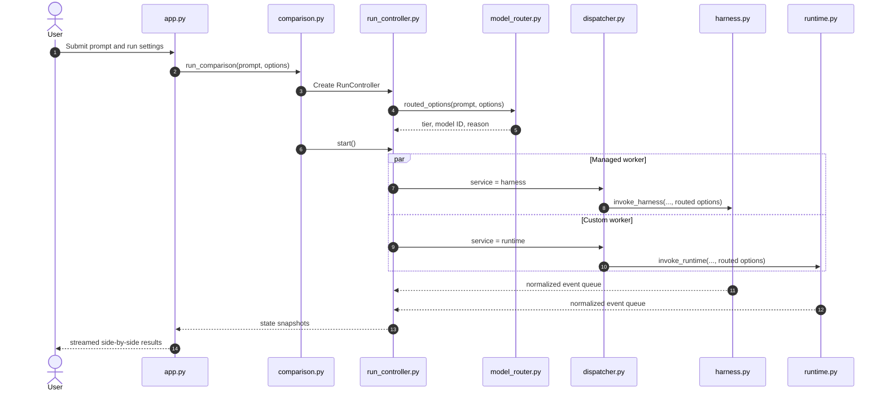

## 8. Managed request sequence

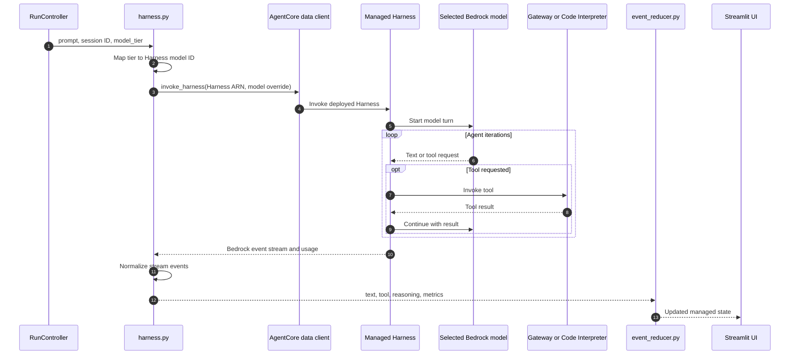

Important: the local `harness.py` appears before the remote Harness invocation.
It prepares the request and parses the result; AWS performs the agent loop after
the invocation reaches the Harness resource.

## 9. Custom request sequence

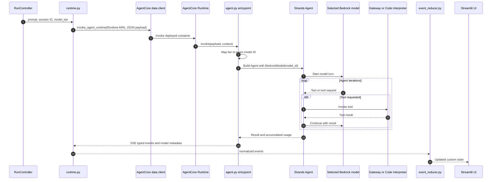

## 10. Model switching across one session

Routing happens once per submitted prompt, not once when the ARN is deployed and
not once for the entire conversation. A session can therefore use both models:

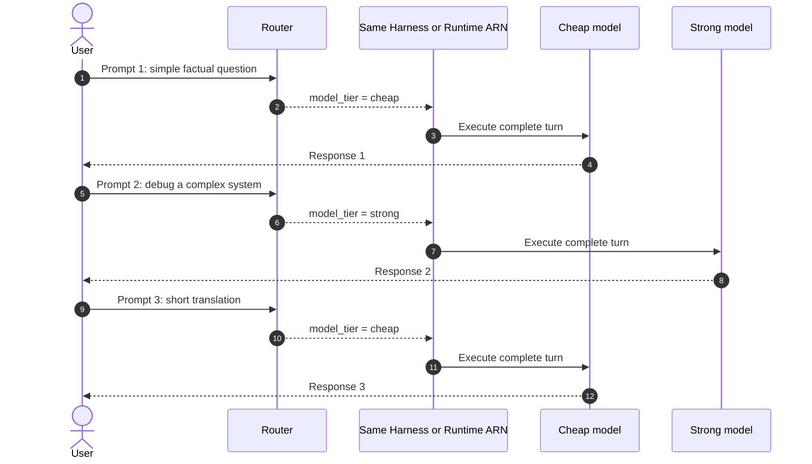

For a single submitted prompt, the selected model stays fixed for the complete
agent/tool loop. The router is not called again between individual tool calls.

## 11. How model identity reaches the UI

The UI displays execution metadata, not ARN-derived assumptions.

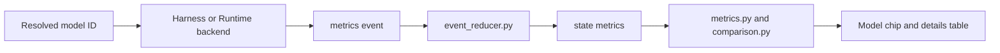

The normalized event can contain:

```json
{
  "type": "metrics",
  "model_id": "eu.anthropic.claude-haiku-4-5-20251001-v1:0",
  "model_tier": "cheap",
  "model_route_reason": "LiteLLM Auto Router scored SIMPLE (-0.150) and selected cheap",
  "usage": {
    "inputTokens": 100,
    "outputTokens": 20
  }
}
```

`event_reducer.py` copies this information into `state["metrics"]`.
`components/metrics.py` converts known model IDs into display names such as
`Claude Haiku 4.5 · Cheap`. `components/comparison.py` also shows the exact
model ID and route reason in the detailed result table.

## 12. File relationship diagram

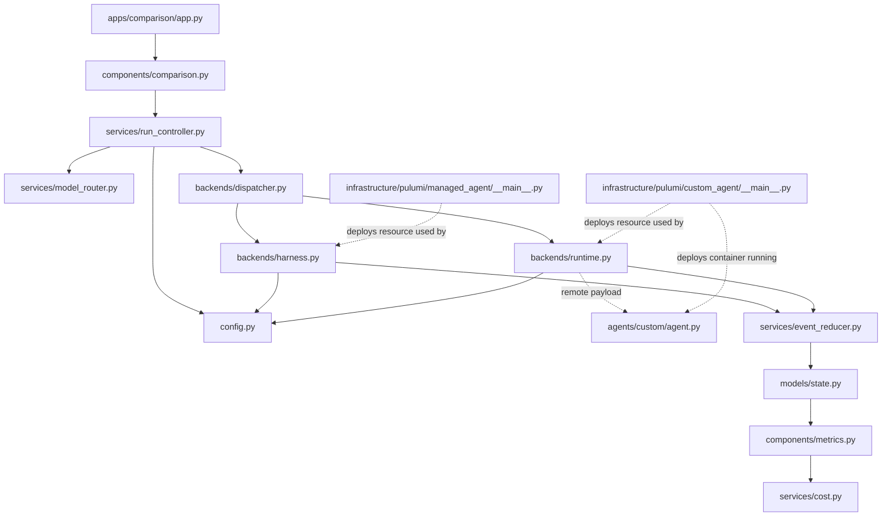

Solid arrows represent local runtime calls or data dependencies. Dotted arrows
cross the deployment boundary or connect infrastructure definitions to the
resources used at application runtime.

## 13. File responsibility matrix

| File | Runs where | Main responsibility | Relationship to routing |
|---|---|---|---|
| `apps/comparison/app.py` | Streamlit process | Collect prompt, routing mode, thinking, caching and upload options | Supplies raw routing inputs |
| `apps/comparison/components/comparison.py` | Streamlit process | Create/start controller and render live/saved comparisons | Starts the routed run and displays details |
| `apps/comparison/services/model_router.py` | Streamlit process | Choose tier, exact UI-side model ID and reason | Owns the routing decision |
| `apps/comparison/services/run_controller.py` | Streamlit process | Hold run state, start concurrent workers and drain events | Calls router once and shares result with both paths |
| `apps/comparison/config.py` | Streamlit process | Define architecture ARNs, Regions, model IDs and pricing | Provides router and adapter configuration |
| `apps/comparison/backends/dispatcher.py` | Streamlit worker | Choose Harness or Runtime adapter from `service` | Does not choose the model |
| `apps/comparison/backends/harness.py` | Streamlit worker | Invoke Managed Harness and normalize AWS events | Converts tier into a Harness model override |
| `apps/comparison/backends/runtime.py` | Streamlit worker | Invoke Custom Runtime and parse SSE | Sends tier and reason to the container |
| `agents/custom/agent.py` | AgentCore Runtime container | Build and run the Strands agent | Resolves tier to model ID and constructs `BedrockModel` |
| `apps/comparison/services/event_reducer.py` | Streamlit process | Merge normalized events into UI state | Stores resolved model metadata |
| `apps/comparison/components/metrics.py` | Streamlit process | Render model, latency, tools, tokens and cost | Displays resolved model metadata |
| `apps/comparison/services/cost.py` | Streamlit process | Select model-specific rates and calculate inference cost | Prices usage using the returned model ID |
| `infrastructure/pulumi/managed_agent/__main__.py` | Pulumi deployment | Define Harness, prompt, skills, tools and IAM | Sets default Harness model; does not route prompts |
| `infrastructure/pulumi/custom_agent/__main__.py` | Pulumi deployment | Define Runtime, image, environment and IAM | Injects cheap and strong IDs into the container |

## 14. Deployment-time versus request-time relationships

It is useful to separate what Pulumi creates from what the UI decides for every
prompt.

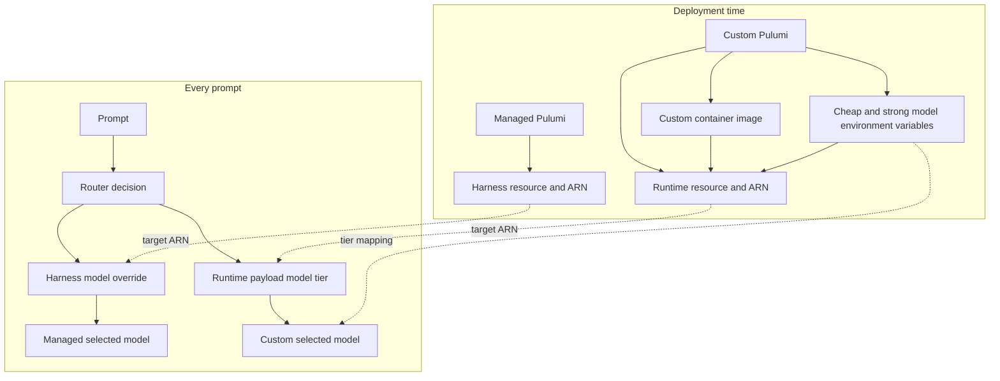

Pulumi does not run before every prompt. It creates the long-lived AWS resources
and their defaults. The Streamlit application and adapters perform per-prompt
routing against those existing resources.

## 15. Managed and Custom differences

| Concern | Managed Harness | Custom Runtime |
|---|---|---|
| Agent loop implementation | AWS-managed | Repository-owned Strands code |
| Local invocation file | `backends/harness.py` | `backends/runtime.py` |
| Remote implementation | Managed Harness service | Container running `agents/custom/agent.py` |
| AWS API | `invoke_harness` | `invoke_agent_runtime` |
| Resource selector | Harness ARN | Runtime ARN |
| Model selection | `model.bedrockModelConfig.modelId` override | Payload tier mapped inside container |
| Tool orchestration | Harness configuration and AWS loop | Strands tools, hooks and plugins |
| Streaming source | Harness Bedrock event stream | Container-generated typed SSE |
| Model metadata | Adapter reports selected override | Container reports resolved model |
| Deployment definition | `pulumi/managed_agent/__main__.py` | `pulumi/custom_agent/__main__.py` |

## 16. Failure and compatibility behavior

### Managed

- If the tier is absent, `harness.py` falls back to the configured strong model.
- If a requested SDK feature is unavailable, the adapter handles or reports the
  limitation before invoking the Harness.
- Closing the client stream stops local consumption, although the remote
  Harness cancellation behavior is controlled by the service.

### Custom

- Any tier other than the exact string `cheap` becomes `strong`.
- A Runtime container must be redeployed before new tier-selection code takes
  effect.
- If an old Runtime image returns metrics without model metadata, `runtime.py`
  labels it as `legacy-runtime` and strong rather than guessing.
- Stopping a custom run closes the stream and requests Runtime session stop; the
  container also cancels the Strands agent after disconnection.

## 17. Practical trace for a cheap prompt

For the prompt `What is the capital of France?` in Auto mode:

```text
1. app.py creates options with model_routing = auto.
2. comparison.py creates RunController.
3. run_controller.py calls routed_options().
4. model_router.py delegates the prompt to the LiteLLM complexity scorer.
5. The scorer returns a tier, score, and allowlisted logical model group.
6. The application maps that group to a tier and Bedrock model ID.
7. RunController starts Managed and Custom workers.
8. harness.py overrides InvokeHarness with the selected model ID.
9. runtime.py sends the selected model tier to the Runtime ARN.
10. agents/custom/agent.py maps the tier to its configured model ID.
11. Both agents run their complete turn with the same selected tier.
12. Both paths emit model metadata and token usage.
13. event_reducer.py stores the metadata and the UI displays it.
```

For a later complex prompt in the same session, steps 3–9 run again and can
select Sonnet without changing either ARN.

## Related documents

- [AgentCore cost-aware model router implementation](AgentCore_cost_aware_model_router_implementation.md)
- [Practical LLM model router methods](LLM_model_router_methods.md)
- [Dynamic Foundation Model assignment](Assignation_dynamique_Foundation_Model_agent_existant.md)
