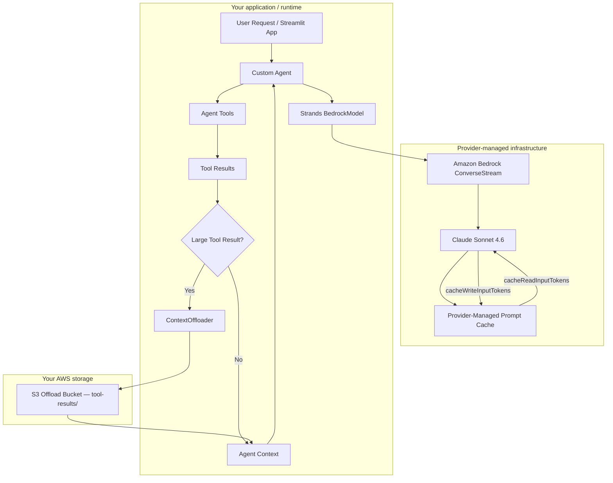
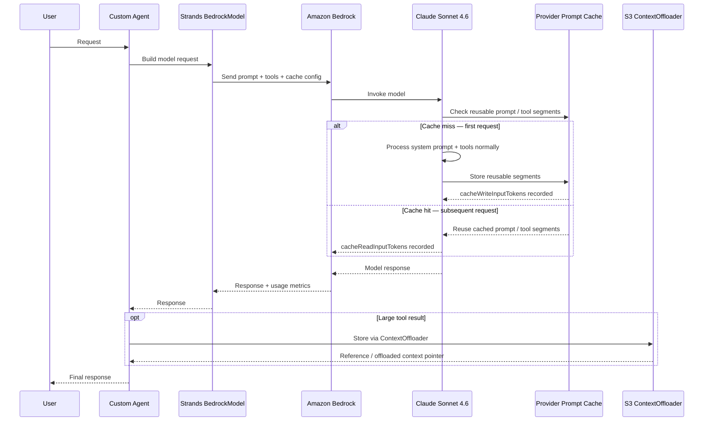

# Prompt Cache Architecture

> [!summary]
> The prompt cache is **not** stored in your repo, runtime, S3 bucket, or CloudWatch. It is an opaque, TTL-scoped cache managed entirely by **Amazon Bedrock / the provider model service**. Your code only sees the token accounting metrics.

---

## Our Exact Stack

In the **Custom agent**, prompt caching is enabled in `agent.py`:

```python
kwargs.update({
    "cache_config": cache_config_cls(strategy="auto"),
    "cache_prompt": "default",
    "cache_tools": "default",
})
```

The model is built further down in `agent.py`:

```python
Agent(
    model=BedrockModel(
        **_bedrock_model_kwargs(...)
    ),
    tools=tools,
    system_prompt=_load_system_prompt(),
    ...
)
```

The full call path is:

```text
Custom AgentCore Runtime
  -> Strands Agent
  -> BedrockModel
  -> Amazon Bedrock ConverseStream
  -> Claude Sonnet 4.6
  -> Bedrock / provider-side prompt cache
```

The **Managed agent** also uses the toggle, but through an experimental provider-level
override. `InvokeHarness` does not expose `cachePoint` in its `systemPrompt` schema, so
the comparison backend sends the local Managed system prompt plus a Bedrock-native
checkpoint through `model.bedrockModelConfig.additionalParams.system`. This is useful
for measuring cache writes and reads, but it replaces the provider-level system block
assembled by Harness for that invocation. Re-test skill discovery when using this mode.

---

## Where the Cache Is Stored

The cache is **not** stored in:

```text
our repo
AgentCore Runtime
Streamlit
CloudWatch
S3 ContextOffloader
MCP Gateway
```

It is managed by **Amazon Bedrock / the provider model service**.

AWS describes the Bedrock prompt cache as a set of **cache checkpoints** — markers on contiguous prefix segments of the prompt that the model can reuse. We have no access to the cache content. We cannot list, read, or manually delete it from our code.

Mental model:

```text
Prompt cache      = opaque cache managed by Bedrock / provider
S3 ContextOffloader = storage for large tool results in our own S3 bucket
```

These are two completely separate things.

---

## What Gets Cached

With our configuration, Strands and Bedrock will attempt to cache:

```text
system prompt
tool definitions
tool JSON schemas
stable message prefixes
```

Strands `strategy="auto"` detects the model and injects cache points to maximize coverage. For Claude / Anthropic, it uses Anthropic-compatible cache point injection.

AWS documents the following limits for Claude Sonnet 4.6 on Bedrock:

| Parameter | Value |
|---|---|
| Minimum tokens per cache checkpoint | 1,024 |
| Maximum checkpoints per request | 4 |
| TTL | 5 minutes |
| Cacheable fields | `system`, `messages`, `tools` |

If a stable prefix is under 1,024 tokens it will not be cached. In our case, tools + schemas + system prompt exceed this threshold, which is why caching appears in the metrics.

---

## Token Types

The UI reads token metrics in `streamlit_app.py`:

```python
fresh_input = inputTokens
cache_read = cacheReadInputTokens
cache_write = cacheWriteInputTokens
output = outputTokens
prompt_total = fresh_input + cache_read + cache_write
total = prompt_total + output
```

Semantics:

| Metric | Meaning |
|---|---|
| `inputTokens` (In) | Fresh tokens processed normally by the model — **excludes cached tokens** |
| `cacheReadInputTokens` (Cache read) | Tokens retrieved from the cache instead of being reprocessed |
| `cacheWriteInputTokens` (Cache write) | Tokens processed now and written into the cache for future calls |
| Prompt | `In + Cache read + Cache write` |
| `outputTokens` (Out) | Tokens generated by the model |
| Total | `Prompt + Out` |

> [!important]
> AWS specifies that `inputTokens` **excludes** cached tokens. It represents only the fresh, uncached portion of the input.

Example reading:

```text
In:          10
Cache read:  50,799
Cache write:  8,486
Prompt:      59,295
Out:          1,098
Total:       60,393
```

This means:
- Only **10 tokens** are new, uncached input.
- **50,799 tokens** were served from the cache.
- **8,486 tokens** were processed and written into the cache for upcoming calls.
- **1,098 tokens** were generated as output.

---

## Why There Is Cache on a New Question

An agentic request is never just the user question. It contains:

```text
system prompt
tool definitions
JSON schemas
Strands internal instructions
conversation history / prior turn blocks depending on the cycle
```

So "first time for this question" does not mean "first time for the full prompt."

What is typically already cached:

```text
system prompt
browser tool schema
Open-Meteo tool schemas
retrieve_offloaded_content schema
fixed instructions
```

What is new each call:

```text
the user question
some tool results
dynamic message blocks
```

This is why `In` can be very small while `Cache read` is large.

---

## Cost Impact

AWS states:

```text
cache reads are charged at a reduced rate
cache writes may be charged higher than standard uncached input
uncached input is charged at the standard input rate
```

Anthropic documents for Claude specifically:

```text
cache write (5-min TTL) = 25% more than base input price
cache read              = 10% of base input price
```

Applied to the example above:

| Path | Token count | Rate applied |
|---|---|---|
| Without cache (hypothetical) | ~59,295 input tokens | Standard input rate |
| With cache — cache read | 50,799 | 10% of input rate |
| With cache — cache write | 8,486 | 125% of input rate |
| With cache — fresh input | 10 | Standard input rate |

Cache reads are highly cost-effective. Cache writes are an upfront cost that pays off when the same prefix is reused across multiple calls.

---

## Latency Impact

AWS states that prompt caching can reduce latency because the model avoids recomputing already-processed inputs.

However, in our agentic demo, total wall-clock latency also depends on:

```text
browser tool navigation
MCP Gateway round-trips
Open-Meteo API calls
agentic tool cycles
thinking mode
S3 offloading
AWS network
cold start
response length
```

Accurate framing:

```text
Prompt caching reduces the processing time for the prompt prefix.
It does not remove time spent inside tools.
```

If the browser tool takes 15 seconds, prompt caching does not eliminate those 15 seconds. But on model-only calls or long stable prompts, caching can reduce the time-to-first-token.

---

## Best Practices

**1. Keep stable content at the top.**

```text
system prompt
tools
schemas
fixed instructions
```

**2. Put dynamic content after the stable prefix.**

```text
user question
current date
browser results
variable RAG results
```

**3. Avoid modifying tool schemas between calls.**

Changing tool definitions invalidates the tool cache checkpoint.

**4. Monitor the metrics.**

Good pattern:
```text
Cache read: high
In: low
Cache write: reasonable
```

Bad pattern:
```text
Cache write: high every call
Cache read: always 0
```

Consistently writing without reading means you are paying for cache writes but never reusing them.

**5. Do not confuse prompt cache and ContextOffloader.**

```text
cacheReadInputTokens / cacheWriteInputTokens
  = Bedrock / provider prompt cache metrics

s3://tool-results/...
  = ContextOffloader — stores large tool result payloads
```

**6. Watch out for the date in the system prompt.**

In our runtime, `_load_system_prompt()` injects:

```python
template.format(today=date.today().isoformat())
```

The system prompt therefore changes every day. In practice, with a 5-minute TTL, this is not a problem within a short session. But it does mean that yesterday's cache will not match today.

For maximum cache stability, the ideal approach is to keep the system prompt fully static and pass the current date as a dynamic variable after the cache checkpoint.

---

## How to Verify the Cache Is Active

In the UI:
```text
Cache read > 0
Cache write > 0
```

In CloudWatch traces, look for these span attributes:
```text
gen_ai.usage.cache_read_input_tokens
gen_ai.usage.cache_write_input_tokens
gen_ai.usage.input_tokens
gen_ai.usage.output_tokens
```

Example observed in Strands spans:
```json
"gen_ai.usage.cache_write_input_tokens": 6660,
"gen_ai.usage.cache_read_input_tokens": 0
```
(first call — write with no prior cache)

Subsequent calls show high `cache_read_input_tokens`, confirming the cache is active.

---

## High-Level Flow



---

## Runtime Sequence



---

## What Not to Say

> ❌ "The cache is in S3."

False. The prompt cache is provider-managed. S3 is used only by the ContextOffloader for tool results.

> ❌ "Cache read is free."

False. Cache reads are charged at a reduced rate (approximately 10% of standard input price for Claude).

> ❌ "Prompt caching always reduces total latency."

Too strong. It reduces model-side prefix recomputation. Tool execution time is unaffected.

> ❌ "Managed Harness exposes a native prompt-caching toggle."

False. Our demo implements an experimental provider-level system override because the
Harness request schema does not currently expose a `cachePoint` block.

> ❌ "`inputTokens` represents the full prompt."

False when prompt caching is active. `inputTokens` is the **uncached** portion only.

---

## Summary

```text
We use Bedrock / Claude prompt caching via Strands BedrockModel.
Strands injects cache points automatically with strategy="auto".
Bedrock / provider stores prompt prefixes in an opaque, TTL-scoped cache.
The cache reuses system prompt + tools + schemas across calls.
Cache read reduces input cost and can reduce latency.
Cache write costs more than a standard input token, but prepares future calls.
Our UI computes: Total = In + Cache read + Cache write + Out.
The Managed agent uses an experimental additionalParams.system checkpoint override.
```

---

## Sources

- [AWS Bedrock — Prompt caching](https://docs.aws.amazon.com/bedrock/latest/userguide/prompt-caching.html)
- [AWS Bedrock — Token accounting / quota terms](https://docs.aws.amazon.com/bedrock/latest/userguide/quotas-token-burndown.html)
- [Anthropic — Prompt caching](https://platform.claude.com/docs/en/build-with-claude/prompt-caching)
- [Strands — CacheConfig API](https://strandsagents.com/docs/api/python/strands.models.model/)

---

## Related

- [[04_LLM Caching Architecture on AWS]] — full multi-layer caching guide; prompt caching is one of the layers described
- [[harness_vs_custom]] — Custom Runtime is the agent path where prompt caching is applicable
- [[Creating an agent with AgentCore Harness]] — implementation context for the agent using this caching setup
