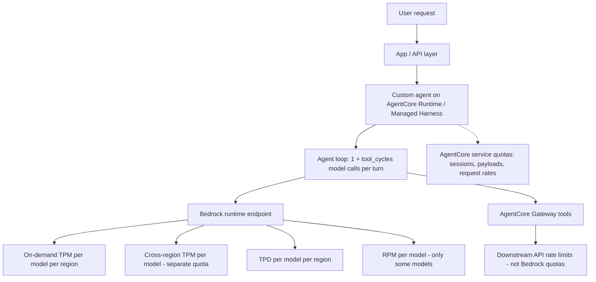
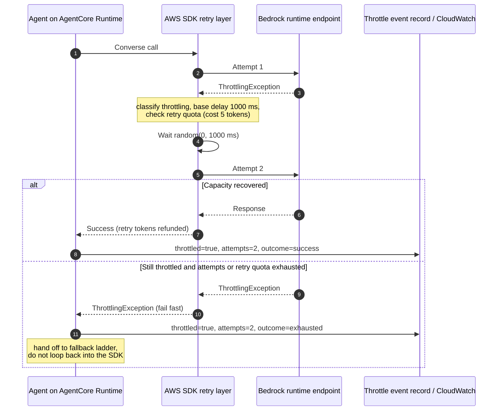
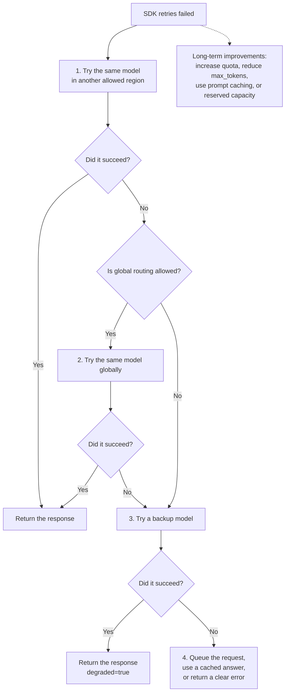

# Rate Limits and Quotas: Bedrock Throttling, Retry and Backoff, Fallback Regions and Models

> [!summary]
> Bedrock model inference is governed by per-model, per-region quotas — tokens per minute, tokens per day, and (for some models) requests per minute. Exceeding them returns `ThrottlingException`, and agentic systems hit this earlier than plain chat apps because one user turn fans out into many model calls. Token quotas burn down faster than the bill: output tokens count at a model-specific multiplier, and `max_tokens` is deducted up front before generation starts. The response stack, in order: right-size `max_tokens` and cache prompts (cache reads are quota-free), let the SDK retry with exponential backoff and jitter at the single-call level, absorb bursts with cross-region inference profiles, and only then fall back to a different model — marked as degraded. Quota increases and provisioned throughput are the structural fixes. In AgentCore, all of this is client-side engineering: the Runtime hosts your agent, but the quota being throttled is your account's Bedrock quota.

## Definition

A **quota** is a per-account ceiling on request or token volume; **throttling** is the service actively rejecting a request (`ThrottlingException`, HTTP 429) because a quota or burst limit was hit. Vocabulary that the rest of this doc depends on:

| Term | Meaning |
|---|---|
| TPM | Tokens per minute, per model, per region — input and output combined on the `bedrock-runtime` endpoint |
| TPD | Tokens per day, per model, per region — defaults to TPM × 24 × 60; new accounts may get reduced values |
| RPM | Requests per minute — enforced for some models, absent for others (some recent models are governed by token quotas only); check the Service Quotas console per model |
| Burndown rate | Multiplier converting output tokens into quota consumption — billing is unaffected |
| On-demand vs cross-region quota | Single-region invocations and inference-profile invocations draw on **separate** TPM quotas per model |
| Retry quota | The SDK's client-side token bucket that stops retrying when failures are sustained (distinct from any service quota) |
| Admission control | Client-side limiting (concurrency caps, rate limiters, queues) that keeps you under quota instead of discovering it via 429s |

Two Bedrock inference endpoints exist — `bedrock-runtime` (the primary one, combined-TPM with burndown) and `bedrock-mantle` (separate input/output token quotas, no burndown). Traffic is tracked against separate quotas per endpoint even for the same model. This doc focuses on `bedrock-runtime`.


Example: `6,000,000` cross-region TPM for a model can still throttle if each agent turn burns many quota tokens, but even if model TPM is healthy, an AgentCore Runtime or Managed Harness path can hit Runtime-backed limits first: synchronous requests have a 15-minute timeout, request/response payloads are capped at 100 MB, streaming can run up to 60 minutes, active session workloads are capped per account and Region, and Runtime invocation APIs have per-agent/per-account TPS limits. Those are separate from Bedrock model quotas and need separate dashboards and fixes.


### Burndown Rate

Burndown rate explains how fast a model call consumes your **Bedrock quota**. It is about **throttling capacity**, not billing.

Example:

```text
Input tokens: 1,000
Output tokens: 1,000
Output burndown rate: 5x
```

Bedrock counts quota usage like this:

```text
1,000 input tokens + (1,000 output tokens × 5)
= 6,000 quota tokens
```

So the model only produced:

```text
1,000 output tokens
```

but those output tokens consumed:

```text
5,000 tokens from your TPM quota
```

Billing is different. The bill follows the real token counts and the model pricing:

```text
1,000 input tokens
1,000 output tokens
```

Burndown only affects:

- how many requests fit in your TPM quota
- how quickly you get throttled
- how much concurrency you can support

## Why It Matters

- **Agent loops multiply exposure.** A single user turn in a ReAct-style agent is `1 + tool_cycles` model calls, each drawing on TPM and RPM. A quota sized for a chat app is undersized for the same traffic through an agent by that multiplier.
- **Throttling compounds at the worst time.** Load peaks are exactly when quotas exhaust, and naive retries amplify the overload (retry storms). Backoff, jitter, and fail-fast behavior are what separate a slowdown from an outage.
- **The burndown gap surprises.** Output tokens can consume quota at 5x–15x their billed count depending on the model, and an oversized `max_tokens` reserves quota up front even if the model generates 100 tokens. Teams watching the bill see headroom; the throttling system sees none.
- **Availability and quality trade off.** The fallback ladder eventually reaches "use a different model," which silently changes answer quality unless it is explicit, marked, and monitored (see the model routing doc).

## How Token Quotas Burn Down

The throttling system deducts quota in three stages:

```text
at request start:   hold = total_input_tokens + max_tokens        # throttled here if quota exceeded
during generation:  hold adjusted toward actual output
at request end:     final = InputTokenCount
                          + CacheWriteInputTokens
                          + OutputTokenCount × burndown_rate
                    unused hold is replenished
```

Consequences, all verified against the AWS token-counting documentation:

- **`max_tokens` is a quota reservation, not just a safety cap.** A request with `max_tokens: 32000` that generates 1,000 tokens holds ~32k tokens of TPM during generation. Oversized `max_tokens` reduces the concurrency your quota can support. Right-size it per task from measured output distributions (the token consumption doc).
- **Output tokens are quota-expensive on Anthropic models.** Current documented burndown rates: 15x for Claude 4.8-generation models, 10x for Claude Sonnet 5, 5x for Anthropic models 4.7 and below, 1:1 for other providers. Check the current table before capacity planning — these are AWS-set and change with model generations.
- **Prompt-cache reads are quota-free.** `CacheReadInputTokens` do not count toward TPM/TPD at all; cache writes do. Prompt caching is therefore a *quota-capacity* lever, not only a cost/latency lever — a warmed cache multiplies how many requests fit in the same TPM.
- **Quota consumption ≠ billing.** You are billed for actual tokens; the burndown multiplier and the `max_tokens` hold affect throttling only.
- The `CountTokens` API can size input before invoking, for admission-control decisions.

## Where Throttling Hits In An Agentic Stack



Three layers can throttle independently: Bedrock model quotas (this doc's focus), AgentCore's own service quotas, and downstream tool APIs behind Gateway (which return their own 429s — handle them in tool code, not by retrying the model call). Attribute a throttle to the right layer before reacting; the fix for each is different.

## Retry And Backoff Patterns

### What The SDK Already Does

Configure the SDK before writing any custom retry loop. The AWS SDK retry behavior (2026 revision — opt-in via `AWS_NEW_RETRIES_2026=true` until it becomes the default):

| Mode | What it does | When to use |
|---|---|---|
| `standard` | Exponential backoff with full jitter, error-type-aware base delays, retry quota (fail-fast under sustained failure) | Default for all workloads |
| `adaptive` | Everything in standard **plus** a client-side rate limiter that can delay the *initial* request when throttling is detected; scoped per client instance | Single-resource, throttling-heavy, latency-tolerant clients — AWS explicitly names high-volume AI workloads calling one operation. Avoid for multi-tenant or multi-resource clients: one throttled target slows all traffic on the client |
| `legacy` | Pre-standardization behavior, inconsistent across SDKs, no standardized retry quota | Backward compatibility only; migrate off it |

Settings: `AWS_RETRY_MODE` / `retry_mode`, `AWS_MAX_ATTEMPTS` / `max_attempts` (default 3 total attempts = 1 initial + 2 retries), overridable per client in code; code > env > config file > SDK default.

The SDK classifies errors and reacts differently:

| Class | Base delay | Examples |
|---|---|---|
| Throttling | 1,000 ms | `ThrottlingException`, `TooManyRequestsException`, `RequestThrottled` |
| Transient | 50 ms | `RequestTimeout`, connection reset, any unrecognized HTTP 500/502/503/504 |
| Non-retryable | returned immediately | `ValidationException`, `AccessDeniedException`, `ResourceNotFoundException` |

```text
delay = random(0, 1) × min(20_000 ms, base_delay × 2^retry_number)   # full jitter, 20 s cap
```

Full jitter exists to prevent thundering herds: clients that failed together must not retry together. If the service sends `x-amz-retry-after`, the SDK honors the server-directed delay instead (clamped, un-jittered — the service jitters it).

The **retry quota** is the underrated part: a 500-token client-side bucket where each throttling retry costs 5 tokens (transient: 14), refunded on success. Under sustained failure (roughly >32% of requests throttled, >22% transient at default settings) the bucket drains and the SDK stops retrying — your calls fail fast instead of stacking latency, and the service recovers sooner. Do not defeat this with an outer retry loop that re-enters the SDK indefinitely.

### Retry At The Right Layer

The agent-specific failure mode is **retry amplification**: retries configured at several layers multiply.

```text
1 user turn × N model calls per turn × M SDK attempts × K app-level retries
```

With N=6, M=3, K=2 a single turn can issue 36 model attempts into an already-throttled quota. Rules:

- Retry at the **single model call** level (the SDK does this). Do not blanket-retry the whole agent turn — on the Managed Harness path, re-invoking `InvokeHarness` re-runs every model call and tool call in the turn.
- Set an **attempt budget per turn** (`max_model_attempts_per_turn`) spanning all layers, and stop cleanly when it is spent.
- **Streaming:** a `ConverseStream` failure after first token means retrying restarts the answer; decide retry policy for the pre-stream window separately from mid-stream (same constraint as fallbacks — see the routing doc).
- On the Runtime, backoff sleeps are I/O wait — they should not add active vCPU-hours if nothing else spins, but they extend session lifetime (billed as memory GB-hours) and user-visible latency. A 20 s worst-case backoff inside a synchronous UI path is usually worse than failing over.



## Fallback Regions Or Models

When retries exhaust, escalate through targets — ordered so quality changes last, same principle as the model routing doc:



What the AWS docs establish about each rung:

- **Geographic cross-region inference profiles** (`us.`, `eu.`, `apac.` prefixes) keep processing inside the geography (the data-residency option) and let Bedrock pick the optimal region for each request. There is no additional routing cost — pricing follows the *source* region. Requests can be fulfilled in regions not enabled on the account; traffic stays on the AWS network, encrypted. Crucially for throttling: inference-profile invocations draw on the **`Cross-Region InvokeModel` TPM quota, separate from the on-demand single-region quota** — capacity headroom you get without any approval process.
- **Global cross-region inference profiles** route to any supported commercial region worldwide: the highest-throughput option, documented at roughly 10% lower price than geographic profiles, but incompatible with strict residency requirements and needing SCPs that allow `"aws:RequestedRegion": "unspecified"`.
- **Fulfillment attribution:** CloudTrail logs every cross-region request in the source region with `additionalEventData.inferenceRegion` — use it to prove where inference actually ran.
- **Model fallback** is the last resort before shedding, because it changes quality: mark responses `degraded=true` end to end and monitor the degraded rate as an availability metric (schema and chain mechanics in the routing doc — this doc's throttle events plug into that fallback chain as the trigger).
- **Structural fixes:** quota increases go through the Service Quotas console per model and region (the three token quotas — on-demand TPM, cross-region TPM, TPD — can be raised together via the cross-region TPM request); AWS documents that priority goes to accounts already consuming their existing allocation, and that increases are not granted for models in Legacy/Deprecated lifecycle status. **Provisioned Throughput** buys reserved model-unit capacity for steady high-volume workloads — note inference profiles don't support it, so it is an alternative to cross-region, not a layer on top.

**Briefly** 
1. Try the same model in nearby allowed regions.
2. If allowed, try the same model globally.
3. If that fails, switch to a backup model and mark degraded=true.
4. If that fails, queue, cache, or return a clear error.
5. In parallel, increase quota or redesign capacity usage.

## Client-Side Admission Control

Discovering quota limits via 429s is the worst way to learn them. Cheaper controls, in increasing order of engineering effort:

| Control | Mechanism | Notes |
|---|---|---|
| Right-size `max_tokens` | Per-task caps from measured output distributions | Directly increases concurrency per TPM; zero code beyond config |
| Prompt caching | Stable prefixes, cache checkpoints | Cache reads are quota-free; biggest capacity lever for repeated-prefix workloads |
| Concurrency cap | Semaphore around model calls per process/tenant | Bounds worst-case parallel quota draw; trivially sized: `TPM / (avg_tokens_per_call × calls_per_min_per_slot)` |
| SDK adaptive mode | Client-side rate limiter reacting to 429s | Per-client scope; dedicate a client per model target so one throttled target doesn't slow others |
| Queue + async completion | Buffer requests, drain at sustainable rate | Converts throttle errors into latency; pairs with the event-driven pattern and honest "working on it" UX |
| Per-tenant token budgets | Meter measured tokens per tenant per window | Fairness: one tenant's burst can otherwise exhaust the shared account quota for everyone |


A semaphore around model calls is a small gate in your app that limits how many Bedrock calls can run at the same time,You have 20 tickets.A model call must take 1 ticket before calling Bedrock.When it finishes, it gives the ticket back.If all 20 tickets are used, the next call waits.so Seamaphore around model calls = limit concurrent Bedrock calls.
## AWS Option Vs Do-It-Yourself

AWS gives managed retry, quota, and capacity primitives, but it does not own the full fallback policy for an AgentCore Runtime application. The policy that decides when to retry, when to switch to a wider-capacity target, and when to mark an answer degraded still belongs in your application/runtime code.

| Concern | Managed AWS option | Do-it-yourself | Notes |
|---|---|---|---|
| Retries with backoff and jitter | SDK `standard` mode | Custom retry loop | The SDK also brings the retry quota (fail-fast); custom loops usually forget it |
| Reacting to sustained throttling | SDK `adaptive` mode | Token-bucket rate limiter | Adaptive is per-client — isolate clients per model target |
| Burst capacity, same model | Cross-region inference profile (geographic or global) | Multi-region clients + failover logic | The profile draws a separate cross-region TPM quota and needs no approval |
| Fallback to a different model | No first-class managed fallback-chain switch | Runtime fallback policy | With boto3, the entrypoint can catch a Bedrock error and call `Converse` again with another `modelId`. With normal Strands usage, one `Agent(model=BedrockModel(...))` has one model target, so model fallback usually means the Runtime orchestrator calls a second Strands agent or rebuilds the agent with a different model |
| Guaranteed capacity | Provisioned Throughput | — | Reserved model units; not combinable with inference profiles |
| More quota | Service Quotas increase request | — | Granted preferentially to accounts consuming existing allocation; not for deprecated models |
| Knowing usage before calling | `CountTokens` API | Local tokenizer estimates | Exact for admission control on input; output still needs `max_tokens` discipline |
| Quota-free repeated context | Prompt caching (cache reads exempt from TPM/TPD) | Response/semantic caching in app | Different layers; both reduce quota draw (see caching docs) |
| Fairness across tenants | — | Per-tenant budgets from measured tokens | Account quotas are shared; only you know your tenants |

## Health Checks

```text
per model, region, endpoint, and layer, per window:
  throttle_rate      = throttled_calls / total_calls
  quota_headroom     = peak_burndown_adjusted_TPM_used / TPM_quota
  retry_added_ms     = total_backoff_ms distribution (p50/p95)
  degraded_rate      = fallback answers marked degraded / total answers
  amplification      = model_attempts_per_turn distribution vs budget
```

```text
alert on:
  throttle_rate above envelope while quota_headroom < 80%   -> burst shape problem, fix admission control
  quota_headroom > 80% sustained                            -> request increase / add cross-region profile
  retries observed at more than one layer for the same call -> retry amplification bug
  degraded_rate > 0 without a matching incident             -> fallback triggering too eagerly
```

| Check | Pass condition |
|---|---|
| Burndown-aware accounting | Capacity math uses `output_tokens × burndown_rate` and the `max_tokens` hold, not billed tokens. |
| `max_tokens` right-sized | Per-task caps exist and track measured output p95, not a global maximum. |
| Retry layering | Exactly one layer retries a given failure; attempt budget per turn enforced across layers. |
| Throttles attributed | Every throttle event names its layer (Bedrock model, AgentCore service, Gateway tool, downstream API). |
| Fallback ladder ordered | Same-model capacity moves (cross-region) precede any model switch; model switches are marked degraded. |
| Residency respected | Global profiles only where policy allows; CloudTrail `inferenceRegion` sampled to verify. |
| Measured, not assumed | Throttle rates, headroom, and degraded rates come from telemetry/decision records, not estimates. |

## Project Notes

- The comparison app's AgentCore client (`apps/comparison/backends/common.py`) sets `read_timeout=600`, `connect_timeout=10`, `tcp_keepalive=True`, and `retries={"max_attempts": 2}` — but does **not** pin a retry mode, so boto3 falls back to its environment/default mode. Pinning `retries={"mode": "standard", ...}` (or `adaptive` for the model-call client) would make behavior explicit and consistent.
- The custom agent's `BedrockModel` (`agents/custom/agent.py`) is constructed with only `model_id` and `region_name` — no explicit retry configuration; it inherits framework/SDK defaults.
- `MAX_TOOL_CALLS = 12` bounds model-call amplification per turn on the custom path; there is no cross-layer attempt budget today.
- The default model target `eu.anthropic.claude-sonnet-4-6` is already a **geographic cross-region inference profile**, so the repo draws on the cross-region TPM quota by default — rung 1 of the fallback ladder is effectively built in. Per the current AWS burndown table, Anthropic models of generation 4.7 and below burn output at 5x; verify against the table when models change.
- Prompt caching is on by default for the custom agent and its cache read/write tokens are already surfaced in the app — cache reads are quota-free, so the existing cache metrics double as quota-capacity metrics.
- `BEDROCK_MAX_TOKENS` defaults to 4096 globally; per-task `max_tokens` sizing (classifier vs final answer) is not implemented.
- No throttle-event records, admission control, per-tenant budgets, or fallback chain exist today; the schemas above are forward-looking and join with the routing doc's `routing_decision/v1`.
- FinOps rule as always: dashboards show measured throttle rates and token usage only — no assumed capacity or savings figures.


### AgentCore Quotas To Include In Capacity Planning


AgentCore services (Runtime, Gateway, Memory, Browser) have their own service quotas on top of Bedrock's model quotas — session counts, payload sizes, request rates. The Harness limits page is explicit: AgentCore Harness is a logical resource backed by a managed AgentCore Runtime that AWS provisions and operates for you. So Managed Harness traffic is not governed by a separate Harness TPM-like quota table; Harness invocations are bound by the same Runtime service quotas for resource allocation, invocation, throttling, lifecycle, and session storage. Check the Service Quotas console under Amazon Bedrock AgentCore for your account and Region.

Practical capacity is the **smallest active gate**, not only the Bedrock TPM number:

```text
effective_capacity =
  min(
    Bedrock model TPM/RPM/TPD capacity,
    AgentCore Runtime or Harness invocation/session capacity,
    AgentCore Gateway/Memory/Browser/tool capacity,
    downstream API capacity
  )
```

These are selected default AgentCore quotas from the AWS documentation, not a replacement for checking Service Quotas in the account and Region where the agent runs.

**Harness and Runtime**

| Area | Quota | Default | Adjustable | Capacity impact |
|---|---|---:|---|---|
| Harness | Harness invocations | Same Runtime quotas | Depends on Runtime quota | Managed Harness is backed by managed AgentCore Runtime; there is no separate Harness TPM-like quota table |
| Runtime | Active session workloads per account | 1,000 in `us-east-1`/`us-west-2`; 500 in other Regions | Yes | Caps concurrent active Runtime session workloads |
| Runtime | Total agents per account | 1,000 | Yes | Caps number of Runtime agents |
| Runtime | Endpoints/aliases per agent | 10 | Yes | Caps deployment aliases per agent |
| Runtime | Maximum hardware allocation per session | 2 vCPU / 8 GB | No | Caps per-session compute/memory headroom |
| Runtime | Synchronous request timeout | 15 minutes | No | Long model/tool chains can time out before model quota is the issue |
| Runtime | Maximum request/response payload size | 100 MB | No | Large tool payloads or traces can fail even with model headroom |
| Runtime | Streaming chunk size | 10 MB | No | Caps individual response-stream chunks |
| Runtime | Streaming maximum duration | 60 minutes | No | Caps long streaming sessions |
| Runtime | Asynchronous job maximum duration | 8 hours | No | Caps async work duration |
| Runtime | `InvokeAgentRuntime` API rate per agent/account | 25 TPS | Yes | Can throttle Runtime entrypoint calls independently of Bedrock TPM |
| Runtime | `InvokeAgentRuntimeCommand` API rate per agent/account | 25 TPS | Yes | Can throttle command calls independently of model quota |
| Runtime | New sessions created rate per endpoint, container deployment | 100 TPM | Yes | Bursty traffic that creates many sessions can throttle before steady-state model capacity |
| Runtime | Maximum session storage size | 1 GB | No | Caps per-session filesystem/state storage |

**Gateway and Tools**

| Area | Quota | Default | Adjustable | Capacity impact |
|---|---|---:|---|---|
| Gateway | Gateways per account | 1,000 | Yes | Caps number of Gateway resources |
| Gateway | Targets per gateway | 100 | Yes | Caps backend integrations per gateway |
| Gateway | Tools per target | 1,000 | Yes | Caps tool surface per target |
| Gateway | Timeout for a gateway invocation | 15 minutes | Yes | Tool calls can time out separately from model calls |
| Gateway | Maximum inline schema size | 1 MB | Yes | Large schemas can fail during target setup |
| Gateway | Maximum S3 payload schema size | 10 MB | Yes | Caps external schema payloads |
| Gateway | Tool-call/tool-list concurrency per gateway | 1,000 concurrent connections | Yes | Caps concurrent tool calls/lists at one gateway |
| Gateway | Tool-call/tool-list concurrency per account | 1,000 concurrent connections | Yes | Caps aggregate concurrent Gateway traffic |
| Gateway | Search-based tool-call rate | 25 TPM | Yes | Search-heavy agents can throttle at Gateway even with Bedrock headroom |
| Gateway | Tool-call/tool-list/tool-search payload size | 6 MB | Yes | Large tool inputs/outputs can fail at Gateway |
| Gateway | Web Search Tool request rate | 10 TPS | Yes | Web-search workflows have their own request-rate ceiling |

**Memory, Browser, Code Interpreter, and Evaluation**

| Area | Quota | Default | Adjustable | Capacity impact |
|---|---|---:|---|---|
| Memory | Memory resources per Region/account | 150 | Yes | Caps number of memory stores |
| Memory | Memory strategies per memory resource | 6 | No | Caps built-in/custom memory strategies per memory |
| Memory | Maximum messages per `CreateEvent` | 100 | No | Caps event batch size |
| Memory | Maximum message size in `CreateEvent` | 100 KB | No | Caps single message payload |
| Memory | Maximum event size in `CreateEvent` | 10 MB | No | Caps total event payload |
| Memory | `RetrieveMemoryRecords` request rate | 30 TPS | Yes | Memory retrieval can throttle independently of model calls |
| Memory | Long-term memory extraction tokens per minute | 150,000 TPM | Yes | Memory extraction has its own token quota, separate from Bedrock model TPM |
| Memory | Episodic extraction tokens per minute per session | 50,000 TPM | No | Per-session memory extraction can throttle on busy sessions |
| Browser | Concurrent active sessions per account | 1,000 | Yes | Browser-heavy agents can hit browser session capacity |
| Browser | Hardware configuration per session | 1 vCPU / 4 GB | No | Caps browser session compute/memory |
| Browser | Async command max duration | 8 hours | No | Caps long browser automations |
| Browser | Disk size per session | 10 GB | No | Caps browser session filesystem |
| Browser | `InvokeBrowser` API rate | 5 TPS | Yes | Browser actions can throttle separately from Bedrock |
| Code Interpreter | Concurrent active sessions per account | 1,000 | Yes | Code-heavy agents can hit session capacity |
| Code Interpreter | Hardware configuration per session | 2 vCPU / 8 GB | No | Caps code execution compute/memory |
| Code Interpreter | Request timeout | 15 minutes | No | Synchronous code tasks can time out |
| Code Interpreter | Max payload size | 100 MB | No | Large files/results can fail at the tool layer |
| Code Interpreter | Disk size per session | 10 GB | No | Caps code session storage |
| Evaluation | Input tokens per minute for built-in evaluators | 200,000 TPM | No | Evaluation traffic has its own token ceiling |
| Evaluation | Evaluations per minute for built-in evaluators | 100 | No | High-volume eval pipelines can throttle |

Design rule: when sizing the app, compute the Bedrock model capacity **and** the AgentCore service capacity. The app's real throughput is whichever one runs out first.


## Sources

- [Quotas for Amazon Bedrock](https://docs.aws.amazon.com/bedrock/latest/userguide/quotas.html)
- [AgentCore Harness and Runtime service quotas](https://docs.aws.amazon.com/bedrock-agentcore/latest/devguide/bedrock-agentcore-limits.html#harness-service-limits)
- [Quotas for the bedrock-runtime endpoint](https://docs.aws.amazon.com/bedrock/latest/userguide/quotas-runtime.html)
- [How tokens are counted in Amazon Bedrock (burndown)](https://docs.aws.amazon.com/bedrock/latest/userguide/quotas-token-burndown.html)
- [Count tokens before running inference](https://docs.aws.amazon.com/bedrock/latest/userguide/count-tokens.html)
- [AWS SDK retry behavior](https://docs.aws.amazon.com/sdkref/latest/guide/feature-retry-behavior.html)
- [Increase throughput with cross-Region inference](https://docs.aws.amazon.com/bedrock/latest/userguide/cross-region-inference.html)
- [Set up a model invocation resource using inference profiles](https://docs.aws.amazon.com/bedrock/latest/userguide/inference-profiles.html)
- [Provisioned Throughput](https://docs.aws.amazon.com/bedrock/latest/userguide/prov-throughput.html)
- [Requesting a quota increase (Service Quotas)](https://docs.aws.amazon.com/servicequotas/latest/userguide/request-quota-increase.html)
- [Converse API reference (error taxonomy)](https://docs.aws.amazon.com/bedrock/latest/APIReference/API_runtime_Converse.html)
- [Model selection and routing: cascades, fallback chains, cost-aware routing](26_Model_selection_and_routing_cascades_fallbacks_cost_aware.md)
- [Token Consumption: Measure, Predict, and Catch Surprises](24_Token_consumption_measure_predict_surprises.md)
- [Latency: Sources and End-to-End Measurement](25_Latency_sources_measure_end_to_end.md)
- [Cost and FinOps beyond tokens](Cost_and_FinOps_beyond_tokens.md)
- [AgentCore Runtime compute model and measured FinOps](../09_AgentCore_runtime_compute_model_and_measured_FinOps.md)
