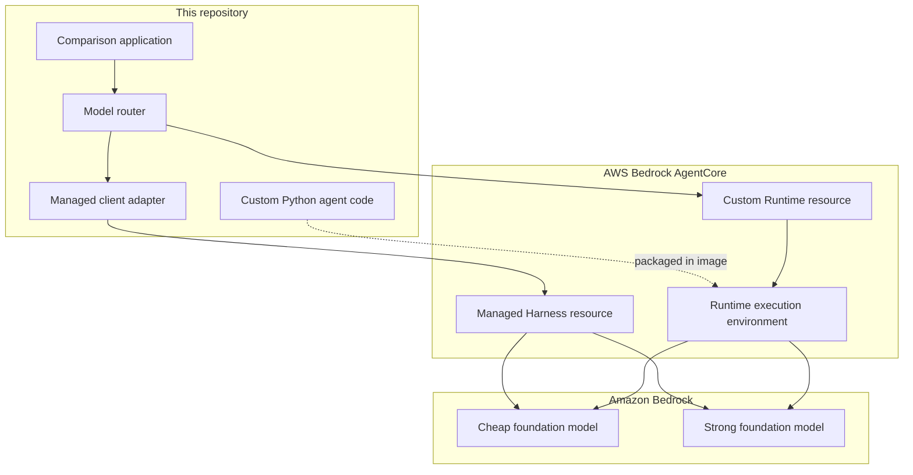
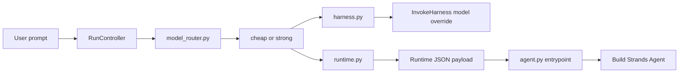
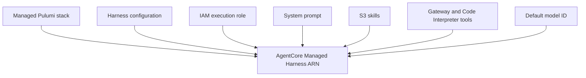
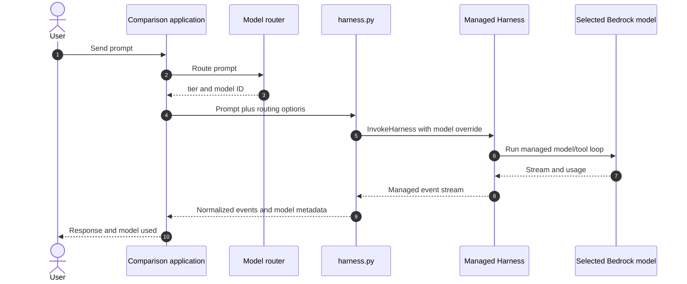
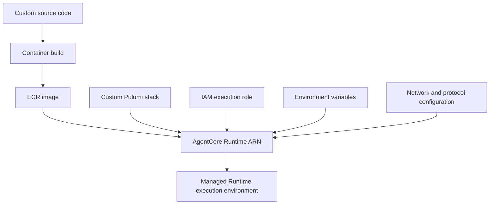
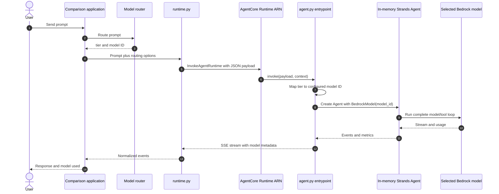
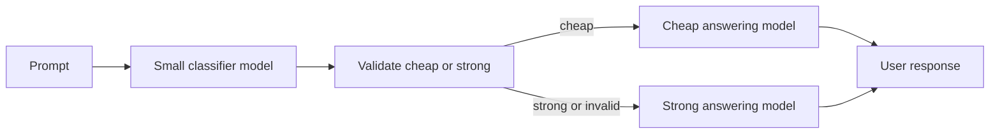
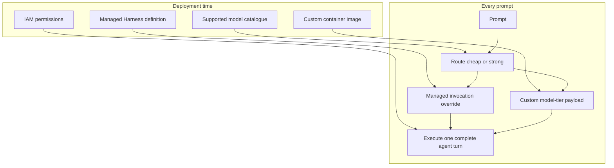
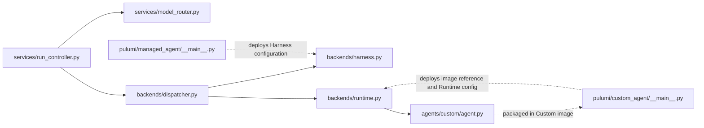

# What We Deploy and How Models Switch: Managed vs Custom

> [!summary]
> In the Managed architecture, we deploy an AgentCore Harness configuration and
> AWS operates the agent loop. The comparison application selects a model and
> sends it as an `InvokeHarness.model` override for the current prompt. In the
> Custom architecture, we deploy a containerized Python application to
> AgentCore Runtime. For every prompt, that application receives the selected
> model tier and creates an in-memory Strands `Agent` with the corresponding
> `BedrockModel`. Neither architecture deploys the foundation-model weights.

## 1. The most important distinction

The word **agent** can refer to several different things. They do not have the
same lifecycle.

| Layer | Managed Harness | Custom Runtime |
|---|---|---|
| AWS resource | AgentCore Harness ARN | AgentCore Runtime ARN |
| Deployed definition | Harness configuration | Container image and Runtime configuration |
| Agent loop | Implemented and operated by AWS | Implemented in this repository with Strands |
| Python Strands `Agent` | Not created by our code | Created in memory for each prompt |
| Foundation model | Hosted separately by Amazon Bedrock | Hosted separately by Amazon Bedrock |
| Model choice | Override on `InvokeHarness` | Payload tier mapped to `BedrockModel(model_id=...)` |

Therefore, deploying an agent does **not** mean uploading Claude Haiku or
Sonnet. The model weights stay in Amazon Bedrock. We deploy either a managed
agent configuration or code that knows how to call those models.



## 2. Shared routing before both architectures

The comparison application's router executes before either AWS backend is
invoked. `RunController` enriches the request options once with:

```json
{
  "model_tier": "cheap",
  "model_id": "eu.anthropic.claude-haiku-4-5-20251001-v1:0",
  "model_route_reason": "router selected the cheaper capable model"
}
```

The same routing decision is then sent to the Managed and Custom workers. The
two backends do not apply the decision in the same way:



The shared routing starts in:

- [`apps/comparison/services/run_controller.py`](../../apps/comparison/services/run_controller.py),
  which calls `routed_options(prompt, options)`;
- [`apps/comparison/services/model_router.py`](../../apps/comparison/services/model_router.py),
  which returns the tier, exact model ID and reason;
- [`apps/comparison/backends/dispatcher.py`](../../apps/comparison/backends/dispatcher.py),
  which sends the enriched options to the appropriate backend adapter.

## 3. Managed AgentCore Harness

### 3.1 What we deploy

Pulumi creates an `AWS::BedrockAgentCore::Harness` resource. Its configuration
contains the logical definition AWS needs to operate the agent:

- the Harness name and execution role;
- a default Bedrock model;
- the system prompt;
- skills stored in S3;
- allowed tools and tool definitions;
- truncation, maximum iterations and timeout settings;
- Runtime lifecycle and network settings.

The resource is defined in
[`infrastructure/pulumi/managed_agent/__main__.py`](../../infrastructure/pulumi/managed_agent/__main__.py).



We do **not** deploy `harness.py` into the Managed Harness. The file
[`apps/comparison/backends/harness.py`](../../apps/comparison/backends/harness.py)
runs in the comparison application. Its role is to construct the AWS request,
invoke the existing Harness ARN, and normalize the returned stream for the UI.

We also do not deploy:

- a Strands `Agent` object;
- our own implementation of the agent/tool loop;
- Haiku or Sonnet model weights;
- one dedicated permanent virtual machine.

AWS owns the managed execution of the Harness agent loop.

### 3.2 What happens for one prompt

The router selects a tier. `harness.py` maps that tier to a model ID:

```python
def _selected_model_id(options: dict) -> str:
    tier = options.get("model_tier")
    if tier == "cheap":
        return HARNESS_CHEAP_MODEL_ID
    if tier == "strong":
        return HARNESS_MODEL_ID
    return options.get("model_id") or HARNESS_MODEL_ID
```

It places that ID in the request-specific model configuration:

```python
{
    "model": {
        "bedrockModelConfig": {
            "modelId": selected_model_id,
            "maxTokens": HARNESS_MAX_TOKENS,
        }
    }
}
```

Finally, the adapter invokes the already deployed Harness:

```python
client.invoke_harness(
    harnessArn=config["arn"],
    runtimeSessionId=session_id,
    messages=messages,
    **invocation_overrides,
)
```



The override is scoped to this invocation. A later prompt can use another
model while keeping the same Harness ARN and session.

```text
Harness ARN H, session S, prompt 1 -> cheap model
Harness ARN H, session S, prompt 2 -> strong model
Harness ARN H, session S, prompt 3 -> cheap model
```

### 3.3 When Managed needs a deployment

Switching the request override between model IDs does not redeploy or recreate
the Harness. A Harness deployment is needed when its deployed definition
changes, for example:

- system prompt, tools or skills;
- default model configuration;
- iteration, timeout or truncation settings;
- Harness lifecycle or network configuration.

Using another model override can still require configuration outside the
Harness: the selected model must be available in the Region, and the Harness
execution role must be authorized to invoke it. The comparison application must
also know or receive the model ID.

## 4. Custom Strands Agent on AgentCore Runtime

### 4.1 What we deploy

The Custom architecture deploys a containerized application. Pulumi creates an
AgentCore Runtime resource that points to a container image in ECR and supplies
the execution configuration.

The deployment includes or references:

- the container image URI;
- Python code, including `agents/custom/agent.py`;
- Strands, the AgentCore SDK and application dependencies in the image;
- the Runtime IAM execution role;
- network and HTTP protocol configuration;
- environment variables for model IDs, Gateway, tools and other settings.

The Runtime is defined in
[`infrastructure/pulumi/custom_agent/__main__.py`](../../infrastructure/pulumi/custom_agent/__main__.py).
The deployed application entrypoint is in
[`agents/custom/agent.py`](../../agents/custom/agent.py).



The model variables currently deployed into the Runtime include:

```text
BEDROCK_MODEL_ID=<strong model ID>
BEDROCK_CHEAP_MODEL_ID=<cheap model ID>
```

These variables are model identifiers, not downloaded model weights. The
Runtime calls the corresponding remote Amazon Bedrock model when a prompt is
executed.

We do **not** deploy:

- Haiku or Sonnet model weights;
- a permanently existing Python Strands `Agent` instance;
- a permanently fixed connection to one model;
- the comparison application's router inside the current Runtime image.

### 4.2 What happens for one prompt

The comparison adapter
[`apps/comparison/backends/runtime.py`](../../apps/comparison/backends/runtime.py)
sends the routing decision in the payload:

```python
payload = {
    "prompt": user_prompt,
    "model_tier": options.get("model_tier", "strong"),
    "model_route_reason": options.get("model_route_reason", "default model"),
}

client.invoke_agent_runtime(
    agentRuntimeArn=config["arn"],
    runtimeSessionId=session_id,
    payload=json.dumps(payload).encode("utf-8"),
)
```

The deployed entrypoint receives the payload and maps the tier to one of the
configured model IDs:

```python
requested_model_tier = str(payload.get("model_tier") or "strong").lower()
model_tier = "cheap" if requested_model_tier == "cheap" else "strong"
model_id = CHEAP_MODEL_ID if model_tier == "cheap" else MODEL_ID
```

It then calls `_build_agent(...)`. That function creates a new in-memory
Strands agent for the current prompt:

```python
agent = Agent(
    model=BedrockModel(model_id=model_id),
    tools=tools,
    system_prompt=system_prompt,
)

agent_result = agent(prompt)
```

The actual code uses `_bedrock_model_kwargs(...)` to add caching, thinking and
other provider settings, but the model-selection principle is the same.



### 4.3 What “the same Custom agent” means

Across two prompts, the following remain the same:

- logical agent purpose;
- AgentCore Runtime ARN;
- deployed container image;
- tools and system-prompt-loading logic;
- Runtime session ID, when the conversation continues in the same session.

However, the same Python object is not reused. In the current implementation,
`_build_agent(...)` creates a new Strands `Agent` instance for every prompt.

```text
Same Runtime ARN R and session S

Prompt 1 -> new Python Agent(model=Haiku)  -> object ends
Prompt 2 -> new Python Agent(model=Sonnet) -> object ends
Prompt 3 -> new Python Agent(model=Haiku)  -> object ends
```

The model is selected once at the beginning of the prompt and remains fixed for
the complete agent turn, including its model/tool cycles. It does not switch
models in the middle of that loop.

### 4.4 When Custom needs a deployment

No deployment is needed to switch between `cheap` and `strong` because the
deployed code already understands both tiers and the Runtime already has both
model IDs.

A Custom Runtime deployment is needed when changing something packaged or
configured as part of that Runtime, for example:

- Python application code or dependencies;
- tools or system-prompt logic;
- environment variables;
- Runtime network or protocol configuration;
- the model catalogue or tier mapping;
- IAM permissions required by a newly supported model or tool.

For example, the current Custom code recognizes only `cheap` and `strong`. To
add a third answering tier such as `medium`, we must:

1. configure its model ID;
2. extend the tier-to-model mapping;
3. ensure the Runtime role can invoke it;
4. build and deploy the updated image/configuration once.

After that deployment, prompts can switch among `cheap`, `medium` and `strong`
without further Runtime deployments.

## 5. Direct comparison

| Question | Managed Harness | Custom Runtime |
|---|---|---|
| What is the deployed AWS resource? | Harness | Agent Runtime |
| Do we deploy application agent-loop code? | No; AWS supplies the loop | Yes; it is in the container image |
| Is `harness.py` deployed into AWS Harness? | No | Not applicable |
| Is `agents/custom/agent.py` deployed? | No | Yes, in the Runtime image |
| Where is the model chosen? | Comparison app, then applied as an invocation override | Comparison app chooses tier; Runtime code resolves the model ID |
| How is the choice transmitted? | `InvokeHarness.model.bedrockModelConfig` | JSON payload containing `model_tier` |
| Who builds/runs the agent loop? | AWS AgentCore Harness | Our Strands code inside AgentCore Runtime |
| Is a Python `Agent` created per prompt by our code? | No | Yes |
| Is a redeployment needed per model switch? | No | No |
| Are model weights deployed with the agent? | No | No |

## 6. The three-model classifier design

If the architecture contains one classifier model and two answering models,
there are three model calls available conceptually, but only one answering model
handles the agent turn:



In this repository's current topology, that classifier belongs in or behind
`model_router.py`, before the Managed/Custom fan-out. Its output becomes the
same `model_tier` already understood by both execution paths:

- Managed converts it to an `InvokeHarness` model override;
- Custom sends it in the Runtime payload and constructs the corresponding
  Strands `BedrockModel`.

The classifier runs once per prompt. It should not run again for every tool
cycle. Its output should be restricted to an allowlisted value such as `cheap`
or `strong`; an invalid result should fall back to `strong`.

The current implementation uses the repository's configured routing component.
Adding a dedicated Bedrock classifier call changes the router implementation,
not the Managed or Custom model-application mechanisms described above.

## 7. Deployment-time versus request-time decisions



Deployment time defines **what the agent is capable of doing** and which models
it is permitted/configured to use. Request time decides **which of those models
will handle this prompt**.

## 8. File relationships



| File | Runs where | Responsibility |
|---|---|---|
| `apps/comparison/services/model_router.py` | Comparison application | Select model tier/ID/reason |
| `apps/comparison/services/run_controller.py` | Comparison application | Route once and coordinate both runs |
| `apps/comparison/backends/harness.py` | Comparison application | Apply Managed invocation override and parse events |
| `apps/comparison/backends/runtime.py` | Comparison application | Send Custom Runtime payload and parse SSE events |
| `infrastructure/pulumi/managed_agent/__main__.py` | Deployment process | Define and deploy the Managed Harness resource |
| `infrastructure/pulumi/custom_agent/__main__.py` | Deployment process | Define Runtime image reference, environment and infrastructure |
| `agents/custom/agent.py` | Custom Runtime container | Resolve tier, build Strands agent and run prompt/tool loop |

## 9. Final mental model

### Managed

```text
Deploy: Harness configuration
Prompt: router -> InvokeHarness(model override) -> AWS-managed agent loop
Switch: different override on the next prompt; no Harness redeployment
```

### Custom

```text
Deploy: containerized code plus Runtime configuration
Prompt: router -> Runtime payload -> new Agent(selected BedrockModel) -> agent loop
Switch: different payload on the next prompt; no Runtime redeployment
```

In one sentence:

> Managed switches the model through an AWS invocation override; Custom
> switches it by executing already-deployed code that constructs the prompt's
> Strands agent with the selected Bedrock model.
