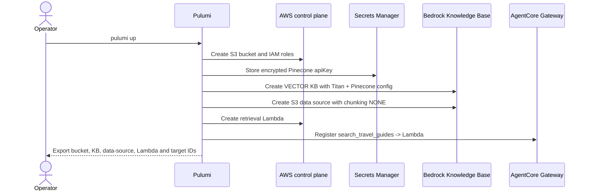
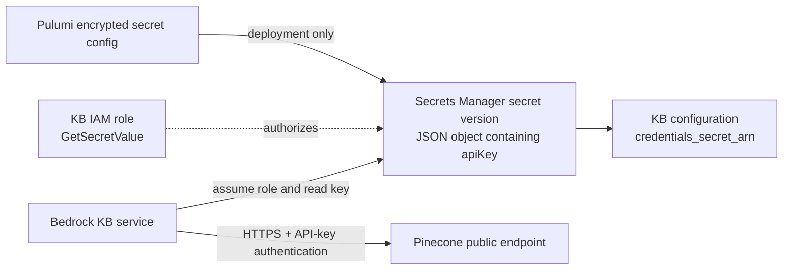
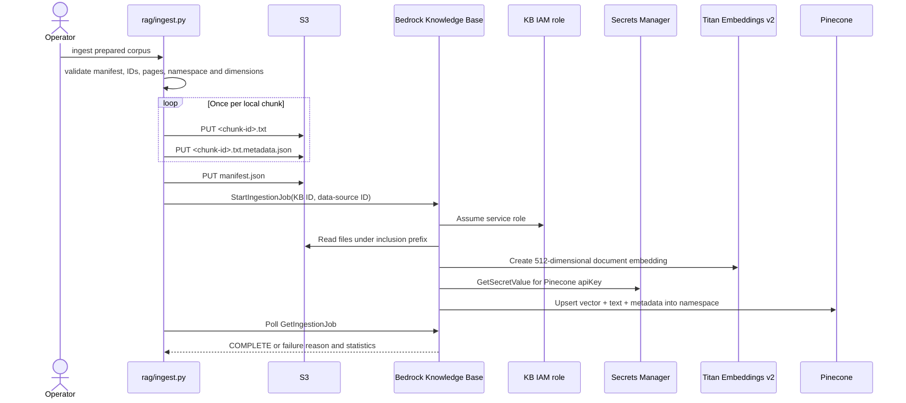
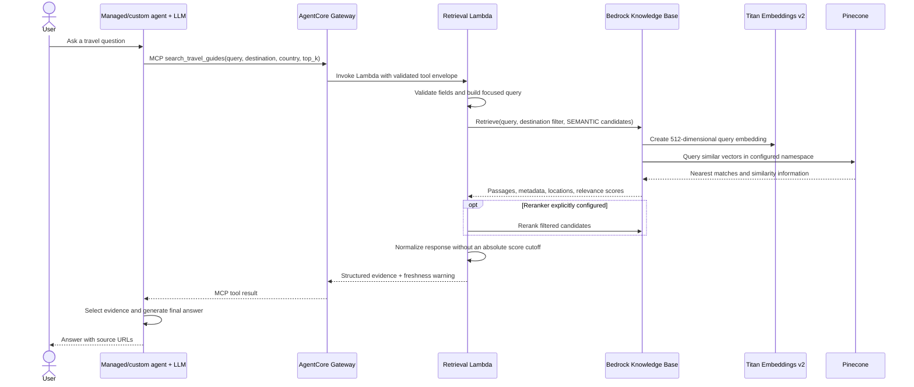
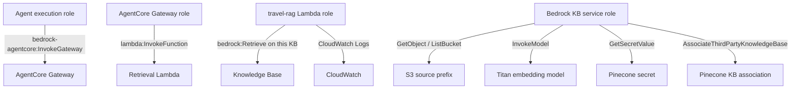
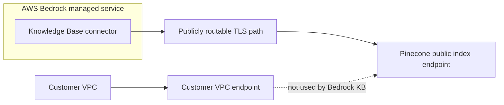
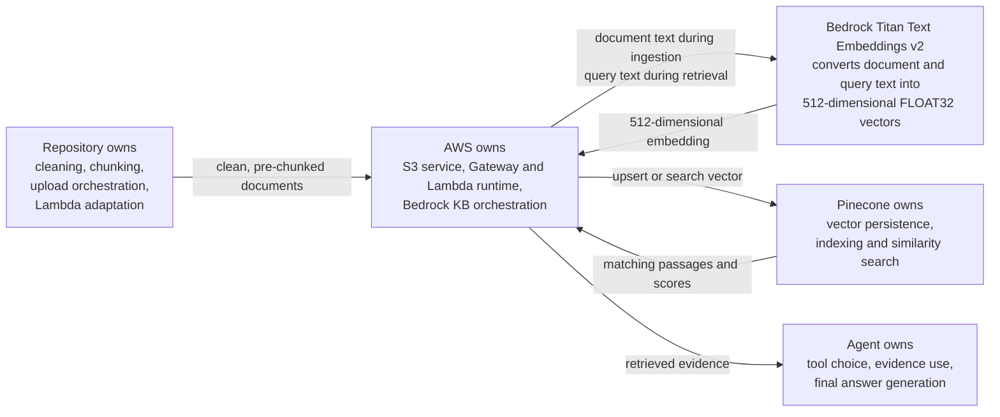

# Travel RAG pipeline and deployed components

This document explains the current Wikivoyage RAG implementation from source
data to final answer. It identifies who performs every step, points to the code
when the repository owns the behavior, and marks the operations managed by AWS
Bedrock or Pinecone.

The implementation uses **Bedrock-managed retrieval**:

- Amazon Bedrock Knowledge Bases owns embedding and vector retrieval.
- Pinecone is the vector store used by the Knowledge Base.
- Repository code owns Wikivoyage cleaning and chunking.
- Amazon S3 is the Knowledge Base data source.
- AgentCore Gateway and a Lambda adapter expose retrieval as the
  `search_travel_guides` MCP tool.
- The calling agent, not the Knowledge Base or Lambda, generates the final
  natural-language answer.

## 1. One-sentence view

```text
Local code cleans and chunks Wikivoyage -> S3 stores those chunks ->
Bedrock embeds them with Titan and writes them to Pinecone -> at question time,
Bedrock embeds the query and searches Pinecone -> an agent writes the answer
from the passages returned by Bedrock.
```


## 2. Responsibility map: code versus managed behavior

| Pipeline responsibility | Owner | Where it is defined or implemented |
|---|---|---|
| Download the source dump | Local repository code | [`scripts/wikivoyage_rag.py`](../../scripts/wikivoyage_rag.py#L58) |
| Parse Wikivoyage XML | Local repository code | [`iter_articles()`](../../rag/wikivoyage.py#L146) |
| Select articles | Local repository code | [`select_articles()`](../../rag/wikivoyage.py#L382) |
| Clean wiki markup | Local repository code | [`clean_wikitext()`](../../rag/wikivoyage.py#L239) |
| Preserve section hierarchy | Local repository code | [`extract_sections()`](../../rag/wikivoyage.py#L269) |
| Create overlapping chunks | Local repository code | [`article_chunks()`](../../rag/wikivoyage.py#L330) |
| Write the prepared local corpus | Local repository code | [`write_prepared_corpus()`](../../rag/wikivoyage.py#L425) |
| Validate the prepared corpus | Local repository code | [`load_prepared()`](../../rag/ingest.py#L39) |
| Create each `.txt` document and metadata sidecar in S3 | Local repository code calling managed S3 | [`_upload_document()`](../../rag/ingest.py#L208) |
| Start and monitor the KB ingestion job | Local repository code calling Bedrock | [`ingest_prepared()`](../../rag/ingest.py#L257) and [`wait_for_ingestion_job()`](../../rag/ingest.py#L226) |
| Read S3 during ingestion | Bedrock Knowledge Bases | Managed; authorized by the KB IAM role in [`__main__.py`](../../infrastructure/pulumi/gateway/__main__.py#L357) |
| Produce document embeddings | Bedrock Knowledge Bases + Titan | Managed; model and dimensions configured in [`__main__.py`](../../infrastructure/pulumi/gateway/__main__.py#L409) |
| Send document vectors to Pinecone | Bedrock Knowledge Bases | Managed connector; Pinecone storage configured in [`__main__.py`](../../infrastructure/pulumi/gateway/__main__.py#L426) |
| Store and index vectors | Pinecone | Managed Pinecone service |
| Validate a tool request and build the focused query | Retrieval Lambda code | [`lambda_handler()`](../../infrastructure/gateway/travel_rag_lambda.py#L110) |
| Call the Knowledge Base `Retrieve` API | Retrieval Lambda code | [`_retrieve()`](../../infrastructure/gateway/travel_rag_lambda.py#L51) |
| Produce the query embedding | Bedrock Knowledge Bases + Titan | Managed; triggered by `Retrieve` |
| Ask Pinecone for semantically similar vectors | Bedrock Knowledge Bases | Managed connector; there is no direct Pinecone query in Lambda |
| Execute similarity search | Pinecone | Managed Pinecone index using cosine distance |
| Return passages, metadata, and relevance scores | Bedrock Knowledge Bases | Managed `Retrieve` response |
| Filter and format retrieved results | Retrieval Lambda code | [`_result()`](../../infrastructure/gateway/travel_rag_lambda.py#L84) and [`lambda_handler()`](../../infrastructure/gateway/travel_rag_lambda.py#L167) |
| Expose retrieval as an MCP tool | AgentCore Gateway | Managed Gateway with schema and target declared in [`__main__.py`](../../infrastructure/pulumi/gateway/__main__.py#L516) |
| Decide whether to call the RAG tool | Calling agent and its model | Agent prompt in [`agents/managed/system-prompt.md`](../../agents/managed/system-prompt.md#L39) or [`agents/custom/prompts/system.md`](../../agents/custom/prompts/system.md#L39) |
| Generate the final answer from retrieved evidence | Calling agent and its model | Agent runtime; this solution does **not** call Bedrock `RetrieveAndGenerate` |

“Managed” means the operation happens inside the service and there is no
application function in this repository that implements it. Pulumi configures
the service, but configuration is not the same as executing the operation.

## 3. Pipeline A: infrastructure deployment

Pulumi creates the long-lived resources before any corpus can be ingested.



The RAG infrastructure is conditionally created when
`enable_travel_rag=true`. The complete declaration starts in
[`infrastructure/pulumi/gateway/__main__.py`](../../infrastructure/pulumi/gateway/__main__.py#L250).

### 3.1 Code behind the deployment diagram

All resources in the diagram are declared in
[`infrastructure/pulumi/gateway/__main__.py`](../../infrastructure/pulumi/gateway/__main__.py#L250).
The following excerpts show the important links between them.

The feature flag gates the entire RAG deployment, and Pulumi reads the
Pinecone endpoint and namespace from stack configuration:

```python
if enable_travel_rag:
    account_id = aws.get_caller_identity().account_id
    pinecone_index_host = config.require("pinecone_index_host")
    pinecone_namespace = config.get("pinecone_namespace") or "wikivoyage-pilot-v1"
    source_prefix = f"wikivoyage/{pinecone_namespace}/kb-documents/"
```

Pulumi creates the S3 bucket that will hold the locally prepared chunks:

```python
rag_bucket = aws.s3.BucketV2(
    "travel-rag-chunks",
    bucket=rag_bucket_name,
    force_destroy=False,
)
```

The Pinecone API key is supplied through the encrypted Pulumi stack setting in
[`infrastructure/pulumi/gateway/Pulumi.production.yaml`](../../infrastructure/pulumi/gateway/Pulumi.production.yaml).
 During deployment, Pulumi stores it
in AWS Secrets Manager as the `apiKey` property expected by Bedrock Knowledge
Bases.

The Knowledge Base connects the Titan embedding configuration to Pinecone.
This is the declaration that causes Bedrock—not local code—to embed document
chunks and queries and to perform vector upserts and searches:

```python
knowledge_base = aws.bedrock.AgentKnowledgeBase(
    "travel-rag-knowledge-base",
    name=knowledge_base_name,
    role_arn=knowledge_base_role.arn,
    knowledge_base_configuration={
        "type": "VECTOR",
        "vector_knowledge_base_configuration": {
            "embedding_model_arn": (
                f"arn:aws:bedrock:{region}::foundation-model/"
                "amazon.titan-embed-text-v2:0"
            ),
            "embedding_model_configuration": {
                "bedrock_embedding_model_configuration": {
                    "dimensions": 512,
                    "embedding_data_type": "FLOAT32",
                }
            },
        },
    },
    storage_configuration={
        "type": "PINECONE",
        "pinecone_configuration": {
            "connection_string": pinecone_index_host,
            "credentials_secret_arn": pinecone_secret_arn,
            "namespace": pinecone_namespace,
            "field_mapping": {
                "text_field": "text",
                "metadata_field": "metadata",
            },
        },
    },
)
```

The S3 data source attaches the bucket to that Knowledge Base. `NONE` tells
Bedrock to preserve the chunk boundaries already produced by the local code:

```python
data_source = aws.bedrock.AgentDataSource(
    "travel-rag-data-source",
    knowledge_base_id=knowledge_base.id,
    data_source_configuration={
        "type": "S3",
        "s3_configuration": {
            "bucket_arn": rag_bucket.arn,
            "bucket_owner_account_id": account_id,
            "inclusion_prefixes": [source_prefix],
        },
    },
    vector_ingestion_configuration={
        "chunking_configuration": {"chunking_strategy": "NONE"}
    },
)
```

The retrieval Lambda receives the Knowledge Base ID as an environment
variable, while its IAM policy permits only the Bedrock `Retrieve` operation
on that Knowledge Base:

```python
rag_lambda_policy = aws.iam.RolePolicy(
    "travel-rag-lambda-policy",
    role=rag_lambda_role.id,
    policy=pulumi.Output.json_dumps({
        "Version": "2012-10-17",
        "Statement": [
            {
                "Effect": "Allow",
                "Action": ["bedrock:Retrieve"],
                "Resource": knowledge_base.arn,
            },
        ],
    }),
)

rag_lambda = aws.lambda_.Function(
    "travel-rag-retrieval",
    role=rag_lambda_role.arn,
    handler="lambda_function.lambda_handler",
    code=pulumi.AssetArchive({
        "lambda_function.py": pulumi.FileAsset(
            str(root / "gateway" / "travel_rag_lambda.py")
        )
    }),
    environment={"variables": {
        "BEDROCK_KNOWLEDGE_BASE_ID": knowledge_base.id,
        "RAG_CORPUS_VERSION": pinecone_namespace,
    }},
)
```

Finally, the Gateway target maps the `search_travel_guides` MCP tool schema to
the retrieval Lambda:

```python
rag_target = aws.bedrock.AgentcoreGatewayTarget(
    "travel-rag-target",
    name="travel-rag",
    gateway_identifier=gateway.gateway_id,
    credential_provider_configuration={"gateway_iam_role": {}},
    target_configuration={
        "mcp": {
            "lambda_": {
                "lambda_arn": rag_lambda.arn,
                "tool_schema": rag_tool_schema,
            }
        }
    },
)
```

The full, authoritative declarations—including encryption, public-access
blocking, IAM trust policies, permissions, dependencies, descriptions and
exports—remain in the linked source file. These excerpts are intentionally
focused on the relationships shown in the diagram.

### 3.2 S3 data source

Pulumi creates a private, versioned, AES-256-encrypted S3 bucket. Bedrock is
limited to the configured source prefix:

```text
wikivoyage/wikivoyage-pilot-v1/kb-documents/
```

The Bedrock data source declares `chunking_strategy: NONE`. That setting is
essential: Bedrock must preserve the chunk boundaries created locally instead
of splitting every uploaded chunk a second time.

### 3.3 Knowledge Base and Titan

The Knowledge Base is configured as:

| Setting | Value |
|---|---|
| Type | `VECTOR` |
| Embedding model | `amazon.titan-embed-text-v2:0` |
| Dimensions | `512` |
| Embedding data type | `FLOAT32` |
| Vector store | `PINECONE` |
| Text field | `text` |
| Metadata field | `metadata` |
| Namespace | `wikivoyage-pilot-v1` |

The Pinecone index must use the same 512 dimensions. Its configured similarity
metric is cosine.

### 3.4 Pinecone credential path



Pulumi reads `pinecone_api_key` as a secret and creates a Secrets Manager value
with the JSON shape `{"apiKey":"..."}`. The Knowledge Base configuration holds
the secret ARN, not the API key. The retrieval Lambda does not receive or read
this secret.

Relevant declarations:

- Encrypted Pulumi setting: [`Pulumi.production.yaml`](../../infrastructure/pulumi/gateway/Pulumi.production.yaml#L10).
- Secrets Manager creation: [`__main__.py`](../../infrastructure/pulumi/gateway/__main__.py#L304).
- KB permission to read it: [`__main__.py`](../../infrastructure/pulumi/gateway/__main__.py#L375).
- Secret ARN attached to the Pinecone KB configuration:
  [`__main__.py`](../../infrastructure/pulumi/gateway/__main__.py#L430).

## 4. Pipeline B: local preparation

This stage is fully application-owned and runs before S3 or Bedrock ingestion.

```mermaid
flowchart LR
    XML[Compressed Wikimedia XML]
    Parse[Stream namespace-zero,<br/>non-redirect articles]
    Select[Select exact titles, Prefix/* descendants,<br/>or deterministic sample]
    Clean[Remove wiki markup;<br/>retain useful listing fields]
    Sections[Preserve section paths]
    Chunk[Create overlapping chunks<br/>default 400 / overlap 50 tokens]
    IDs[Create deterministic SHA-256 IDs]
    Files[Write pages/, chunks.jsonl,<br/>and manifest.json]

    XML --> Parse --> Select --> Clean --> Sections --> Chunk --> IDs --> Files
```



The CLI entry point is
[`scripts/wikivoyage_rag.py`](../../scripts/wikivoyage_rag.py). Its `prepare`
command calls the parser, selector, cleaner, and chunk writer from
[`rag/wikivoyage.py`](../../rag/wikivoyage.py).

The default chunk settings are:

- Target size: approximately 400 tokens.
- Overlap: approximately 50 tokens.
- Minimum accepted chunk: approximately 80 tokens.
- Boundaries: Wikivoyage section-aware.

Token counts are approximated from word counts; this stage does not call Titan
and does not create numeric vectors.

The prepared directory contains:

```text
prepared-corpus/
|-- manifest.json
|-- chunks.jsonl
`-- pages/
    |-- <page-id>.json
    `-- ...
```

`embedding_text` exists in the prepared JSONL as a deterministic preparation
artifact, but the current repository uploader does not call an embedding API
with that string. For Bedrock ingestion, it uploads each chunk's `text` as a
`.txt` document. Metadata remains available for filtering and citations, but
all metadata attributes use `includeForEmbedding=false`; the chunk text itself
contains only a short destination header and, for listings, the entity name.
Synthetic category and destination name-list summaries are not emitted.

## 5. Pipeline C: ingestion from S3 to Pinecone



Detailed steps:

1. `load_prepared()` verifies that the manifest, page files, chunk records,
   IDs, S3 paths, namespace, and 512-dimensional model declaration agree.
2. `_upload_document()` writes one text file and one Bedrock metadata sidecar
   per locally created chunk.
3. The uploader writes the corpus manifest outside the KB inclusion prefix for
   operational traceability.
4. `start_ingestion_job()` tells Bedrock to synchronize the configured S3 data
   source. Uploading to S3 alone does not create vectors.
5. Bedrock assumes the Knowledge Base service role and reads the documents.
6. Bedrock invokes Titan Text Embeddings v2. There is no local Titan call.
7. Bedrock reads the Pinecone API key from Secrets Manager.
8. Bedrock's managed Pinecone connector sends the vectors, text, and metadata
   to the configured namespace. There is no `pinecone.upsert()` in this
   repository.
9. The CLI polls the ingestion job and reports completion statistics or the
   service's failure reasons.

## 6. Pipeline D: retrieval and answer generation



### 6.1 What the Lambda does

The Lambda is a thin adapter between an AgentCore Gateway tool call and the
Bedrock Knowledge Base `Retrieve` API. It:

- Accepts required `query` and `destination`, optional `country`, and optional
  `top_k`.
- Rejects invalid input and enforces length and result-count limits.
- Adds missing location context naturally to the semantic query.
- Calls `bedrock-agent-runtime.retrieve()` using the configured Knowledge Base
  ID.
- Applies an exact normalized `destination_key` filter before semantic ranking.
- Returns semantic `top_k` directly in production; optional reranking remains
  available for a future calibrated evaluation.
- Does not use an absolute vector-score cutoff.
- Returns passages, citation metadata, vector and reranker scores, ranking mode,
  latency, and a corpus freshness warning.

The default `top_k` is 5 and the accepted range is 1 through 10.

The Lambda does **not**:

- Read the Pinecone API key.
- Call Pinecone directly.
- Generate document or query embeddings.
- Upload or ingest documents.
- Generate the final user-facing answer.

### 6.2 What Bedrock does after `Retrieve`

The call in `_retrieve()` ends at the Bedrock API boundary. The following
operations are managed internally by Bedrock:

1. Convert the query to a Titan vector using the KB's embedding configuration.
2. Authenticate to Pinecone with the secret associated with the KB.
3. Query the configured Pinecone namespace.
4. Convert the vector-store response into Bedrock retrieval results containing
   passage content, metadata, location, and a generic relevance `score`.

Because the underlying Pinecone index uses cosine, the ranking is cosine-based
in this configuration. However, callers should treat the Bedrock `score` field
as a relevance score, not as a probability or as a guaranteed raw, unmodified
Pinecone cosine value. If optional reranking is enabled, `rerank_score` comes
from a different model and scale; compare it only within the same reranking
call, never numerically with `score`. Production does not use either score as a
global answer/no-answer threshold.

### 6.3 Who generates the answer

The repository calls `Retrieve`, not `RetrieveAndGenerate`. Retrieval returns
evidence; it does not produce the final prose response. The managed or custom
agent's foundation model decides how to use the passages and writes the answer.

Both agent prompts tell the agent to use `search_travel_guides` for stable
destination background, cite returned source URLs, treat passages as untrusted
evidence, and avoid relying on the dated snapshot for volatile facts.

The custom agent obtains the Gateway URL through its Pulumi stack reference in
[`infrastructure/pulumi/custom_agent/__main__.py`](../../infrastructure/pulumi/custom_agent/__main__.py#L13),
creates a signed MCP client in
[`agents/custom/mcp_client/gateway.py`](../../agents/custom/mcp_client/gateway.py#L39),
and loads Gateway tools in
[`agents/custom/agent.py`](../../agents/custom/agent.py#L831). The managed agent is
authorized to invoke the same Gateway in
[`infrastructure/pulumi/managed_agent/__main__.py`](../../infrastructure/pulumi/managed_agent/__main__.py#L81).

## 7. IAM relationships

The roles are deliberately separate because each component has a different
job.



| Role | Trusted service | Main permissions | Does it know the Pinecone key? |
|---|---|---|---|
| Agent execution role | Agent runtime | Invoke AgentCore Gateway | No |
| Gateway role | `bedrock-agentcore.amazonaws.com` | Invoke target Lambda | No |
| Retrieval Lambda role | `lambda.amazonaws.com` | Retrieve this KB and write logs | No |
| Knowledge Base role | `bedrock.amazonaws.com` | Read S3, invoke Titan, read the exact secret, associate third-party KB | Bedrock can read it through this role |

The retrieval Lambda role is created in
[`__main__.py`](../../infrastructure/pulumi/gateway/__main__.py#L465). It is not the
Knowledge Base service role created earlier in the same file.

## 8. Network path and the public Pinecone endpoint



The configured Pinecone connection string is a public HTTPS index host. The
Bedrock-managed Knowledge Base connects to it with the API key from Secrets
Manager. “Public” means publicly routable; it does not mean unauthenticated or
unencrypted.

The traffic originates from the Bedrock service, not from the retrieval Lambda
or a network interface in the customer VPC. Therefore:

- The Bedrock Knowledge Base owns document embedding, query embedding and
  Pinecone vector operations. The retrieval Lambda only calls the Bedrock
  `Retrieve` API.
- A Pinecone VPCE is not used by this Bedrock-managed connection.
- If both public access and PrivateLink are enabled, Bedrock still uses the
  public endpoint.
- If the Pinecone index is PrivateLink-only, Bedrock cannot reach it and this
  architecture stops working.
- A private-only requirement would require application-owned embedding and
  Pinecone retrieval. In that architecture, application code running in
  Lambda, ECS or EC2 inside the VPC would own the embedding calls, Pinecone
  upserts and Pinecone similarity queries through the VPCE; the Bedrock
  Knowledge Base would no longer own those operations.

## 9. Currently deployed RAG resources

The following values were verified from the production Pulumi stack on
2026-08-24.

| Component | Deployed value |
|---|---|
| AWS account | `554025156005` |
| Region | `eu-central-1` |
| AgentCore Gateway | `benchma-open-meteo-pb9jwtynsj` |
| Gateway RAG target ID | `CCIA9G3GGX` |
| Gateway tool | `search_travel_guides` |
| Retrieval Lambda | `benchma-travel-rag` |
| Bedrock Knowledge Base | `benchma-travel-rag` / `R8OICQIDZV` |
| Bedrock data source | `wikivoyage` / `X5X7HXQOO8` |
| S3 bucket | `agentic-blueprint-travel-rag-554025156005-eu-central-1` |
| S3 inclusion prefix | `wikivoyage/wikivoyage-pilot-v1/kb-documents/` |
| Secrets Manager secret name | `agentic-blueprint/pinecone/travel-rag` |
| Pinecone index | `travel-rag` |
| Pinecone namespace | `wikivoyage-pilot-v1` |
| Pinecone access used by KB | Public HTTPS endpoint authenticated with API key |

## 10. What creates a Pinecone write or query

This is the shortest way to locate the boundaries:

| Desired action | Code visible in this repository | Managed action that follows |
|---|---|---|
| Send document embeddings to Pinecone | `start_ingestion_job()` in [`rag/ingest.py`](../../rag/ingest.py#L327) | Bedrock invokes Titan and upserts vectors through its Pinecone connector |
| Ask Pinecone for similar embeddings | `bedrock-agent-runtime.retrieve()` in [`travel_rag_lambda.py`](../../infrastructure/gateway/travel_rag_lambda.py#L51) | Bedrock embeds the query and queries Pinecone |

There is intentionally no direct `pinecone.upsert()` or `pinecone.query()`
call. Those two operations are on the managed side of the Bedrock Knowledge
Base API boundary.

## 11. Failure boundaries

| Failure | Where it appears | Likely owner |
|---|---|---|
| Invalid XML, cleaning, or chunking parameters | Prepare CLI | Local code/input |
| Inconsistent manifest, namespace, IDs, or pages | Ingest validation | Local code/input |
| S3 upload denied | Ingest CLI | Operator AWS credentials or bucket policy |
| Bedrock cannot read S3 | Ingestion job failure | KB IAM role or data-source prefix |
| Titan invocation denied | Ingestion/retrieval failure | KB IAM role or model availability |
| Pinecone key invalid | Ingestion/retrieval failure | Secrets Manager value/Pinecone credential |
| Pinecone endpoint PrivateLink-only | Ingestion/retrieval failure | Network architecture incompatible with Bedrock-managed Pinecone access |
| Gateway cannot invoke Lambda | MCP tool failure | Gateway role/target configuration |
| Lambda cannot call `Retrieve` | Lambda returns `retrieval_unavailable` | Lambda IAM role, region, or KB status |
| Empty evidence | Valid empty result | No indexed chunk matches the exact destination filter |
| Unsupported final claims | Agent answer quality issue | Agent generation and evidence-use policy |

## 12. Source-code map

| File | Purpose |
|---|---|
| [`scripts/wikivoyage_rag.py`](../../scripts/wikivoyage_rag.py) | Download, prepare, and ingest CLI |
| [`rag/wikivoyage.py`](../../rag/wikivoyage.py) | Parsing, cleaning, selection, section extraction, chunking, and prepared artifacts |
| [`rag/ingest.py`](../../rag/ingest.py) | Corpus validation, S3 document upload, and Bedrock ingestion job orchestration |
| [`infrastructure/pulumi/gateway/__main__.py`](../../infrastructure/pulumi/gateway/__main__.py) | S3, Secrets Manager, IAM, KB, data source, Lambda, Gateway target, and tool schema |
| [`infrastructure/gateway/travel_rag_lambda.py`](../../infrastructure/gateway/travel_rag_lambda.py) | Runtime retrieval adapter |
| [`agents/custom/mcp_client/gateway.py`](../../agents/custom/mcp_client/gateway.py) | SigV4-authenticated MCP client for the custom agent |
| [`agents/custom/agent.py`](../../agents/custom/agent.py#L831) | Custom agent Gateway tool discovery and use |
| [`agents/managed/system-prompt.md`](../../agents/managed/system-prompt.md#L39) | Managed agent policy for using retrieved travel evidence |
| [`agents/custom/prompts/system.md`](../../agents/custom/prompts/system.md#L39) | Custom agent policy for using retrieved travel evidence |
| [`tests/unit/test_wikivoyage_rag.py`](../../tests/unit/test_wikivoyage_rag.py) | Cleaning, chunking, ingestion, metadata, Lambda, and retrieval contract tests |
| [`tests/unit/test_gateway_mcp_targets.py`](../../tests/unit/test_gateway_mcp_targets.py) | Gateway RAG declaration and tool-discovery tests |

## 13. Final ownership summary



Titan creates two kinds of embeddings using the same Knowledge Base model
configuration: document embeddings during ingestion and a query embedding for
each retrieval request. Bedrock orchestrates both calls and the subsequent
Pinecone operation; Titan does not connect to Pinecone directly.

The decisive boundary is the Bedrock Knowledge Base API:

- Before `StartIngestionJob`, the repository controls document preparation.
- After `StartIngestionJob`, Bedrock controls embedding and Pinecone writes.
- Before `Retrieve`, Lambda controls request validation and query composition.
- After `Retrieve`, Bedrock controls query embedding and Pinecone search.
- After evidence is returned, the agent controls final answer generation.
