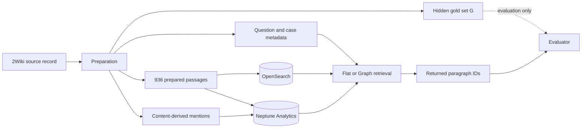
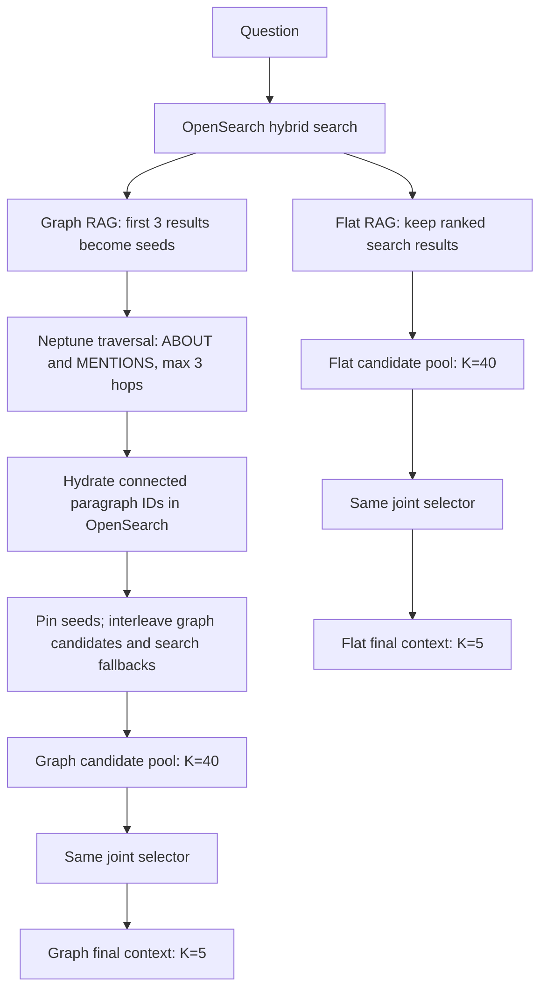
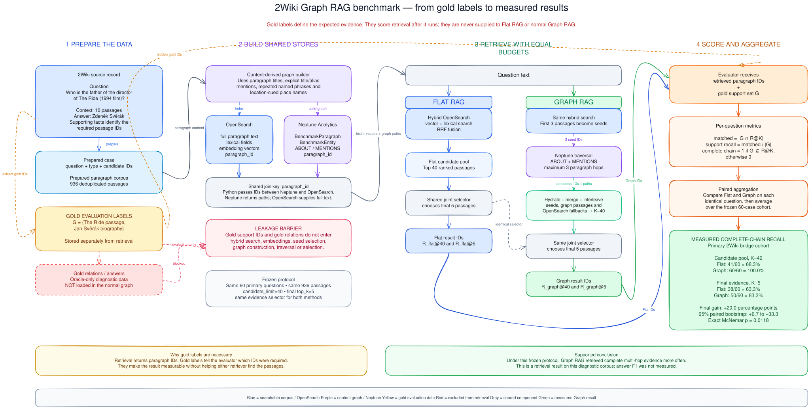

# From one dataset record to a measured retrieval result

This document defines its vocabulary first and then follows one real question through the complete experiment. It begins with the source data, shows what is stored, follows the processing stages, lists every returned candidate, identifies the required passages, explains the evidence-selection step, and ends with the recorded output.

The walkthrough uses source record `022a3dd40bdd11eba7f7acde48001122` from the frozen September 2026 run. Every passage ID, rank, quote, and measurement below comes from the saved experiment artifacts.

## 1. Definitions needed to read the data

The prefix **Benchmark** is a namespace used to distinguish these experimental graph objects from other Neptune data. It does not mean that a node contains a correct answer or a gold label.

### Dataset and corpus terms

| Term | Meaning |
| --- | --- |
| Multi-hop question | A question whose answer requires connecting facts from more than one passage. |
| 2WikiMultihopQA, shortened to 2Wiki | A dataset containing questions, passages, expected answers, and evidence annotations for multi-hop question answering. |
| Record | One source item containing a question, ten context passages, an expected answer, and supporting-fact annotations. |
| Context | The ten passages originally packaged with one source record. |
| Passage | One titled block of text that can be retrieved. |
| Supporting fact | A dataset annotation containing a passage title and sentence position. It identifies a sentence required to justify the expected answer. |
| Expected answer | The answer supplied by the dataset as reference data. This retrieval benchmark does not calculate answer F1. |
| Pooled corpus | The 936 unique passages searched in this experiment after deduplicating the 1,200 passage occurrences from 120 records. |
| Distractor | An available passage that is not required evidence for the current question. A distractor may be useful evidence for a different question. |

### Graph objects

| Term | Meaning | Example |
| --- | --- | --- |
| Graph | A collection of objects and the relationships connecting them. | The content graph stored in Neptune Analytics. |
| Node | One object stored in a graph. | A paragraph, entity, or case node. |
| Relationship or edge | A named connection between two nodes. | A paragraph `MENTIONS` an entity. |
| Path | A sequence of connected nodes and relationships. | Paragraph → entity → biography paragraph. |
| `BenchmarkCase` | One benchmark question record. It identifies the question and its original passage membership. | “Who is the father of the director of *The Ride*?” |
| `BenchmarkParagraph` | One unique prepared passage represented as a lightweight Neptune node. It holds a paragraph ID, title, and small metadata; its complete text remains in OpenSearch. | The passage titled *The Ride (1994 film)*. |
| `BenchmarkEntity` | A normalized person, film, place, or named subject extracted from passage titles and text. It is a shared connection point, not an answer label. | `Jan Svěrák`. |
| Schema | The versioned namespace that separates this graph from other indexed data. | `2wiki-content-v2-20260911`. |
| Neptune Analytics | The system that stores the lightweight paragraph nodes, entity nodes, and relationships used for traversal. | The 2Wiki content graph. |

Several passages can connect to the same `BenchmarkEntity`. That shared entity lets traversal move between related passages without using the benchmark's hidden answer annotations.

### Graph relationships

| Relationship | Meaning |
| --- | --- |
| `ABOUT` | The passage title identifies its main subject entity. The stored direction is from the paragraph to the entity. |
| `MENTIONS` | The passage text explicitly mentions an entity. The stored direction is from the paragraph to the entity. |
| `RELATED_TO` | Two entities have a permitted relationship. The normal reported graph permits only content-derived instances of this edge. |
| `HAS_PARAGRAPH` | Records that a paragraph originally appeared among a benchmark case's ten passages. Normal retrieval does not traverse this relationship. |
| Content-derived relationship | A relationship inferred from passage titles and text rather than copied from the dataset's answer annotations. |

For example:

```text
BenchmarkParagraph: The Ride (1994 film)
        |
        | MENTIONS
        v
BenchmarkEntity: Jan Svěrák
        ^
        | ABOUT
        |
BenchmarkParagraph: Jan Svěrák
```

The first passage mentions Jan Svěrák, while the biography passage is about Jan Svěrák. Neptune can use the shared entity to move between the two passages. Normal Graph RAG traversal follows `ABOUT`, `MENTIONS`, and permitted content-derived `RELATED_TO` edges. It does not traverse `HAS_PARAGRAPH`, so it does not use knowledge about which ten passages belonged to a question.

### IDs and stored content

| Term | Meaning |
| --- | --- |
| `paragraph_id` | The stable identifier shared by the OpenSearch document and Neptune paragraph node. |
| Hash | The deterministic calculation used to create a paragraph ID from the dataset, title, and text. It creates a stable identity; it does not hide an answer from retrieval. |
| Deduplication | Combining identical passage occurrences into one unique passage. |
| Join key | A shared identifier that lets Python match a Neptune node to its OpenSearch document. Here, the join key is `paragraph_id`. |
| Hydration | Fetching the complete passage title and text from OpenSearch after Neptune returns a paragraph ID. |

For example:

```text
OpenSearch document                         Neptune BenchmarkParagraph
paragraph:ffdaeb31fc2265649a2d4869  <---->  paragraph:ffdaeb31fc2265649a2d4869
```

Neptune stores the graph structure, while OpenSearch stores the complete searchable passage. The matching ID lets the application move between the two systems.

### OpenSearch and embedding terms

| Term | Meaning |
| --- | --- |
| OpenSearch | The search system holding complete passage text, lexical fields, entity metadata, and passage embedding vectors. |
| Embedding | A numerical representation of text meaning. |
| Vector | The ordered list of numbers that constitutes an embedding. |
| Passage embedding | The stored embedding of `Title: <title>` followed by the complete passage text. |
| Question embedding | A temporary embedding created from the current question when retrieval runs. It is compared with the stored passage embeddings. |
| Vector similarity | A calculation measuring how close the question vector is to each passage vector. |
| Lexical search | Search based on matching words and phrases in titles, entity fields, and passage text. |
| Vector search | Search based on semantic similarity between the question and passage embeddings. |
| Hybrid search | The combination of lexical and vector search. |
| Ranking | Search results ordered from strongest to weakest match. |
| Reciprocal Rank Fusion, shortened to RRF | A rule that combines lexical and vector rankings by adding `1 / (60 + rank)` for each list in which a passage appears. It avoids comparing unlike raw scores. |

OpenSearch performs this sequence:

```text
Question text
   |-- lexical search
   `-- question embedding --> vector search
                    |
                    v
                 RRF fusion
                    |
                    v
             ranked passages
```

### Retrieval terms

| Term | Meaning |
| --- | --- |
| Retriever | The component that finds candidate passages for a question. |
| Candidate | A passage considered potentially useful by retrieval. A candidate is not necessarily correct evidence. |
| Candidate pool | The complete shortlist passed to the selector. Here the pool contains forty passages. |
| Seed | One of the first three OpenSearch results used to begin Neptune traversal. |
| Traversal | Following graph relationships from one node to connected nodes. |
| Hop | One paragraph-to-paragraph movement through the graph. Moving from a paragraph through an entity to another paragraph normally crosses two stored edges. |
| Graph arm | Candidates discovered through Neptune traversal. |
| Search arm | Candidates supplied by the ordinary OpenSearch ranking. |
| OpenSearch fallback | An ordinary search result used while filling the forty-candidate Graph RAG budget. |
| Interleave | Alternating graph candidates and OpenSearch fallbacks in the final candidate order. |
| Final context | The selected passages that would be passed to a later answer-generation stage. |

The Graph RAG pool records four candidate origins:

| Candidate origin | Meaning |
| --- | --- |
| OpenSearch seed | One of the first three hybrid-search results. |
| Graph only | Neptune found the passage, while Flat RAG's top forty did not. |
| Graph and search | Both Neptune and OpenSearch found the passage. |
| OpenSearch fallback | Ordinary search supplied the passage while the implementation filled the forty-candidate budget. |

### Cutoffs, selection, and evaluation

| Term | Meaning |
| --- | --- |
| `K` | The maximum number of returned passages at a stage. |
| `R@K` | The ordered retrieval result within cutoff `K`. `R_graph@40` is the forty-candidate Graph RAG result; `R_graph@5` is its five-passage selected result. |
| Selector | The component that reads the current question and all forty candidates together, then chooses exactly five complementary passages. It does not receive the gold set. |
| Evidence role | The relationship that a selected passage supports in the reasoning chain. |
| Evidence quote | A grounded excerpt copied from the selected passage. |
| Gold passage | A passage the dataset marks as required evidence for the current question. |
| Gold set, written `G` | The set of every required gold passage ID for one question. The evaluator receives it after retrieval; OpenSearch, Neptune, and the selector do not. |
| Evaluator | The component that compares retrieved paragraph IDs with the hidden gold IDs after retrieval finishes. |
| Support recall | The fraction of required passages retrieved: `|G ∩ R@K| / |G|`. |
| Support precision | The fraction of returned passages that are gold: `|G ∩ R@K| / |R@K|`. |
| Complete chain | `true` only when every required gold passage was retrieved: `G ⊆ R@K`. |
| Chain completion rank | The rank of the last gold passage needed to complete the chain. It is zero when the chain never becomes complete within `K`. |
| Complete-chain recall | Across several questions, the number with complete chains divided by the number evaluated. |

For the worked question:

```text
Gold set G = {
    The Ride passage,
    Jan Svěrák biography
}
```

If only *The Ride* is retrieved, support recall is `1 / 2 = 50%` and the chain is incomplete. If both required passages are retrieved, support recall is `2 / 2 = 100%` and the chain is complete. These metrics measure evidence retrieval, not the correctness of a separately generated answer.

### Reading the Neptune visualization

In the current graph-notebook style:

- Blue nodes are normally `BenchmarkParagraph` nodes.
- Yellow nodes are normally `BenchmarkEntity` nodes.
- Arrows show `ABOUT`, `MENTIONS`, or permitted `RELATED_TO` relationships.
- Separate groups can represent unrelated branches reached from different OpenSearch seeds.

An entity may display `BenchmarkEntity` instead of its name because the visualization requests the `title` property, while entity names are stored in `canonical_name`.

## 2. A glimpse of the real source data

Here is a shortened view of the source record. The wording of the question, supporting facts, evidence relations, and answer is unchanged. The context list is shortened to titles plus the sentences that matter for orientation.

```json
{
  "_id": "022a3dd40bdd11eba7f7acde48001122",
  "type": "compositional",
  "question": "Who is the father of the director of film The Ride (1994 Film)?",
  "context": [
    ["Lars Eliasson", ["He is the father of ... Anna Eliasson."]],
    ["Jan Svěrák", [
      "Jan Svěrák ... is a Czech film director.",
      "He is the son of screenwriter and actor Zdeněk Svěrák.",
      "..."
    ]],
    ["Peter Hamel", ["...", "He is the father of ... Peter Michael Hamel."]],
    ["Yasuichi Oshima", ["He is the father of ... Towa Oshima."]],
    ["Obata Toramori", ["He was the father of Obata Masamori."]],
    ["Ian Barry (director)", ["Ian Barry is an Australian director ..."]],
    ["Cleomenes II", ["... He was the father of Acrotatus I ..."]],
    ["Paul Brooke", ["...", "He is the father of actor Tom Brooke."]],
    ["The Ride (1994 film)", [
      "The Ride is a 1994 Czech drama film directed by Jan Svěrák."
    ]],
    ["Inoue Masaru (bureaucrat)", ["... father of the Japanese railways ..."]]
  ],
  "supporting_facts": [
    ["The Ride (1994 film)", 0],
    ["Jan Svěrák", 1]
  ],
  "evidences": [
    ["The Ride", "director", "Jan Svěrák"],
    ["Jan Svěrák", "father", "Zdeněk Svěrák"]
  ],
  "answer": "Zdeněk Svěrák"
}
```

A supporting-fact position is zero-based. `0` means the first sentence of the named passage; `1` means the second sentence.

The raw record contains ten passages, but only two are gold:

| Gold label | Title | Required sentence | Prepared paragraph ID |
| --- | --- | --- | --- |
| `G1` | The Ride (1994 film) | “The Ride is a 1994 Czech drama film directed by Jan Svěrák.” | `paragraph:ffdaeb31fc2265649a2d4869` |
| `G2` | Jan Svěrák | “He is the son of screenwriter and actor Zdeněk Svěrák.” | `paragraph:4adb89580828fc3d13e919f5` |

The gold set used later by the evaluator is therefore:

```text
G = {
  paragraph:ffdaeb31fc2265649a2d4869,
  paragraph:4adb89580828fc3d13e919f5
}
```

The reasoning supported by these passages is:

```text
The Ride --director--> Jan Svěrák --father--> Zdeněk Svěrák
```

The `evidences` relations shown in the raw record describe the reference reasoning. They were not loaded into the normal content graph. Normal graph construction used titles, aliases, explicit mentions, repeated named phrases, and location cues derived from passage content.

## 3. What preparation produces

Preparation converts the source data into four logical outputs:

| Prepared output | Contents | Used by retrieval? | Used by evaluation? |
| --- | --- | :---: | :---: |
| Cases | Question, question type, case ID, and source candidate membership | Yes | Yes |
| Paragraphs | Deterministic paragraph ID, title, full text, dataset metadata, embedding text, and extracted entity metadata | Yes | Yes, by ID |
| Content mentions | Content-derived paragraph-to-entity connections | Yes | No |
| Gold labels and gold relations | Required paragraph IDs and reference reasoning relations | **No** in the reported normal run | Yes |

This separation is the benchmark's leakage barrier. The system cannot prove Graph RAG by quietly inserting the answer relations into Neptune.




### Diagram explanation

This is a high-level diagram showing how raw 2Wiki data becomes searchable, how retrieval runs, and how its result is evaluated.

#### 1. Start with one raw 2Wiki record

```text
RAW[2Wiki source record]
```

A raw record contains:

```text
Question
10 context passages
Expected answer
Supporting-fact annotations
Evidence relations
```

For example:

```text
Question:
Who is the father of the director of The Ride?

Expected answer:
Zdeněk Svěrák

Required passages:
The Ride
Jan Svěrák
```

#### 2. Prepare the data

```text
RAW --> PREP[Preparation]
```

Preparation transforms the original dataset into the format used by our experiment. It:

- Selects the 120 benchmark questions.
- Combines each passage’s sentences.
- Assigns stable paragraph IDs.
- Removes duplicate passages.
- Extracts entity mentions from passage content.
- Converts supporting-fact titles into gold paragraph IDs.

Preparation produces three retrieval outputs and one evaluation output.

#### 3. Prepared cases

```text
PREP --> CASE[Question and case metadata]
```

A prepared case contains information such as:

```json
{
  "case_id": "022a3dd...",
  "question": "Who is the father of the director of The Ride?",
  "question_type": "compositional"
}
```

The question is passed to retrieval:

```text
CASE --> RETRIEVE
```

The retriever uses the question as its search input.

#### 4. Prepared passages

```text
PREP --> PARA[936 prepared passages]
```

The passages from the 120 selected questions are deduplicated:

```text
1,200 passage occurrences
        ↓
936 unique passages
```

One prepared passage looks like:

```json
{
  "paragraph_id": "paragraph:ffdaeb31...",
  "title": "The Ride (1994 film)",
  "text": "The Ride is a 1994 Czech drama film directed by Jan Svěrák."
}
```

#### 5. Content-derived mentions

```text
PREP --> CONTENT[Content-derived mentions]
```

Preparation examines the passages and finds entity names appearing in their text.

For example:

```text
The Ride passage contains “Jan Svěrák”
```

This produces:

```text
The Ride paragraph ──MENTIONS──▶ Jan Svěrák entity
```

These mentions come from the passage content, without using the expected answer or gold evidence relations.

#### 6. Hidden gold set

```text
PREP --> GOLD[Hidden gold set G]
```

The **gold set**, written `G`, contains the required paragraph IDs for one question.

For *The Ride*:

```text
G = {
  ID of The Ride passage,
  ID of Jan Svěrák biography
}
```

The gold set is hidden from retrieval. It is used only after retrieval finishes.

#### 7. Index passages in both stores

```text
PARA --> OS[(OpenSearch)]
PARA --> N[(Neptune Analytics)]
CONTENT --> N
```

The same passages receive two different representations.

OpenSearch receives:

```text
paragraph ID
title
complete text
entity names
embedding vector
```

Neptune receives:

```text
paragraph nodes
entity nodes
ABOUT edges
MENTIONS edges
paragraph IDs
```

The stores share the same paragraph IDs:

```text
OpenSearch document                     Neptune node
paragraph:ffdaeb31...  ◀──────────────▶ paragraph:ffdaeb31...
```

#### 8. Run retrieval

```text
OS --> RETRIEVE
N --> RETRIEVE
```

This box represents either Flat or Graph retrieval.

For Flat RAG:

```text
Question
   ↓
OpenSearch searches 936 passages
   ↓
40 candidates
```

Flat retrieval does not use Neptune.

For Graph RAG:

```text
Question
   ↓
OpenSearch searches 936 passages
   ↓
First 3 results become seeds
   ↓
Neptune discovers connected paragraph IDs
   ↓
OpenSearch fetches their text
   ↓
Combine graph and search results
   ↓
40 candidates
```

The arrows from OpenSearch and Neptune to `RETRIEVE` mean that those systems are available to the retrieval process. They do not mean both methods always use both stores.

#### 9. Return paragraph IDs

```text
RETRIEVE --> RETURNED[Returned paragraph IDs]
```

Retrieval returns a ranked list of passage IDs:

```text
R_flat@40
```

or:

```text
R_graph@40
```

For Graph RAG on *The Ride*:

```text
Rank 1: The Ride paragraph ID
Rank 8: Jan Svěrák paragraph ID
...
Rank 40: another candidate ID
```

The diagram does not currently show the selector. The complete experiment contains another step:

```text
40 returned candidates
        ↓
Same LLM selector
        ↓
5 final paragraph IDs
```

Therefore, `RETURNED` could mean either the candidate IDs at `K=40` or the final selected IDs at `K=5`. The diagram should label that explicitly.

#### 10. Evaluate the returned IDs

```text
GOLD -. evaluation only .-> SCORE[Evaluator]
RETURNED --> SCORE
```

The dashed arrow means:

> Gold information is used only for evaluation.

The evaluator compares:

```text
Gold IDs
   with
Returned IDs
```

For Graph RAG:

```text
Gold:
{The Ride, Jan Svěrák}

Returned:
{The Ride, ..., Jan Svěrák, ...}

Matched gold passages: 2 of 2
Support recall: 100%
Complete chain: yes
```

For Flat RAG:

```text
Gold:
{The Ride, Jan Svěrák}

Returned:
{The Ride, ...}

Matched gold passages: 1 of 2
Support recall: 50%
Complete chain: no
```

The main message is:

```text
Raw data
   ↓
Prepare passages, questions, graph mentions and isolated gold labels
   ↓
Index searchable text in OpenSearch and connections in Neptune
   ↓
Retrieve passages without seeing gold labels
   ↓
Compare the returned IDs with gold IDs
```

## 4. How the same passage is represented in two stores

A prepared passage is indexed twice because search and graph traversal need different representations.

| Store | Representation | Job |
| --- | --- | --- |
| OpenSearch | Paragraph ID, title, full text, metadata, entity metadata, and embedding vector | Run lexical and vector search; return full passage text. |
| Neptune Analytics | A lightweight `BenchmarkParagraph` node with the same paragraph ID, connected to `BenchmarkEntity` nodes | Traverse relationships and return connected paragraph IDs plus path information. |

The paragraph ID is the join key. For `G1`, OpenSearch holds the text and vector, while Neptune can hold this content-derived structure:

```text
(BenchmarkParagraph: The Ride)
        -[:MENTIONS]->
(BenchmarkEntity: Jan Svěrák)
        <-[:ABOUT]-
(BenchmarkParagraph: Jan Svěrák)
```

The stored `ABOUT` direction goes from the biography passage to its title entity. Retrieval is allowed to traverse these links in either direction, which lets it move from the `Jan Svěrák` entity to the biography paragraph.

## 5. The real input question

The text sent to retrieval is:

> **Who is the father of the director of film The Ride (1994 Film)?**

The retrievers do not receive the expected answer, the supporting-fact annotations, `G1`, `G2`, or the two reference evidence relations.

## 6. What OpenSearch does first

OpenSearch performs two searches over the same 936-passage pooled corpus:

1. **Vector search** embeds the question and finds passages with similar vector representations.
2. **Lexical search** matches words and phrases against boosted title, entity, and body-text fields.
3. **RRF** combines the two rankings and removes duplicate paragraph IDs.

The question directly names *The Ride*, so its passage becomes the first OpenSearch result. The question does not name Jan Svěrák; his identity is revealed only after reading the first passage. That makes the biography passage harder for one-shot Flat retrieval to rank.

### Why passages from other questions appear

The raw sample contains ten passages for each of 120 questions, initially producing 1,200 passage occurrences. Preparation deduplicates repeated title-and-text pairs into the shared corpus of 936 unique passages. In this pooled experiment, retrieval searches that shared corpus rather than restricting the search to the ten passages originally packaged with the current question.

OpenSearch stores one document per unique passage. Its embedding represents the passage input:

```text
Title: <passage title>

<complete passage text>
```

The stored vector is therefore a **passage embedding**, not a question embedding. When a question is submitted, the same embedding model creates a temporary question vector. OpenSearch compares that vector with the stored passage vectors, runs lexical search over the title, main entity, extracted entity names, and passage text, and combines the two rankings with RRF.

For the worked question, the first three results illustrate the consequence:

| Seed rank | Passage | Why it can rank highly |
| ---: | --- | --- |
| 1 | *The Ride (1994 film)* | Direct match for the named film; this is required evidence. |
| 2 | *The Man in the Saddle (1945 film)* | Shares film and director terminology, but does not support the required chain. |
| 3 | *The Fortress (1994 film)* | Shares the year, film terminology, and Czech-film context, but does not support the required chain. |

OpenSearch ranks lexical and semantic similarity; it does not know which passages are gold evidence. Consequently, a forty-passage candidate pool is expected to contain passages that originally belonged to other benchmark cases, passages that are evidence for other questions, and passages that are only superficially related to the current question.

Graph RAG uses all three top results as seeds. Neptune can therefore produce a useful branch and unrelated branches at the same time:

```text
The Ride seed
  └── Jan Svěrák entity
        └── Jan Svěrák biography       useful branch

The Man in the Saddle seed
  └── its actors, director, and films        distractor branch

The Fortress seed
  └── its director, actors, and films        distractor branch
```

The full Neptune trajectory graph shows these branches because it is a diagnostic view of the graph arm, not a visualization of only the correct evidence. The nodes reached through seeds 2 and 3 may have been context or gold evidence for other questions, but Neptune treats them only as paragraph and entity nodes. Normal retrieval does not traverse `BenchmarkCase` or `HAS_PARAGRAPH`, and it does not receive the current question's gold passage IDs or expected answer.

The later selector is responsible for reading the current question and the forty candidates together and preserving the strongest complementary evidence. Under the fixed five-passage budget, it must still return five passages even when only two provide the decisive chain. This is why the final table can contain the two required passages plus three low-value fillers. The evaluation asks whether all required evidence survived; it does not require every returned candidate to be gold.

## 7. Where Flat and Graph retrieval separate



Flat RAG stops after the search ranking. Graph RAG uses the first three search results as seeds, traverses Neptune for connected passages, fetches their text from OpenSearch, then mixes graph and fallback candidates inside the same forty-position budget.

The Graph table uses four origin labels:

| Origin | Meaning |
| --- | --- |
| Seed from OpenSearch | One of the first three hybrid-search results used to start graph traversal. |
| Graph only | Reached through Neptune and absent from Flat's top forty. |
| Both graph and search | Reached through Neptune and also present in Flat's top forty. |
| OpenSearch fallback | Added from ordinary search to preserve semantic coverage while graph candidates are interleaved. |

## 8. Every Flat RAG candidate at K=40

The `K=40` Flat run returned these forty passages in rank order. `G1` appears at rank 1. `G2` is absent from the entire pool.

| Rank | Gold status | Candidate origin | Candidate title | Paragraph ID |
| ---: | :---: | --- | --- | --- |
| 1 | **GOLD** | OpenSearch | The Ride (1994 film) | `paragraph:ffdaeb31fc2265649a2d4869` |
| 2 | — | OpenSearch | The Man in the Saddle (1945 film) | `paragraph:b7b2228e2c5ce7f0cc612b9e` |
| 3 | — | OpenSearch | The Fortress (1994 film) | `paragraph:863ccd5aec17e24aea885d9a` |
| 4 | — | OpenSearch | Jack Lee (film director) | `paragraph:7bd0bda53d58ae91e437a5a4` |
| 5 | — | OpenSearch | Henry Levin (film director) | `paragraph:a9ca93015731deb73b1610b7` |
| 6 | — | OpenSearch | The Tango of Our Childhood | `paragraph:08b77e2cb62ca8c75a0b001d` |
| 7 | — | OpenSearch | A Son of the Sahara | `paragraph:e499b9ed6460c7e5ae892619` |
| 8 | — | OpenSearch | Man in the Saddle (1951 film) | `paragraph:ca07f1fec8014185dfdb93e7` |
| 9 | — | OpenSearch | Above the Rim | `paragraph:057e1fa6048fa35f9e4c507b` |
| 10 | — | OpenSearch | The San Antonio Kid | `paragraph:489f83ffdfbb8d970e78a129` |
| 11 | — | OpenSearch | The Prairie (film) | `paragraph:a4ec117cdda92c3164971a1a` |
| 12 | — | OpenSearch | The Messenger (2009 film) | `paragraph:1f32d763baa2ebe4f54c2d11` |
| 13 | — | OpenSearch | Bernie Bonvoisin | `paragraph:44f1e792c64adb2ef5d497a6` |
| 14 | — | OpenSearch | The Oasis (2008 film) | `paragraph:a6804204802a459c56f617dd` |
| 15 | — | OpenSearch | The Man in the Saddle (1926 film) | `paragraph:22c6711a7a951def11ffe11d` |
| 16 | — | OpenSearch | Paul Brooke | `paragraph:74cfcf09e6b807d431e0be2a` |
| 17 | — | OpenSearch | The Silence of Dean Maitland (1914 film) | `paragraph:4f715e490faf5afc74e70c93` |
| 18 | — | OpenSearch | Keeper of the Bees (1947 film) | `paragraph:a6a2b162837be68fc8c9c195` |
| 19 | — | OpenSearch | The Fall of the House of Usher (1928 French film) | `paragraph:49cc8a17a273551790787d82` |
| 20 | — | OpenSearch | Joseph De Grasse | `paragraph:7d63f931bb4a88edc725cc5c` |
| 21 | — | OpenSearch | Buffalo Bill Rides Again | `paragraph:23ea1b0874bed9d9ce96769a` |
| 22 | — | OpenSearch | Beyond the Rocks (film) | `paragraph:52357ee3bb0a722c4ce728b8` |
| 23 | — | OpenSearch | Peter Hamel | `paragraph:7812f879893e1f9d896cb8ab` |
| 24 | — | OpenSearch | The Boer War (film) | `paragraph:c4ebb282faa1749eb18bbac3` |
| 25 | — | OpenSearch | The Great Adventure (1918 film) | `paragraph:45f988287e7863b28e56684a` |
| 26 | — | OpenSearch | Lyudmil Kirkov | `paragraph:8c1856ba3e7eba0d857acbd5` |
| 27 | — | OpenSearch | Rain Man | `paragraph:135c2eabb6b6c347b1d99453` |
| 28 | — | OpenSearch | The Great Adventure (1921 film) | `paragraph:77a4438aea3a3aefa9a299c4` |
| 29 | — | OpenSearch | Oren Moverman | `paragraph:325e42d71a8ce8f1b09dad01` |
| 30 | — | OpenSearch | A Peasant on a Bicycle | `paragraph:317fde4e1ed7738bf8bc5401` |
| 31 | — | OpenSearch | The Silence of Dean Maitland (1934 film) | `paragraph:42eadc1b8c2ae977216f0bee` |
| 32 | — | OpenSearch | Johnnie To | `paragraph:280a53c69c4d7f3ef48b534b` |
| 33 | — | OpenSearch | The Great Adventure (1953 film) | `paragraph:949a0b2b5e8b2912c288fa45` |
| 34 | — | OpenSearch | Northville Cemetery Massacre | `paragraph:30e8dcb33eadca8cfbebd34a` |
| 35 | — | OpenSearch | The Romantic Age (1927 film) | `paragraph:abb8c52320275722159d5924` |
| 36 | — | OpenSearch | The Testament of Billions | `paragraph:5eb94a14d39005fca5d6565a` |
| 37 | — | OpenSearch | Jeff Pollack | `paragraph:61dc7aefaa77054bc96c45d5` |
| 38 | — | OpenSearch | The Night of Nights | `paragraph:61391a52d9c49c24151c7d5d` |
| 39 | — | OpenSearch | Jerrold Wexler | `paragraph:f8b2fe17d6cb863e2b4354b0` |
| 40 | — | OpenSearch | Gerald Rudolff Ford | `paragraph:398914d2d20dc7ad98f23e23` |

Flat candidate-stage calculation:

```text
G = {G1, G2}
R_flat@40 contains G1 but not G2
matched count       = 1
support recall      = 1 / 2  = 50%
support precision   = 1 / 40 = 2.5%
complete chain      = false
chain completion rank = 0 because G2 never appears within K=40
```

The many titles involving films, directors, fathers, rides, and saddles illustrate the limitation of independent similarity ranking: passages may resemble individual words or themes in the question without supplying the missing Jan Svěrák fact.

## 9. Every Graph RAG candidate at K=40

Graph RAG uses the first three OpenSearch results as seeds, traverses the existing Neptune graph without knowing the gold passages, and combines the connected passages with the remaining OpenSearch results until it reaches forty candidates.

Graph RAG fills its forty-position candidate budget from OpenSearch and Neptune:

- Ranks 1–3 are the first three OpenSearch results, pinned as **seeds** for Neptune traversal.
- The **graph arm** contains passages reached from those seeds through Neptune. **Graph only** means Flat's top forty missed the passage; **Both graph and search** means Neptune and OpenSearch both found it.
- The **OpenSearch fallback arm** contains ordinary search results that were neither seeds nor graph-arm results. These preserve useful semantic matches that may have no graph connection.
- Beginning at rank 4, the implementation alternates one graph-arm result with one fallback. This prevents either source from consuming the entire candidate budget.

For this case, the final pool is `3 seeds + 16 graph only + 3 both + 18 fallbacks = 40`. The Jan Svěrák biography at rank 8 is the decisive graph-only result: Flat missed it, while Neptune discovered it from the *The Ride* seed.

The saved case record retains the ordered paragraph IDs and the four origin totals, but not an origin beside every individual ID. The origin column below is therefore reconstructed from the implemented alternating order and overlap with the recorded Flat top forty. Its counts exactly match the saved totals.

| Rank | Gold status | Candidate origin | Candidate title | Paragraph ID |
| ---: | :---: | --- | --- | --- |
| 1 | **GOLD** | Seed from OpenSearch | The Ride (1994 film) | `paragraph:ffdaeb31fc2265649a2d4869` |
| 2 | — | Seed from OpenSearch | The Man in the Saddle (1945 film) | `paragraph:b7b2228e2c5ce7f0cc612b9e` |
| 3 | — | Seed from OpenSearch | The Fortress (1994 film) | `paragraph:863ccd5aec17e24aea885d9a` |
| 4 | — | Both graph and search | Man in the Saddle (1951 film) | `paragraph:ca07f1fec8014185dfdb93e7` |
| 5 | — | OpenSearch fallback | Jack Lee (film director) | `paragraph:7bd0bda53d58ae91e437a5a4` |
| 6 | — | Both graph and search | The Man in the Saddle (1926 film) | `paragraph:22c6711a7a951def11ffe11d` |
| 7 | — | OpenSearch fallback | Henry Levin (film director) | `paragraph:a9ca93015731deb73b1610b7` |
| 8 | **GOLD** | Graph only | Jan Svěrák | `paragraph:4adb89580828fc3d13e919f5` |
| 9 | — | OpenSearch fallback | The Tango of Our Childhood | `paragraph:08b77e2cb62ca8c75a0b001d` |
| 10 | — | Graph only | Isabella I of Jerusalem | `paragraph:7168878080128892af321e4d` |
| 11 | — | OpenSearch fallback | A Son of the Sahara | `paragraph:e499b9ed6460c7e5ae892619` |
| 12 | — | Graph only | Natürlich die Nelli | `paragraph:e3f59e00eb4a8f3ed3b780fa` |
| 13 | — | OpenSearch fallback | Above the Rim | `paragraph:057e1fa6048fa35f9e4c507b` |
| 14 | — | Graph only | Humphrey IV of Toron | `paragraph:e40df59aec261ab95ac2b904` |
| 15 | — | OpenSearch fallback | The Prairie (film) | `paragraph:a4ec117cdda92c3164971a1a` |
| 16 | — | Both graph and search | The San Antonio Kid | `paragraph:489f83ffdfbb8d970e78a129` |
| 17 | — | OpenSearch fallback | Bernie Bonvoisin | `paragraph:44f1e792c64adb2ef5d497a6` |
| 18 | — | Graph only | Hannibal (2001 film) | `paragraph:2cbfe07700fb818944d167e0` |
| 19 | — | OpenSearch fallback | The Oasis (2008 film) | `paragraph:a6804204802a459c56f617dd` |
| 20 | — | Graph only | Sibylla, Queen of Jerusalem | `paragraph:32b54556ca6f046c70940e4d` |
| 21 | — | OpenSearch fallback | Paul Brooke | `paragraph:74cfcf09e6b807d431e0be2a` |
| 22 | — | Graph only | Alix de Montmorency | `paragraph:3f9b52b5c4fc1965b0d781b0` |
| 23 | — | OpenSearch fallback | The Silence of Dean Maitland (1914 film) | `paragraph:4f715e490faf5afc74e70c93` |
| 24 | — | Graph only | Barry Levinson | `paragraph:4126aa6ec7485df6eb44a401` |
| 25 | — | OpenSearch fallback | Keeper of the Bees (1947 film) | `paragraph:a6a2b162837be68fc8c9c195` |
| 26 | — | Graph only | Jessica Yu | `paragraph:5c90d67934cc8686650092fb` |
| 27 | — | OpenSearch fallback | The Fall of the House of Usher (1928 French film) | `paragraph:49cc8a17a273551790787d82` |
| 28 | — | Graph only | Heroes of the Saddle | `paragraph:76912517bcd160846bab6856` |
| 29 | — | OpenSearch fallback | Joseph De Grasse | `paragraph:7d63f931bb4a88edc725cc5c` |
| 30 | — | Graph only | Baldwin IV, Count of Hainaut | `paragraph:973ca693ea1597cbc2801b5d` |
| 31 | — | OpenSearch fallback | Buffalo Bill Rides Again | `paragraph:23ea1b0874bed9d9ce96769a` |
| 32 | — | Graph only | Caitrin Rogers | `paragraph:9b1a74db64cddd2d59afc55f` |
| 33 | — | OpenSearch fallback | Beyond the Rocks (film) | `paragraph:52357ee3bb0a722c4ce728b8` |
| 34 | — | Graph only | Satan Town | `paragraph:b1d8157032971e32e2eaf0e4` |
| 35 | — | OpenSearch fallback | Peter Hamel | `paragraph:7812f879893e1f9d896cb8ab` |
| 36 | — | Graph only | Ida Random | `paragraph:b50411a6344bdb6e154facb1` |
| 37 | — | OpenSearch fallback | The Boer War (film) | `paragraph:c4ebb282faa1749eb18bbac3` |
| 38 | — | Graph only | Lethal Weapon 2 | `paragraph:c62ddb38fcbd2caca62140e4` |
| 39 | — | OpenSearch fallback | The Great Adventure (1918 film) | `paragraph:45f988287e7863b28e56684a` |
| 40 | — | Graph only | Alice of Namur | `paragraph:c6f62fa45d852feb1e70ffe4` |

Graph candidate-stage calculation:

```text
G = {G1, G2}
R_graph@40 contains G1 at rank 1 and G2 at rank 8
matched count         = 2
support recall        = 2 / 2  = 100%
support precision     = 2 / 40 = 5.0%
complete chain        = true
chain completion rank = 8
```

The decisive row is rank 8: **Jan Svěrák**, marked `GOLD` and `Graph only`. The recorded normal graph can reach that biography through the entity named in the first passage:

```text
The Ride passage
  --MENTIONS--> Jan Svěrák entity
  <--ABOUT--    Jan Svěrák biography passage
```

Some other graph candidates are distractors. Graph traversal deliberately produces a broad candidate pool; it does not itself decide which connected passages form the answer chain. This is why a separate selector is necessary.

## 10. What the selector does

The **joint evidence selector** reads all forty candidates together and returns exactly five passages. In this run both Flat and Graph use the same selector model, `eu.anthropic.claude-sonnet-4-6`, with the same prompt rules and output size.

The selector's role is to preserve complementary evidence while removing most distractors. For each chosen passage it must return:

- an integer index pointing to an allowed candidate;
- an exact quote copied from that candidate; and
- a short description of the passage's role in the evidence chain.

The implementation rejects duplicate or out-of-range indices and quotes that are not exact substrings. It feeds validation errors back to the model and allows three attempts. If all three attempts fail, the case is recorded with an empty final context rather than silently bypassing selection.

Two limits of the selector matter here:

1. It cannot recover a passage missing from its forty-candidate input. Flat's pool does not contain `G2`, so no selector choice can create a complete Flat chain.
2. It must return exactly five passages even though this question needs only two gold passages. The remaining positions are filler, so the presence of distractors in the final five does not by itself make the chain incomplete.

The selector is an evidence-selection component. It does not receive gold labels, and it is not the answer-generation or answer-scoring component.

## 11. Recorded Flat output at K=5

| Rank | Gold status | Title | Exact quote returned by selector | Selector role |
| ---: | :---: | --- | --- | --- |
| 1 | **GOLD** | The Ride (1994 film) | “The Ride  is a 1994 Czech drama film directed by Jan Svěrák.” | Identifies Jan Svěrák as the director of The Ride (1994 film) |
| 2 | — | Johnnie To | “Johnnie To Kei-fung (born 22 April 1955) is a Hong Kong film director and producer.” | Irrelevant filler - no passage in the set identifies the father of Jan Svěrák; missing link |
| 3 | — | Peter Hamel | “He is the father of the composer Peter Michael Hamel.” | Example of father relationship structure; does not cover Jan Svěrák's father - missing link |
| 4 | — | Gerald Rudolff Ford | “Gerald Rudolff Ford( December 9, 1890 – January 26, 1962) was an American businessman, creator of Ford Industries, and Republican politician who was the stepfather of U.S. President Gerald Ford” | Irrelevant filler - missing link: no passage identifies Jan Svěrák's father |
| 5 | — | Paul Brooke | “He is the father of actor Tom Brooke.” | Irrelevant filler - missing link: no passage in the set identifies the father of Jan Svěrák |

Flat final calculation:

```text
G1 retained: yes
G2 retained: no
matched count: 1 of 2
support recall: 50%
support precision: 1 / 5 = 20%
complete chain: false
```

The selector correctly reports the missing link in several roles, but it cannot select the absent Jan Svěrák biography. The Flat output can establish the director's identity but cannot ground who his father is.

## 12. Recorded Graph output at K=5

| Rank | Gold status | Title | Exact quote returned by selector | Selector role |
| ---: | :---: | --- | --- | --- |
| 1 | **GOLD** | The Ride (1994 film) | “The Ride  is a 1994 Czech drama film directed by Jan Svěrák.” | Identifies Jan Svěrák as the director of The Ride (1994 film) |
| 2 | **GOLD** | Jan Svěrák | “He is the son of screenwriter and actor Zdeněk Svěrák.” | Identifies Zdeněk Svěrák as the father of Jan Svěrák, the director of The Ride (1994) |
| 3 | — | The Tango of Our Childhood | “The Tango of Our Childhood is a 1985 Soviet- Armenian tragicomedy film written and directed by Albert Mkrtchyan” | Unrelated filler - only 2 passages are directly relevant to the question |
| 4 | — | Peter Hamel | “He is the father of the composer Peter Michael Hamel.” | Unrelated filler - only 2 passages are directly relevant to the question |
| 5 | — | Paul Brooke | “He is the father of actor Tom Brooke.” | Unrelated filler - only 2 passages are directly relevant to the question |

Graph final calculation:

```text
G1 retained: yes, at final rank 1
G2 retained: yes, at final rank 2
matched count: 2 of 2
support recall: 100%
support precision: 2 / 5 = 40%
complete chain: true
chain completion rank: 2
```

The selector promotes the graph-retrieved biography from candidate rank 8 to final rank 2. The first two selected passages now support the complete reasoning chain.

## 13. From selected evidence to the expected answer

The selected Graph evidence supports two explicit steps:

1. `G1`: *The Ride* was directed by **Jan Svěrák**.
2. `G2`: Jan Svěrák is the son of **Zdeněk Svěrák**.

Therefore, the father of the director is:

> **Zdeněk Svěrák**

This matches the dataset's expected answer. The saved benchmark output measures whether the evidence was retrieved and preserved; it does not contain a separately generated answer or an answer-F1 score. A complete production RAG application would pass the five selected passages to an answer model after this point.

## 14. One-question result summary

| Stage | Flat RAG | Graph RAG | What caused the difference? |
| --- | --- | --- | --- |
| Candidate pool, `K=40` | `G1` only; 50% support recall; incomplete | `G1` at rank 1 and `G2` at rank 8; 100% support recall; complete | Neptune followed the Jan Svěrák content connection to the biography. |
| Final context, `K=5` | `G1` only; 50% support recall; incomplete | `G1` and `G2` at ranks 1 and 2; 100% support recall; complete | The selector preserved both gold passages because both existed in the Graph pool. |
| Evidence-supported answer | Cannot ground the father from the selected passages | Supports **Zdeněk Svěrák** | Graph retrieval supplied the missing second fact. |

The candidate retrieval time recorded for this one case was approximately 0.83 seconds for Flat and 1.25 seconds for Graph. Those values describe this request only and are not a latency benchmark.

## 15. From one case to the cohort result

A single worked example explains the mechanism but cannot establish average performance. The frozen primary cohort contains sixty questions: thirty compositional questions and thirty inference questions. A **cohort** is the group of questions included in one reported aggregate.

For each question, the evaluator computes the complete-chain indicator separately for Flat and Graph. It then counts complete questions and divides by sixty.

| Measurement point | Flat complete chains | Graph complete chains | Observed Graph gain |
| --- | ---: | ---: | ---: |
| Candidate pool, `K=40` | 41/60 = 68.3% | 60/60 = 100.0% | +31.7 percentage points |
| Final context, `K=5` | 38/60 = 63.3% | 50/60 = 83.3% | +20.0 percentage points |

A **paired comparison** compares both methods on each identical question. At final `K=5`, there were sixteen Graph wins, four Graph losses, and forty ties.

A **paired bootstrap interval** repeatedly resamples whole question pairs to estimate a plausible range for the gain. Its 95% interval was +6.7 to +33.3 percentage points.

An **exact McNemar test** evaluates whether the paired win/loss imbalance is consistent with equal method performance. Its two-sided p-value was `0.0118`.

These results support the following scoped conclusion:

> Under the frozen protocol on the sixty-question primary 2Wiki bridge cohort, Graph RAG retrieved complete multi-hop evidence more often than Flat RAG.

They do not establish that every Graph RAG implementation is universally better, and they do not measure answer F1.

## 16. Evidence trail

The walkthrough can be audited against these local artifacts:

| Artifact | Role |
| --- | --- |
| [`source/dev.json`](../../var/multihop/2wiki-20260911/source/dev.json) | Original 2Wiki development records. |
| [`prepared/cases.jsonl`](../../var/multihop/2wiki-20260911/prepared/cases.jsonl) | Prepared questions and gold support paragraph IDs. |
| [`prepared/paragraphs.jsonl`](../../var/multihop/2wiki-20260911/prepared/paragraphs.jsonl) | Paragraph IDs, titles, full text, and entity metadata. |
| [`pool-pooled-k40.json`](../../var/multihop/2wiki-20260911/pool-pooled-k40.json) | Recorded forty-candidate results and candidate-stage metrics. |
| [`final-pooled-k5.json`](../../var/multihop/2wiki-20260911/final-pooled-k5.json) | Recorded selected evidence, exact quotes, roles, and final metrics. |
| [`protocol.json`](../../var/multihop/2wiki-20260911/protocol.json) | Frozen experiment settings and provenance. |
| [`result-audit.json`](../../var/multihop/2wiki-20260911/result-audit.json) | Independent consistency checks over the saved results. |
| [`rag/multihop/retrieve.py`](../../rag/multihop/retrieve.py) | Flat and Graph candidate construction. |
| [`rag/multihop/selection.py`](../../rag/multihop/selection.py) | Joint evidence selector and validation. |
| [`rag/multihop/evaluate.py`](../../rag/multihop/evaluate.py) | Per-question metrics and aggregate evaluation. |

---

## Diagram 




This diagram shows the complete benchmark lifecycle: starting with raw 2Wiki data, building the two stores, running Flat RAG and Graph RAG under the same limits, and measuring which method retrieved all required evidence.

## 1. Prepare the data

The raw 2Wiki record contains:

```text
Question
10 context passages
Expected answer
Supporting-fact annotations
Gold reasoning relations
```

For the example:

```text
Question:
Who is the father of the director of The Ride?

Answer:
Zdeněk Svěrák

Required evidence:
1. The Ride passage
2. Jan Svěrák biography
```

Preparation converts the selected 120 questions into:

- **120 prepared cases**
- **936 unique passages**
- Content-derived entity mentions
- Gold evidence labels stored separately

The ten passages per question initially produce:

```text
120 questions × 10 passages = 1,200 passage occurrences
```

After removing duplicate passages:

```text
1,200 occurrences → 936 unique passages
```

Each unique passage receives a stable `paragraph_id`.

### Gold evaluation labels

For the example, the hidden gold set is:

```text
G = {
    ID of The Ride passage,
    ID of Jan Svěrák biography
}
```

These IDs tell the evaluator which passages retrieval must find. They are never given to OpenSearch, Neptune traversal, or the selector.

The gold reasoning relations and expected answer are also kept outside the normal retrieval graph.

## 2. Build the shared stores

The prepared passages are represented differently in OpenSearch and Neptune.

### OpenSearch

OpenSearch stores:

```text
paragraph_id
title
complete passage text
lexical search fields
embedding vector
entity names
```

Its job is to find passages whose words or meaning are similar to the question.

### Neptune Analytics

Neptune stores:

```text
BenchmarkParagraph nodes
BenchmarkEntity nodes
ABOUT relationships
MENTIONS relationships
paragraph_id
```

For example:

```text
The Ride paragraph
    ──MENTIONS──▶ Jan Svěrák entity
                       ◀──ABOUT──
                 Jan Svěrák paragraph
```

Its job is to discover passages connected through entities.

### Content-derived graph builder

The graph builder examines passage titles and text. It creates relationships from:

- Passage titles
- Explicit mentions of other article titles
- Conservative title aliases
- Repeated named phrases
- Location-cued place names

It does not use the gold evidence relations.

### Shared `paragraph_id`

OpenSearch and Neptune share the same ID:

```text
OpenSearch document                     Neptune node
paragraph:ffdaeb31...  ◀──────────────▶ paragraph:ffdaeb31...
```

This lets Python move between the stores:

```text
OpenSearch returns seed IDs
        ↓
Neptune traverses from those IDs
        ↓
Neptune returns connected IDs
        ↓
OpenSearch supplies their complete text
```

That last lookup is called **hydration**.

## 3. Retrieve with equal budgets

The benchmark gives both methods identical inputs and limits:

```text
Same question
Same 936 passages
Maximum candidate pool: 40
Final selected evidence: 5 passages
Same selector
```

This is what **“retrieve with equal budgets”** means.

### Flat RAG path

Flat RAG sends the question to OpenSearch.

OpenSearch runs:

1. Lexical search based on words and phrases.
2. Vector search based on embedding similarity.
3. Reciprocal Rank Fusion, or RRF, to combine the two rankings.

It keeps the top 40:

```text
Question
   ↓
Hybrid OpenSearch search
   ↓
Flat candidate pool: 40 passages
   ↓
Shared selector
   ↓
Final 5 passages
```

The outputs are:

- `R_flat@40`: the 40 Flat candidates.
- `R_flat@5`: the five selected Flat passages.

Flat RAG never traverses Neptune.

### Graph RAG path

Graph RAG begins with the same OpenSearch ranking.

The first three OpenSearch passages become **seeds**:

```text
Question
   ↓
Same hybrid OpenSearch search
   ↓
First 3 passages become seeds
```

Neptune starts from those three passage nodes and follows `ABOUT` and `MENTIONS` relationships, with a maximum of three paragraph hops.

```text
Seed passage
   ↓
Entity
   ↓
Connected passage
```

For the worked example, the useful path is approximately:

```text
The Ride passage
   ──MENTIONS──▶ Jan Svěrák entity
   ◀──ABOUT──── Jan Svěrák biography
```

Neptune returns connected paragraph IDs and the paths used to reach them.

### Hydrate, merge and interleave

The next Graph RAG box performs several operations:

1. **Hydrate:** retrieve the complete text for Neptune’s paragraph IDs from OpenSearch.
2. **Merge:** combine the three seeds, graph-derived passages, and remaining OpenSearch results.
3. **Deduplicate:** avoid returning the same passage more than once.
4. **Interleave:** alternate graph results with OpenSearch fallbacks.
5. Continue until the candidate pool reaches 40.

The Graph candidate pool can therefore contain:

```text
OpenSearch seeds
Graph-derived passages
Passages found by both mechanisms
OpenSearch fallback passages
```

OpenSearch fallbacks fill positions when the graph does not provide enough additional unique passages. The graph does not search until it recognizes a gold passage; it has no access to the gold set.

The outputs are:

- `R_graph@40`: the 40 Graph RAG candidates.
- `R_graph@5`: the five passages chosen by the selector.

## 4. The shared selector

Both candidate pools are passed independently to the same selector:

```text
Flat 40 candidates  ──▶ same selector ──▶ Flat final 5
Graph 40 candidates ──▶ same selector ──▶ Graph final 5
```

The selector examines the question and candidate text and tries to choose five complementary passages that support the complete reasoning chain.

The selector cannot recover a missing passage. If a gold passage is absent from the 40 candidates, it cannot appear in the final five.

## 5. Score each result

Only after retrieval finishes does the evaluator receive:

```text
Retrieved paragraph IDs
+
Hidden gold support set G
```

For a returned set `R@K`, it calculates:

### Number of matched gold passages

```text
matched = |G ∩ R@K|
```

### Support recall

```text
support recall = matched / |G|
```

For two required passages:

```text
0 found → 0%
1 found → 50%
2 found → 100%
```

### Complete-chain recall

```text
complete chain = 1 if every gold passage is present
complete chain = 0 otherwise
```

Therefore, finding only *The Ride* is insufficient:

```text
The Ride found
Jan Svěrák missing
        ↓
1 of 2 gold passages
50% support recall
Incomplete chain
```

Finding both produces:

```text
The Ride found
Jan Svěrák found
        ↓
2 of 2 gold passages
100% support recall
Complete chain
```

## 6. Aggregate the results

Although 120 cases were prepared, the reported primary comparison uses a frozen cohort of **60 bridge questions**.

Each question produces a paired result:

```text
Flat result for question 1 vs Graph result for question 1
Flat result for question 2 vs Graph result for question 2
...
Flat result for question 60 vs Graph result for question 60
```

The benchmark then averages the complete-chain scores.

### At the 40-candidate stage

| Method | Complete chains |
|---|---:|
| Flat RAG | 41/60 = 68.3% |
| Graph RAG | 60/60 = 100.0% |

Graph RAG found every required passage within the candidate pool for all 60 questions.

### After selecting five passages

| Method | Complete chains |
|---|---:|
| Flat RAG | 38/60 = 63.3% |
| Graph RAG | 50/60 = 83.3% |

Graph RAG’s observed final gain was:

```text
83.3% − 63.3% = 20 percentage points
```

The paired outcomes were:

```text
Graph wins:   16
Graph losses:  4
Ties:         40
```

## 7. What the conclusion means

The supported conclusion is:

> Under this fixed protocol, Graph RAG retrieved and preserved complete multi-hop evidence more often than Flat RAG.

The experiment measures passage retrieval and evidence selection. It stops after selecting five passages. It does not pass those passages to an answer-generating model, so it does not report answer F1.

## Diagram colors

- **Blue:** OpenSearch, searchable passages, and Flat RAG.
- **Purple:** Neptune and graph traversal.
- **Yellow/orange:** gold evaluation information.
- **Red:** information blocked from retrieval.
- **Gray:** components shared by both methods.
- **Green:** Graph RAG processing and measured Graph results.
## Executive summary 

The experiment compares two retrieval strategies over the same pooled corpus of **936 prepared passages**:

- **Flat RAG** performs hybrid OpenSearch retrieval using lexical and vector search, fused with Reciprocal Rank Fusion (RRF).
- **Graph RAG** starts from the same OpenSearch ranking, uses the top three passages as graph seeds, traverses content-derived relationships in Neptune Analytics, and interleaves graph-retrieved passages with OpenSearch fallbacks.

Both methods then pass **40 candidates** to the **same joint evidence selector**, which must choose exactly **5 passages**.

For the worked question:

> **Who is the father of the director of film The Ride (1994 Film)?**

the answer requires two supporting passages:

1. *The Ride (1994 film)* → identifies **Jan Svěrák** as the director.
2. *Jan Svěrák* → identifies **Zdeněk Svěrák** as his father.

Flat retrieval finds the first passage but misses the second within its top 40. Graph retrieval follows a content-derived connection from *The Ride* to the `Jan Svěrák` entity and retrieves the missing biography at rank 8.

As a result:

| Stage | Flat RAG | Graph RAG |
| --- | --- | --- |
| Candidate pool, `K=40` | 1 of 2 gold passages; 50% recall | 2 of 2 gold passages; 100% recall |
| Final context, `K=5` | 1 of 2 gold passages; incomplete chain | 2 of 2 gold passages; complete chain |
| Evidence-supported answer | Cannot ground the father | Supports **Zdeněk Svěrák** |

Across the frozen primary cohort of **60 questions**, Graph RAG also retrieved complete multi-hop evidence more often than Flat RAG:

| Measurement point | Flat complete chains | Graph complete chains | Observed Graph gain |
| --- | ---: | ---: | ---: |
| Candidate pool, `K=40` | 41/60 = 68.3% | 60/60 = 100.0% | +31.7 percentage points |
| Final context, `K=5` | 38/60 = 63.3% | 50/60 = 83.3% | +20.0 percentage points |

The final paired comparison produced **16 Graph wins, 4 Graph losses, and 40 ties**. The paired bootstrap 95% interval for the gain was **+6.7 to +33.3 percentage points**, and the exact two-sided McNemar p-value was **0.0118**.

The scoped conclusion is therefore:

> Under the frozen protocol on the sixty-question primary 2Wiki bridge cohort, Graph RAG retrieved complete multi-hop evidence more often than Flat RAG.

This experiment measures evidence retrieval and preservation. It does **not** establish that Graph RAG is universally better, and it does **not** report answer F1.

---
