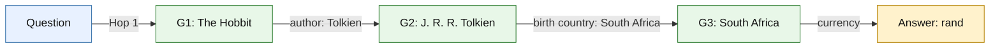
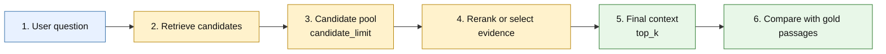
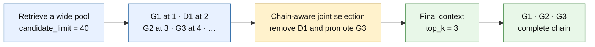

# Three-hop retrieval: Top K, Hit, and MRR

The [2Wiki compositional and inference benchmark](2wiki_multihop_benchmark.md)
is complete: final complete-chain recall at K=5 is 63.3% for flat and 83.3% for
graph on 60 bridge questions. Its report includes per-type results, selector
failures, uncertainty, and the retained MuSiQue baseline. The historical MuSiQue
example below retains its original measurements and configuration.

This example shows why ordinary Hit and MRR do not prove that a multi-hop
retriever found a complete reasoning chain.

## Beginner glossary

Before following the example, it helps to separate a few terms that sound
similar:

| Term | Plain-language meaning |
| --- | --- |
| Question | The text entered by the user. |
| Passage | A small piece of a document that the retriever can return. |
| Node | A box in a graph or diagram. A passage or an entity can be represented as a node. |
| Entity | A named thing, such as *The Hobbit*, Tolkien, or South Africa. |
| Gold passage | A passage that the benchmark dataset labels as required evidence for the answer. |
| Distractor | A retrieved passage that is not part of the required evidence chain. |
| Candidate pool | The wider set of passages available to a reranker or selector. |
| Final context | The smaller set of passages that would be given to an answering model. |
| Hop | One relationship that must be followed during reasoning, such as book → author. |
| Rank | A passage's position in a result list; rank 1 is the first result. |

In this document, `G1`, `G2`, and `G3` mean **gold passages 1, 2, and
3**. The letter `G` means *gold*, not *graph*. Each passage is drawn as a node
in the diagram, but its `G` label tells us that it is required ground-truth
evidence. `D1` means the first distractor.

Gold labels are used only after retrieval to evaluate the result. The retriever
and evidence selector must not be told which passages are gold; otherwise the
benchmark would leak the correct answer.

### What exactly is a gold passage?

A **gold passage** is a passage that the benchmark dataset marks as necessary
evidence for answering a question. “Gold” means **known correct reference
evidence**. It does not mean that the retriever ranked the passage first or gave
it a high score.

For the question in this document:

- G1 is gold because it connects *The Hobbit* to Tolkien.
- G2 is gold because it connects Tolkien to South Africa.
- G3 is gold because it connects South Africa to the rand.

The pipeline uses gold passages as follows:

1. The retriever searches without knowing which passages are gold.
2. It returns a ranked candidate list.
3. A reranker or selector may reduce that list to the final context.
4. The evaluator compares the returned passage IDs with the gold passage IDs.
5. Retrieving all the gold passages means that the complete evidence chain was
   found.

A gold passage is different from a gold answer. In this example, G1, G2, and G3
are the **gold passages**, while “rand” is the **gold answer**. The passages are
the evidence used to justify the answer.

## Example question

> What currency is used in the country where the author of *The Hobbit* was
> born?

For this simplified example, answering the question requires three supporting
passages:

| Hop | Required passage | Information contributed |
| ---: | --- | --- |
| 1 | **G1 — The Hobbit** | *The Hobbit* was written by J. R. R. Tolkien. |
| 2 | **G2 — J. R. R. Tolkien** | Tolkien was born in South Africa. |
| 3 | **G3 — South Africa** | South Africa uses the rand. |



The three hops are reasoning steps. They are not the same thing as `top_k=3`.

## How the question moves through the pipeline

The benchmark can use Flat RAG, Iterative RAG, or Graph RAG. They share the
same overall shape:



For the example question, the stages are:

1. **Receive the question.** The pipeline receives the text about the currency,
   the author's birthplace, and *The Hobbit*.
2. **Find initial passages.** Hybrid search uses semantic similarity and keyword
   matching. It may find G1 because the question explicitly mentions *The
   Hobbit*. It may not immediately find G2 or G3 because the question does not
   name Tolkien or South Africa.
3. **Build a candidate pool.** The retrieval strategy tries to add passages that
   may contain the missing links. With `candidate_limit=40`, the main retrieval
   request uses a width of 40. Iterative RAG can also retain initial seeds that
   are not duplicated in its follow-up results.
4. **Choose the final evidence.** A reranker scores individual passages, or a
   joint evidence selector chooses passages that work together. With `top_k=3`,
   at most three passages are retained.
5. **Evaluate the retrieved evidence.** The benchmark compares the retained
   passage IDs with the known gold passage IDs. It calculates Hit, MRR, support
   recall, precision, and complete-chain metrics.
6. **Answering is a later step.** An answering model could use the final context
   to produce “rand,” but the measurements in this document evaluate retrieval,
   not whether a generated answer is correct.

### How the three retrieval strategies differ

| Strategy | What it does | Main benefit | Main risk or cost |
| --- | --- | --- | --- |
| Flat RAG | Runs hybrid search using the original question. | Simple and fast; strong when the question directly names the relevant topics. | May miss bridge passages whose wording is not similar to the question. |
| Iterative RAG | Retrieves initial seed passages, extracts related titles/entities, and performs a follow-up search. | The second query can name an intermediate entity that was absent from the original question. | Adds another embedding/search operation and can follow a wrong seed. |
| Graph RAG | Retrieves seed passages, follows content-derived graph connections, and mixes graph results with ordinary search results. | Can discover bridge and later-hop passages through relationships. | Graph traversal adds latency and can introduce noisy neighbors. |

Using the example, Flat RAG may retrieve G1 directly. Iterative RAG can use
“Tolkien” from G1 in its follow-up query. Graph RAG can start from the G1
passage node and follow connected entities toward passages about Tolkien and
South Africa. Finding G1 is only a starting point; the pipeline still needs G2
and G3 to complete the chain.

## What Top K = 3 means

`top_k=3` means that evaluation examines only the first three retrieved
passages:

```text
All ranked retrieval results

rank 1     rank 2     rank 3     rank 4     rank 5 ...
  └──────────┬──────────┘
       evaluated context
          Top K = 3
```

A three-hop question can fit in this context only if all three returned
passages are the required gold passages. One distractor is enough to make the
chain incomplete.

### Top K = 40 still does not guarantee a complete chain

Increasing K changes the cutoff; it does not guarantee that retrieval found
every required passage. If G3 is ranked 41st or was never retrieved, the chain
is still incomplete at K=40.

For example:

```text
Top K = 40 candidate pool

G1 is at rank 1       ✓
G2 is at rank 7       ✓
G3 is not in Top 40   ✗

Hit@40       = 1       (at least G1 was found)
MRR@40       = 1.0     (G1 was at rank 1)
Chain Hit@40 = 0       (G3 is missing)
Chain MRR@40 = 0.0     (the chain was never completed)
```

K is therefore a capacity limit, not a completeness guarantee.

### What if South Africa is at rank 4 but final Top K = 3?

Directly truncating the raw ranking loses G3:

```text
Raw retrieval

Rank 1: G1 — The Hobbit       ✓
Rank 2: D1 — Distractor       ✗
Rank 3: G2 — Tolkien          ✓
Rank 4: G3 — South Africa     ✓  required, but outside final Top 3
```

The fix is to separate the **candidate pool** from the **final context**:



In this project, the two controls have different jobs:

| Setting | Purpose |
| --- | --- |
| `candidate_limit=40` | Give graph/search retrieval and selection a wide working pool. |
| `top_k=3` | Limit the passages delivered after reranking or joint selection. |

A reranker or joint evidence selector must see G3 in the candidate pool and
promote it above the distractor. Without a reranker or selector, the pipeline
keeps the raw first three and the chain remains incomplete.

If the selector cannot reliably choose exactly three correct passages, use
`top_k=4` (when the context budget permits) to provide one slot of slack. If G3
is absent even from the 40-candidate pool, increasing the final Top K from 3 to
4 is not sufficient: retrieval itself must improve through a better query,
iterative retrieval, graph expansion, or a wider candidate pool.

## How changing each parameter affects the result

There is no setting that is always best. Larger values usually give the system
more opportunities to find evidence, but they can also add distractors, latency,
and cost.

### `candidate_limit`: size of the working pool

`candidate_limit` controls the width of the main retrieval and graph-expansion
work before the final context is selected. The implementation always retrieves
at least `top_k`, so if `candidate_limit` is smaller than `top_k`, the effective
request is still at least `top_k` passages. Iterative RAG combines its initial
seeds with its follow-up results and then removes duplicates, so its actual
pre-selection list can be slightly larger than `candidate_limit`.

Increasing `candidate_limit`:

- Can improve support recall and Chain Hit because later-ranked gold passages
  remain available.
- Gives a reranker or joint selector more evidence to inspect.
- Increases retrieval work and the amount of text sent to a selector.
- Can add more distractors, making selection harder.
- In Graph RAG, also allows more graph-expansion results per seed.

Decreasing `candidate_limit`:

- Usually reduces latency, selector input size, and cost.
- Risks removing a required passage before selection. No reranker or selector
  can recover a passage that is absent from its candidate pool.

For example, if G3 is at candidate rank 18, `candidate_limit=10` loses it, while
`candidate_limit=40` keeps it available.

### `top_k`: size of the final context

`top_k` controls the maximum number of passages retained after retrieval and
selection.

Increasing `top_k`:

- Gives the final context more room for every required passage.
- Can improve Chain Hit and support recall when useful passages were just below
  the old cutoff.
- Increases the context tokens and downstream model cost.
- Can reduce support precision by including extra distractors.
- Can make answer generation harder if irrelevant passages contradict or
  distract from the evidence.

Decreasing `top_k`:

- Produces a smaller, cheaper, and often more focused context.
- Requires more accurate selection because every slot matters.
- Can make a complete chain impossible when the question needs more distinct
  passages than the final budget allows.

For the simplified three-passage chain, `top_k=3` has no spare slot. With
`top_k=4`, the context can contain G1, G2, G3, and one distractor. This extra
slack can improve chain completion, but precision would be `3 / 4 = 0.75`
instead of `3 / 3 = 1.0`.

These improvements are not guaranteed when the selector is run again with a
different budget: changing the budget can cause it to choose a different set or
order of passages. The simple “larger K includes the smaller K” rule applies
only when evaluating prefixes of one unchanged ranking.

### `seed_limit`: number of starting passages

`seed_limit` applies to Iterative RAG and Graph RAG. Flat RAG does not use it.

Increasing `seed_limit`:

- Raises the chance that at least one starting passage points toward the correct
  reasoning chain.
- Gives iterative query construction or graph traversal more starting entities.
- Adds query terms, graph paths, and possible noise.
- Can increase graph-traversal latency and consume candidate slots with results
  from weak seeds.

Decreasing `seed_limit`:

- Focuses work on the highest-ranked starting passages and can be faster.
- Makes the pipeline fragile when the first result is a distractor. With
  `seed_limit=1`, a wrong first passage may send all later retrieval in the wrong
  direction.

For this question, a seed containing *The Hobbit* is useful because it exposes
Tolkien. A passage that merely mentions fantasy novels may be a poor seed even
if it shares words with the question.

### `max_hops`: graph-expansion depth

`max_hops` applies only to Graph RAG. It limits how far graph traversal may
expand from a seed.

Increasing `max_hops`:

- Can reach bridge evidence that is several graph connections away.
- Can improve later-hop support recall.
- Visits more graph paths, increasing traversal latency.
- Raises the risk of topic drift and noisy, high-degree connections.

Decreasing `max_hops`:

- Keeps traversal local, faster, and easier to explain.
- Can stop before a later bridge passage is reached.

`max_hops=3` does **not** mean that the question must have exactly three
reasoning hops, and it does not guarantee that three gold passages will be
found. Reasoning hops describe the facts needed to answer the question;
`max_hops` is a search-depth limit inside the stored graph.

### Reranker and joint evidence selector

The final candidate ordering or selection policy is as important as the pool.

| Mode | Behavior | Likely impact |
| --- | --- | --- |
| No reranker or selector | Keeps retrieval order, with Graph RAG preserving required seed dependencies. | Lowest extra cost, but relevant later-ranked evidence may remain outside `top_k`. |
| Reranker | Rescores passages for relevance to the question. | Often improves early precision and MRR, but scoring passages individually may prefer redundant evidence over a complete chain. |
| Joint evidence selector | Examines candidates together and selects complementary passages. | Can improve complete-chain retrieval, but adds model latency, token cost, and possible selection failures. |

In the current pipeline, configuring an evidence selector takes precedence over
the reranker; they are not applied one after the other. A selector can promote
G3 only if G3 survived `candidate_limit`.

### `graph_source`: which graph relationships may be followed

- `content-derived` follows relationships extracted from corpus content. This is
  the normal non-oracle setting because it does not use benchmark answers.
- `gold-evidence` follows dataset-provided gold relationships. It is an oracle
  diagnostic available only for 2Wiki, not a fair production configuration.

Oracle results should never be compared directly with non-oracle results as if
they were equivalent systems.

### `pooled` versus controlled corpus mode

This is an evaluation setting rather than a ranking parameter:

- In **controlled** mode, retrieval is restricted to passages associated with
  the current case. There are fewer distractors, so the task is easier.
- In **pooled** mode, cases share a larger searchable corpus. This better tests
  whether the retriever can reject passages belonging to other questions.

Metrics from pooled and controlled runs should not be compared without clearly
labeling the corpus mode.

### Embedding and model choices

Changing the embedding model can change every initial search rank, affecting
which passages become seeds and which evidence enters the candidate pool. The
query and indexed corpus must use compatible embeddings; changing the indexed
embedding model normally requires rebuilding the index.

Changing the reranker or evidence-selector model can change final precision and
chain completion as well as latency and cost. Record model identifiers when
comparing runs so that a model change is not mistaken for an architectural
improvement.

### Quick parameter summary

| Change | Possible benefit | Possible downside | Metrics most likely to move |
| --- | --- | --- | --- |
| Increase `candidate_limit` | More gold evidence can enter the pool. | More latency, selector input, cost, and distractors. | Candidate support recall and Chain Hit. |
| Increase `top_k` | More room for a complete final chain. | More context cost and usually lower precision. | Final support recall, precision, and Chain Hit. |
| Increase `seed_limit` | More chances to start from a useful passage. | More noisy expansion and traversal work. | Graph/iterative candidate recall and latency. |
| Increase `max_hops` | Reach more distant graph evidence. | More traversal latency and topic drift. | Graph candidate recall and latency. |
| Enable a reranker | Move individually relevant passages earlier. | Extra latency; may select redundant passages. | Hit, MRR, and precision. |
| Enable a joint selector | Choose complementary evidence as a set. | Model cost, latency, and selection variability. | Final support recall, precision, and Chain Hit. |
| Use pooled mode | More realistic distractor competition. | Lower metrics and more retrieval difficulty. | Potentially all retrieval metrics. |

## Example A: complete chain

```text
Top K = 3

┌──────────────┬──────────────┬──────────────┐
│ Rank 1       │ Rank 2       │ Rank 3       │
│ G1 ✓         │ G2 ✓         │ G3 ✓         │
│ The Hobbit   │ Tolkien      │ South Africa │
└──────────────┴──────────────┴──────────────┘
       Hop 1          Hop 2          Hop 3
                                      │
                                      └── complete answer: rand
```

The first relevant passage is at rank 1, and the final required passage arrives
at rank 3.

| Metric | Value | Reason |
| --- | ---: | --- |
| Hit@3 | 1 | At least one gold passage occurs in the top three. |
| MRR@3 | 1.0 | The first gold passage is at rank 1: `1 / 1`. |
| Chain Hit@3 | 1 | All of G1, G2, and G3 occur in the top three. |
| Chain MRR@3 | 0.333 | The chain is completed at rank 3: `1 / 3`. |

## Example B: same Hit and MRR, incomplete chain

```text
Top K = 3

┌──────────────┬──────────────┬──────────────┐
│ Rank 1       │ Rank 2       │ Rank 3       │
│ G1 ✓         │ D1 ✗         │ G2 ✓         │
│ The Hobbit   │ Distractor   │ Tolkien      │
└──────────────┴──────────────┴──────────────┘
       Hop 1          noise           Hop 2

Missing G3: South Africa ──X──> currency: rand
```

| Metric | Value | Reason |
| --- | ---: | --- |
| Hit@3 | 1 | G1 and G2 are relevant, so there is a hit. |
| MRR@3 | 1.0 | The first gold passage is still at rank 1. |
| Chain Hit@3 | 0 | G3 is missing, so the chain is incomplete. |
| Chain MRR@3 | 0.0 | An incomplete chain receives zero. |

Examples A and B have identical ordinary Hit@3 and MRR@3. Those metrics cannot
distinguish a complete three-hop chain from a result that retrieves only its
first two supports.

## Example C: later first hit and incomplete chain

```text
Top K = 3

┌──────────────┬──────────────┬──────────────┐
│ Rank 1       │ Rank 2       │ Rank 3       │
│ D1 ✗         │ G1 ✓         │ G2 ✓         │
│ Distractor   │ The Hobbit   │ Tolkien      │
└──────────────┴──────────────┴──────────────┘
```

| Metric | Value | Reason |
| --- | ---: | --- |
| Hit@3 | 1 | At least one gold passage is retrieved. |
| MRR@3 | 0.5 | The first gold passage is at rank 2: `1 / 2`. |
| Chain Hit@3 | 0 | G3 is missing. |
| Chain MRR@3 | 0.0 | The chain is incomplete. |

## Metric definitions

Let `rank(Gi)` be the first rank of required passage `Gi` and let `K=3`.

```text
Hit@K       = 1 if any required passage appears by rank K; otherwise 0

MRR@K       = 1 / rank of the first required passage
              or 0 when no required passage appears by rank K

Chain Hit@K = 1 if every required passage appears by rank K; otherwise 0

Chain MRR@K = 1 / rank where the final required passage is found
              or 0 when the chain is incomplete
```

For a collection of questions, MRR and Chain MRR are the means of their
question-level reciprocal ranks.

Equal aggregate Hit@K or MRR@K between Flat RAG and Graph RAG means that the two
systems have the same **average** first-support score. It does not prove that
they find the first support at the same rank for each question, and it does not
mean that they retrieve the same number of later-hop passages. Use paired
per-question results, Chain Hit@K, Chain MRR@K, and mean support recall to
compare complete multi-hop retrieval.

## Measured Flat RAG versus Graph RAG results

These are results from one historical diagnostic run, not universal performance
claims. The run used 60 MuSiQue development questions: 20 two-hop, 20 three-hop,
and 20 four-hop questions. It searched a pooled corpus of 1,057 passages with
`candidate_limit=40`, `top_k=4`, `seed_limit=3`, and `max_hops=3`. Graph RAG
used content-derived relationships, both strategies used the same embedding and
OpenSearch configuration, no passage reranker was enabled, and the final joint
selector used `eu.anthropic.claude-sonnet-4-6`.

The chain-level metrics reveal differences that ordinary Hit and MRR hide:

| Metric | What it measures | Flat RAG | Graph RAG |
| --- | --- | ---: | ---: |
| Complete chain / Chain Hit@40 | All required passages found in the 40-candidate pool | 55.0% | **70.0%** |
| Mean support recall@40 | Average fraction of required passages found | 78.8% | **85.3%** |
| Complete chain / Chain Hit@4 | All required passages retained in the final context | 45.0% | **50.0%** |
| Mean support recall@4 | Average fraction retained in the final context | 73.1% | **76.9%** |
| Support precision@4 | Fraction of final passages that are required evidence | 51.3% | **55.0%** |
| Chain MRR@40 | How early the complete chain is assembled | 0.0701 | **0.0898** |
| Chain MRR@4 | How early the final context completes the chain | 0.1847 | **0.1972** |

Bold values show which system had the higher observed score; they do not by
themselves prove a repeatable advantage. At the 40-candidate stage, the paired
complete-chain improvement was statistically supported in this sample
(`p=0.0117`). After final selection at K=4, Graph RAG's five-percentage-point
complete-chain improvement had a 95% paired bootstrap interval from -3.3 to
+13.3 percentage points and `p=0.453`. Because that interval includes zero, this
run does not establish that Graph RAG is better after final selection; a larger
evaluation is needed.

The strongest distinction is on difficult questions:

| Complete chain in 40 candidates | Flat RAG | Graph RAG |
| --- | ---: | ---: |
| 2-hop | **90%** | 85% |
| 3-hop | 55% | **75%** |
| 4-hop | 20% | **50%** |

Ordinary Hit@4 and MRR@4 do not distinguish them:

- Hit@4: both 100%
- MRR@4: both 0.975

Those metrics only measure whether the first gold passage was found and how
early it appeared. In this run, Graph RAG's clear candidate-stage advantage was
finding more bridge and later-hop passages needed to complete the chain.

### Runtime performance

Graph traversal improves evidence coverage but adds retrieval latency:

| Stage | Flat RAG | Graph RAG | Difference |
| --- | ---: | ---: | ---: |
| Candidate retrieval median | 669 ms | 1,002 ms | +333 ms |
| Candidate retrieval p95 | 765 ms | 2,287 ms | +1,522 ms |
| Retrieval plus final selector median | 2,094 ms | 2,350 ms | +256 ms |
| Retrieval plus final selector p95 | 3,992 ms | 3,684 ms | -308 ms |

At the candidate stage, Graph RAG is approximately 50% slower at the median.
Once the shared joint evidence selector is included, the median difference is
approximately 12%. The p95 selector measurements are noisy and should not be
interpreted as evidence that Graph RAG has lower tail latency.

Overall, Graph RAG provides substantially better candidate coverage for
complex questions, but only part of that gain survives final evidence
selection, and it comes with moderately higher median latency. These are
support-retrieval measurements, not downstream answer accuracy; answer EM/F1,
citation correctness, cost, and latency should be measured together before a
production decision.

### Why Flat RAG is slightly better on two-hop questions

These questions are usually easy enough for semantic and keyword retrieval
alone. At K=40:

- Flat RAG: 18/20 complete chains = 90%
- Graph RAG: 17/20 complete chains = 85%

Graph RAG expands from initial seed passages and inserts graph-connected
candidates into the same fixed 40-passage budget. In one additional two-hop
case, graph expansion displaced a useful Flat RAG passage:

```text
Flat RAG
Top 40: [Gold hop 1, Gold hop 2, ...]
         → complete chain

Graph RAG
Top 40: [Gold hop 1, graph neighbors, ..., Gold hop 2 at rank > 40]
         → incomplete chain
```

This can happen because:

- Two-hop questions often contain enough direct lexical or semantic clues.
- Graph expansion provides less additional value for these easy cases.
- Noisy or overly broad graph connections can consume candidate slots.
- The subset contains only 20 questions, so one case changes the score by five
  percentage points.

This does not mean Flat RAG is generally stronger. The graph becomes valuable
as the chain gets harder:

- 3-hop: 55% Flat RAG versus 75% Graph RAG.
- 4-hop: 20% Flat RAG versus 50% Graph RAG.

One possible improvement is an adaptive strategy: rely mostly on Flat RAG for
confidently answered two-hop-like queries, and allocate more graph-expansion
budget when bridge evidence appears to be missing.

## Cost comparison

The benchmark does not yet contain a reliable dollar-cost comparison. It
records latency and approximate selector input size, but not Neptune uptime and
capacity, exact output-token usage, selector repair calls, or billed AWS
charges.

### Relative cost by component

| Cost component | Flat RAG | Graph RAG |
| --- | --- | --- |
| OpenSearch retrieval | Required | Required |
| Query embedding | Required | Required |
| Neptune Analytics | Not used | **Required** |
| Graph traversal | Not used | **Additional queries** |
| Evidence-selector calls | 60 | 60 |
| Selector input size | 1,399,953 characters | 1,472,496 characters |

Flat RAG and Graph RAG use the same OpenSearch retrieval, embedding model, and
joint evidence-selection model. Graph RAG additionally pays for Neptune
Analytics storage/capacity and traversal. The current measurements establish
that these are additional costs, but do not establish which incremental cost
component is the largest.

### What selector input size means

The historical input-size accounting reconstructed the title-and-text portion
of the selector's user prompt. For each question, it includes:

- The question
- The final selection budget, such as `top_k=4`
- Titles and full text from the 40 candidate passages

It does not include the system instructions, tool schema, eligible
`graph_connection` metadata, the selector's generated output, or validation
retries. It is therefore a useful passage-input proxy, not the exact size of the
complete Bedrock request or response.

| Strategy | Total input characters | Average per question | Estimated input tokens per question |
| --- | ---: | ---: | ---: |
| Flat RAG | 1,399,953 | 23,333 | 5,200–6,670 |
| Graph RAG | 1,472,496 | 24,542 | 5,450–7,010 |

Graph RAG's reconstructed title-and-text input was approximately 5.2% larger.
Across all 60 questions, this represents approximately 16,000–21,000 additional
input tokens, or approximately 270–345 additional tokens per question. The
estimate uses a range of 3.5–4.5 characters per token because exact token counts
were not available for this historical run. Graph metadata and the other
excluded request fields would change the complete totals.

Input size affects model cost, latency, and context-window usage. The output
and any validation-retry tokens were not captured, so these figures must not be
presented as the complete Bedrock cost.

### What is needed for an exact cost per question

A defensible monetary comparison still requires:

1. Neptune Analytics capacity and active hours.
2. OpenSearch capacity and active hours.
3. Exact Bedrock input, output, cache, and retry token usage.
4. Indexing and storage costs.
5. Monthly query volume over which fixed costs can be amortized.
6. Cost-allocation tags or AWS Cost Explorer measurements for the experiment.

With the current evidence, the appropriate conclusion is that Flat RAG is the
less expensive architecture. Graph RAG improves difficult multi-hop retrieval,
but its exact monetary premium—and whether that premium is justified by the
retrieval gain—has not yet been measured.
