# How LLM Inference Infrastructure Works: GPUs, vLLM, llm-d and Kubernetes

*September 18, 2026 · @Mostapha*

## 1. The Stack at a Glance

Each layer of an LLM serving stack exists because the layer below it runs out
of something: memory, parallelism, or knowledge of what the other servers are
doing.

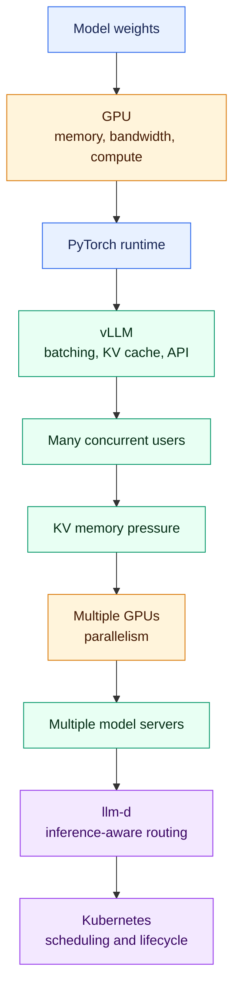

| Layer | Problem it solves | Problem it creates |
|---|---|---|
| GPU | Parallel matrix mathematics for transformer layers | Fixed memory holds both weights and inference state |
| PyTorch runtime | Executes the model | One request at a time wastes the GPU |
| vLLM | Batches requests, manages KV cache, and serves an API | KV memory can run out before compute does |
| Multiple GPUs | Fits larger models and shortens each step | Communication cost and topology constraints |
| Multiple model servers | Adds throughput | Servers hold different cached state and load |
| llm-d | Routes with knowledge of cache, queue, and KV pressure | Needs a cluster on which to run |
| Kubernetes | Schedules, restarts, and scales the fleet | Adds orchestration overhead that must be measured |

The rest of this document works up that chain. The recurring theme is that GPU
memory, rather than GPU compute, often limits how many users a deployment can
serve.

---

## 2. The Hardware That Matters

Three accelerator properties determine LLM serving performance. Peak TFLOPS
is the least useful of them on its own.

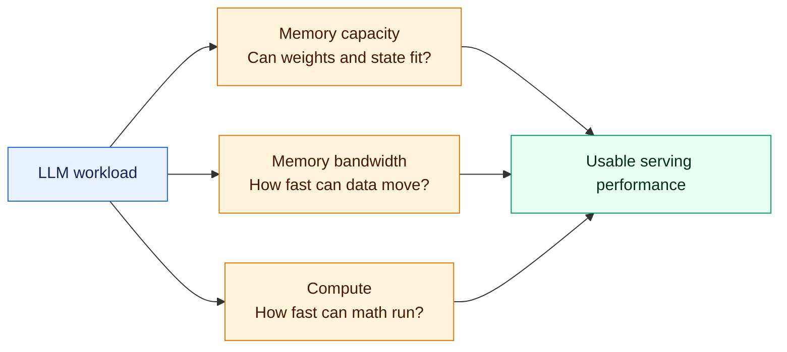

| Property | What it determines | When it binds |
|---|---|---|
| Memory capacity (HBM or GDDR) | Whether the model fits and how much room remains for inference state | Always: it caps concurrency |
| Memory bandwidth | How quickly weights can be streamed to compute units | Token generation, especially at small batch sizes |
| Compute (BF16, FP8, FP4 throughput) | How quickly large token batches are processed | Prompt processing and generation at large batch sizes |

A rough memory budget for one GPU is:

$$
\text{GPU memory} =
\text{model weight shard} +
\text{KV cache} +
\text{activations} +
\text{graphs and kernels} +
\text{communication buffers}
$$

Each term represents a different consumer of GPU memory:

- **Model-weight shard:** The model parameters stored on this GPU. A single-GPU
  deployment may hold the complete model, while a multi-GPU deployment divides
  the weights into shards.
- **KV cache:** The attention state retained for active requests. It grows with
  prompt length, generated output, and the number of concurrent sequences.
- **Activations:** Temporary intermediate results produced while transformer
  layers process tokens.
- **Graphs and kernels:** Memory used by compiled GPU operations, CUDA graphs,
  and execution workspaces.
- **Communication buffers:** Temporary storage used to exchange tensors between
  GPUs during distributed inference.

Model weights consume a mostly fixed amount after loading. The KV cache is the
largest dynamic component in many deployments and often determines how many
requests can run concurrently. Some GPU memory must also remain available as a
safety margin for temporary allocations and workload variation.

### Precision Is the First Lever

Weight precision affects both fit and speed. Fewer bytes per parameter mean
less memory consumption and less traffic per token.

| Precision | Bytes per parameter | Approximate weights for a 70B model |
|---|---:|---:|
| BF16 | 2 | ~140 GB |
| FP8 | 1 | ~71 GB |
| 4-bit (MXFP4, NVFP4, INT4) | ~0.53-0.56 including scales | ~38-42 GB |

Four-bit formats are not exactly four bits per stored parameter. MXFP4 adds an
8-bit scale per 32 values, NVFP4 adds an FP8 scale per 16 values, and embeddings
are often kept at BF16. Quantization can also change model quality, as discussed
in section 9.

Once a model spans GPUs, interconnect belongs on the hardware list too. NVLink
or an equivalent link within a server provides much more bandwidth than the
Ethernet or InfiniBand fabric between servers. Parallelism strategies must
therefore respect the physical topology, as section 10 explains.

---

## 3. Prefill and Decode

One request creates two different workloads. Prefill processes the prompt in
parallel; decode then generates output tokens one step at a time.

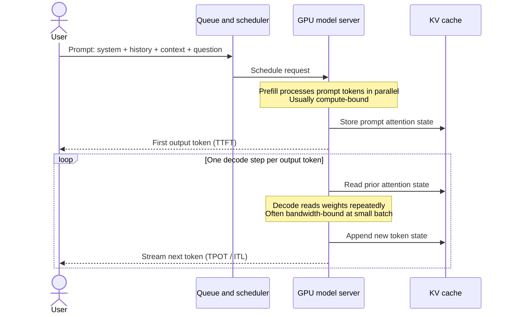

| Phase | Work per step | Usually limited by | User-visible metric |
|---|---|---|---|
| Prefill | All prompt tokens at once | Compute | TTFT |
| Decode | One token per active sequence | Memory bandwidth at small batch; compute at large batch | TPOT and ITL |

### The Metrics

- **TTFT (time to first token)** measures request start to the first output
  token. It includes queueing, routing, and scheduling, not only prompt
  computation. A long queue raises TTFT just as a long prompt does.
- **TPOT (time per output token)** is the average time between output tokens
  for one request. A TPOT of 20 ms is approximately 50 tokens per second;
  100 ms per token feels much slower.
- **ITL (inter-token latency)** is the distribution of individual gaps. Its
  tail exposes stalls that average TPOT hides, such as another request's
  prefill joining the batch.
- **End-to-end latency** measures the complete request:

$$
\text{end-to-end latency}
\approx
\text{TTFT} + (\text{output tokens} - 1) \times \text{TPOT}
$$

For a 500-token answer at 40 ms per token, generation takes about 20 seconds.
That duration matters for the concurrency arithmetic in section 5.

For reasoning models, hidden reasoning tokens consume decode capacity before
anything appears. Time to first *visible* token is therefore worth measuring
separately.

The decode picture also differs for mixture-of-experts models. Only active
experts' weights are read for each token, so bandwidth demand scales with
active parameters rather than total parameters, while memory still holds all
experts.

---

## 4. KV Cache

The KV cache stores attention state for every token the model has already seen.
It prevents generation of token $n+1$ from recomputing tokens 1 through $n$.
This saves enormous computation by spending GPU memory instead.

> **Illustration and version note:** the animated PagedAttention figures in
> this section were created by the vLLM authors for the June 2023 article
> [vLLM: Easy, Fast, and Cheap LLM Serving with PagedAttention](https://vllm.ai/blog/2023-06-20-vllm).
> They are loaded from the official vLLM website and are referenced, not copied
> into this repository. They explain the original design clearly, but current
> cache-manager classes, block layouts, defaults, and supported features can
> differ by vLLM version.

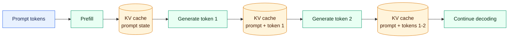

### How Big It Is

Cache size per token depends on the attention architecture, not only context
length. Different designs can vary by an order of magnitude.

| Architecture | Bytes per token | Example |
|---|---|---|
| Multi-head attention (MHA) | $2 \times layers \times heads \times head\ dimension \times precision$ | Older models; largest cache |
| Grouped-query attention (GQA) | Same formula, using KV heads only | 80 layers, 8 KV heads, 128 dimensions: ~328 KB/token at BF16 or ~164 KB at FP8 |
| Multi-head latent attention (MLA) | $layers \times (latent\ dimension + RoPE\ dimension) \times precision$ | Compressed to tens of KB/token for some 600B-class models |
| Sliding-window layers | Capped at the window size | Adds a fixed amount per sequence instead of growing indefinitely |

For MHA and GQA, the expanded formula is:

$$
\text{KV bytes per token}
=
2 \times
\text{layers} \times
\text{KV heads} \times
\text{head dimension} \times
\text{bytes per value}
$$

The leading factor of 2 represents the two vectors stored by attention: one
**Key** vector and one **Value** vector. The remaining factors represent how
many transformer layers store them, how many KV heads each layer has, how many
values each head contains, and how many bytes are used for each value.

For example, consider a GQA model with 80 layers, 8 KV heads, and a head
dimension of 128. With BF16, each value occupies 2 bytes:

$$
2 \times 80 \times 8 \times 128 \times 2
= 327{,}680\ \text{bytes per token}
\approx 328\ \text{KB per token}
$$

With FP8, each value occupies 1 byte, so the same cache requires approximately
164 KB per token.

The attention architectures reduce memory in different ways:

- **MHA:** Every attention head has its own Key and Value vectors, producing the
  largest KV cache.
- **GQA:** Several query heads share a smaller number of KV heads, substantially
  reducing the cache.
- **MLA:** Key and Value information is compressed into a smaller latent
  representation.
- **Sliding-window attention:** Only the most recent tokens are retained. Once
  the window is full, older entries are discarded, so cache use stops growing
  for those layers.

The table describes memory for one token. Total KV-cache memory also depends on
the number of cached tokens and active sequences:

$$
\text{total KV memory}
=
\text{bytes per token} \times
\text{cached tokens per sequence} \times
\text{active sequences}
$$

Using the BF16 example, one sequence containing 8,000 cached tokens needs
approximately $328\ \text{KB} \times 8{,}000 = 2.6\ \text{GB}$. FP8 KV reduces
that to approximately 1.3 GB.

KV precision is an independent lever. FP8 KV roughly halves cache size compared
with BF16, potentially at a quality cost for long-context retrieval.

### How It Is Allocated

Naive allocation reserves the maximum context length for every sequence and
wastes most of it. vLLM's PagedAttention stores the cache in fixed-size blocks:

*Illustration: [PagedAttention block layout](https://vllm.ai/blog-assets/figures/annimation0.gif), from the [official vLLM PagedAttention article](https://vllm.ai/blog/2023-06-20-vllm), by Woosuk Kwon et al.*

#### Reading the block-layout animation

- The sequence is logically continuous even though its KV blocks are scattered
  across physical GPU memory.
- A block table supplies the translation from logical block order to physical
  block locations.
- The attention kernel follows this mapping when it reads historical keys and
  values.
- Any suitable free physical block can extend the sequence; the allocator does
  not need to find one large adjacent region.

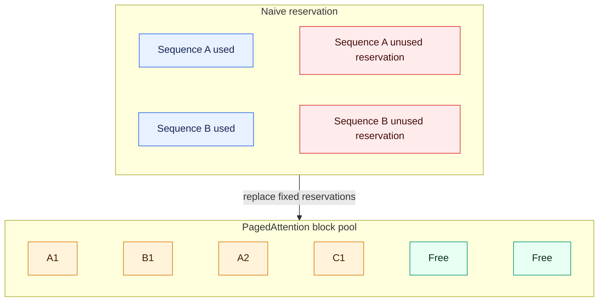

In the naive design, each sequence reserves enough memory for its maximum
possible context length. If a request can grow to 32,000 tokens but currently
contains only 2,000, most of that reservation remains empty and unavailable to
other requests. The diagram labels these areas as `Sequence A unused
reservation` and `Sequence B unused reservation`.

PagedAttention replaces those large fixed reservations with a shared pool of
small, fixed-size blocks:

- `A1` and `A2` are blocks used by Sequence A.
- `B1` is a block used by Sequence B.
- `C1` is a block used by Sequence C.
- `Free` blocks can be assigned to any sequence when it grows.

The blocks belonging to a sequence do not need to be physically adjacent in
GPU memory. vLLM maintains a mapping from each sequence's logical KV-cache
positions to their physical blocks. A sequence therefore consumes blocks only
as it needs them, and a completed sequence immediately returns its blocks to
the shared pool.

This design provides several benefits:

- unused memory is available to other requests instead of being reserved;
- internal waste is limited to the unused portion of a sequence's final block;
- more concurrent sequences can fit into the same GPU memory;
- identical prefix blocks can be shared between requests, enabling the prefix
  caching described in section 7.

In the Mermaid source, `~~~` creates an invisible connection. It places the
memory blocks next to each other without drawing an arrow. The `classDef` and
`class` lines assign colors to used, wasted, allocated, and free memory.

### How One Request Grows

*Illustration: [PagedAttention generation process](https://vllm.ai/blog-assets/figures/annimation1.gif), from the [official vLLM PagedAttention article](https://vllm.ai/blog/2023-06-20-vllm), by Woosuk Kwon et al.*

#### Reading the request-growth animation

1. Prompt processing fills the first logical blocks and records their physical
   block IDs in the request's block table.
2. Decode appends one token's K/V state at a time to the partially filled final
   block.
3. When that block fills, the allocator takes another block from the free pool
   and appends its ID to the block table.
4. Physical block numbers need not be adjacent or numerically ordered.
5. When generation finishes, the request releases its physical blocks for
   reuse, subject to any remaining shared references.

The final block is the main source of internal fragmentation. If a block holds
16 token positions and the request uses only one position in its last block,
15 positions are temporarily unused. Unlike a maximum-length reservation, the
waste is bounded to the unfilled tail rather than the request's entire possible
future context.

### How Prefix Blocks Are Shared

Parallel sampling and beam search can produce several continuations from the
same prompt. Their prompt K/V state is identical until the sequences diverge,
so their block tables can initially point to the same physical prefix blocks.

*Illustration: [Parallel sampling with shared KV blocks](https://vllm.ai/blog-assets/figures/annimation2.gif), from the [official vLLM PagedAttention article](https://vllm.ai/blog/2023-06-20-vllm), by Woosuk Kwon et al.*

#### Reading the shared-prefix animation

- Several logical sequences originate from one prompt.
- Their logical prefix entries map to the same physical blocks rather than to
  duplicated copies.
- Reference counts or equivalent ownership metadata prevent a shared block
  from returning to the free pool while another sequence still uses it.
- Each continuation allocates private blocks as its generated suffix grows.

Sharing saves both KV memory and the prompt computation that produced the
shared state. It is possible only where token IDs, positions, model state, and
other cache-identity inputs are compatible.

### Copy-on-Write When Sequences Diverge

*Illustration: [Copy-on-write during parallel generation](https://vllm.ai/blog-assets/figures/annimation3.gif), from the [official vLLM PagedAttention article](https://vllm.ai/blog/2023-06-20-vllm), by Woosuk Kwon et al.*

#### Reading the copy-on-write animation

1. Two sequences initially map a logical block to the same physical block.
2. One sequence needs to write a different continuation into that shared
   block.
3. The cache manager allocates a new physical block and copies the required
   existing contents.
4. The writer's block-table entry is changed to the private copy.
5. The other sequence continues pointing to the original block unchanged.

This is copy-on-write: sharing remains cheap while data is identical, and a
copy is created only at the point where a write would make the states differ.
Modern automatic prefix caching and cache-management implementations have
evolved since the original article, so current sharing rules should be checked
against version-matched vLLM documentation.

When the cache fills, the server generally preempts sequences rather than
failing immediately. It evicts and later recomputes or swaps their state.
Preemption count is therefore an important metric: users experience it as
latency spikes rather than explicit errors.

---

## 5. Context Length, Concurrency and Memory

Context length and concurrency compete for the same memory pool. Consequently,
"how many users?" is meaningless unless prompt and output lengths are stated.

$$
\text{available KV memory} =
\text{GPU memory} -
\text{weight shards} -
\text{activations} -
\text{graphs} -
\text{communication buffers}
$$

$$
\text{memory concurrency}
=
\frac{\text{available KV memory}}
{\text{KV bytes per active sequence}}
$$

A sequence with $I$ input tokens and $O$ output tokens holds about $I + O/2$
tokens on average over its lifetime and $I + O$ tokens at its peak.

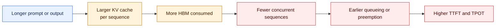

### Worked Example

A 70B model at FP8 on two H200s, with about 282 GB total memory, leaves roughly
167 GB for KV after weights and runtime reserves. At 164 KB per token, that is
approximately one million cached tokens.

The rounded memory budget behind that estimate is:

$$
\underbrace{282\ \text{GB}}_{\text{total GPU memory}}
-
\underbrace{70\ \text{GB}}_{\text{FP8 model weights}}
-
\underbrace{45\ \text{GB}}_{\text{runtime reserve}}
=
\underbrace{167\ \text{GB}}_{\text{available for KV cache}}
$$

The 45 GB runtime reserve is memory used by activations, CUDA graphs and kernels,
temporary calculations, communication buffers, framework overhead, and safety
headroom that helps avoid out-of-memory failures. It is an illustrative estimate,
not a fixed value: the actual reserve depends on the model, batch size, parallelism,
CUDA graph settings, and vLLM configuration.

| Tokens held per sequence | Approximate concurrent sequences |
|---:|---:|
| 2,000 | 500 |
| 8,250 (8K prompt, 500 output) | 121 |
| 32,000 | 31 |
| 128,000 | 7 |

The same hardware can therefore serve roughly 500 short chats or seven
long-context requests. Both cases can report 100% utilization.

### Concurrency Is Not the Same as Users

Users create an arrival rate. Little's law connects that rate to concurrency:

$$
\text{concurrent sequences}
=
\text{arrival rate} \times \text{mean end-to-end latency}
$$

At 20 seconds per request, 10 requests per second produce approximately 200
sequences in flight. If memory holds only 121, the server queues or preempts
requests, increasing latency.

Usable capacity is the smallest of three limits:

$$
\text{usable capacity}
=
\min(\text{memory limit},\ \text{compute limit},\ \text{latency limit})
$$

A deployment that fits 200 sequences in memory may sustain only 80 while
meeting its TTFT and TPOT targets. The memory number is a ceiling, not the
production capacity.

---

## 6. Continuous Batching and Where It Stops

Batching makes a GPU economical: one pass over the weights serves every active
sequence in the batch, so throughput initially rises faster than latency.

Static batching waits to collect a batch and retains it until its slowest
member finishes. This wastes capacity when generation lengths vary. Continuous
batching, also called in-flight batching, adds and removes sequences at every
step. A completed sequence leaves immediately and a waiting request takes its
place. This is vLLM's default approach and a major reason a dedicated model
server outperforms a simple loop around PyTorch.

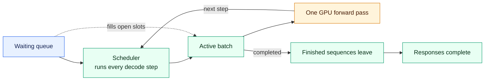

### Where It Stops Scaling

| Memory region | What makes it grow |
|---|---|
| Model weights | Fixed once loaded |
| KV cache | Number and length of active sequences |
| Activations, graphs, and communication buffers | Batch and parallelism settings |

Three things happen as the batch grows:

1. **Throughput rises, then flattens.** Once the GPU is saturated, adding
   sequences creates queueing rather than more output.
2. **Per-user speed falls.** Step time rises as more sequences share the GPU,
   increasing TPOT and reducing interactivity.
3. **Memory runs out.** On large models, KV capacity often binds before compute,
   causing sequence preemption.

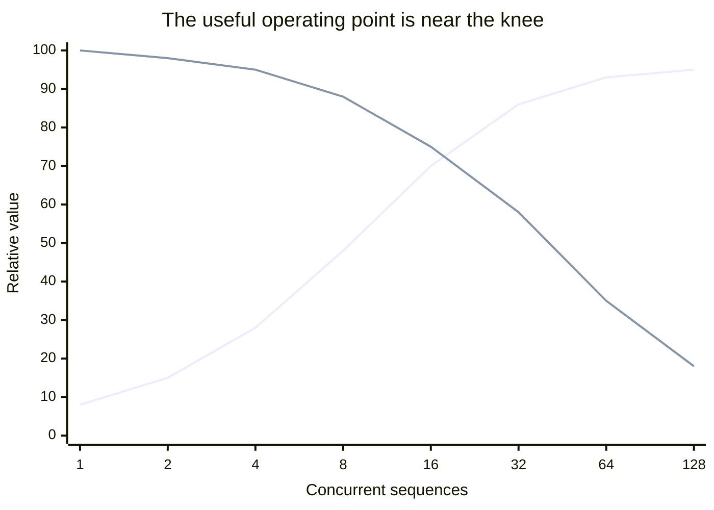

- **Before the knee (about 1-16 sequences):** Adding concurrency uses the GPU
  more efficiently, so total throughput rises quickly while per-user
  responsiveness declines only moderately.
- **Near the knee (about 16-32 sequences):** Throughput begins to flatten and
  responsiveness starts falling much faster. This is the likely operating
  region if TTFT, TPOT, and memory targets are still satisfied.
- **After the knee (above about 32 sequences):** Additional requests provide
  little extra throughput but substantially worsen each user's latency and can
  trigger queueing or KV-cache preemption.

The crossing of the two normalized curves does not define the knee. The knee is
the region where marginal throughput gains become small compared with the
increase in user latency. Its actual location must be measured for the specific
model, hardware, prompt lengths, and serving configuration.

The deployment therefore has an **operating point**, not merely a maximum.
Beyond the knee of the curve, total throughput improves little while every
user's experience worsens.

---

## 7. Prefix Caching and Cache Locality

Enterprise traffic repeats stable prefixes: system prompts, policy text, tool
definitions, or retrieved documents appear at the front of many requests.
Prefix caching processes that shared portion once and reuses its KV blocks.

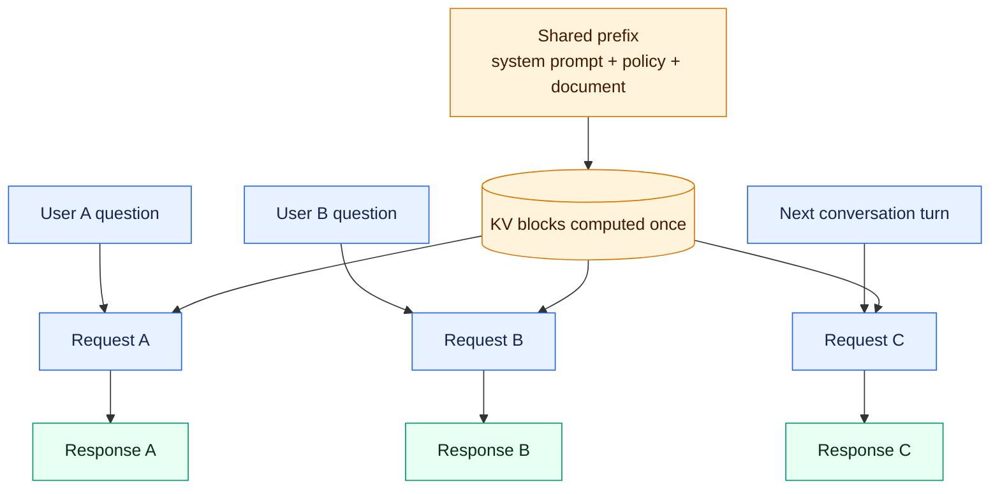

The effect is greatest when prefill dominates. An 8K-token prompt with a
6K-token shared prefix pays for only 2K tokens of new prefill on a hit. This
reduces TTFT and frees compute for other requests. Multi-turn chat benefits for
the same reason: each turn resends the conversation prefix.

Two caveats matter:

- **Hit rates fall under memory pressure.** Cached blocks compete with active
  sequences and are evicted as concurrency grows. Measure hit rate at the real
  operating point, not on an idle server.
- **Benchmarks are easy to inflate.** Repeating identical prompts measures the
  cache rather than the model. Record and reset cache state when comparing
  configurations.

### Why This Reaches the Routing Layer

A cached prefix usually lives in one server's local memory. Sending the
follow-up elsewhere discards that locality:

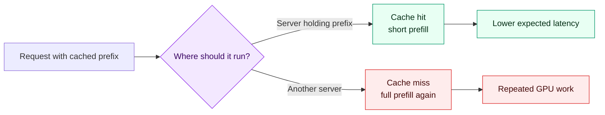

This is the first reason model servers are not interchangeable. Routing becomes
part of inference optimization rather than ordinary networking.

---

## 8. Prefill-Decode Interference

When both phases share a GPU, they interfere. A long prefill can block decode
steps in the same batch, stretching every active user's ITL. Queued decode work
can also delay prefill and raise TTFT.

| Approach | How it works | Gains | Costs |
|---|---|---|---|
| Chunked prefill | Splits long prompts into token-budget chunks and mixes each chunk with ongoing decodes | Smooths ITL spikes, preserves one homogeneous pool, and is simpler to operate | Prefill completes later, cached blocks are reread per chunk, and interference is reduced rather than eliminated |
| Prefill/decode disaggregation | Separate GPU pools; prefill produces the first token and KV state, which transfer to a decode pool | Each phase scales independently and interference is removed | KV transfer consumes fabric bandwidth; more components and coupled failure modes |

Chunked prefill is the usual default for vLLM deployments. Disaggregation earns
its complexity when the phases have very different demands or latency targets
are strict.

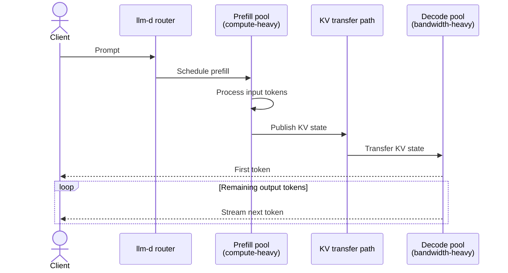

The workload determines the ratio between pools:

| Workload | Example | Needs more |
|---|---|---|
| Long prompt, short answer | RAG over documents, classification | Prefill capacity |
| Short prompt, long answer | Reasoning, code generation, long-form summarization | Decode capacity |
| Long prompt, long answer | Agentic sessions with accumulated context | Both, plus KV capacity |

Disaggregation makes the transfer path a first-class concern. The KV state for
a long prompt can be gigabytes, so the link between pools must carry it without
adding visibly to TTFT.

---

## 9. Other Levers and the Quality Caveat

Beyond batching and caching, four techniques materially change capacity. Each
has a cost, and three can alter the model's output.

| Lever | What it buys | What it costs |
|---|---|---|
| Weight quantization (FP8, FP4, INT4) | Smaller weights, less bandwidth per token, more room for KV | Potential accuracy loss, particularly for reasoning and long context |
| KV-cache quantization (FP8 KV) | Roughly twice as many cached tokens | Potential degradation in long-context retrieval |
| Speculative decoding | A draft model proposes tokens and the target verifies them together, lowering TPOT at low batch | Extra memory and compute; gains shrink at high batch and depend on acceptance rate |
| KV offloading to host memory or NVMe | Longer contexts and better cache retention than HBM alone | Transfer latency when offloaded state is needed |

### The Quality Caveat

A configuration that is 40% faster but three points worse on reasoning is not
simply faster; it is a different product.

Any deployment that changes precision or decoding should be compared with the
same model at native precision, using a fixed evaluation set and the intended
serving concurrency. Batched kernels can alter numerical behavior. Speculative
decoding is lossless in principle; comparing greedy outputs with the target
model is a practical implementation check.

Acceptance rate needs the same skepticism. A result measured on random-token
prompts says little because the draft model has no realistic text to predict.
Measure it using representative workload traffic.

---

## 10. Scaling Beyond One GPU

A model spans GPUs either because it does not fit on one or because splitting
it reduces step time and TPOT. The reason determines the parallelism strategy.

| Strategy | What it splits | Communication | Use it for |
|---|---|---|---|
| Tensor parallelism (TP) | Each layer's matrices across GPUs | All-reduce at every layer; heavy and needs fast intra-node links | Fitting large models and reducing per-step latency |
| Pipeline parallelism (PP) | Layers into sequential stages | Activations between stages; comparatively light | Spanning weaker links such as cross-node fabrics |
| Data parallelism (DP) | Nothing; each replica holds the full model | None between replicas during inference | Throughput after one replica meets the latency target |
| Expert parallelism (EP) | MoE experts across GPUs | All-to-all per token; sensitive to expert imbalance | Large mixture-of-experts models |

Strategies combine. A common layout uses TP within a node, PP or EP across
nodes, and DP replicas above them.

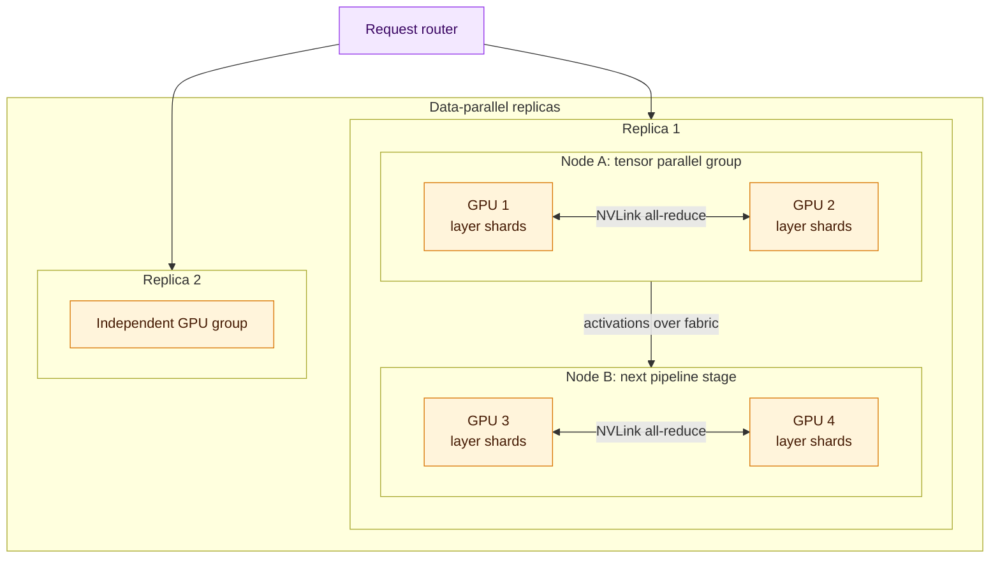

### Topology Determines What Works

GPU links within a server, such as NVLink, provide much more bandwidth than the
fabric between servers. Tensor parallelism normally stays within a node while
looser coupling crosses node boundaries. Scheduling must honor this topology:
two free GPUs in different servers are not equivalent to two GPUs in one
NVLink domain.

### Judging Whether It Worked

More GPUs are not automatically better. When a model does not fit on one GPU,
"N times one GPU" is also the wrong baseline. Compare per-GPU throughput at the
same latency target with the smallest configuration that fits:

$$
\operatorname{efficiency}(N)
=
\frac{\operatorname{throughput}(N) / N}
{\operatorname{throughput}(N_0) / N_0}
$$

Efficiency above 100% can be real: additional GPUs add memory, enabling larger
batches. Efficiency below 100% may still be acceptable when only the larger
configuration meets a strict TPOT target. Communication time as a share of step
time, and expert imbalance for MoE, explain much of the shortfall.

---

## 11. Routing Across Model Servers

### Why a Traditional Load Balancer Is Not Enough

With several model servers, routing is an inference decision. Sending a request
to the wrong replica can recompute a prefix already held elsewhere.

Round robin assumes interchangeable, stateless backends. LLM servers differ at
every instant in queue depth, active batch, free KV capacity, cached prefixes,
and memory pressure.

That difference has direct consequences:

- **A wrong route repeats GPU work.** If one replica already holds a reusable
  prefix but the next request goes elsewhere, the new replica must run the
  prefill again.
- **Free compute does not imply free capacity.** A replica may have available
  compute but insufficient KV-cache memory to admit another long sequence.
- **Cached work creates locality.** A moderately busy replica with a matching
  prefix can complete a request sooner than an idle replica that must process
  the entire prompt.
- **Request costs vary dramatically.** A 200-token chat turn and a 100K-token
  document should not be treated as equivalent units of work.
- **Responses are long-lived streams.** One request can keep generating tokens
  long after another finishes, so connection count alone does not describe the
  remaining GPU work or memory pressure.
- **Some pools have specialized roles.** In a disaggregated deployment, prefill
  and decode servers perform different work. A generic load balancer does not
  know which phase should run in which pool or how to coordinate the KV transfer.

Routing is therefore part of inference optimization, not merely a networking
function. The best backend is the one with the lowest expected completion cost
while still meeting the request's latency objective, not necessarily the next
backend in a list or the one with the lowest current utilization.

| Signal | Question it answers |
|---|---|
| Prefix-cache locality | Does a replica already hold this request's prefix? |
| Queue depth and running batch | How much work is already waiting? |
| KV-cache utilization | Does the replica have room for another sequence? |
| Expected cost | Is this a 200-token chat turn or a 100K-token document? |
| Predicted latency | Which replica is expected to meet this request's SLO? |

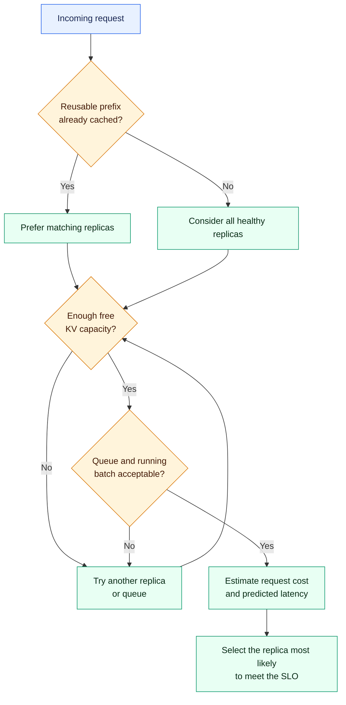

### llm-d

The boundary between vLLM and llm-d is easiest to express as two questions:

> **vLLM:** How can one model server use its GPUs efficiently while serving
> many active sequences?

> **llm-d:** How should requests and inference work be coordinated across a
> distributed fleet of those model servers?

llm-d is a distributed inference orchestration layer for model servers running
on Kubernetes. It is not an LLM and it does not replace vLLM. Instead, it adds
cluster-level coordination around vLLM or another supported model server.

vLLM owns work **inside one replica**: model execution, continuous batching,
scheduling, PagedAttention, and local KV- and prefix-cache management. llm-d
coordinates work **across the fleet**: it can route requests using server load
and prefix-cache locality, apply flow control and priorities, coordinate separate
prefill and decode pools, and support autoscaling. Once llm-d selects a replica,
that replica's vLLM scheduler places the request into its local continuous batch.

The short mental model is:

> **vLLM manages requests within an inference engine; llm-d manages traffic and
> specialized work across the inference cluster.**

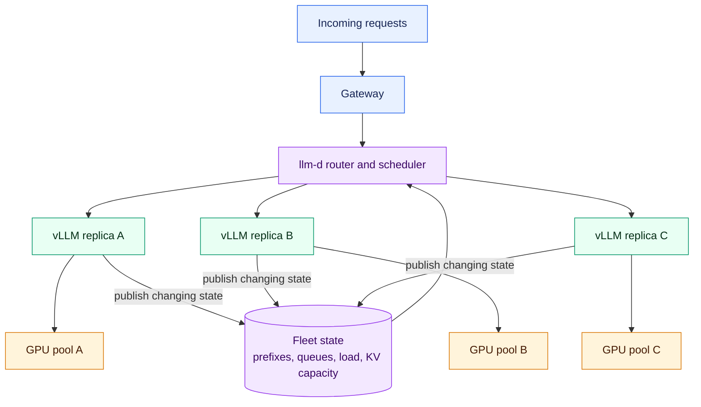

The feedback loop is important. After every admission, completion, cache
allocation, or eviction, the replicas' states change. llm-d continually uses
that changing state rather than assuming all replicas remain equivalent.

A simplified request path is:

1. The gateway receives a request and sends it to the llm-d routing layer.
2. The router identifies reusable-prefix opportunities and estimates request
   cost from prompt and expected output characteristics.
3. It evaluates candidate replicas using cache locality, queue depth, active
   batches, available KV capacity, and predicted latency.
4. It selects a replica expected to meet the SLO with the least repeated work.
5. The chosen vLLM replica schedules the request into its continuous batch and
   manages its local KV cache.
6. Updated cache and load state feeds back into subsequent routing decisions.

llm-d is a Kubernetes-native distributed inference stack built on vLLM and the
Gateway API Inference Extension. It does not replace either vLLM or Kubernetes:

| Layer | Scope |
|---|---|
| vLLM | Efficient model execution inside each inference replica |
| llm-d | Inference-aware coordination and routing across replicas or pools |
| Kubernetes | Placement, lifecycle, recovery, and resource management for the complete fleet |

### Well-Lit Paths

llm-d calls its tested distributed-inference patterns **well-lit paths**. The
idea is to provide a known architecture for recurring optimization problems,
rather than asking every organization to assemble and validate all components
from scratch.

The documented foundations include:

- optimized and prefix-cache-aware routing;
- predicted-latency routing;
- tiered prefix caching to CPU memory or NVMe;
- prefill/decode disaggregation;
- wide expert parallelism for MoE models;
- flow control and fairness;
- inference-pool autoscaling and fast model actuation;
- composed workload paths for agentic, multimodal, and batch serving.

These paths can be composed according to the workload. For example, a
long-context RAG service may combine prefix-cache-aware routing with tiered KV
storage, while a reasoning workload may combine prefill/decode disaggregation
with independently scaled decode capacity.

Precise prefix-cache routing is the clearest example. vLLM creates reusable
prefix state inside a replica. llm-d tries to preserve that locality when it
routes related requests. A conventional load balancer can scatter them across
replicas, destroy the benefit, and force the GPUs to repeat prefill work that
the fleet has already paid for.

### How It Is Deployed

On Kubernetes, KServe's `LLMInferenceService` wraps llm-d in a single custom
resource. It provisions the router and scheduler alongside an inference pool of
vLLM workers. It supports single-node, multi-node, disaggregated, and combined
data- and expert-parallel layouts. The router scales independently from the
worker pool.

This separation matters operationally. More routing replicas can be added to
handle connection or scheduling load without loading additional model copies,
while the inference pool can scale according to queue depth, KV pressure, or
the capacity required by a particular serving layout.

---

## 12. Kubernetes and Who Does What

Kubernetes is the control plane underneath the serving stack. It places model
servers on GPUs, restarts them, scales them, and manages their lifecycle. vLLM
and llm-d handle the inference-specific work.

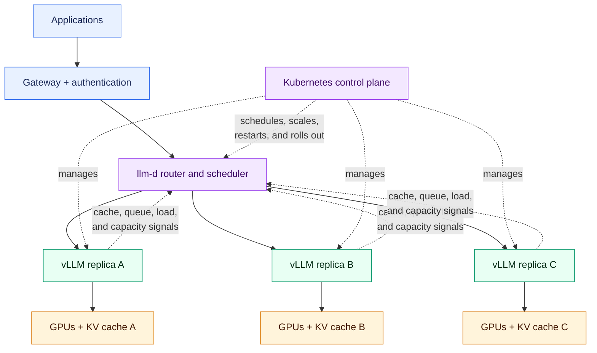

| Responsibility | Owner |
|---|---|
| Execute the model and expose an OpenAI-compatible API | vLLM |
| Continuous batching, KV-cache, and prefix-cache management | vLLM |
| Tensor, pipeline, and expert parallelism within a replica | vLLM and its distributed runtime |
| Cache-, load-, and KV-aware routing between replicas | llm-d router and scheduler |
| Prefill/decode disaggregation and KV transfer | llm-d |
| Declare the complete serving topology | KServe `LLMInferenceService` |
| Place replicas on GPUs with the correct topology | Kubernetes scheduler, often GPU-aware |
| Scale replicas using queue depth or KV utilization | Autoscaler |
| Restart, rollout, recovery, quotas, and multi-tenancy | Kubernetes |

### What Kubernetes Adds to Measure

Orchestration has specific, measurable costs:

- CPU limits can throttle tokenization and scheduling loops.
- NUMA misalignment can separate GPUs from the optimal CPUs or NICs.
- Overlay networking can slow collective communication.
- Each gateway or sidecar hop adds latency to TTFT.

Model load time also becomes an operational metric. Pulling and loading a large
model, then capturing CUDA graphs and compiling kernels, can take minutes. That
sets the lower bound on autoscaling response time. Local caches for weights and
compiled artifacts can reduce it.

---

## 13. Bottlenecks, Metrics and Honest Measurement

The stack reduces to four bottlenecks, each with metrics that reveal it. Peak
TFLOPS alone reveals none of them.

| Bottleneck | How it appears | What to watch |
|---|---|---|
| Compute | TTFT rises with prompt length even at low load | Prefill throughput and GPU utilization during prefill |
| Memory bandwidth | TPOT remains high, particularly at small batch | Output tokens/s per user and achieved bandwidth |
| Memory capacity | Concurrency stops growing with compute to spare; sequences are preempted | KV utilization, preemption count, and waiting queue |
| Distributed system | Weak multi-GPU scaling, uneven replicas, and recomputed prefixes | Communication share of step time, queue imbalance, and prefix-cache hit rate |

### Metrics Worth Reporting

| Group | Metrics |
|---|---|
| User experience | TTFT, TPOT, ITL, and end-to-end latency at p50, p90, and p99 |
| Capacity | Output tokens/s, input tokens/s, requests/s, and concurrent sequences |
| Memory | Weight memory, KV utilization, prefix-cache hit rate, and preemptions |
| Infrastructure | GPU utilization and memory, queue depth, routing imbalance, and power |

Requests per second is meaningless without input and output lengths. A
200-token chat turn and a 100K-token document request are different units of
work.

### How to Measure Honestly

```mermaid
flowchart LR
    SLO[Define TTFT and TPOT SLOs] --> LOAD[Send open-loop traffic]
    LOAD --> SWEEP[Sweep arrival rate<br/>until SLO failure]
    SWEEP --> CONTEXT[Vary context and<br/>output lengths]
    CONTEXT --> CACHE[Record and control<br/>cache state]
    CACHE --> QUALITY[Evaluate quality at<br/>serving concurrency]
    QUALITY --> CURVE[Keep the full curve:<br/>throughput vs. user latency]

    classDef setup fill:#e8f1ff,stroke:#2563eb,color:#172554
    classDef test fill:#fff4db,stroke:#d97706,color:#451a03
    classDef result fill:#e8fff3,stroke:#059669,color:#052e16
    class SLO,LOAD setup
    class SWEEP,CONTEXT,CACHE,QUALITY test
    class CURVE result
```

1. **Define capacity against an SLO.** The useful number is the highest
   sustained load at which nearly all requests meet their TTFT and TPOT targets,
   not the peak tokens per second emitted by a saturated server.
2. **Send load open-loop.** Fixed-concurrency tests start a request only when
   another finishes and cannot reveal a growing queue. Real users arrive
   independently of completions.
3. **Sweep rather than spot-check.** Increase load until the SLO fails and keep
   the complete curve. Throughput per GPU versus per-user speed is the view
   needed for deployment decisions.
4. **Control caches.** Record whether prefix caching is enabled and what it hit.
   Repeated benchmark prompts otherwise measure the cache.
5. **Vary context length separately from user count.** Prompts of 2K, 8K, 32K,
   and 128K tokens create different capacity on identical hardware.
6. **Check quality alongside speed.** Quantization or decoding changes need an
   accuracy comparison at serving concurrency before their throughput gains
   count.

---

## Sources

- Woosuk Kwon et al., [*vLLM: Easy, Fast, and Cheap LLM Serving with
  PagedAttention*](https://vllm.ai/blog/2023-06-20-vllm), official vLLM blog,
  June 20, 2023. The four animated KV-cache figures in section 4 are referenced
  from this article.
- llm-d, *Well-Lit Paths*, documentation v0.9.
- KServe, *Understanding LLMInferenceService*, documentation v0.20.
- *DistServe: Disaggregating Prefill and Decoding for Goodput-optimized LLM
  Serving*, arXiv:2401.09670v3.
- KodeKloud, *AI Infrastructure Explained (GPUs, vLLM, and LLM-D)*, YouTube,
  2026. This is the talk from which the original notes were developed.

Hardware and model figures in sections 2, 4, and 5 are approximate planning
values. Confirm them against vendor data sheets and each model's configuration
file before making deployment decisions.
