# Inside vLLM: A Deeper Step-by-Step Guide to High-Throughput Inference

*September 21, 2026 · @Mostapha*

This document is the slow, detailed companion to
[Inside vLLM: An Illustrated Guide to High-Throughput Inference](./Inside%20vLLM%20-%20An%20Illustrated%20Guide%20to%20High-Throughput%20Inference.md).
The original guide gives the architectural map. This guide repeatedly zooms in:
first on one request, then on one engine iteration, then on one token, one KV
block, and finally one GPU operation.

The objective is to make the following sentence precise:

> vLLM serves many variable-length requests efficiently by continuously
> choosing useful token work, packing that work into GPU-friendly batches, and
> managing each request's growing attention state in reusable memory blocks.

This is a conceptual guide, not a promise that a current vLLM release uses the
exact class names shown here. vLLM changes quickly. The stable ideas are the
request lifecycle, prefill/decode split, token-budget scheduling, paged KV
memory, continuous batching, and the latency-throughput trade-off. Confirm
flags, defaults, kernels, and process topology against the
[version-matched vLLM documentation](https://docs.vllm.ai/).

---

## 1. The Whole System in One Picture

An application sends text and sampling parameters. vLLM turns them into an
internal request, schedules part of that request, runs the model, samples an
output token, and repeats until generation stops.

```mermaid
flowchart LR
    C[Client] --> API[API and request validation]
    API --> TOK[Tokenizer and input processor]
    TOK --> Q[Waiting requests]
    Q --> SCH[Scheduler]
    SCH <--> KV[KV-cache manager]
    SCH --> RUN[Model runner]
    KV <--> RUN
    RUN --> GPU[GPU kernels]
    GPU --> SAMP[Logits and sampling]
    SAMP --> OUT[Output processor]
    OUT --> C
    OUT -->|unfinished request| SCH

    classDef edge fill:#e8f1ff,stroke:#2563eb,color:#172554
    classDef control fill:#f3e8ff,stroke:#9333ea,color:#3b0764
    classDef state fill:#fff4db,stroke:#d97706,color:#451a03
    classDef compute fill:#e8fff3,stroke:#059669,color:#052e16
    class C,API,TOK,OUT edge
    class Q,SCH control
    class KV state
    class RUN,GPU,SAMP compute
```

The important distinction is between **control-plane decisions** and
**data-plane computation**:

| Part | Main job | Usually runs on |
|---|---|---|
| API, tokenizer, output processor | Convert between network objects, text, and internal objects | CPU |
| Scheduler | Decide what work enters the next iteration | CPU |
| KV-cache manager | Track ownership of cache blocks | CPU metadata plus GPU-resident tensors |
| Model runner | Prepare tensors and launch model execution | CPU controlling GPU work |
| Transformer and attention kernels | Perform the numerical work | GPU |
| Sampling | Turn logits into token IDs | Usually GPU-assisted, with CPU orchestration |

The scheduler does not execute the transformer. The cache manager does not
understand natural language. The GPU does not decide which customer deserves
the next token. Performance comes from making these boundaries cooperate.

---

## 2. The Three Loops Hidden Inside “Inference”

It helps to separate three loops that operate at different timescales.

### Loop A: server lifetime

This happens once or rarely:

```text
parse configuration
  -> initialize processes and distributed groups
  -> load model weights
  -> profile available memory
  -> allocate KV-cache tensors
  -> compile or capture supported execution paths
  -> begin accepting requests
```

### Loop B: request lifetime

This happens once per request:

```text
receive prompt
  -> tokenize and validate
  -> wait
  -> prefill prompt
  -> emit first token
  -> decode repeatedly
  -> stop
  -> release cache blocks
```

### Loop C: engine iteration

This happens many times per second:

```text
schedule tokens
  -> reserve cache space
  -> build a mixed batch
  -> execute one model step
  -> sample output
  -> update request state
  -> stream available output
```

A common source of confusion is treating these as the same loop. Model loading
is not part of time to first token for a warm server. One engine iteration is
not one complete request. One iteration can advance many requests, and a long
request participates in many iterations.

---

## 3. What Enters the Engine

Consider this simplified chat request:

```json
{
  "messages": [
    {"role": "system", "content": "Answer clearly."},
    {"role": "user", "content": "Why is the sky blue?"}
  ],
  "max_tokens": 80,
  "temperature": 0.7,
  "stop": ["</answer>"]
}
```

Before the GPU can use it, the frontend must do more than place the text in a
queue:

1. Apply the model's chat template.
2. Convert the rendered text to token IDs with the matching tokenizer.
3. Validate prompt length, output limits, and sampling parameters.
4. Attach request identity, arrival time, priority, and optional structured
   output state.
5. Send an internal request to the engine core.

The model files contain a tokenizer vocabulary and rules, but they do not
contain tokenized versions of future prompts. Tokenization is an operation on
each request.


The exact request representation is internal and version-dependent. The useful
mental model is that a request carries four categories of state:

| State | Examples |
|---|---|
| Input | Prompt token IDs, optional multimodal embeddings |
| Generation policy | Temperature, top-p, penalties, maximum tokens |
| Progress | Computed-token count, generated token IDs, stop status |
| Memory mapping | Logical-to-physical KV block table |

---

## 4. Why Autoregressive Generation Has Two Phases

Suppose the prompt contains six tokens and the model will generate three:

```text
Prompt:  [p0 p1 p2 p3 p4 p5]
Output:                          [g0 g1 g2]
```

### Prefill

The prompt already exists in full. Under causal attention, prompt token `p5`
may attend to `p0..p5`, while `p2` may attend to `p0..p2`. The GPU can process
all prompt positions in parallel within a forward pass, subject to kernel and
memory limits.

Prefill produces:

- the prompt's per-layer K and V tensors;
- the logits used to choose the first output token;
- request state ready for decode.

### Decode

Token `g1` is unknown until `g0` has been selected. Token `g2` is unknown until
`g1` exists. This dependency forces a sequential outer loop:

```text
run model -> sample g0
run model -> sample g1
run model -> sample g2
```

Within each run, the GPU still performs highly parallel matrix operations. The
sequence of decode steps is serial, not every calculation inside a step.

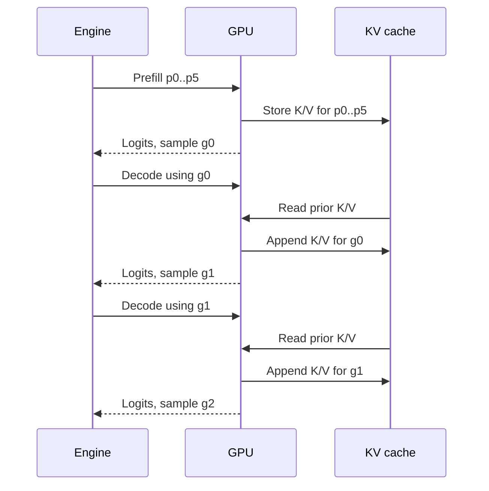

This gives the first major performance split:

| Phase | Parallelism within one request | Typical concern | User metric |
|---|---|---|---|
| Prefill | Many prompt positions at once | Compute and prompt queueing | TTFT |
| Decode | Normally one new position per step | Weight/KV bandwidth and repeated launches | TPOT or ITL |

“Prefill is compute-bound and decode is memory-bound” is a useful starting
point, not a law. Very short prefills may underuse compute; very large decode
batches can become compute-bound; long contexts increase KV reads; and kernels,
quantization, hardware, and parallelism all move the boundary.

---

## 5. What the KV Cache Saves

Every self-attention layer projects token representations into queries, keys,
and values:

```text
Q = XWq
K = XWk
V = XWv
```

For a newly appended token, earlier tokens' keys and values are unchanged.
Keeping them avoids recomputing their projections on every decode step.

For the new token, one attention layer conceptually does this:

1. Compute the new query, key, and value.
2. Compare the new query with all valid earlier keys.
3. Use the resulting weights to combine earlier values.
4. Append the new key and value to the cache.

The cache saves repeated work, but it does not make long context free. The new
query still attends over an increasingly long history, and the engine still
stores that history.

For more attention-level detail, see
[KV Cache and PagedAttention in vLLM: An Illustrated Guide](./KV%20Cache%20and%20PagedAttention%20in%20vLLM%20-%20Illustrated%20Guide.md).

---

## 6. KV-Cache Memory Math, Step by Step

An approximate KV size per token for one model replica is:

```text
bytes per token
  = 2
  x number of attention layers
  x number of KV heads
  x head dimension
  x bytes per cache element
```

The leading `2` means one tensor for keys and one for values.

### Worked example

Assume a hypothetical model has:

- 32 attention layers;
- 8 KV heads because it uses grouped-query attention;
- head dimension 128;
- BF16 KV elements, which use 2 bytes each.

Then:

```text
bytes per token
  = 2 x 32 x 8 x 128 x 2
  = 131,072 bytes
  = 128 KiB per token
```

A sequence occupying 8,000 tokens uses approximately:

```text
8,000 x 128 KiB
  = 1,024,000 KiB
  ~= 0.977 GiB
```

Thirty such sequences would require roughly 29.3 GiB of KV storage before
allocator metadata and other runtime memory are considered.

This explains why maximum context length and maximum concurrency cannot be
treated independently:

```text
total KV demand
  ~= concurrent cached tokens x KV bytes per token
```

### Effects of architecture and dtype

| Change | Approximate KV effect |
|---|---|
| Twice as many active tokens | 2x memory |
| Twice as many layers | 2x memory |
| MHA to GQA with one quarter as many KV heads | About 1/4 memory |
| BF16 KV to 8-bit KV | About 1/2 raw cache bytes |
| Tensor parallelism across compatible shards | Per-rank layout changes; total logical state still exists |

Real allocation can differ because of block rounding, alignment, model-specific
layers, parallel layout, and runtime buffers. The formula is a capacity model,
not an exact allocator report.

---

## 7. Why a Naive KV Allocator Wastes Memory

Imagine reserving each request's declared maximum context as one contiguous
array. Three requests declare 8,192 tokens but currently use 700, 2,100, and
6,000 tokens:

```text
Request A: [used 700][reserved but empty .......................]
Request B: [used 2100........][reserved but empty ..............]
Request C: [used 6000............................][empty ........]
```

The unused reservations cannot help another request. Variable lengths also
leave awkward holes when requests finish at different times.

vLLM instead divides KV storage into fixed-size physical blocks. A request
receives more blocks as its token history grows.

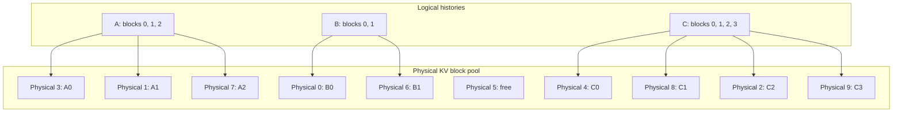

The physical blocks are scattered, but the block table preserves logical
order. Attention kernels use that indirection to find the correct keys and
values.

### What “paged” means here

The idea resembles virtual memory:

- logical positions are consecutive from the request's point of view;
- physical storage need not be consecutive;
- a table maps logical block number to physical block number;
- fixed-size allocation reduces external fragmentation;
- blocks return to a free pool when no longer referenced.

This is an analogy, not a claim that GPU KV blocks are ordinary operating-system
pages or that page faults work the same way.

---

## 8. A Concrete Block-Allocation Example

Assume a block holds four token positions. Request A has ten cached tokens:

```text
logical block 0 -> tokens 0..3
logical block 1 -> tokens 4..7
logical block 2 -> tokens 8..9 plus two currently unused slots
```

Its block table might be:

```text
A block table = [7, 2, 11]
```

This means:

```text
logical block 0 is stored in physical block 7
logical block 1 is stored in physical block 2
logical block 2 is stored in physical block 11
```

If A generates two more tokens, physical block 11 fills. The next token needs
a new free physical block. If block 5 is free, the table becomes:

```text
A block table = [7, 2, 11, 5]
```

If A finishes, those physical blocks become reusable, unless one is shared by
another request through prefix caching.

### Internal fragmentation still exists

Paging greatly reduces waste, but it does not remove all waste. The last block
of each request may be partially empty. With a block size of 16, a request with
17 cached tokens needs two blocks and leaves 15 token slots unused in its final
block at that moment.

The block-size trade-off is therefore:

| Smaller blocks | Larger blocks |
|---|---|
| Less last-block waste | Fewer block-table entries |
| Finer allocation | Lower metadata/lookup overhead |
| More allocator operations | Potentially friendlier kernel behavior |

The best value depends on implementation and hardware; it is not determined by
fragmentation alone.

---

## 9. What the Scheduler Really Chooses

A scheduler is often described as selecting requests. More precisely, it
selects **token work for requests**.

At one iteration it may choose:

```text
Request A: 1 decode token
Request B: 1 decode token
Request C: 512 prompt tokens
Request D: 256 prompt tokens
```

The total scheduled-token count is 770. Each request has different state and
different memory needs, yet the model runner combines the work into one
execution plan.

The scheduler must respect at least these conceptual limits:

```text
scheduled tokens <= step token budget
active sequences <= sequence/concurrency limit
new KV slots <= available cache capacity
request position <= model context limit
```

It may also account for priorities, encoder inputs, multimodal resources,
cached prefixes, speculative verification tokens, adapter availability, or
distributed coordination.

### Simplified pseudocode

The following is explanatory pseudocode, not copied vLLM source:

```python
while server_is_running:
    budget = max_batched_tokens
    plan = []

    for request in runnable_requests():
        wanted = request.useful_tokens_this_iteration()
        admitted = min(wanted, budget)

        if admitted == 0:
            continue
        if not kv_cache.can_reserve(request, admitted):
            handle_memory_pressure(request)
            continue

        kv_cache.reserve(request, admitted)
        plan.append((request, admitted))
        budget -= admitted

        if budget == 0:
            break

    outputs = model_runner.execute(plan)
    update_requests(outputs)
    free_finished_requests()
```

Actual scheduling is more sophisticated. The pseudocode exposes the three
decisions that matter: how much work is useful, whether it fits the token
budget, and whether its resulting state fits memory.

---

## 10. Continuous Batching With a Timeline

Static batching waits for a fixed group to finish. If one member produces 200
tokens while another produces 10, the short request's slot can sit idle.

Continuous batching rebuilds or updates the effective batch at engine-step
boundaries.

Assume requests arrive as follows:

- A arrives first and needs three decode steps.
- B arrives with A and needs one decode step.
- C arrives after the first iteration and needs two decode steps.

```text
Iteration 1: run A + B
             A continues, B finishes

Iteration 2: run A + C
             both continue

Iteration 3: run A + C
             both finish
```

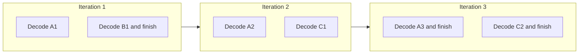

This does not mean kernels are interrupted halfway through to insert a new
request. Admission normally occurs at an engine scheduling boundary. A request
arriving during GPU execution waits for a later iteration.

### Why this improves utilization

Each decode sequence contributes little work by itself. Grouping many active
sequences lets one weight read and one set of kernel launches produce useful
work for many users. As requests finish, new ones replace them rather than
waiting for the longest original batch member.

---

## 11. Mixing Prefill and Decode

Prefill and decode can share an iteration, but they have different shapes:

```text
Decode A:     1 token, long existing context
Decode B:     1 token, medium existing context
Prefill C:  600 new prompt tokens
Prefill D:  300 new prompt tokens
```

The benefit is higher GPU utilization. The danger is latency interference. A
large prefill can make an iteration much longer, so active decoders wait longer
for their next streamed token.

### Chunked prefill

Suppose the step budget is 1,024 tokens, two decoders need one token each, and
a new prompt contains 3,000 uncached tokens. Scheduling all 3,000 at once would
exceed the budget. Chunking can produce:

```text
Step 1: 2 decode + 1,022 prompt tokens
Step 2: 2 decode + 1,022 prompt tokens
Step 3: 2 decode +   956 prompt tokens
Step 4: request becomes ready to produce its first output token
```

The existing decoders continue to make progress. The new long prompt takes
several boundaries to finish.

### The trade-off

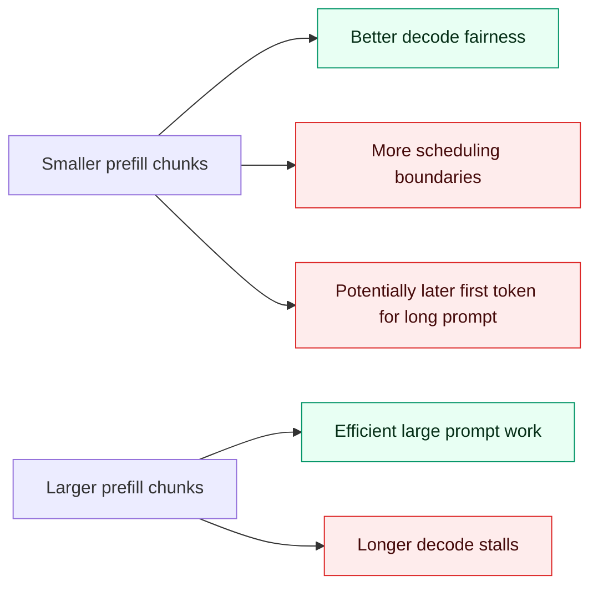

There is no universal best token budget. Interactive chat may prioritize low
tail ITL. Batch summarization may prioritize aggregate prompt throughput.

---

## 12. From Scheduled Requests to One GPU Batch

Requests have different lengths, but GPUs prefer dense, regular tensors. The
model runner bridges the two views.

Assume one iteration schedules:

```text
A: one decode token at logical position 100
B: three prefill tokens at positions 40, 41, 42
C: one decode token at logical position 900
```

The runner can flatten the selected input tokens:

```text
input IDs: [A_token, B40, B41, B42, C_token]
positions: [100,     40,  41,  42,  900]
```

Additional metadata explains:

- which token belongs to which sequence;
- which past positions it may attend to;
- which block table locates that history;
- where new K/V state must be written;
- which final hidden states need logits;
- which sampling policy belongs to each request.

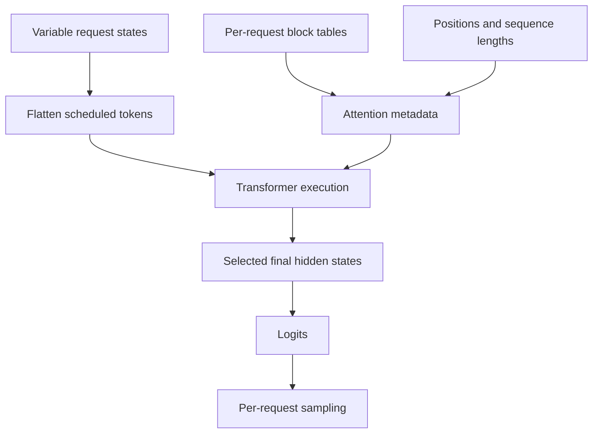

The flat batch is a physical execution layout. It does not merge users'
logical contexts. Masks, positions, sequence metadata, and block tables keep
the histories separate.

---

## 13. One Transformer Step Under the Microscope

At a high level, each layer performs operations such as normalization,
attention projections, attention, output projection, and an MLP. Details vary
by model architecture.

```mermaid
flowchart LR
    X[Input hidden states] --> N1[Normalization]
    N1 --> QKV[Q K V projections]
    QKV --> ATT[Paged attention]
    ATT --> O[Output projection]
    O --> R1[Residual addition]
    R1 --> N2[Normalization]
    N2 --> MLP[Feed-forward network]
    MLP --> R2[Residual addition]
    R2 --> NEXT[Next layer]
```

For decode, the model's weight tensors are large while the number of new input
positions can be small. If the GPU must repeatedly read many weight bytes to
process only a few tokens, memory bandwidth dominates. Batching adds new
positions so the same weight traffic performs more useful computation.

For prefill, many prompt positions create larger matrix multiplications. Those
operations can better occupy the GPU's arithmetic units. Eventually additional
batch work raises iteration time because compute is saturated.

This is the intuition behind the roofline-shaped throughput curve:

```text
small batch                        saturation                 very large batch
    |                                  |                            |
bandwidth underutilization -> efficient reuse -> compute/latency pressure
```

Maximum tokens per second usually occurs at a different operating point from
minimum per-request latency.

### 13.1 The missing layer: how a linear operation becomes GPU work

This subsection follows the conceptual progression in Aleksa Gordić's
[Inside NVIDIA GPUs: Anatomy of High-Performance Matmul Kernels](https://www.aleksagordic.com/blog/matmul):
start with matrix multiplication, follow the data through the GPU memory
hierarchy, and then explain tiling and asynchronous execution. The Mermaid
diagrams and vLLM examples here are original to this guide. Hardware behavior
is also cross-checked against NVIDIA's
[CUDA Programming Guide](https://docs.nvidia.com/cuda/cuda-programming-guide/),
[CUTLASS GEMM documentation](https://docs.nvidia.com/cutlass/latest/media/docs/cpp/gemm_api.html),
and [Hopper architecture description](https://developer.nvidia.com/blog/?p=45555).

> **Illustration attribution:** the bitmap figures in subsections 13.1 through
> 13.13 were created by Aleksa Gordić for the matmul article. They are loaded
> from the author's website and are referenced, not copied into this
> repository. The Mermaid diagrams remain original to this guide.


*Figure 1: [Model of the NVIDIA Hopper H100 GPU](https://www.aleksagordic.com/blog/matmul/h100_model.png), by Aleksa Gordić.*

### How to read the illustration

- The blue path is primarily storage and movement: HBM, caches, shared memory,
  registers, and transfer machinery.
- The red units perform arithmetic: Tensor Cores, CUDA cores, and special
  function units.
- Streaming multiprocessors repeat across the GPU, allowing many independent
  matrix tiles to execute concurrently.
- A fast kernel needs both sides: unused compute is common when data cannot be
  delivered quickly enough.

In model code, a projection can look deceptively small:

```python
y = x @ weight
```

Underneath that expression, the runtime must:

1. Decide which kernel matches the tensor shapes, dtypes, layouts, and GPU.
2. Divide the output matrix into tiles.
3. Assign tiles to thread blocks and streaming multiprocessors.
4. Move input tiles from high-bandwidth memory toward the compute units.
5. Reuse those tiles in shared memory and registers.
6. Issue many matrix multiply-accumulate instructions.
7. Write accumulated results back through the memory hierarchy.

vLLM influences the first item by assembling the scheduled tokens into a
particular shape. The selected CUDA, library, compiler-generated, or custom
kernel handles the lower-level work. Serving efficiency therefore depends on
both the scheduler's batch and the kernel's efficiency for that batch shape.

### 13.2 Where matrix multiplication appears in a transformer

Transformers contain several large linear operations per layer:

| Model operation | Simplified matrix multiplication |
|---|---|
| Query projection | `X @ Wq` |
| Key projection | `X @ Wk` |
| Value projection | `X @ Wv` |
| Attention output projection | `AttentionOutput @ Wo` |
| MLP expansion or gate projection | `X @ Wup`, often also `X @ Wgate` |
| MLP contraction | `Intermediate @ Wdown` |
| Vocabulary projection | `FinalHidden @ EmbeddingMatrix.T` |

Attention itself also contains matrix products such as query-key scores and
the weighted sum of values. Those products have specialized shapes, masking,
and paged-memory access patterns, so they are often handled by dedicated
attention kernels rather than a generic dense GEMM.

For an ordinary linear layer, flatten the scheduled token positions into `T`
rows:

```text
X: [T, H]
W: [H, D]
Y: [T, D]

Y = X @ W
```

Mapped to conventional GEMM notation:

```text
M = T   scheduled token positions
K = H   input hidden dimension
N = D   output dimension

[M, K] @ [K, N] -> [M, N]
```

This connection is central to vLLM:

- During a large **prefill**, `T` can be hundreds or thousands of positions.
- During **decode**, `T` is approximately the number of active sequences that
  contribute a new position to the step.
- Continuous batching tries to keep `T` large enough to use the GPU efficiently
  without making the step too slow for latency objectives.

The scheduler does not merely increase an abstract “batch size.” It changes the
`M` dimension seen by many projection kernels.

### 13.3 The arithmetic in one GEMM

For:

```text
C[M, N] = A[M, K] @ B[K, N]
```

each output element is a dot product:

```text
C[m, n] = sum over k of A[m, k] x B[k, n]
```

There are `M x N` output elements and `K` multiply-add pairs per output, so the
conventional operation count is:

```text
GEMM work ~= 2 x M x N x K FLOPs
```

The factor two counts a multiplication and addition as two floating-point
operations. It does not mean the hardware necessarily issues two separate
instructions; fused multiply-add or matrix instructions perform combined work.


*Figure 16: [Naive CPU matrix-multiplication example](https://www.aleksagordic.com/blog/matmul/cpu_kernel_example.png), by Aleksa Gordić.*

### How to read the illustration

- A row of `A` and a column of `B` form one dot product.
- Every output coordinate in `C` can be computed independently of the other
  output coordinates.
- The independence exposes parallelism, but a naive GPU mapping still wastes
  bandwidth if every output independently reloads the same inputs.

#### Example projection

Suppose:

```text
M = 128 scheduled positions
K = 4096 hidden values
N = 4096 output values
```

Then:

```text
work = 2 x 128 x 4096 x 4096
     = 4,294,967,296 FLOPs
     ~= 4.29 GFLOPs
```

That is one projection. A transformer step performs multiple projections in
each layer and repeats them across many layers.

The same weight matrix contains:

```text
4096 x 4096 = 16,777,216 elements
```

At two bytes per element, it occupies about 32 MiB. With only one decode row,
the GPU performs relatively little math after making this large matrix
available to the compute pipeline. With 128 rows, each fetched weight can
contribute to many more output values. This is weight reuse through batching.

### 13.4 Why the textbook implementation is slow

A correct serial implementation uses three loops:

```text
for m in 0..M:
    for n in 0..N:
        accumulator = 0
        for k in 0..K:
            accumulator += A[m, k] * B[k, n]
        C[m, n] = accumulator
```

The output elements are independent, so a GPU can compute many simultaneously.
But merely assigning one output element to each thread is not enough. A naive
kernel may repeatedly fetch the same input values from device memory:

```text
A row m is reused across many output columns n.
B column n is reused across many output rows m.
```

If every consumer independently reloads those values from HBM, traffic grows
far faster than necessary. The kernel becomes bandwidth-bound even though the
GPU has abundant arithmetic capability.

The remedy is **tiling**: load a useful chunk once into faster on-chip storage,
then reuse it for many multiply-accumulate operations.

### 13.5 The memory hierarchy is a data-reuse hierarchy

A useful simplified path is:

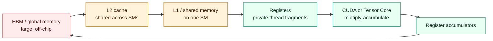

The general trend moving toward compute is:

| Storage | Relative capacity | Relative latency/bandwidth | Managed mainly by |
|---|---|---|---|
| HBM/global memory | Largest | Highest latency, lowest local bandwidth | Hardware plus software access pattern |
| L2 cache | Smaller | Faster than HBM | Hardware, with policy controls |
| L1/shared memory | Much smaller | High on-chip bandwidth | L1 by hardware; shared memory by kernel |
| Registers | Smallest practical working store | Closest to compute | Compiler and kernel design |

“Local memory” in CUDA terminology can be misleading: register spills and some
thread-private arrays may live in device memory, not in a magical fast per-thread
SRAM. Excess register demand can therefore create both occupancy loss and slow
spill traffic.

The optimization objective is to pay for distant movement as few times as
possible and reuse the resulting data near compute as many times as possible.


*Figure 2: [H100 memory hierarchy](https://www.aleksagordic.com/blog/matmul/mem_hierarchy.png), by Aleksa Gordić.*

### How to read the illustration

- Start at HBM/global memory, where model weights and large tensors reside.
- Follow data through L2 and the per-SM L1/shared-memory level.
- Registers are closest to the execution units and hold operand fragments and
  accumulators.
- Capacity falls and local bandwidth rises as data moves toward compute.
- Tiling exists to reuse data after paying the cost to move it inward.

### 13.6 Tiling at several levels

A high-performance GEMM is hierarchically tiled. The exact names and dimensions
vary, but the nesting resembles this:

```text
complete output matrix
  -> tiles assigned to thread blocks
     -> subtiles assigned to warps or warp-groups
        -> fragments consumed by matrix instructions
           -> per-thread register accumulator fragments
```

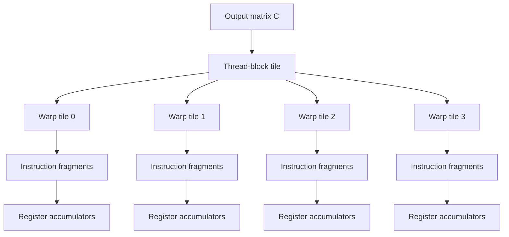


*Figure 30: [High-level warp-tiling structure](https://www.aleksagordic.com/blog/matmul/warp_tiling_pt1.png), by Aleksa Gordić.*

### How to read the illustration

- The complete output is divided into independent thread-block tiles.
- One block owns a rectangular output region and walks through the reduction
  dimension in `BK`-sized chunks.
- Corresponding chunks of `A` and `B` are staged in shared memory.
- Warps and threads divide the output tile further and accumulate partial
  results in registers.
- Repeating the `K`-chunk loop completes the same dot products as the textbook
  algorithm while greatly increasing data reuse.

For one thread-block output tile, the kernel walks across the reduction
dimension `K`:

```text
for each K tile:
    load A tile from global memory to shared memory
    load B tile from global memory to shared memory
    reuse A and B fragments from shared memory/registers
    accumulate partial products into registers

write final accumulator tile to C
```

The `K` chunks contribute partial sums to the same output tile. The output can
remain in register accumulators until the reduction is complete, avoiding a
global-memory round trip after every partial product.

#### Why tile shape changes arithmetic intensity

Suppose a tile multiplies:

```text
A_tile[BM, BK] @ B_tile[BK, BN] -> C_tile[BM, BN]
```

The useful work is approximately:

```text
2 x BM x BN x BK operations
```

The input elements loaded for that `K` slice are approximately:

```text
BM x BK + BK x BN elements
```

Larger, balanced output tiles can increase reuse: each loaded A value
participates across more `BN` columns, and each loaded B value participates
across more `BM` rows. But larger tiles consume more shared memory and
registers, so fewer blocks may reside on an SM. Reuse and occupancy must be
balanced.

### 13.7 Threads, warps, blocks, and SMs

CUDA exposes a hierarchy of execution:

```text
thread
  -> warp of 32 threads
     -> thread block containing several warps
        -> optional thread-block cluster
           -> grid covering the kernel launch
```


*Figure 5: [CUDA programming model](https://www.aleksagordic.com/blog/matmul/cuda_model.png), by Aleksa Gordić.*

### How to read the illustration

- Individual threads are grouped into hardware-scheduled warps.
- Several warps form a thread block that shares on-chip shared memory.
- Hopper can group blocks into a cluster with distributed shared-memory
  capabilities.
- All blocks or clusters together form the launch grid.
- The hierarchy in the diagram is the execution counterpart of the tile
  hierarchy in the preceding figure.

A thread block is assigned to one streaming multiprocessor, while multiple
blocks may reside on an SM if registers, shared memory, and architectural limits
permit. The hardware schedules resident warps so that another ready warp can
make progress while one waits for a dependency or data.

Two words should remain separate:

- **Parallelism** is work actually executing at the same moment.
- **Concurrency** is work resident and available for the hardware to schedule.

High occupancy means many warps can be resident. It is useful for hiding
latency, but maximum occupancy is not itself the goal. A kernel using more
registers per thread may support fewer resident warps yet run faster because it
keeps valuable data close to compute and avoids repeated loads.

### 13.8 Coalescing: adjacent threads should fetch adjacent data

Global-memory instructions are issued for a warp, not as 32 unrelated trips
that ignore each other. When neighboring threads request neighboring addresses,
the hardware can satisfy them with a small number of memory transactions.

```text
Coalesced:
thread 0 -> element 0
thread 1 -> element 1
thread 2 -> element 2
...

Strided:
thread 0 -> element 0
thread 1 -> element 1024
thread 2 -> element 2048
...
```

The first pattern uses fetched cache-line sectors efficiently. The second can
force many transactions whose transferred bytes are mostly unused by that
warp.


*Figure 25: [Naive matmul with uncoalesced global-memory access](https://www.aleksagordic.com/blog/matmul/simple_kernel_uncoalesced.png), by Aleksa Gordić.*

### How to read the illustration

- Compare the addresses requested by neighboring threads in the same warp.
- The problematic mapping makes those threads traverse a non-contiguous matrix
  dimension.
- More memory transactions are required even though the mathematical operation
  is unchanged.
- This is why swapping index calculations can preserve correctness while
  severely reducing performance.

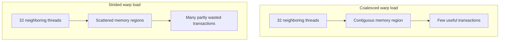

A matrix layout and thread-to-element mapping that look like a harmless index
choice can therefore cause a large performance change. Correctness tests will
not reveal the problem; profiling memory transactions and achieved bandwidth
will.

### 13.9 Shared-memory banks and swizzling

Shared memory is fast, but it is divided into banks. Threads in a warp can
access different banks concurrently. If several threads request different
addresses in the same bank, those accesses can serialize into a **bank
conflict**.

This creates another layout problem:

```text
Global-memory layout should support coalesced loads.
Shared-memory layout should support conflict-free consumer accesses.
Tensor instructions require their own fragment-compatible arrangement.
```

Sometimes one plain row-major layout cannot satisfy every stage. Kernels can
transpose, permute, or **swizzle** addresses while placing tiles in shared
memory. The logical matrix values remain the same; only their physical bank
placement changes.


*Figure 36: [Conflict-free row and column access after swizzling](https://www.aleksagordic.com/blog/matmul/swizzle_property.png), by Aleksa Gordić.*

### How to read the illustration

- Colors identify shared-memory banks rather than logical matrix values.
- A plain layout can map many addresses requested by a warp to the same bank.
- Swizzling permutes address bits so simultaneous accesses spread across banks.
- The consumer reconstructs the intended logical layout through the matching
  address transformation.

On architectures that support it, the Tensor Memory Accelerator can perform
multidimensional global-to-shared transfers and apply supported swizzle layouts.
This offloads address-generation work and helps prepare tiles for efficient
consumption.

### 13.10 Tensor Cores do tiled matrix math, not an entire model layer

Tensor Cores execute hardware-supported matrix multiply-accumulate operations
on small fragments. A large `[M, K] @ [K, N]` projection is decomposed into
many such fragment operations.

```text
large model projection
  -> thread-block tiles
  -> warp/warp-group tiles
  -> hardware matrix instruction fragments
  -> accumulated output tile
```

The kernel still has to feed those units. Peak Tensor Core throughput is not
useful if:

- global-memory loads arrive too slowly;
- shared-memory accesses conflict;
- too few output tiles exist to occupy the GPU;
- unsupported or awkward shapes leave many lanes idle;
- register pressure reduces residency too far;
- synchronization leaves the compute pipeline waiting.

This is why quoting only a GPU's peak FLOP/s does not predict LLM serving
performance.

### 13.11 Overlap data movement with computation

A synchronous tile loop behaves like:

```text
load tile 0 -> compute tile 0 -> load tile 1 -> compute tile 1 -> ...
```

The compute units can idle during loads, and load machinery can idle during
computation. A pipelined kernel uses multiple buffers:

```text
load tile 1 while computing tile 0
load tile 2 while computing tile 1
load tile 3 while computing tile 2
```

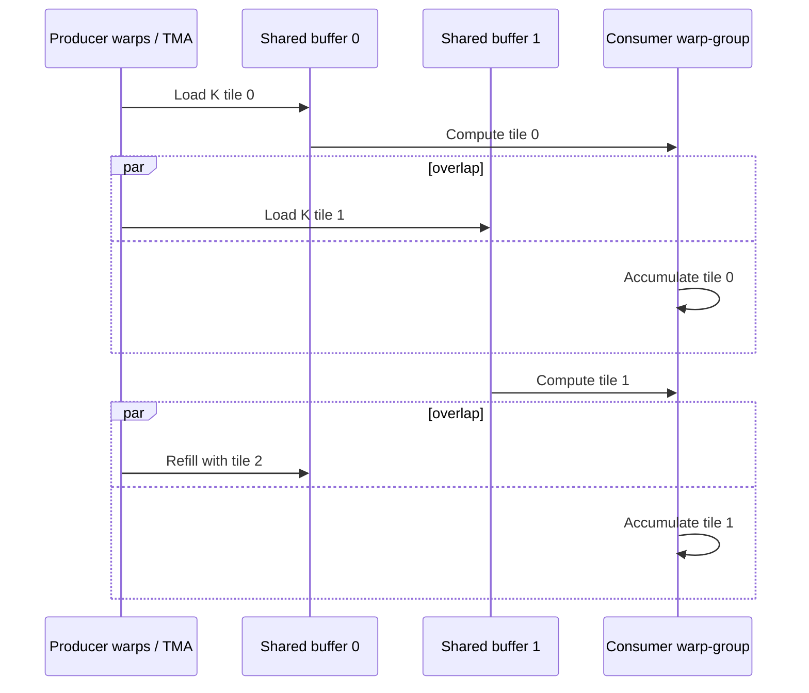


*Figure 41: [Asynchronous Tensor Core/TMA producer-consumer pipeline](https://www.aleksagordic.com/blog/matmul/kernel4_pipeline.png), by Aleksa Gordić.*

### How to read the illustration

- A producer warp-group fills a sequence of shared-memory buffers through TMA.
- A consumer warp-group waits for a full buffer, issues Tensor Core work, and
  then marks the buffer reusable.
- The circular queue allows a future tile to move while the current tile is
  being consumed.
- Full/empty barriers protect buffers without forcing all data movement and
  arithmetic into a strictly serial sequence.

Hopper's TMA and asynchronous transaction barriers support producer/consumer
pipelines in which a small producer group streams multidimensional tiles into
shared-memory buffers while consumer warp-groups issue Tensor Core work. The
barriers prevent a producer from overwriting a buffer still in use and prevent
a consumer from reading a tile before its transfer completes.

Extra stages are not free. They require more shared memory, can reduce the
number of resident blocks, and add synchronization state. Pipeline depth is
another resource trade-off.

### 13.12 Tile quantization, wave quantization, and serving shapes

Kernel tiles have fixed granularities. If an output dimension is not divisible
by its tile size, the edge tile contains lanes that do no useful arithmetic.
This is **tile quantization**.

Example with an output containing 130 rows and a row tile of 64:

```text
tile 0: rows   0..63   -> 64 useful rows
tile 1: rows  64..127  -> 64 useful rows
tile 2: rows 128..129  ->  2 useful rows, most tile capacity idle
```


*Figure 17: [Tile quantization](https://www.aleksagordic.com/blog/matmul/tile_quantization.png), by Aleksa Gordić.*

### How to read the illustration

- Full tiles perform useful work across their complete area.
- Boundary tiles still occupy scheduling resources even when only a small
  portion lies inside the valid matrix.
- Larger tiles can improve reuse but make awkward edge shapes proportionally
  more wasteful.
- Serving batch shapes can cross these boundaries as requests enter and leave
  the continuous batch.

At the GPU level, thread blocks are often scheduled in waves across the
available SMs. If one full wave uses 120 blocks and a launch creates 125, the
last five blocks form a poorly occupied final wave. This is commonly called
**wave quantization**.

The connection to vLLM is direct:

- Scheduled-token count changes the `M` dimension.
- Tensor parallelism changes per-rank `N` or `K` dimensions for sharded
  projections.
- Padding and capture buckets can move a shape onto or away from a favorable
  tile boundary.
- A batch that is slightly larger can sometimes have disproportionately better
  hardware utilization.
- A batch that is too large can still worsen latency or exceed memory budgets.

Performance is therefore not perfectly smooth as batch size rises. Shape
boundaries, kernel dispatch choices, and wave counts can create steps or dips.

### 13.13 Arithmetic intensity connects matmul kernels to the roofline

Arithmetic intensity is:

```text
useful arithmetic operations / bytes moved from the limiting memory level
```

The roofline bound is:

```text
achievable FLOP/s
  <= min(peak compute FLOP/s,
         memory bandwidth x arithmetic intensity)
```


*Figure 26: [Roofline performance model](https://www.aleksagordic.com/blog/matmul/roofline.png), by Aleksa Gordić.*

### How to read the illustration

- The sloped region is limited by memory bandwidth: more useful arithmetic per
  byte raises achievable performance.
- The horizontal region is limited by peak compute throughput.
- Their intersection is the ridge point for that hardware and datatype.
- Batching and tiling try to move work rightward by increasing reuse; once the
  compute ceiling is reached, additional work mainly increases elapsed time.

A one-row decode projection has little opportunity to reuse each weight within
that request. Combining rows from many sequences raises useful work per weight
byte and moves the operation toward the compute-bound region. Large prefills
naturally supply many rows and often have higher arithmetic intensity.

Tiling raises intensity at lower memory levels by reusing data already moved
into shared memory and registers. Continuous batching raises intensity at the
serving level by supplying more independent token rows to the same projection.
These are different layers of the same reuse principle.

### 13.14 What this changes when diagnosing vLLM

The kernel-level view refines several operational symptoms:

| Symptom | Possible matmul-level explanation |
|---|---|
| Decode throughput rises sharply with concurrency | Larger `M` reuses weights and fills more tiles |
| A nearby batch size is unexpectedly faster | Better tile/wave alignment or a different kernel |
| Quantization helps less than expected | Conversion/scaling overhead or an inefficient shape path |
| GPU compute utilization is low during decode | Weight bandwidth or insufficient parallel tiles limits work |
| Prefill is fast but ITL is poor | Large compute-efficient prefills create long shared iterations |
| Tensor parallel scaling flattens | Smaller per-rank GEMMs and collectives erase compute savings |
| CUDA graph coverage helps small decode | Launch overhead was material for short repeated shapes |

The complete stack is now:

```text
request arrivals
  -> vLLM token scheduler
  -> scheduled-token shape
  -> model projection shapes
  -> kernel and tile selection
  -> HBM/shared-memory/register movement
  -> Tensor Core or CUDA Core instructions
  -> step latency
  -> TTFT, ITL, throughput, and goodput
```

No single layer explains performance alone. A perfect GEMM kernel cannot fix a
bad admission policy, and a perfect scheduler cannot make an inefficient
memory-access pattern reach peak compute.

---

## 14. Startup and the GPU Memory Budget

Before serving, a worker must decide how much memory remains for KV blocks.

```text
physical GPU memory
  - model weight shard
  - runtime and framework allocations
  - peak activation/workspace allowance
  - CUDA graph state, if used
  - communication buffers
  - safety margin
  = memory available for KV-cache blocks
```

### Example budget

For an illustrative 80 GiB GPU:

| Consumer | Example only |
|---|---:|
| Model weight shard | 44 GiB |
| Runtime, workspaces, activations, graphs | 9 GiB |
| Safety/unallocated margin | 3 GiB |
| Available KV cache | 24 GiB |

If the hypothetical model from section 6 consumes 128 KiB per cached token:

```text
24 GiB / 128 KiB = 196,608 token slots
```

With blocks of 16 tokens:

```text
196,608 / 16 = 12,288 physical blocks
```

This is an upper-level estimate. Runtime profiling is needed because temporary
allocations and execution modes determine the safe cache size.

### Why configured maximum context does not reserve that context per request

Paged allocation allows requests to grow on demand. A maximum model length is
a validity limit, not necessarily an immediate full-size reservation for every
admitted request. Capacity is still finite: if many requests grow toward the
limit simultaneously, the block pool can be exhausted.

---

## 15. Prefix Caching in More Detail

Many requests share an exact leading token sequence:

```text
[system prompt][tool definitions][shared document][user-specific question]
```

Automatic prefix caching tries to reuse KV blocks for the identical complete
prefix rather than recomputing them.

### Why a block hash includes history

Hashing only the tokens in one block is insufficient. The same token block can
appear after different earlier contexts, and its K/V values depend on that
earlier context through attention.

A conceptual chained hash is:

```text
H0 = hash(block_0_tokens, model/cache identity)
H1 = hash(H0, block_1_tokens)
H2 = hash(H1, block_2_tokens)
```

Matching `H2` means the complete prefix through block 2 matches, not merely
that block 2 contains the same local token IDs.

### Reference sharing

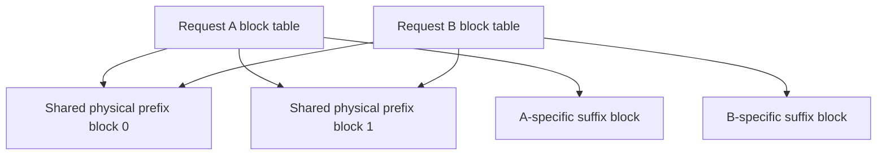

Shared blocks cannot be returned to the free pool until no active or cached
reference needs them. A reference count or equivalent ownership mechanism
protects them.

### Complete blocks and divergent tails

If the block size is 16 and two requests share 35 prefix tokens, the first 32
tokens form two complete reusable blocks. The remaining three-token fragment
is generally not reusable in the same simple way because later continuation
tokens may differ inside that physical block.

### What a hit saves

A prefix hit saves prompt computation for the matched blocks. It does not:

- skip tokenization unless a separate tokenization cache exists;
- make subsequent decode tokens free;
- share generated suffixes that diverge;
- help a request routed to a replica without the cached blocks;
- guarantee lower latency if queueing or decode dominates.

---

## 16. Memory Pressure and Preemption

Suppose the scheduler wants to extend a request but no free KV block remains.
It cannot safely write the new state into a block owned by another live
sequence.

Conceptual responses include:

1. Delay admission of waiting work.
2. Stop growing some requests temporarily.
3. Preempt a request and later recompute state that was discarded.
4. Use an implementation-supported transfer or offload mechanism.
5. Reject work through admission control before the situation becomes unsafe.

Preemption is not free. If a request's KV state must be recomputed, the GPU
reprocesses earlier tokens, increasing load precisely when the system is under
pressure.

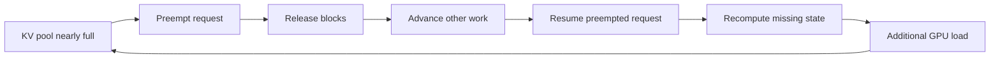

This feedback loop explains why latency can degrade sharply near capacity
rather than smoothly. A deployment should observe cache usage, preemption,
queue depth, and tail latency together.

---

## 17. Sampling Is Part of the Serving Loop

The transformer produces logits: one score per vocabulary token. Generation
then transforms those scores according to request policy.

A simplified path is:

```text
hidden state
  -> vocabulary projection
  -> logits
  -> penalties and token constraints
  -> temperature/top-k/top-p transformation
  -> sample or choose token
  -> append token to request
```

Different requests in the same GPU execution batch may use different sampling
parameters. Their transformer work can be grouped while their sampling policy
remains logically separate.

### Stop tokens versus stop strings

A stop-token rule can terminate as soon as a particular token ID is sampled.
A stop-string rule may require incremental detokenization and matching across
token boundaries because one human-readable string can span multiple tokens.
The output processor therefore participates in correctness, not merely display.

### Deterministic does not always mean identical across configurations

Greedy decoding removes sampling randomness, but results can still differ
across model revisions, quantization, kernels, parallel reduction order, or
numerical precision. Serving configuration is part of reproducibility.

---

## 18. Guided Decoding, One Token at a Time

Suppose output must match:

```json
{"sentiment": "positive"}
```

At each generation state, the grammar determines which token IDs can legally
continue the partial output. Those IDs form a mask over the vocabulary.

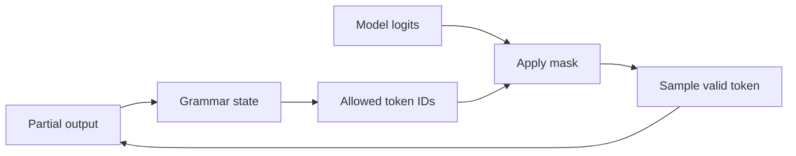

The grammar does not replace the model. The model ranks valid choices; the
grammar eliminates invalid ones. There is overhead in compiling and advancing
grammar state and applying masks. The benefit is structural validity, not
factual correctness.

A JSON-conforming answer can still contain a false value. Schema enforcement
and semantic validation solve different problems.

---

## 19. Speculative Decoding With an Example

Ordinary target-model decode produces one accepted token per target step.
Speculative decoding asks a cheaper proposer to guess several tokens:

```text
existing prefix: The sky appears
draft proposal:  blue because molecules scatter
```

The target evaluates the drafted positions together and checks them from left
to right. Suppose it accepts:

```text
blue because
```

but rejects `molecules`. Two output tokens were obtained from one verification
step, followed by a target-consistent replacement at the rejection point.

### Speedup intuition

Let:

- `k` be the number of drafted tokens;
- `a` be the expected accepted prefix length;
- `Tverify(k)` be target verification time;
- `Td` be draft-generation and bookkeeping time;
- `Ttarget(1)` be an ordinary target decode step.

A rough usefulness test is:

```text
cost per accepted token with speculation
  ~= (Td + Tverify(k)) / useful accepted tokens

This should be lower than Ttarget(1).
```

This is deliberately qualitative: verification may emit an additional token,
acceptance is distribution-dependent, and GPU batch shape matters.

Speculation tends to disappoint when:

- draft tokens are frequently rejected;
- the proposer is too expensive;
- verification adds poorly utilized work;
- normal decode already has a large efficient batch;
- extra KV or metadata pressure reduces concurrency.

Measure accepted tokens per verification step, TPOT, and total throughput
together.

---

## 20. CUDA Graphs and Why Shapes Matter

A CPU normally launches a sequence of GPU kernels for every model step. For
small, repeated decode shapes, launch overhead can be significant. CUDA graphs
can record a compatible sequence of GPU operations and replay it with lower
CPU overhead.

```text
ordinary path:
CPU launch -> kernel 1 -> CPU launch -> kernel 2 -> ...

captured path:
CPU graph replay -> recorded kernel sequence
```

Graph replay prefers stable shapes and memory addresses. Serving traffic is
variable, so runtimes often capture a collection of supported batch shapes or
fall back to an eager path for incompatible work.

Trade-offs include:

- memory retained for graph states and static buffers;
- warmup or capture time;
- coverage gaps for unusual shapes;
- complexity around dynamic features.

“CUDA graphs are enabled” is not enough to interpret performance. Useful
questions are which iterations are covered, which fall back, and how much
memory capture consumes.

---

## 21. Parallelism: Four Different Problems

Using more GPUs can mean four very different things.

### Tensor parallelism

Tensor parallelism divides operations within layers across ranks. Each rank
holds a shard of relevant weights and participates in collectives during model
execution.

```text
one request -> one logical model replica -> several cooperating GPU ranks
```

It helps a model fit and can reduce compute time, but frequent communication
makes fast links important.

### Pipeline parallelism

Pipeline parallelism places consecutive layer groups on different ranks:

```text
GPU group 0: layers 0..19
GPU group 1: layers 20..39
GPU group 2: layers 40..59
```

Activations move between stages. It can span larger topology boundaries but
introduces stage balance and pipeline utilization concerns.

### Data parallelism

Data parallelism creates independent replicas:

```text
request A -> replica 0
request B -> replica 1
```

It increases fleet throughput but does not make one replica's model smaller.
Each replica normally owns its own scheduler and KV cache.

### Expert parallelism

For mixture-of-experts models, experts can be distributed across ranks. Tokens
are routed to selected experts, creating all-to-all communication and load
balance concerns that dense models do not have in the same form.

### GPU-count arithmetic

For a layout where dimensions multiply cleanly:

```text
total GPU workers = DP x TP x PP
```

For example:

```text
DP=4, TP=2, PP=1 -> 8 GPUs
```

Expert-parallel layouts require version- and architecture-specific reasoning;
do not blindly multiply EP as another independent dimension.

---

## 22. Why More GPUs Can Be Slower

Parallelism reduces work or memory per rank but adds communication and
synchronization.

A simplified step time is:

```text
step time
  ~= local compute
   + collective/transfer time
   + synchronization wait
   + launch and framework overhead
```

Adding ranks can reduce the first term while increasing the others. Gains are
small or negative when:

- tensors are too small for efficient collective operations;
- tensor-parallel ranks cross a slow inter-node link;
- pipeline stages are imbalanced;
- one rank becomes a straggler;
- per-rank batches become too small;
- coordination overhead dominates the shortened computation.

Topology is therefore part of model configuration. `TP=8` across eight GPUs
with high-bandwidth intra-node links is not equivalent to `TP=8` across eight
nodes connected by ordinary Ethernet.

---

## 23. Replicas, Routing, and Cache Locality

With data-parallel replicas, a router must choose where each new request goes.

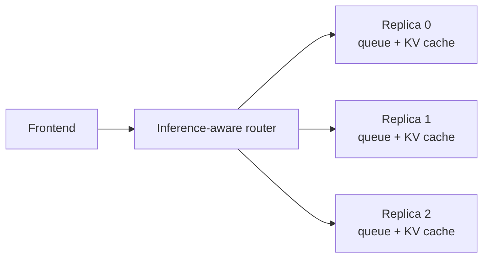

A least-request router sees only counts. Two replicas with five requests can
have very different work:

```text
Replica 0: five short decodes near completion
Replica 1: five 32k-token prompts waiting for prefill
```

Useful routing signals can include:

- waiting prompt tokens;
- active decode sequences;
- estimated remaining output;
- free KV blocks;
- prefix-cache affinity;
- required adapter or model;
- request priority and SLO class;
- stale-report age.

### Locality versus balance

A request sharing a long cached prefix with replica 0 might run faster there,
even if replica 1 has a slightly shorter queue. But excessive stickiness can
overload replica 0. The routing problem is multi-objective:

```text
estimated completion cost
  = queue cost
  + compute cost
  + cache-miss cost
  + transfer/communication cost
  + risk penalty for low free capacity
```

The formula is conceptual. Its purpose is to show why request count alone is
not enough.

---

## 24. Disaggregated Prefill and Decode

Prefill-decode disaggregation assigns the phases to different worker pools.

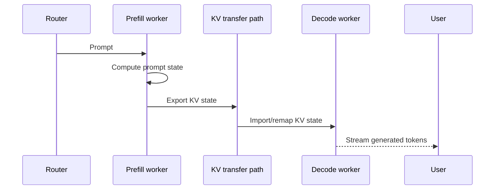

Why do this?

- Prefill workers can be tuned for large prompt batches and TTFT.
- Decode workers can be tuned for stable iteration time and ITL.
- A long prefill no longer extends a decode worker's iteration directly.
- The two pools can scale from different backlog signals.

What new costs appear?

- KV data must move between workers.
- The destination needs enough blocks and correct metadata.
- Routing must choose both a prefill and a decode owner.
- Cancellation and failure require cross-pool cleanup.
- The fabric can become a bottleneck.
- First-token delivery semantics depend on where sampling and transfer occur.

If transferring the prompt state costs more than the interference it removes,
disaggregation loses. Benchmark with real context lengths and real fabric.

---

## 25. Process Architecture Versus GPU Architecture

Processes and GPUs are related but not interchangeable concepts.

A possible serving layout contains:

```text
HTTP/API process
  -> tokenizer/input work
  -> engine-core process
       -> scheduler
       -> output coordination
       -> executor
            -> worker process per GPU rank
```

An asynchronous API process can hold many open client connections without one
OS thread per request. This does not execute transformer layers concurrently in
Python. It keeps network and serialization work from blocking while GPU worker
processes perform scheduled computation.

Queues and IPC boundaries help isolate responsibilities, but they also add:

- serialization and copying;
- backpressure requirements;
- failure propagation;
- queueing latency;
- observability boundaries.

When debugging latency, identify the actual timestamp boundary: client,
frontend, engine input, scheduler admission, GPU start/end, output queue, or
client receipt.

---

## 26. Latency Decomposed Precisely

Time to first token can be expanded as:

```text
TTFT
  = client/network ingress
  + API validation and tokenization
  + routing and IPC
  + scheduler queueing
  + prefill execution
  + first-token sampling and detokenization
  + network egress
```

For later tokens:

```text
ITL sample
  = wait for next eligible engine iteration
  + that iteration's execution time
  + sampling/output handling
  + streaming delay
```

End-to-end latency for ordinary one-token decode is approximately:

```text
E2E ~= TTFT + (N_output - 1) x TPOT
```

This is not exact when stream chunks contain multiple tokens, speculative
decoding emits token groups, output buffering occurs, or work overlaps.

### Server-side versus client-observed metrics

| Measurement | Starts | Ends | Includes network? |
|---|---|---|---|
| Engine queue delay | Engine admission | First scheduling | No |
| Model step time | GPU execution start | GPU execution end | No |
| Server TTFT | Server receive | First response write | Partly |
| Client TTFT | Client send | First token received | Yes |

Always state which one a chart reports.

---

## 27. Throughput, Goodput, and the Queueing Cliff

Throughput may mean requests per second, input tokens per second, output tokens
per second, or total tokens per second. These are not interchangeable.

Suppose configuration A processes many long prompts, while configuration B
processes many short prompts. Request throughput alone makes the comparison
meaningless.

### Offered load versus completed load

- **Offered load** is what clients attempt to send.
- **Achieved throughput** is what the server completes.
- **Goodput** is completed work that also meets the latency SLO.

As offered load approaches sustainable capacity, queueing often rises sharply.
Raw throughput may barely change while p99 TTFT becomes unacceptable.

```text
low load       near knee              overload
   |               |                     |
idle capacity -> efficient batching -> growing queue and tail latency
```

For a stable system, Little's Law gives a useful consistency check:

```text
average items in system
  = completion rate x average time in system
```

If the service completes 20 requests/s and average end-to-end residence time is
2 seconds, about 40 requests are present on average. This is descriptive, not a
capacity guarantee, and requires consistent units and a stable observation
window.

---

## 28. A Worked Three-Request Simulation

Assume:

- token budget per iteration: 8;
- KV block size: 4 tokens;
- enough physical blocks are available;
- decode consumes one scheduled token per active request;
- prompts may be chunked.

Requests:

| Request | Arrival | Prompt tokens | Output tokens needed |
|---|---:|---:|---:|
| A | Before step 1 | 6 | 3 |
| B | Before step 1 | 2 | 2 |
| C | Before step 3 | 10 | 1 |

### Step 1

The scheduler spends all eight tokens on prompt work:

```text
A prefill: 6
B prefill: 2
```

A needs `ceil(6/4) = 2` KV blocks. B needs one. Each prompt produces logits
from which its first output token is sampled.

### Step 2

```text
A decode: 1
B decode: 1
```

Only two new positions are scheduled. The step can be fast but may not fully
use the GPU. A now has seven cached positions and emits its second output. B
has three cached positions, emits its second output, and finishes. B's block
can now be released.

### Step 3

C has arrived:

```text
A decode: 1 and then finishes
C prefill chunk: 7
```

The token budget is full. A reaches eight cached positions and emits its third
output. Because A is complete, its final sampled token does not need KV state
for a future decode step; A's two blocks can be released. C owns two blocks for
its first seven prompt tokens.

### Step 4

```text
C prefill remainder: 3 and then finishes
```

C now has ten cached prompt positions across three blocks. Its prefill result
produces its only requested output token, so it finishes and releases the
blocks without needing another decode iteration.

### What this tiny example demonstrates

- The batch changes every iteration.
- Prefill and decode can share a token budget.
- Block demand follows actual cached positions, rounded to blocks.
- A request can allocate a block and release it shortly afterward.
- Finishing work creates capacity for waiting work.
- Token budget and KV capacity are separate constraints.

Internal scheduled/computed-token counters are implementation-specific. The
important subtlety is that prefill can produce the first output token, while a
later decode step computes the KV state for the previously sampled token and
produces the next one.

---

## 29. How Common Tuning Knobs Interact

The useful question is not “what does this knob do?” but “which resource and
metric does it move?” Exact flag names and defaults can change.

| Conceptual knob | Increasing it may improve | Increasing it may hurt |
|---|---|---|
| Batched-token budget | Throughput, large-prefill efficiency | ITL, temporary memory, tail latency |
| Maximum active sequences | Decode batching and throughput | KV pressure, iteration time |
| GPU memory fraction for cache | Concurrency | OOM safety margin |
| Maximum model length | Supported contexts | Capacity planning if workloads use it |
| Prefill chunk size | Prompt throughput when larger | Decode fairness and ITL |
| Prefix caching | Repeated-prefix TTFT and prefill cost | Metadata/memory residency; little benefit without reuse |
| Speculative token count | Tokens accepted per target step | Verification work and rejection waste |
| Tensor-parallel degree | Model fit, sometimes step latency | Communication, smaller per-rank work |
| Number of replicas | Fleet throughput | Per-replica cache locality and routing complexity |

Knobs interact. Raising concurrency may increase batching efficiency until KV
pressure triggers preemption. Raising token budget may improve throughput until
longer steps violate ITL. Enabling prefix caching may help only if routing keeps
similar prefixes together.

---

## 30. Symptom-Driven Diagnosis

### High TTFT at low load

Check:

- prompt length and tokenizer time;
- cold startup or compilation;
- prefix-cache miss versus expected hit;
- inefficient prompt kernel or unsupported shape;
- distributed communication;
- client/server timestamp mismatch.

Queueing is less likely if the server is genuinely idle.

### High TTFT only under load

Check:

- waiting prompt-token backlog;
- admission policy;
- token budget consumed by decoders or other prefills;
- memory pressure and preemption;
- unbalanced replicas;
- arrival bursts hidden by average request rate.

### High or uneven ITL

Check:

- mixed long-prefill interference;
- decode batch-size growth;
- iteration-time distribution;
- collective synchronization or stragglers;
- speculative verification shape;
- output buffering and network flush behavior.

### High GPU utilization but poor goodput

The system may be doing useful arithmetic for requests that miss their SLO, or
recomputing preempted work. Utilization alone does not distinguish efficient
service from overload.

### Low GPU utilization

Check:

- insufficient arrival rate or concurrency;
- CPU tokenization/output bottlenecks;
- small decode batches;
- synchronization bubbles;
- networking or IPC starvation;
- unsupported shapes falling off an optimized execution path.

### Frequent out-of-memory failures

Check all memory consumers, not only weights:

- KV allocation and context distribution;
- peak prefill activations;
- CUDA graph memory;
- communication workspaces;
- quantization scratch space;
- concurrent features such as adapters or multimodal encoders;
- memory fragmentation outside the paged KV pool.

---

## 31. A Benchmark That Answers a Real Question

Start with an SLO and workload, not a favorite throughput number.

Example objective:

```text
For chat traffic with the production prompt/output distribution,
find the highest request rate such that:
  p99 TTFT < 1.0 s
  p99 ITL  < 80 ms
  errors    < 0.1%
```

### Record the environment

- model revision and tokenizer revision;
- vLLM and framework versions;
- GPU model, count, memory, and interconnect;
- weight and KV dtypes;
- TP, PP, DP, and replica placement;
- scheduling, caching, graph, and speculative settings;
- container limits and CPU allocation.

### Preserve the workload shape

Record distributions, not only averages:

- prompt token length;
- requested and realized output length;
- arrival intervals and bursts;
- repeated-prefix frequency;
- structured-output usage;
- cancellations and timeouts.

### Suggested experiment order

1. Warm the model and optimized paths.
2. Measure low-load TTFT and TPOT.
3. Increase offered request rate gradually.
4. Record p50/p95/p99 latency, tokens/s, errors, and preemptions.
5. Find the SLO knee.
6. Change one configuration dimension.
7. Repeat with the same request stream and seeds where meaningful.
8. Test a cold-cache variant separately if cold behavior matters.

### Important anti-patterns

- Reusing identical prompts unintentionally warms prefix caching.
- Comparing request/s with different length distributions compares different
  amounts of work.
- Reporting average TTFT hides overload tails.
- A closed-loop client can hide overload because slow responses reduce the
  rate at which it sends new work.
- An infinite-rate benchmark measures saturation, not interactive quality.
- Ignoring rejected requests makes achieved throughput look healthier.

---

## 32. Tuning Playbooks

### Interactive chat

Priorities:

- low p95/p99 TTFT;
- smooth ITL;
- good prefix reuse for shared system/tool prompts;
- admission control before severe preemption.

Likely strategy:

- keep decode iterations bounded;
- use chunked prefill for long prompts;
- route with queue and prefix locality awareness;
- scale replicas before driving each replica far beyond its latency knee.

### Offline summarization

Priorities:

- aggregate tokens/s;
- high utilization;
- completion time for the full job.

Likely strategy:

- tolerate larger batches and longer per-request latency;
- group compatible lengths;
- use large prompt batches where memory permits;
- measure total job makespan and failure recovery.

### Shared long templates

Priorities:

- prefix-cache hit rate;
- cache-aware routing;
- stable template tokenization.

Likely strategy:

- ensure byte-identical-looking text truly produces identical token IDs;
- avoid per-request data near the start of the prefix;
- keep requests with the same prefix on compatible replicas;
- measure saved prompt tokens, not just lookup hits.

### Very long context

Priorities:

- KV capacity;
- attention cost;
- TTFT;
- protection against a few requests monopolizing memory.

Likely strategy:

- enforce length-aware admission;
- consider KV dtype and model architecture;
- chunk prefills;
- separate service classes if long-context traffic harms interactive users;
- benchmark the actual context distribution, not only the maximum.

---

## 33. Common Misunderstandings Corrected

### “vLLM makes the model itself smarter”

No. vLLM changes how inference work and memory are organized. Model quality is
primarily determined by weights, decoding policy, prompt, and numerical
choices.

### “PagedAttention reduces the mathematical context length”

No. It changes KV storage and addressing. Attention still sees the request's
valid logical history.

### “Continuous batching means waiting to create one big batch”

No. It means reconsidering batch membership repeatedly so arriving and
unfinished requests can share future steps.

### “Prefix caching is the same as response caching”

No. Prefix caching reuses intermediate K/V state and still runs generation.
Response caching returns an already materialized answer under a separate
application policy.

### “A cache hit removes all prompt cost”

No. Only matched complete prefix blocks avoid model prefill work. Tokenization,
routing, unmatched suffixes, and decode remain.

### “More batching always improves performance”

No. It generally raises throughput until saturation, while individual step
latency and queueing can worsen.

### “More GPUs always reduce latency”

No. Communication and synchronization can exceed the compute saved.

### “GPU utilization proves the server is healthy”

No. A saturated GPU can coexist with unacceptable queueing, preemption, and
tail latency.

### “The maximum context length tells me concurrency”

No. Concurrency depends on the distribution of active cached tokens, KV bytes
per token, cache capacity, batching, and other memory consumers.

---

## 34. The Minimal Operational Dashboard

An effective dashboard connects demand, scheduling, memory, execution, and user
experience.

| Layer | Metrics to correlate |
|---|---|
| Demand | Arrival rate, prompt/output length distributions, cancellations |
| Queue | Waiting requests, waiting prompt tokens, queue delay |
| Scheduler | Scheduled tokens by type, active sequences, preemptions |
| KV memory | Used/free blocks, cached tokens, prefix-hit tokens |
| GPU execution | Step time, batch tokens, decode sequences, graph coverage |
| Distributed | Collective time, transfer bytes, rank skew |
| User experience | TTFT, ITL, TPOT, E2E, error rate, goodput |

One chart should make it possible to answer:

```text
Did latency rise because demand increased,
because scheduling changed,
because cache memory filled,
or because each GPU step became slower?
```

A metric without request-length context is often misleading. A rise in cached
tokens can be healthy growth in useful concurrency or a warning that several
long requests are approaching memory exhaustion.

---

## 35. A Reading Map From Symptom to Concept

| If you want to understand... | Read these sections |
|---|---|
| Why first token is slow | 4, 11, 26, 30 |
| Why later tokens stall | 10, 11, 13, 26 |
| How model projections become GPU work | 13.1 through 13.14 |
| Why context consumes so much memory | 5, 6, 7, 8 |
| How requests share a GPU safely | 9, 10, 12 |
| Why repeated prompts can be faster | 15, 23 |
| What happens when cache fills | 16, 30 |
| Whether speculative decoding helps | 19 |
| Why adding GPUs disappointed | 21, 22 |
| How to scale replicas | 23, 24, 25 |
| How to benchmark honestly | 26, 27, 31 |
| Which knobs to change | 29, 32 |

---

## 36. Final Mental Model

Think of vLLM as a token factory with a finite state warehouse.

- **Requests** arrive with prompt work and an uncertain amount of future decode
  work.
- The **scheduler** chooses token work that fits this iteration.
- The **KV-cache manager** reserves warehouse space for the state that work
  creates.
- **PagedAttention** lets each request see a consecutive logical history even
  when its physical blocks are scattered or shared.
- The **model runner** converts irregular request state into GPU-ready tensors
  and metadata.
- The **GPU** executes the transformer for the combined work.
- **Sampling and output processing** turn logits into streamed text and decide
  when a request is complete.
- **Continuous batching** replaces finished work with newly useful work at
  future iteration boundaries.
- **Parallelism and replicas** expand capacity, while introducing communication,
  routing, and locality trade-offs.

The central constraint is not simply “how many requests fit?” It is:

```text
Which tokens should run next,
how long will that GPU step take,
and can the state created by those tokens remain resident?
```

Once those three questions are clear, most vLLM behavior—from high throughput
to latency spikes, prefix-cache wins, preemption storms, and multi-GPU scaling—
becomes much easier to reason about.

---

## Glossary

| Term | Meaning |
|---|---|
| Attention | Mechanism that lets a token retrieve information from valid sequence positions |
| Block table | Mapping from a request's logical KV blocks to physical blocks |
| Continuous batching | Revising active batch membership at engine-step boundaries |
| Decode | Autoregressive generation after prompt processing |
| DP | Data parallelism: independent model replicas serving different work |
| E2E latency | Time from request start to final response |
| EP | Expert parallelism: distributing mixture-of-experts experts and token work |
| GEMM | General matrix multiplication, conventionally `C = alpha AB + beta C` |
| Goodput | Completed work that also satisfies defined SLOs |
| GQA | Grouped-query attention, where query heads share fewer KV heads |
| HBM | High-bandwidth off-chip GPU memory used for weights, KV state, and tensors |
| ITL | Inter-token latency: time gaps between streamed token events |
| KV cache | Per-layer key/value state retained for active token history |
| PagedAttention | Attention using block-mapped, non-contiguous KV storage |
| PP | Pipeline parallelism: splitting consecutive model layers across ranks |
| Prefill | Processing prompt tokens and creating their KV state |
| Prefix caching | Reusing KV blocks for identical complete token prefixes |
| Preemption | Pausing/removing resident request state to free capacity |
| SLO | Service level objective for latency, errors, or other service behavior |
| Speculative decoding | Drafting tokens cheaply and verifying them with the target model |
| Streaming multiprocessor (SM) | GPU unit containing schedulers, registers, shared memory, and compute pipelines |
| Tensor Core | Specialized GPU unit for matrix multiply-accumulate instructions on small fragments |
| Tile | A submatrix assigned to a level of the GPU execution hierarchy |
| TMA | Hopper Tensor Memory Accelerator for asynchronous multidimensional tensor transfers |
| TP | Tensor parallelism: splitting layer tensor operations across ranks |
| TPOT | Average time per generated output token after the first |
| TTFT | Time from request start until the first output token |
| Warp | A hardware-scheduled group of 32 CUDA threads |

---

## Further Reading

- [Inside vLLM: An Illustrated Guide to High-Throughput Inference](./Inside%20vLLM%20-%20An%20Illustrated%20Guide%20to%20High-Throughput%20Inference.md)
- [Inside NVIDIA GPUs: Anatomy of High-Performance Matmul Kernels](https://www.aleksagordic.com/blog/matmul)
- [KV Cache and PagedAttention in vLLM: An Illustrated Guide](./KV%20Cache%20and%20PagedAttention%20in%20vLLM%20-%20Illustrated%20Guide.md)
- [How LLM Inference Infrastructure Works: GPUs, vLLM, llm-d and Kubernetes](./How%20LLM%20Inference%20Infrastructure%20Works%20-%20GPUs%20vLLM%20llm-d%20and%20Kubernetes.md)
- [Official vLLM documentation](https://docs.vllm.ai/)
- [NVIDIA CUDA Programming Guide](https://docs.nvidia.com/cuda/cuda-programming-guide/)
- [NVIDIA CUTLASS GEMM API](https://docs.nvidia.com/cutlass/latest/media/docs/cpp/gemm_api.html)
- [NVIDIA Hopper Architecture In-Depth](https://developer.nvidia.com/blog/?p=45555)
- [PagedAttention paper](https://arxiv.org/abs/2309.06180)
- [Orca continuous batching paper](https://www.usenix.org/conference/osdi22/presentation/yu)
- [Speculative sampling paper](https://arxiv.org/abs/2302.01318)
