# KV Cache and PagedAttention in vLLM: An Illustrated Guide

*September 21, 2026 · @Mostapha*

This guide builds the KV-cache mental model from transformer attention up to
vLLM's block allocator. The aim is not merely to define PagedAttention, but to
show exactly which computation is avoided, which memory is consumed, how a
block table connects logical tokens to physical GPU memory, and where the
optimization stops helping.

> **Version note:** vLLM evolves quickly. The stable concepts are causal
> attention, reusable K/V state, block-based allocation, and indirect lookup.
> Defaults, supported cache dtypes, cache layouts, and manager classes are
> version- and hardware-dependent. Check the
> [current vLLM documentation](https://docs.vllm.ai/en/latest/) before choosing
> production flags.

> **Illustration attribution:** the four animated PagedAttention figures used
> below were created by the vLLM authors for the June 2023 article
> [vLLM: Easy, Fast, and Cheap LLM Serving with PagedAttention](https://vllm.ai/blog/2023-06-20-vllm).
> They are loaded from the official vLLM website and are referenced, not copied
> into this repository. They illustrate the original design; current cache
> managers and sharing rules can differ by version.

---

## 1. The Five Ideas First

If only five ideas remain after reading this document, they should be these:

1. **The model weights are learned knowledge.** They stay mostly fixed while
   requests are served.
2. **The KV cache is request state.** It stores attention information already
   computed for the tokens in each active context.
3. **The cache grows with tokens.** More concurrent sequences and longer
   contexts consume more GPU memory.
4. **PagedAttention changes the layout, not the attention equation.** It stores
   KV state in reusable fixed-size blocks that need not be contiguous.
5. **The block table supplies the missing order.** It maps a request's logical
   token blocks to their physical cache blocks.

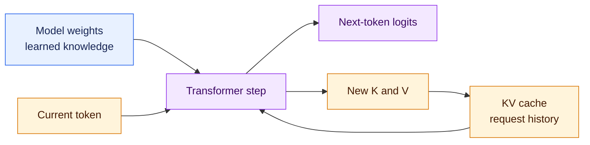

The loop continues until a stop condition is reached. PagedAttention is the
memory system underneath the `KV cache` box.

---

## 2. Transformer Architecture and Attention Heads

### Where attention sits in a transformer

The original *Attention Is All You Need* paper introduced the Transformer as
an encoder–decoder model:


*Illustration: Figure 1, “The Transformer — model architecture,” from
[Attention Is All You Need](https://arxiv.org/abs/1706.03762), by Vaswani et
al., via [Wikimedia Commons](https://commons.wikimedia.org/wiki/File:Attention_Is_All_You_Need_-_Encoder-decoder_Architecture.png),
licensed under [CC BY-SA 4.0](https://creativecommons.org/licenses/by-sa/4.0/).*

### Reading the original Transformer figure

1. **The left stack is the encoder.** It reads the source sequence using
   unmasked self-attention and produces representations for the decoder.
2. **The right stack is the decoder.** Its masked self-attention prevents a
   position from reading future tokens.
3. **The decoder's middle attention block is cross-attention.** It reads the
   encoder output. A decoder-only causal LLM normally does not have this
   encoder or cross-attention path.
4. **`N×` means repeat the layer.** Each layer has its own learned projections
   and its own K/V state; the KV cache is not one shared tensor for the entire
   model.
5. **Add & Norm includes a residual path.** A sublayer's input is added back to
   its output, then normalized in the original architecture. Many current LLMs
   place normalization before the sublayer instead.
6. **Linear and Softmax produce token probabilities.** After the final decoder
   layer, the hidden state is projected to vocabulary logits from which an
   output token can be selected.

For this guide, focus on the decoder's **masked multi-head self-attention** and
feed-forward block. Modern autoregressive LLMs usually stack decoder-only
layers: token embeddings enter the stack, causal self-attention lets each token
read its valid prefix, the MLP transforms each position, and the final hidden
state produces next-token logits.

The KV cache belongs to the causal self-attention part of every decoder layer.
It stores that layer's K and V vectors for reuse; it does not cache the MLP
output or residual stream.

### Q, K, and V without the mystery

At every attention layer, each token representation is projected into three
vectors:

```text
Q = xWq
K = xWk
V = xWv
```

Their useful intuition is:

| Vector | Question it answers |
|---|---|
| Query (`Q`) | What information does the current token need? |
| Key (`K`) | What kind of information does this token contain? |
| Value (`V`) | What content should be retrieved from that token? |

Attention is commonly written as:

```text
Attention(Q, K, V) = softmax(QK^T / sqrt(d))V
```

The equation has two conceptual stages:

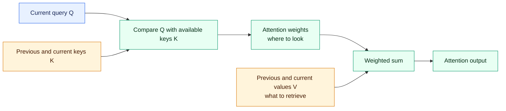

`QK^T` produces relevance scores. Softmax turns those scores into weights. The
weighted combination of `V` produces the information passed onward.

### What is an attention head?

An attention head is one parallel attention calculation. Instead of making one
large Q/K/V comparison, the layer divides the attention features into several
smaller heads. Every query head can learn to look for a different kind of
relationship, although the model learns those roles rather than having them
assigned manually.

For a common configuration:

```text
hidden size H = 4,096
query heads   = 32
head dimension = H / query heads = 128
```

Each query head therefore works with a 128-value query vector. The outputs of
all query heads are combined and passed through the attention output
projection, returning a vector with the model's hidden size.

### Query heads and KV heads

The two head counts answer different questions:

- **Query heads** are the independent views used to ask what information each
  token needs. Model configurations usually call this `num_attention_heads`.
- **KV heads** produce the key and value representations that query heads read.
  Configurations commonly call this `num_key_value_heads`.

The numbers can be equal, or several query heads can share one KV head. For
example:

```text
num_attention_heads = 32
num_key_value_heads = 8

query heads per KV head = 32 / 8 = 4
```

The mapping is then:

```text
Q0  Q1  Q2  Q3   -> KV0
Q4  Q5  Q6  Q7   -> KV1
...
Q28 Q29 Q30 Q31  -> KV7
```

`KV0` means key head 0 and value head 0. Four query heads perform four separate
attention calculations, but all four read the K and V vectors produced by that
same KV head.

### MHA: Multi-Head Attention

In MHA, every query head has its own K/V pair:

```text
32 query heads -> 32 KV heads

Q0 -> KV0
Q1 -> KV1
...
Q31 -> KV31
```

This gives every query head an independent K/V representation. It also creates
the largest KV cache because the model must retain a separate K and V vector
for every head, token, and attention layer.

### GQA: Grouped-Query Attention

In GQA, a group of query heads shares one K/V pair:

```text
32 query heads -> 8 KV heads
4 query heads share each KV head
```

GQA keeps many independent query views while storing and reading fewer K/V
vectors. In this example, its raw KV cache is one quarter the size of the MHA
cache with 32 KV heads, assuming the same layer count, head dimension, context,
and dtype. This is a common balance between model capability and inference
efficiency.

### MQA: Multi-Query Attention

In MQA, all query heads share one K/V pair:

```text
32 query heads -> 1 KV head
Q0 through Q31 -> KV0
```

This minimizes the KV cache and the amount of KV data read during decode. The
tradeoff is that every query head uses the same K/V representation, giving the
attention layer less K/V diversity than MHA or GQA.

### Comparing the three architectures

For a layer with 32 query heads:

| Architecture | Query heads | KV heads | Sharing | Relative raw KV size |
|---|---:|---:|---|---:|
| MHA | 32 | 32 | Each query head has its own K/V pair | 1.00x |
| GQA | 32 | 8 | Each group of 4 query heads shares one K/V pair | 0.25x |
| MQA | 32 | 1 | All query heads share one K/V pair | 0.03125x |

The architecture is part of the trained model. vLLM reads these head counts
from the model configuration; it does not turn an existing MHA model into GQA
or MQA with a serving flag.

### One important precision

The model computes Q, K, and V in **every transformer layer**, not once for the
whole model. The KV cache therefore contains per-layer state. When people say
“the cache for token 42,” they mean the K/V vectors for that token across the
relevant attention layers.

---

## 3. Why K and V Are Cached

Autoregressive generation extends a sequence one token at a time:

```text
The cat sat on the
The cat sat on the mat
The cat sat on the mat and
The cat sat on the mat and looked
```

At every step, the new token attends to the earlier tokens. Their K and V
vectors are unchanged: the word `cat` does not receive different K/V vectors
merely because another token was appended after it.

Without caching, the engine would recompute the earlier tokens at every step.
With caching, it computes their K/V state once and reuses it.

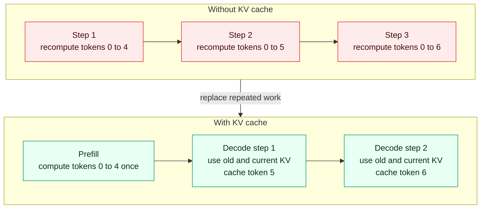

For one new decode token, each attention layer conceptually performs:

1. Compute the new token's Q, K, and V.
2. Compare the new Q with all valid earlier K vectors **and the new token's K**.
3. Use the attention weights to combine the corresponding earlier V vectors
   **and the new token's V**.
4. Keep the new K and V in the cache for later decode steps. Depending on the
   attention backend, the cache write can happen before, during, or after
   attention; the new K and V must be available to that attention calculation.

The cache avoids repeated projection of the past. It does **not** remove the
need to read and attend over the past.

---

## 4. Why Q Is Not Normally Cached

The causal direction explains the asymmetry:

- A future token needs earlier tokens' **K** vectors to decide where to attend.
- It needs their **V** vectors to retrieve information.
- It does not need their old **Q** vectors, because those queries described what
  the earlier tokens needed at the time they were processed.

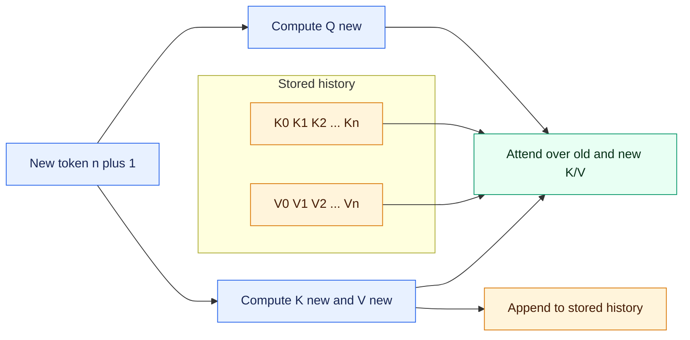

During prefill, queries exist for all prompt positions because all prompt
positions are being processed. They are temporary activations, not state needed
by later decode steps. That is why the persistent structure is called the **KV
cache**, not the QKV cache.

---

## 5. How Large Is the KV Cache?

As Section 2 showed, MHA, GQA, and MQA have different numbers of KV heads.
Because the cache stores K and V rather than old queries, that KV-head count
directly affects cache size.

For standard MHA, GQA, or MQA attention, the approximate cache size per token
for one model replica is:

```text
KV bytes per token
  = 2
  x number of attention layers
  x number of KV heads
  x head dimension
  x bytes per element
```

The factor `2` is for K and V.

These architecture choices affect model behavior as well as memory. MLA
compresses attention state differently, and hybrid models may need a different
cache-size formula.

For multiple active sequences:

```text
total raw KV bytes
  = KV bytes per token
  x sum of cached tokens across active sequences
```

### Worked GQA example

Assume:

```text
80 attention layers
8 KV heads
128 values per head
BF16 KV = 2 bytes per value
```

Then:

```text
2 x 80 x 8 x 128 x 2
= 327,680 bytes per token
= 320 KiB per token
```

A single 4,096-token sequence requires approximately:

```text
320 KiB x 4,096 = 1.25 GiB
```

One hundred active sequences averaging 2,048 cached tokens require roughly:

```text
320 KiB x 100 x 2,048 = 62.5 GiB
```

That number is before allocator metadata, alignment, hybrid cache layouts, or
other runtime overhead. It describes the aggregate logical KV state before
distribution across GPUs. For that placement, see the
[production parallelism and scaling guide](./Production%20vLLM%20Strategies%20-%20Model%20KV%20Cache%20and%20Requests.md).

### From token size to block size

If a conceptual block contains 16 tokens:

```text
block bytes = 16 x 320 KiB = 5 MiB
```

In a multi-layer implementation, a logical block ID corresponds to cache
storage across the relevant layers or cache groups. It should not be imagined
as one tiny universal byte array independent of model architecture.

### Capacity estimate

```text
available KV memory
  = GPU memory budget
  - weight shard
  - activations and temporary tensors
  - CUDA graph and kernel workspace
  - communication buffers
  - runtime reserve

approximate sequence capacity
  = available KV memory / average KV bytes per active sequence
```

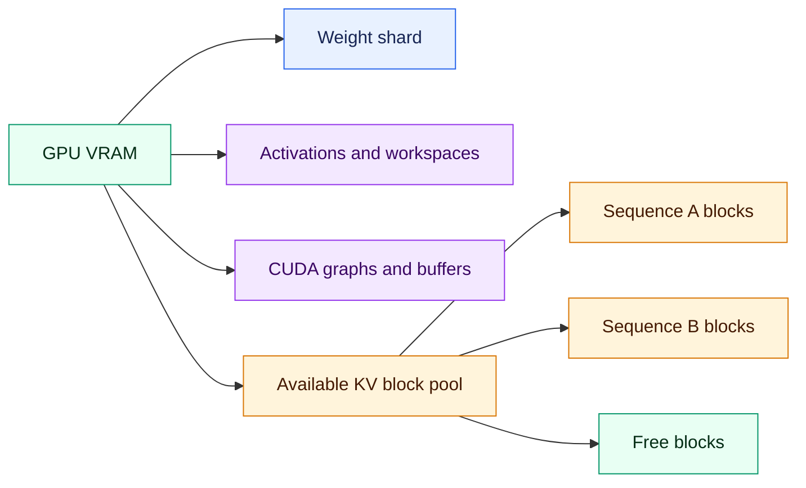

The model can fit while the server still cannot admit another long request.
Model fit and serving capacity are different questions.

---

## 6. The Naive Allocation Problem

The final length of a generated sequence is unknown when its request arrives.
A naive allocator could reserve one contiguous region large enough for the
maximum possible sequence, but most requests would finish before using it.

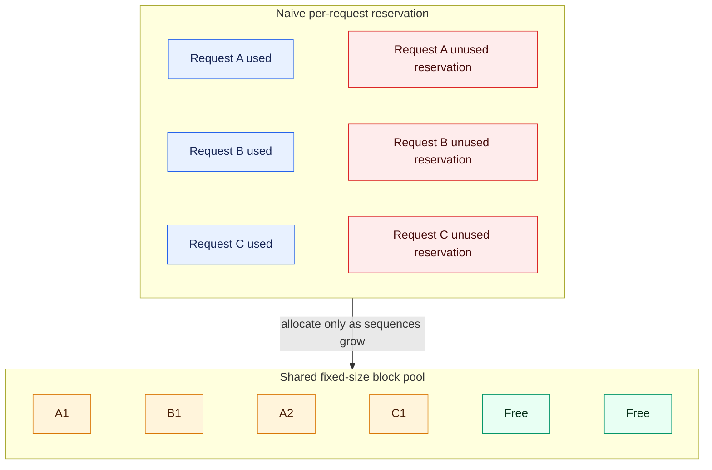

### Conventional contiguous cache vs. paged cache: the GPU-memory view

Here, **conventional** means a KV-cache design that keeps one request's K/V
history in a contiguous range of GPU *addresses*. It does not describe every
inference engine. Because the final output length is unknown, such a design
must either reserve space ahead of time or grow the range later. Reserving for
the maximum length leaves unused slots; growing a contiguous range can require
a new allocation and copying data if the existing range cannot be extended.
Even when enough GPU memory is free overall, it may not be available as one
suitable contiguous range. These are allocation problems, not changes to the
attention calculation. See the [original vLLM explanation](https://vllm.ai/blog/2023-06-20-vllm).

PagedAttention instead divides the request's token history into fixed-size
**logical blocks**. vLLM assigns each logical block an available **physical
block**: a numbered storage slot for cached K/V tensors in GPU memory. The
slots for one request do not need consecutive addresses. Its **block table**
records the mapping, and the attention kernel uses that table to read the
history in token order.

```text
Request A, in token order:   logical block 0 → logical block 1 → logical block 2
GPU KV-cache slots:         physical slot 7 → physical slot 2 → physical slot 19
```

For example, with 35 cached tokens and 16-token blocks, the paged cache needs
three blocks: capacity for 48 tokens, with 13 unused positions in the last
block. A contiguous design that reserved capacity for 512 tokens up front
would leave 477 positions unused while the request remained at 35 tokens.
Paging reduces *reservation waste*; it does not reduce the K/V data required
for the 35 actual tokens. As the request grows, it receives another available
block; after it finishes, its blocks can be reused by other requests.

**Physical-level clarification:** A physical block is a vLLM cache-storage
slot—not a CUDA thread block, a particular HBM chip, or necessarily an
operating-system page. “Contiguous” here refers to GPU address layout, not a
guarantee about literal HBM cells. The precise layout of K and V across layers
depends on the model, vLLM memory layout, and attention backend; one logical
block need not be one monolithic byte range containing every layer's cache.
See the [vLLM kernel documentation](https://docs.vllm.ai/en/v0.7.3/design/kernel/paged_attention.html)
and [vLLM memory-layout discussion](https://vllm.ai/blog/2026-01-08-kv-offloading-connector).

### Internal fragmentation

Internal fragmentation is unused space **inside an allocation**. Reserving room
for 4,096 tokens when a sequence finishes at 600 wastes most of that region.

Fixed-size paging reduces this waste. A sequence normally wastes space only in
its partially filled final block. With a 16-token block, the simple upper bound
is 15 unused token slots per sequence, rather than thousands of reserved slots.

### External fragmentation

External fragmentation occurs when total free memory is sufficient but split
into holes too small to satisfy a large contiguous request.

A fixed-block pool changes the allocation unit. A growing sequence can take any
free block, so it does not require one increasingly large contiguous region.

### What paging does not eliminate

Paging still has costs:

- the final block may be partly empty;
- block tables and reference counts consume metadata;
- smaller blocks mean more metadata and lookup work;
- larger blocks increase tail waste;
- kernels must gather K/V through an indirection layer.

The block size is therefore an engineering trade-off, not a magic constant.

---

## 7. Logical Blocks and Physical Blocks

The official animation shows attention reading a KV cache split into blocks:


*Illustration: [PagedAttention block layout](https://vllm.ai/blog-assets/figures/annimation0.gif), from the [official vLLM PagedAttention article](https://vllm.ai/blog/2023-06-20-vllm), by Woosuk Kwon et al.*

### Reading the block-layout animation

1. The yellow cells stand for cached K and V vectors, labeled with their
   corresponding tokens. This illustration has four token slots per block:
   block 0 contains “Alan Turing is a,” block 1 contains “computer scientist
   and mathematician,” and block 2 contains “renowned for.” The last block is
   only partly filled.
2. The green “for” box on the left is the **query vector** for the token being
   processed. “For” also appears in block 2 because that token has its own K
   and V vectors. Its query is used now; its K/V state can be read by attention.
3. In the frame showing **attention computation for block 0**, the kernel
   compares the query with each key in that block. For example, “for · Alan”
   means the dot product of the query vector for “for” and the key vector for
   “Alan,” not a comparison of the printed words. The kernel then processes
   the other blocks, applies softmax to the scores across eligible tokens,
   weights their V vectors, and produces the attention output.
4. The picture displays blocks 1, 2, and 0 from top to bottom, even though the
   token sequence runs through blocks 0, 1, and 2. The block table lets the
   kernel find each block in physical memory. The arrows represent reads;
   the blocks do not move during this attention calculation.

For a concrete numerical example, suppose a request has 35 cached tokens and
the block size is 16:

```text
logical block 0 = tokens 0 to 15
logical block 1 = tokens 16 to 31
logical block 2 = tokens 32 to 34
```

Those logical blocks can be placed in any available physical blocks:

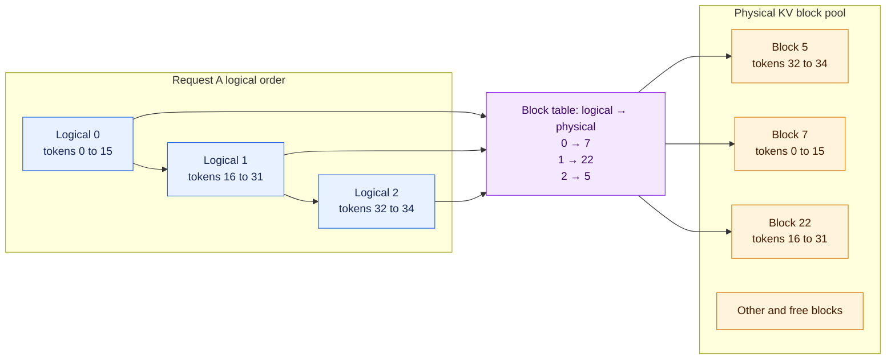

Logical order belongs to the request. Physical location belongs to the shared
allocator. The block table connects the two.

### The operating-system analogy

| Operating system | vLLM cache concept |
|---|---|
| Virtual address range | Request's logical token positions |
| Virtual page | Logical KV block |
| Page table | Request block table |
| Physical page frame | Physical KV block |

The analogy is about address translation and fixed-size allocation. It does not
mean PagedAttention automatically moves blocks to disk or CPU memory.

---

## 8. How a Sequence Grows and Finishes

Blocks are allocated incrementally.


*Illustration: [PagedAttention generation process](https://vllm.ai/blog-assets/figures/annimation1.gif), from the [official vLLM PagedAttention article](https://vllm.ai/blog/2023-06-20-vllm), by Woosuk Kwon et al.*

### Reading the request-growth animation

In the frame labeled **“Generated 1st token”**, the prompt already occupies six
slots. The animation uses four token slots per block:

1. Logical block 0 holds “Alan Turing is a” and is full. Logical block 1 holds
   “computer scientist” from the prompt.
2. The yellow “and” is the first completion token. It appears in the third
   slot of logical block 1, leaving one slot free. No new block is needed in
   this frame.
3. The block table maps logical block 0 to physical block 7, with four filled
   slots, and logical block 1 to physical block 1, with three filled slots.
4. On the right, physical blocks 7 and 1 are far apart. The request's token
   order comes from its logical blocks and block table, not from the blocks'
   positions in physical memory.

The next token that needs KV storage fills the remaining slot in logical block 1.
When another token needs storage after that block is full, the allocator takes
a free physical block and adds its ID to the request's block table. The
animation simplifies the exact decode-step timing of when a newly generated
token's K/V state is written.

### How KV blocks are released and reused

vLLM normally clears request KV state automatically. It does not destroy and
recreate the entire GPU cache after every request. Instead, it removes the
finished request's block table, updates block ownership metadata, and makes
blocks with no remaining owner available for reuse.

Suppose Request A has this block table:

```text
Request A logical blocks -> physical blocks [7, 1, 3]
```

When A reaches EOS, a stop condition, cancellation, or its length limit, the
engine releases A's references to those blocks. What happens next depends on
whether anyone else still uses them:

| Block state | What happens when Request A finishes |
|---|---|
| Private to A | Its ownership count reaches zero, so the allocator can return it to the free-block pool. |
| Shared with another active sequence | Its ownership count decreases, but it remains allocated because another sequence still needs it. |
| Retained for prefix caching | It may remain indexed by its prefix hash for reuse, but it can be evicted and reassigned when free capacity is needed. |

For example, a shared block with two active owners changes like this:

```text
Request A and Request B use block 7: ownership count = 2
Request A finishes:               ownership count = 1
Request B finishes:               ownership count = 0
```

An ownership count of zero means no active sequence depends on the block. With
prefix caching enabled, the block may still be a reusable cached entry until
the allocator evicts it. Exact metadata and eviction details vary by vLLM
version.

Releasing a block means making its slot reusable; it does not necessarily mean
zeroing the bytes immediately or returning the GPU allocation to the operating
system. vLLM generally keeps its KV memory pool reserved, so `nvidia-smi` may
show nearly the same GPU usage after requests finish. A later request can reuse
the released slots.

Manual clearing is usually needed only for cache invalidation, controlled
benchmarks, or maintenance. A version-specific prefix-cache reset clears
reusable prefix entries, while draining and restarting a worker recreates its
in-memory KV pool. Active request state should be released through normal
completion or cancellation so the engine can update ownership safely.

### What happens under memory pressure?

If a scheduled token needs a block and the free pool cannot supply one, the
engine cannot simply write the token somewhere else. Depending on configuration
and version, it must delay admission or preempt work. Recompute-style
preemption releases a request's blocks and later rebuilds its state from tokens.

That creates a feedback loop:

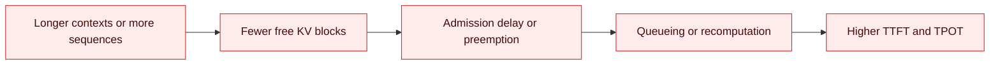

This is why maximizing the number of admitted sequences can reduce useful
throughput if it causes repeated cache churn.

---

## 9. PagedAttention and Continuous Batching

Continuous batching changes which requests run together at each engine step.
The batch is not fixed for the lifetime of its requests. When one request
finishes, the scheduler can replace it with waiting work while the other
requests continue generating.

Suppose three requests begin decoding together:

| Request | Output tokens still needed |
|---|---:|
| A | 2 |
| B | 20 |
| C | 10 |

The active batch can change like this:

```text
Step 1: A + B + C
Step 2: A + B + C   ← A finishes
Step 3: D + B + C   ← D enters immediately
```

With a fixed batch, request D may have to wait until B and C also finish.
Continuous batching reclaims A's scheduling and KV-cache capacity as soon as A
finishes. This keeps more useful work on the GPU and is a major serving
**throughput** technique: the server can usually complete more requests or
tokens per second.

PagedAttention and continuous batching solve different halves of this
dynamic-serving problem:

| Mechanism | Responsibility |
|---|---|
| **Continuous batching** | Decides which requests or token chunks participate in the next engine step |
| **PagedAttention** | Allocates and locates the physical KV blocks those requests need |
| **Chunked prefill** | Divides a long prompt into smaller pieces that can share scheduling capacity with other work |

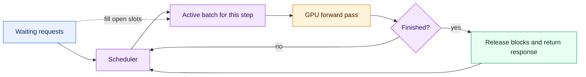

One decode scheduling step works conceptually as follows:

1. The scheduler selects requests that are ready and fit within the token and
   KV-cache budget.
2. PagedAttention locates the KV blocks belonging to each selected request.
3. The model processes the scheduled tokens. During decode, this is commonly
   one new token per selected sequence.
4. Finished or stopped requests leave and release their request-owned KV
   blocks. Unfinished requests retain their block tables.
5. Waiting requests can enter a later step using the freed capacity, so the
   next batch can have a different shape.

Paged allocation makes this churn practical because requests do not need
fixed-size contiguous reservations. Continuous batching keeps the GPU fed;
PagedAttention keeps the changing state manageable.

Each request still owns a separate logical sequence and KV-cache mapping.
Batching requests together does not mix their prompts, attention state, or
outputs.

Higher throughput does not guarantee lower latency for every request. Under
heavy load, adding more work to each step can increase the time between an
individual request's output tokens. Production tuning therefore measures
throughput together with time to first token (TTFT) and time per output token
(TPOT).

Continuous batching is a scheduling technique, not a parallelism layout. It
can operate inside a replica built with TP or PP, and each DP replica normally
runs its own scheduler and active batch.

---

## 10. PagedAttention Is Not Prefix Caching

PagedAttention and prefix caching both operate on KV blocks, but they answer
different questions.

### PagedAttention

```text
How can one request's growing KV cache be allocated and read efficiently?
```

### Prefix caching

```text
Can a later request reuse KV blocks already computed for an identical prefix?
```

### The Original Shared-Block Example

The original PagedAttention article illustrates sharing with **parallel
sampling**: several output sequences are created from one prompt. This is not
the same lookup mechanism as automatic prefix caching across independently
arriving requests, but it demonstrates the same low-level capability—multiple
logical block tables can safely reference the same physical KV blocks.


*Illustration: [Parallel sampling with shared KV blocks](https://vllm.ai/blog-assets/figures/annimation2.gif), from the [official vLLM PagedAttention article](https://vllm.ai/blog/2023-06-20-vllm), by Woosuk Kwon et al.*

### Reading the shared-block animation

- One prompt branches into several logical sequences.
- Their common logical prefix entries point to the same physical blocks rather
  than storing duplicate K/V tensors.
- Reference counts or equivalent ownership metadata prevent premature release.
- New private blocks are allocated after the output sequences diverge.
- Sharing avoids redundant prompt memory and, when the prompt is evaluated
  once, redundant prompt computation.

### Why Copy-on-Write Is Required

A partially filled shared block creates a write-safety problem. If one sequence
appends a different token directly into it, the other sequence would observe
state that does not belong to its own continuation. The original design handles
this by copying only when a write would make the shared contents diverge.


*Illustration: [Copy-on-write during parallel generation](https://vllm.ai/blog-assets/figures/annimation3.gif), from the [official vLLM PagedAttention article](https://vllm.ai/blog/2023-06-20-vllm), by Woosuk Kwon et al.*

### Reading the copy-on-write animation

1. Two logical sequences initially point to the same physical block.
2. A sequence reaches a write that would make its continuation different.
3. The manager allocates a private block and copies the required shared prefix
   state into it.
4. Only the writer's block-table entry changes to the new physical block.
5. The other sequence keeps reading the original block without modification.

The important invariant is that an immutable physical prefix may have multiple
readers, while a divergent write must target privately owned storage. Current
automatic prefix caching uses version-specific hashing, ownership, and eviction
logic, so this animation should be read as the foundational memory-sharing
idea, not as a literal trace of every current implementation path.

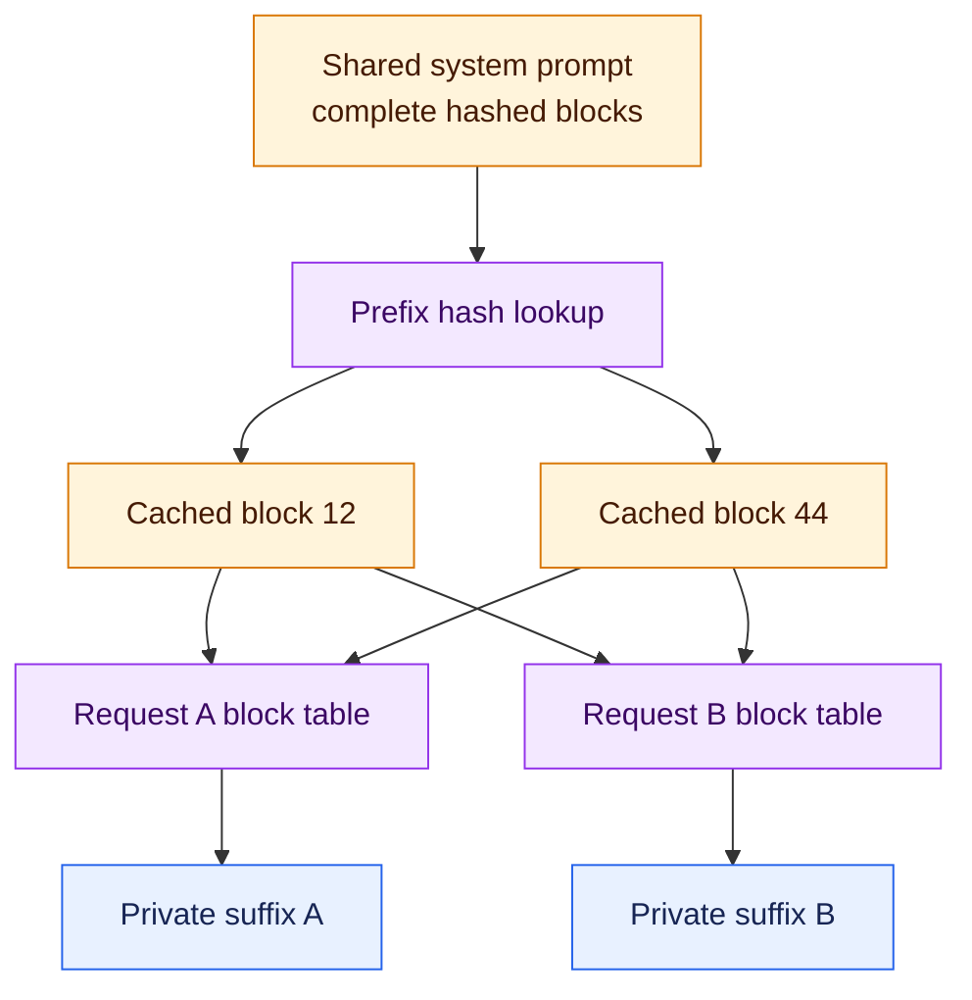

The shared prefix is computed once. Later requests reference the same immutable
cached blocks until their prompts diverge, after which they allocate private
blocks.

### Why complete boundaries matter

A partially filled tail block is awkward to share. Request A and Request B may
place different suffix tokens into its remaining slots. Simple prefix caching
therefore reuses complete hashed boundaries. Current vLLM versions may support
more advanced matching and hybrid layouts, so the exact boundary rules are
implementation-specific.

### Security

Cross-request reuse must respect tenant isolation and cache-salt policy.

---

## 11. Prefill and Decode Use the Cache Differently

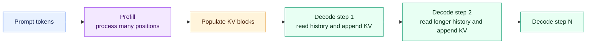

### Prefill

Prefill processes the prompt, writes K/V for its tokens, and produces the first
next-token distribution. With enough prompt tokens, large matrix operations can
make prefill compute-bound. Prompt length and prefill queueing strongly affect
time to first token.

### Decode

Decode processes a small number of new tokens per active sequence, reads model
weights, and reads an increasing amount of KV history. At modest batch sizes it
is often memory-bandwidth-bound, especially because the weight read is amortized
over relatively few new tokens.

The phrase “decode is bandwidth-bound because of KV cache” is incomplete. Both
weight traffic and KV traffic matter; their relative importance changes with
model size, batch size, context length, attention design, dtype, and hardware.

---

## 12. Why Long Context Remains Expensive

PagedAttention solves allocation waste. It does not change the fundamental
full-attention dependency on prior tokens.

For a standard full-attention decode step at context length `L`:

- KV memory grows approximately as `O(L)`;
- KV data read by attention grows approximately as `O(L)` per new token;
- attention computation for that new token grows approximately as `O(L)`;
- generating many additional tokens accumulates these growing per-step costs.

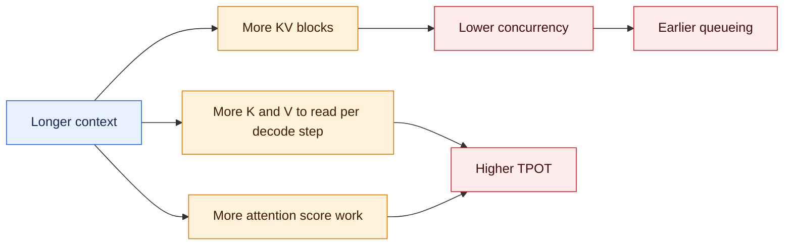

During prefill, ordinary dense causal attention has quadratic score-work with
prompt length, although optimized kernels reduce memory traffic and constants.
Architectures such as sliding-window attention, sparse attention, and MLA alter
the cache or attention cost, so the basic formula must be adapted to the model.

---

## 13. KV Precision and Offloading

The cache dtype can be an independent capacity lever.

| KV dtype | Typical bytes per stored scalar | Capacity effect versus BF16 |
|---|---:|---:|
| BF16 / FP16 | 2 | Baseline |
| FP8 | 1 | Approximately 2x raw capacity |

Real support depends on the accelerator, attention backend, model, scaling
method, and vLLM version. Lower precision can add conversion overhead and can
affect quality, especially in sensitive or long-context workloads. It must be
evaluated rather than treated as a lossless switch.

### Offloading is a different mechanism

Offloading keeps the KV blocks needed immediately in fast GPU memory and moves
eligible blocks to a larger, slower memory tier. That capacity tier might be CPU
memory, another GPU, or external KV storage. The GPU can therefore serve a
working set larger than its local KV-cache allocation, but an offloaded block
must be transferred back before an attention operation can read it.

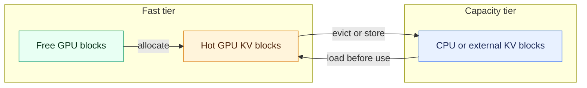

### Reading the offloading diagram

1. **Allocate a GPU block.** A request receives a block from the free GPU pool
   as its prompt or generated sequence creates new K/V state.
2. **Use it as a hot block.** While the request is actively using that part of
   its context, attention reads the block from fast GPU memory.
3. **Move an eligible block out.** When GPU space is needed, the system may
   store a block in the capacity tier. The block's K/V contents still exist, but
   they are no longer immediately readable by the GPU attention kernel.
4. **Load it before reuse.** If a later attention step needs that block, the
   system transfers it back into GPU memory. Attention must wait if the transfer
   has not completed in time.

For example, suppose a request owns six KV blocks but only four fit in its
available GPU working set. Four blocks can remain hot while two reside in CPU
memory. If attention later needs one of the CPU-resident blocks, that block must
be loaded into a GPU slot, possibly after another GPU block is moved out.

Offloading therefore trades **transfer time and bandwidth for KV capacity**.
The transfer consumes PCIe, CXL, NVLink, RDMA, or network bandwidth depending
on where the capacity tier resides. It works best when transfers can overlap
useful computation or when offloaded blocks are reused infrequently. Repeatedly
moving the same blocks between tiers can cause cache thrashing and increase
latency.

- **Paging** decides how cache is split, allocated, and addressed.
- **Quantization** reduces bytes stored per value.
- **Offloading** changes the memory tier where some cache state resides.

---

## 14. End-to-End Request Lifecycle

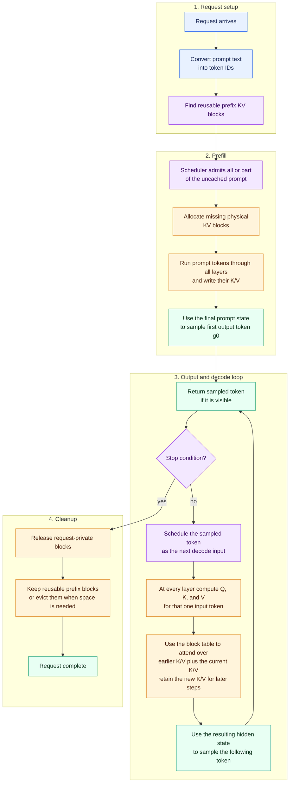

### Reading the lifecycle diagram

1. **Set up the request.** Tokenization converts prompt text to token IDs. The
   cache manager then finds any complete prefix blocks whose K/V state can be
   reused.
2. **Run the missing prefill work.** The scheduler admits the uncached prompt
   tokens, possibly in chunks. vLLM allocates physical blocks for them and
   stores the K/V produced at every transformer layer.
3. **Choose the first output token.** The final prompt hidden state produces
   logits from which the engine samples `g0`. Prefill has computed prompt K/V;
   it has selected `g0` but has not yet computed `g0`'s K/V.
4. **Enter the decode loop.** If generation continues, the next step processes
   `g0`, stores its K/V, and samples `g1`. The following step processes `g1` and
   samples `g2`. Each sampled token is therefore processed on the next model
   step if the request continues.
5. **Find the history through the block table.** Physical blocks can be
   scattered in GPU memory. The request's block table preserves their logical
   order so attention can read the complete valid history.
6. **Finish and release ownership.** Private blocks return to the free pool.
   Shared blocks remain while another request references them, and reusable
   prefix blocks may remain cached until the cache manager evicts them.

| Model step | K/V computed and retained | Output selected |
|---|---|---|
| Prefill | Prompt tokens | First output token `g0` |
| First decode step | `g0` | Following token `g1` |
| Second decode step | `g1` | Following token `g2` |

This is the lifecycle of one request. During serving, the engine continuously
combines work from many requests into each GPU iteration. The active batch can
change between iterations while every request retains its own block table and
logical history.

---

## 15. Common Misunderstandings

| Misunderstanding | Correction |
|---|---|
| PagedAttention reduces the number of attention operations | It primarily improves KV allocation and access; full-attention math still spans valid context |
| A block stores token IDs | It stores K/V tensor state derived from tokens; token IDs are tracked elsewhere |
| Each request owns one contiguous cache tensor | Its logical sequence can map to scattered physical blocks |
| PagedAttention means CPU swapping | CPU or external offload is separate from block-based GPU allocation |
| Prefix caching and PagedAttention are the same | Paging organizes memory; prefix caching reuses matching computed blocks |
| Q should be cached with K and V | Old Q vectors are not normally needed by future causal decode steps |
| Model parameter size determines concurrency | Free KV capacity, context lengths, cache architecture, and runtime overhead also determine concurrency |
| FP8 KV always doubles real throughput | It roughly halves raw KV bytes, but kernels, quality, and other bottlenecks determine the outcome |
| Decode bandwidth is only KV traffic | Model-weight traffic is often dominant at short contexts and small batches |
| Maximum admitted concurrency is the best setting | Too much pressure can cause queueing, preemption, and worse goodput |

---

## 16. Operational Reasoning Checklist

When sizing or debugging a vLLM deployment, answer these questions in order:

### Model architecture

- How many attention layers are present?
- How many KV heads and what head dimensions are used?
- Is the model MHA, GQA, MQA, MLA, sliding-window, or hybrid?
- What KV dtypes are supported by the chosen backend and hardware?

### Memory

- How large is the per-GPU weight shard?
- How much memory remains after graphs, activations, buffers, and reserve?
- How many KV bytes does one token consume per replica and per GPU?
- What are average and peak cached tokens per active request?
- How many cache blocks fit, and how much tail waste is expected?

### Workload

- What are the prompt and output length distributions?
- How many requests share prefixes?
- How bursty is arrival traffic?
- What are the TTFT and TPOT SLOs?

### Runtime behavior

- Are requests queueing because compute is saturated or because KV blocks are
  exhausted?
- Is preemption occurring, and how much recomputation does it create?
- Does FP8 KV improve capacity without unacceptable quality loss?
- Does offloading save more time than its transfers cost?

### Metrics to correlate

Track at least:

- running and waiting requests;
- prompt and generation tokens;
- KV-cache utilization and free blocks;
- prefix-cache hit rate;
- preemption or recomputation count;
- TTFT, ITL, TPOT, and end-to-end latency;
- input, output, and total token throughput;
- goodput under explicit SLOs.

No single metric explains the system. For example, high KV utilization is fine
until it combines with preemption, queue growth, and worsening tail latency.

---

## 17. Final Mental Model

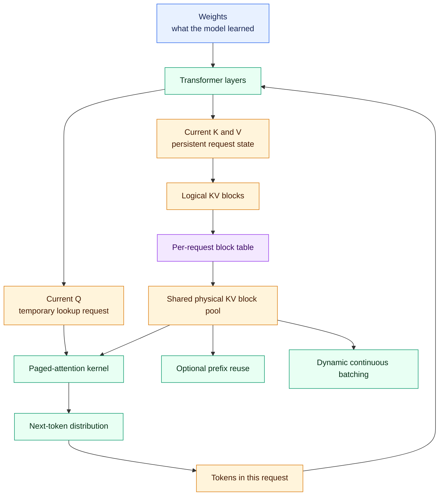

In one sentence:

> The KV cache preserves each request's already-computed attention history, and
> PagedAttention lets vLLM allocate and read that history through reusable
> non-contiguous blocks so dynamic batches waste less GPU memory.

For multi-GPU cache placement and capacity, continue with the
[production parallelism and scaling guide](./Production%20vLLM%20Strategies%20-%20Model%20KV%20Cache%20and%20Requests.md).

---

## 18. How the KV Cache Is Cleaned

“Clear the KV cache” can mean four different operations:

| Goal | What vLLM needs to do |
|---|---|
| Finish or cancel one request | Release that request's ownership of its physical blocks |
| Remove reusable prefixes | Invalidate the prefix-hash index and make unowned blocks available for reassignment |
| Clear an external or offloaded cache | Reset the configured connector or use the external backend's own invalidation procedure |
| Return the physical KV allocation to the system | Pause or stop the engine and discard the KV buffers; restarting the worker also recreates them |

These operations are different. Normal request cleanup does not require a
global cache purge.

### Normal cleanup when a request finishes

When a request reaches EOS, a stop condition, cancellation, or its length
limit, the scheduler removes its block table and releases its references:

```text
Request finishes
      |
      v
remove the request's logical block table
      |
      v
decrement ownership for each physical block
      |
      +-- another active request still uses it --> keep the block
      |
      +-- no active owner, reusable prefix ------> retain as an evictable hit
      |
      +-- no active owner or reusable entry -----> return to free-block pool
```

This cleanup happens automatically. Applications should normally finish or
cancel requests through the engine instead of manipulating KV memory directly.

### Prefix-cache eviction

A completed prefix block can have no active owner while still remaining in the
prefix-cache index. Its bytes stay in the GPU memory pool so that a later
matching request can reuse them. When the allocator needs the block for new
content, it evicts the old hash entry, reassigns the block, and later writes new
K/V into it.

Releasing or evicting a block therefore does not require immediately filling
its memory with zeros. Correctness comes from ownership, hashes, and block-table
mappings that prevent a request from addressing stale contents. The persistent
GPU allocation also means `nvidia-smi` may show nearly unchanged memory usage
after requests finish even though their slots are reusable.

### Explicitly resetting reusable prefix state

Current vLLM engine interfaces expose `reset_prefix_cache()`. A reset is useful
when cached K/V has become semantically invalid, such as after model weights
change, or when a benchmark requires a cold cache.

```python
# Direct LLMEngine-style use. Check the return value.
was_reset = engine.reset_prefix_cache()
```

By default, the reset succeeds only when running requests are not using the KV
cache. Current versions also support:

```python
engine.reset_prefix_cache(reset_running_requests=True)
```

That option can preempt running requests and move them back to the waiting
queue so their state is recomputed. It is disruptive and should be coordinated
with request admission. Exact signatures and behavior are version-specific;
see the official [reset-KV example](https://docs.vllm.ai/en/latest/examples/features/reset_kv/)
and [scheduler API](https://docs.vllm.ai/en/latest/api/vllm/v1/core/sched/scheduler/).

The OpenAI-compatible server also has a `/reset_prefix_cache` endpoint in
current releases, but the official security documentation classifies it as a
development endpoint gated by `VLLM_SERVER_DEV_MODE=1`. It can disrupt service
and should not be exposed as an unauthenticated production operation. See the
[vLLM security guide](https://docs.vllm.ai/en/latest/usage/security/).

### Connector and offloaded-cache cleanup

Resetting the local prefix index does not necessarily erase a copy stored by a
KV connector, CPU offload tier, or external cache. Current engine protocols
include a `reset_connector` option:

```python
engine.reset_prefix_cache(reset_connector=True)
```

Support depends on the connector. An external service may need its own scoped
invalidation, namespace change, retention policy, or restart. In a
prefill/decode deployment, resets must be coordinated across the relevant
prefill and decode workers so one side does not advertise state that the other
side has invalidated.

### Releasing the physical GPU allocation

A prefix reset invalidates cached contents but usually leaves vLLM's allocated
KV memory pool in place. If the goal is to return that GPU allocation rather
than merely reuse its blocks, use a supported engine lifecycle operation:

- current sleep level 1 offloads model weights to CPU and discards KV-cache
  contents;
- current sleep level 2 discards model weights and KV-cache GPU memory;
- stopping or restarting the worker releases the process's CUDA allocations.

Sleep and pause behavior requires coordinated request handling. Current vLLM
documents these semantics in the [LLM API](https://docs.vllm.ai/en/latest/api/vllm/).

### Which operation should be used?

| Situation | Appropriate action |
|---|---|
| One request completes normally | Let automatic reference release return its private blocks |
| A client cancels one request | Abort that request through the serving layer |
| GPU KV capacity is needed for new work | Let the allocator reuse free blocks and evict unowned cached prefixes |
| Measure cold-prefix performance | Drain traffic, then reset the prefix cache using the version-matched engine API |
| Model weights or adapters changed | Invalidate every cache tier whose K/V was computed with the old parameters |
| Clear connector or external KV state | Use `reset_connector` where supported and the backend's own invalidation procedure |
| Return KV allocation to the system | Use a supported pause/sleep lifecycle or restart the worker |

The compact rule is:

> **Request completion releases ownership, eviction removes reusable entries,
> prefix reset invalidates cached state, and engine shutdown or supported sleep
> operations release the physical GPU allocation.**

---

## References

- [vLLM: Easy, Fast, and Cheap LLM Serving with PagedAttention](https://vllm.ai/blog/2023-06-20-vllm)
- [vLLM documentation](https://docs.vllm.ai/en/latest/)
- [Paged Attention design notes](https://docs.vllm.ai/en/latest/design/paged_attention/)
- [Automatic Prefix Caching](https://docs.vllm.ai/en/latest/design/prefix_caching/)
- [Hybrid KV Cache Manager](https://docs.vllm.ai/en/latest/design/hybrid_kv_cache_manager/)
- [vLLM cache configuration](https://docs.vllm.ai/en/latest/api/vllm/config/cache/)
- [Efficient Memory Management for Large Language Model Serving with PagedAttention](https://arxiv.org/abs/2309.06180)
- [Attention Is All You Need](https://arxiv.org/abs/1706.03762)
- [Fast Transformer Decoding: One Write-Head is All You Need](https://arxiv.org/abs/1911.02150)
- [GQA: Training Generalized Multi-Query Transformer Models from Multi-Head Checkpoints](https://arxiv.org/abs/2305.13245)
