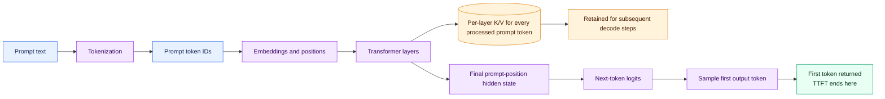
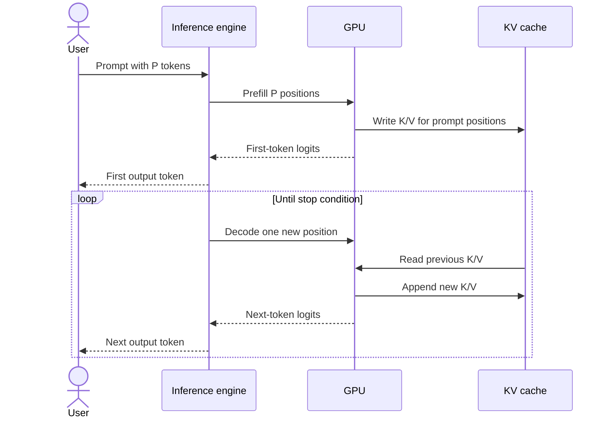
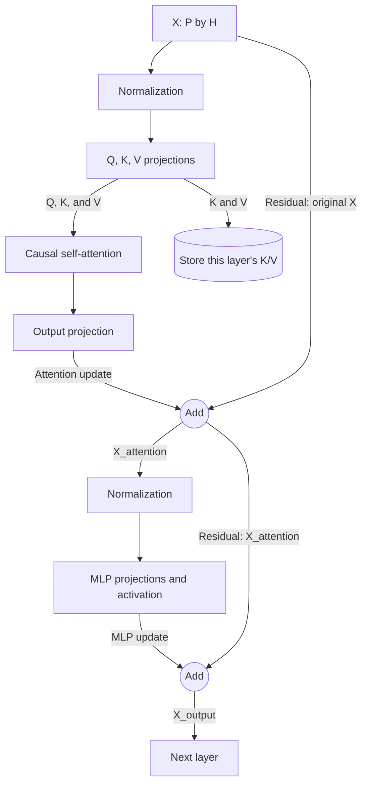
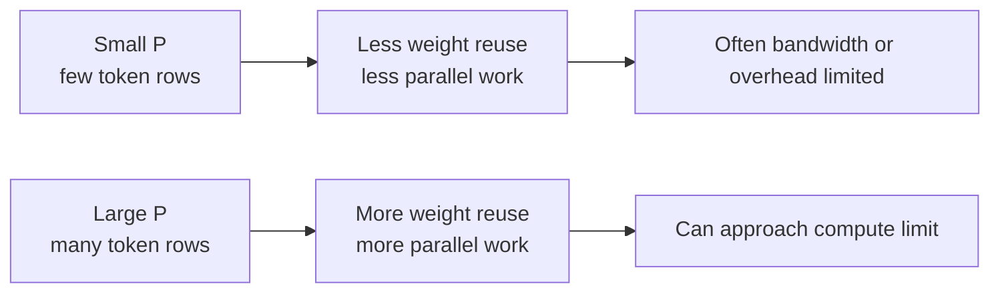
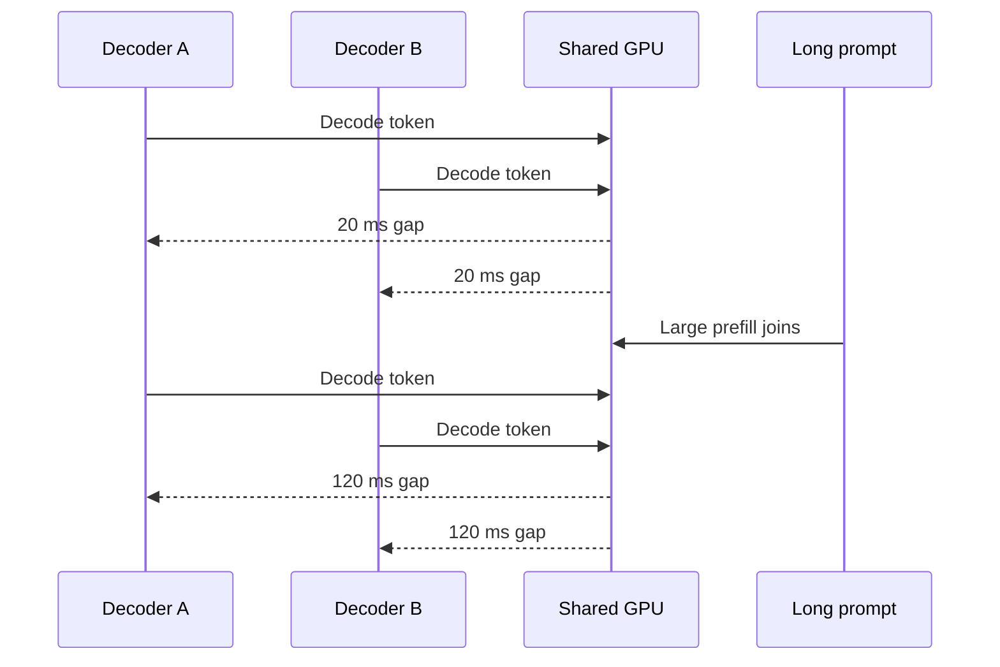
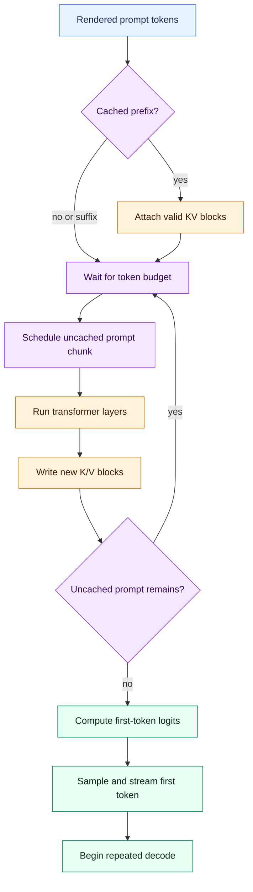

# Prefill in LLM Inference: An Illustrated Guide

*September 21, 2026 · @Mostapha*

Prefill is the phase in which a language model reads an existing prompt,
computes the prompt's internal representations, writes its attention state into
the KV cache, and produces the distribution for the first generated token.

That one sentence connects model mathematics, GPU kernels, vLLM scheduling,
memory capacity, and the user-visible **time to first token**. This guide builds
that connection step by step.

> **Version note:** prefill, causal attention, and KV-cache creation are stable
> concepts. Scheduler policies, defaults, command-line flags, attention
> backends, cache connectors, and process layouts change across vLLM releases.
> Verify production configuration against the
> [version-matched vLLM documentation](https://docs.vllm.ai/en/stable/).

> **Illustration attribution:** most externally hosted bitmap diagrams below
> were created by Aleksa Gordić for
> [Inside vLLM: Anatomy of a High-Throughput LLM Inference System](https://www.aleksagordic.com/blog/vllm).
> The original Transformer figure is from *Attention Is All You Need* and is
> attributed separately at the point of use. The images are referenced, not
> copied into this repository. All Mermaid diagrams are original to this guide.

---

## 1. Prefill in One Picture



Prefill is not just “loading the prompt.” It performs real transformer
computation for every prompt position. The results have two destinations:

1. **Persistent request state:** K and V vectors are retained in the KV cache
   for later decode steps.
2. **First-token decision:** the final prompt position produces logits from
   which the first output token is selected. Returning that token marks the end
   of time to first token, or TTFT.

The retained K/V branch points forward without expanding the decode process:
the first decode step uses the prompt's K/V state and the first sampled token
to produce the second output token.

---

## 2. Prefill Versus Decode

One request creates two computational phases:



| Property | Prefill | Decode |
|---|---|---|
| Existing input | Entire prompt | Most recently selected token |
| New positions processed per request step | Many | Normally one |
| K/V written | One entry per prompt position | One entry per new position |
| K/V read | Earlier prompt positions under causal attention | Complete valid history |
| Common GPU shape | Larger matrix-matrix operations | Small-row projections batched across sequences |
| Often constrains | TTFT and input-token throughput | TPOT, ITL, and output-token throughput |
| Typical starting intuition | More compute-intensive | More bandwidth-sensitive at modest batch sizes |

The last row is not a law. Tiny prefills can underutilize compute; large decode
batches can become compute-bound; long decode contexts create substantial KV
traffic; and kernel, dtype, model architecture, and hardware change the
boundary.

---

## 3. Before Prefill: Constructing the Actual Prompt

A chat API does not normally send the model a Python list of messages. The
frontend first applies a model-specific chat template:

```text
messages
  -> system/user/assistant formatting
  -> tool definitions and control tokens
  -> rendered prompt text
  -> tokenizer
  -> token IDs
```

The actual prompt can contain much more than the user's visible sentence:

- system instructions;
- conversation history;
- tool schemas;
- retrieved documents;
- few-shot examples;
- multimodal placeholder tokens or embeddings;
- special beginning, separator, and assistant-prefix tokens.

For example:

```text
Visible user message:       24 tokens
System prompt:             700 tokens
Tool schemas:            2,400 tokens
Conversation history:    1,800 tokens
Retrieved documents:     5,000 tokens
Chat-template overhead:    120 tokens
--------------------------------------
Actual prefill:          10,044 tokens
```

Prefill cost follows the actual rendered token sequence, not the number of
characters in the latest user message.

### Tokenization belongs in TTFT but not GPU prefill

Tokenization usually runs on the CPU before model execution. It contributes to
end-to-end time to first token, but it is useful to measure separately:

```text
client-observed TTFT
  = request/network time
  + validation and chat templating
  + tokenization
  + routing and queueing
  + GPU prefill
  + first-token sampling/output
  + response network time
```

Calling all of this “prefill latency” makes diagnosis harder.

---

## 4. What Happens in One Transformer Layer

The original *Attention Is All You Need* paper introduced the Transformer as
an encoder–decoder model:


*Illustration: Figure 1, “The Transformer — model architecture,” from
[Attention Is All You Need](https://arxiv.org/abs/1706.03762), by Vaswani et
al., via [Wikimedia Commons](https://commons.wikimedia.org/wiki/File:Attention_Is_All_You_Need_-_Encoder-decoder_Architecture.png),
licensed under [CC BY-SA 4.0](https://creativecommons.org/licenses/by-sa/4.0/).*

### Reading the original figure for prefill

1. **The left stack is the encoder.** The original translation model used it
   to represent a source sentence.
2. **The right stack is the decoder.** Its masked self-attention prevents a
   position from reading tokens to its right. This causal path is the relevant
   part for prefill in a decoder-only LLM.
3. **The decoder's middle attention block is cross-attention.** It reads the
   encoder output. A typical decoder-only causal LLM has neither this block nor
   a separate encoder.
4. **`N×` means that the layer repeats.** During prefill, prompt hidden states
   pass through every layer. Each layer uses its own learned Q/K/V projections
   and produces its own K/V state for every processed prompt position.
5. **The feed-forward block is the layer's MLP.** Attention mixes information
   across valid token positions; the MLP then transforms each position's
   hidden representation.
6. **Add & Norm contains a residual path and normalization.** Modern LLMs may
   order these operations differently from the original post-normalization
   design.
7. **Linear and Softmax form the output decision.** After the final decoder
   layer, the final prompt position supplies the hidden state used to produce
   next-token logits and select the first output token.

During prefill, the important path is therefore:

```text
prompt embeddings
  -> repeated causal decoder layers
  -> per-layer K/V retained for every prompt position
  -> final prompt-position hidden state
  -> vocabulary logits
  -> first output token
```

The following diagram zooms into one representative decoder layer.

### Zooming into one decoder layer

The input `X` is the current numerical representation of the prompt positions.
It has shape `[P, H]`:

```text
P = prompt positions in this execution chunk
H = model hidden dimension
```

There is one row in `X` for every processed position, and every row contains
`H` numbers. For example, if this chunk contains three prompt tokens and the
model hidden dimension is 4,096, then:

```text
X.shape = [3, 4096]

X[0] = hidden state for prompt position 0
X[1] = hidden state for prompt position 1
X[2] = hidden state for prompt position 2
```

`P` can change between requests or prefill chunks. `H` is fixed by the model
architecture.

A simplified transformer layer performs:



This is a representative pre-normalization layer. Exact ordering and
normalization choices vary by model, but the data flow is similar.

### Reading the diagram step by step

1. **Normalize the hidden states.** Normalization rescales each position's
   hidden vector before attention without changing the `[P, H]` organization.

2. **Create Q, K, and V.** Learned projections derive three representations
   from the normalized hidden states:

   ```text
   Q = queries: what each position is looking for
   K = keys:    how each position can be matched
   V = values:  the information each position can contribute
   ```

   Q is needed for the current attention calculation. This layer's K and V are
   also stored in this layer's KV cache so later generated tokens can attend to
   the prompt without recomputing them. Every transformer layer has its own K/V
   state.

3. **Perform causal self-attention.** A position can attend only to itself and
   earlier valid positions. For positions `0`, `1`, and `2`:

   ```text
   position 0 can see: 0
   position 1 can see: 0, 1
   position 2 can see: 0, 1, 2
   ```

   The GPU can calculate these positions in parallel; the causal mask controls
   which relationships are allowed.

4. **Project the attention result and apply the first residual connection.**
   The output projection converts the attention result back to the model's
   hidden dimension. The arrow from `X` directly to the first `Add` carries the
   original layer input around the attention path:

   ```text
   A = OutputProjection(Attention(Q, K, V))
   X_attention = X + A
   ```

   The residual path preserves the existing representation while attention
   adds contextual information to it.

5. **Run the MLP and apply the second residual connection.** The normalized
   post-attention state passes through the layer's feed-forward network:

   ```text
   M = MLP(Normalization(X_attention))
   X_output = X_attention + M
   ```

   The second residual path carries `X_attention`, not the original `X`. It
   preserves everything produced so far while the MLP adds another learned
   update.

6. **Send the result to the next layer.** `X_output` becomes the next
   transformer layer's input. The same pattern repeats across all transformer
   layers. After the final layer, the final prompt position's hidden state is
   used to produce the first-token logits.

### What “per-layer K/V for every processed prompt token” means

Consider this four-token prompt and a model with three transformer layers:

```text
[Alan] [Turing] [is] [here]
```

During prefill, all four positions pass through all three layers. Each layer
therefore stores K/V state for all four positions:

| KV cache | Stored prompt positions |
|---|---|
| Layer 1 | Alan, Turing, is, here |
| Layer 2 | Alan, Turing, is, here |
| Layer 3 | Alan, Turing, is, here |

This does **not** mean that one K/V pair for `Turing` is copied into every
layer. At layer `l`, prompt position `i` arrives with that layer's hidden state
`h[l, i]`. The layer applies its own learned projections:

```text
K[l, i] = h[l, i] x W_K[l]
V[l, i] = h[l, i] x W_V[l]
```

The hidden state changes as it moves through the model, and every layer has
different projection weights. Consequently, the K/V for `Turing` in layer 1
differs from the K/V for `Turing` in layer 2. A simplified cache layout is:

```text
K and V [layer][token position][KV head][head dimension]
```

If the example has four prompt positions and three layers, the cache contains
four K entries and four V entries at each layer: 12 token-position entries for
K and 12 for V before counting the KV heads and vector dimensions. With eight
KV heads, each token position has eight key vectors and eight value vectors at
that layer. MHA, GQA, and MQA use different numbers of KV heads, but the
layer-specific principle is the same.

During decoding, a new token passes through the layers one at a time. At layer
1, its query reads layer 1's cached history and its new K/V is appended to the
layer 1 cache. At layer 2, it reads and extends layer 2's cache, and so on. A
layer never substitutes another layer's K/V because the vector spaces and
learned projections are different.

Here, **processed** means that the token position has completed the required
forward computation. On a prefix-cache hit, matching positions already have
valid K/V and can be reused; prefill computes and appends K/V only for the
uncached positions.

The two outputs to keep separate are therefore the **updated hidden states**,
which continue through the model, and the **per-layer K/V state**, which is
retained for subsequent decode steps.

### Why all prompt positions matter

Only the final prompt position normally supplies the logits needed for the next
token. It may seem wasteful to process every earlier position, but the final
position's representation depends on them through causal attention. Earlier
positions also need complete per-layer K/V state for future decode attention.

The engine can discard most prompt activations after a layer is finished. It
must retain the K/V cache until the request completes or that state is safely
reused, transferred, evicted, or recomputed.

---

## 5. Causal Attention During Prefill

For a six-token prompt, the causal attention pattern is triangular:

```text
             Key position
             0  1  2  3  4  5
Query 0      ✓
Query 1      ✓  ✓
Query 2      ✓  ✓  ✓
Query 3      ✓  ✓  ✓  ✓
Query 4      ✓  ✓  ✓  ✓  ✓
Query 5      ✓  ✓  ✓  ✓  ✓  ✓
```

Token 2 cannot attend to tokens 3 through 5 because they are future positions
from its perspective. Token 5 may attend to all prompt positions.

For one attention head:

```text
scores = QK^T / sqrt(d_head)
probabilities = causal_softmax(scores)
output = probabilities V
```

Conceptually, prompt attention has a `P x P` score region. The causal mask makes
about half of it invalid, but ordinary full causal attention still has
quadratic score work in prompt length:

```text
attention score work ~= O(P^2 x d_head)
```

Linear projections and MLP work scale approximately linearly with `P` for a
fixed model:

```text
projection/MLP work ~= O(P)
```

For moderate contexts, large dense projections can dominate. At very long
contexts, attention's growth becomes increasingly important.

---

## 6. Why Prefill Often Uses the GPU Well

Consider a linear projection:

```text
X[P, H] @ W[H, D] -> Y[P, D]
```

Here, `P` is the number of prompt positions being processed, `H` is the model's
hidden dimension, and `D` is the projection's output width. The result contains
one `D`-value output row for each of the `P` positions.

GPU libraries describe the same matrix multiplication with the generic GEMM
dimensions `M`, `K`, and `N`:

```text
A[M, K] @ B[K, N] -> C[M, N]

M = P
K = H
N = D
```

These are two names for the same three dimensions, not six separate values:
`M/P` counts token rows, `K/H` is the shared dimension multiplied and summed
over, and `N/D` is the number of output columns.

The work is approximately:

```text
2 x P x H x D FLOPs
```

The factor `2` counts one multiplication and one addition for each term in the
matrix product.

The weight matrix `W` is shared across all `P` rows. A longer prompt or a batch
of prompt chunks gives the kernel more rows over which to reuse weight data.
This raises arithmetic intensity and makes it easier to occupy Tensor Cores.



`P` is the number of prompt-token rows processed together, and every row uses
the same model weight matrix. With a small `P`, the GPU loads those weights for
only a little work and may spend more time moving data or launching kernels.
With a larger `P`, it reuses the weights across more rows and gives GPU cores
more independent calculations to perform in parallel. The GPU then spends more
of its time doing arithmetic and can get closer to its maximum compute rate.

This is why input-token throughput can improve as prompt batches grow, even
though an individual request performs more total work.

### Larger is not always better

A very large prefill can:

- occupy the GPU for a long engine iteration;
- raise temporary activation/workspace memory;
- delay active decoders;
- increase queueing for short prompts;
- cross into inefficient edge shapes or kernel paths;
- hit context, token-budget, or KV-capacity limits.

The best batch for aggregate tokens/s is not necessarily the best batch for
interactive latency.

For a deeper GPU treatment, see
[Inside vLLM: A Deeper Step-by-Step Guide to High-Throughput Inference](./Inside%20vLLM%20-%20A%20Deeper%20Step-by-Step%20Guide%20to%20High-Throughput%20Inference.md#131-the-missing-layer-how-a-linear-operation-becomes-gpu-work).

---

## 7. What Prefill Writes Into the KV Cache

At every attention layer, each prompt position produces a key vector and a
value vector for every KV head. Those vectors are persistent request state.

Approximate cache bytes created by a prompt are:

```text
prompt KV bytes
  = prompt tokens
  x 2
  x attention layers
  x KV heads
  x head dimension
  x bytes per cache element
```

The factor `2` represents keys and values.

### Worked example

Assume:

- 8,000 prompt tokens;
- 32 attention layers;
- 8 KV heads;
- head dimension 128;
- BF16 cache elements at 2 bytes each.

Per token:

```text
2 x 32 x 8 x 128 x 2
  = 131,072 bytes
  = 128 KiB
```

For the complete prompt:

```text
8,000 x 128 KiB
  ~= 0.977 GiB
```

Prefill therefore transforms a request from “tokens waiting for computation”
into “nearly one GiB of live GPU state” in this hypothetical example.

### Temporary versus persistent memory

| Memory | Lifetime |
|---|---|
| Model weights | Server or worker lifetime |
| Intermediate layer activations | Usually until the next operation/layer no longer needs them |
| Attention workspaces | Kernel or execution lifetime |
| Prompt KV cache | Request lifetime, or longer if retained for reuse |
| CUDA graph/static buffers | Captured execution lifetime |

Peak prefill memory can exceed the final KV-cache increment because temporary
activations and workspaces coexist during execution.

For block allocation details, see
[KV Cache and PagedAttention in vLLM: An Illustrated Guide](./KV%20Cache%20and%20PagedAttention%20in%20vLLM%20-%20Illustrated%20Guide.md).

---

## 8. The First-Token Boundary

Prefill ends with the information needed to choose the first output token:

```text
final prompt hidden state
  -> vocabulary projection
  -> logits
  -> constraints and sampling
  -> first output token
```

The transformer forward pass produces the logits; the serving engine applies
the sampling rules and selects the first token. Returning that token marks the
end of TTFT.

A subtle timeline matters:

```text
Prefill:
  computes KV for prompt tokens
  samples output token g0

First decode step:
  consumes g0
  computes KV for g0
  samples output token g1
```

Here, `g0` means the first generated token and `g1` means the second. For the
prompt `The capital of France is`, prefill might select `g0 = Paris`. Selecting
`Paris` from the logits does not pass it through the transformer, so it has no
K/V state yet. The first decode step processes `Paris`, appends its K/V to the
prompt's cache, and then selects `g1`.

If generation stops after `g0`, no future token needs to attend to it, so the
engine need not run another step merely to cache its K/V.

This distinction explains why internal counters such as “computed tokens,”
“scheduled tokens,” and “output tokens” may not all advance in the same place.

---

## 9. Time to First Token, Decomposed


*Diagram: [TTFT, ITL, and end-to-end latency](https://www.aleksagordic.com/blog/vllm/latency_diagram.png), by Aleksa Gordić.*

### How to read the diagram

- TTFT ends when the client receives the first generated token.
- Later token gaps are ITL samples.
- End-to-end latency ends at the final response.
- GPU prefill is only one component inside TTFT.

A more diagnostic decomposition is:

```text
client TTFT
  = network ingress
  + request parsing and validation
  + chat templating and tokenization
  + routing
  + engine queueing
  + scheduler wait
  + GPU prefill execution
  + logits, sampling, and detokenization
  + network egress/flush
```

### Three TTFT regimes

| Regime | What dominates | Evidence |
|---|---|---|
| Low load, short prompt | Fixed frontend and kernel overhead | TTFT changes little with prompt length |
| Low load, long prompt | GPU prefill work | TTFT grows with input tokens |
| High load | Queueing and scheduling | TTFT rises without a matching rise in execution time |

A single TTFT number cannot identify which regime applies.

### Prefill latency versus prefill throughput

These metrics answer different questions:

```text
request prefill latency = elapsed time for this request's prompt work

prefill throughput = total uncached prompt tokens processed / elapsed time
```

A larger batch can improve throughput while increasing each request's elapsed
latency. Report both.

---

## 10. Why Prefill Interferes With Decode

Suppose active decoders normally complete one engine iteration in 20 ms. A
large prefill joins the batch and makes the next iteration take 120 ms. The
prefill request progresses efficiently, but existing users observe a 120 ms
gap before their next token.



This is prefill-decode interference. It creates a policy conflict:

- prioritizing prefill can reduce waiting prompts' TTFT;
- prioritizing decode can protect active users' ITL;
- maximizing total tokens per step can improve throughput while violating both
  tail-latency goals.

### What “prioritizing” means

The scheduler builds the work batch for each engine iteration. Prioritizing a
phase means assigning that phase space in the iteration's token budget first;
it does not change the transformer calculation itself.

Assume one iteration can schedule 1,024 token positions, 80 requests are
already decoding, and a new request has a long prompt:

| Policy | How the scheduler can use the iteration | Main effect |
|---|---|---|
| Prefill first | Give most or all 1,024 positions to the waiting prompt | The new request approaches its first token sooner, but active streams can pause |
| Decode first | Schedule 80 decode positions, then use the remaining 944 positions for a prompt chunk | Existing streams remain responsive, but the new prompt may need more iterations |
| Throughput first | Choose a large, efficient mixture of prompt and decode work | Total tokens/s may improve without guaranteeing either TTFT or ITL |

With decode priority, the ordinary scheduling order is therefore:

```text
1. Give active decode requests their next positions.
2. Measure the remaining token budget.
3. Fill that remainder with one or more prefill chunks.
4. Repeat until the prompt is complete and can enter decode.
```

With prefill priority, the scheduler considers waiting prompt work first. A
large prompt may then create a long GPU iteration during which already active
decoders receive no new token. Chunked prefill limits that interference by
placing a bound on how much of the prompt enters one iteration.

### How vLLM V1 creates the preference internally

The vLLM V1 scheduler does not fundamentally label each operation “prefill” or
“decode.” For each request, it tracks two quantities:

```text
num_computed_tokens = positions whose model computation is complete
num_tokens_with_spec = positions currently available to be computed
```

Ignoring speculative-decoding details, the request's available work is the gap
between them:

```text
available request work
  = num_tokens_with_spec - num_computed_tokens
```

For a newly arrived 4,000-token prompt, that gap may be 4,000 positions. For an
ordinary request already decoding, the newly sampled token normally creates a
gap of one position. This single representation lets the scheduler handle
full prefill, chunked prefill, prefix-cache hits, and decode without separate
phase-specific request objects.

At the beginning of `Scheduler.schedule()`, vLLM creates an iteration token
budget. `max_num_scheduled_tokens` supplies that budget and normally defaults
to `max_num_batched_tokens`. The scheduling flow can be summarized as:

```python
budget = maximum_tokens_for_this_iteration

# Existing admitted requests are considered first.
for request in running_requests:
    work = request.available_uncomputed_positions()
    work = apply_prompt_chunk_and_model_limits(work)
    scheduled = min(work, budget)

    if kv_manager_can_allocate(request, scheduled):
        record_scheduled_work(request, scheduled)
        budget -= scheduled
    else:
        preempt_or_defer_work()

# New or preempted requests are considered with what remains.
for request in waiting_requests:
    if budget == 0 or no_request_slot_is_available():
        break

    scheduled = min(request.available_uncomputed_positions(), budget)
    if kv_manager_can_allocate(request, scheduled):
        move_request_to_running(request)
        record_scheduled_work(request, scheduled)
        budget -= scheduled
```

This is explanatory pseudocode rather than a copy of the implementation. The
production scheduler also handles cached-token matches, speculative tokens,
encoder inputs, priorities, KV transfer, data-parallel coordination, and other
constraints.

The usual decode preference emerges from the ordering:

1. Existing `RUNNING` requests are visited before new `WAITING` requests.
2. Active decoders are already `RUNNING` and commonly need one position each.
3. Their scheduled positions reduce the iteration token budget.
4. A newly arrived prompt is still `WAITING`, so it receives only the remaining
   budget and becomes a prefill chunk when the whole prompt does not fit.

For example:

```text
iteration budget                  = 1,024 positions
80 RUNNING decoders x 1 position  =    80 positions
remaining for WAITING prompt      =   944 positions
```

An unfinished prompt chunk can itself be in `RUNNING`, so the internal rule is
more precise than “decode always runs before every prefill.” Options such as
`long_prefill_token_threshold` can further cap a long prefill when other
requests are present. KV allocation is another gate: if the required cache
slots cannot be allocated, vLLM may preempt eligible work or leave the request
unscheduled rather than exceeding memory capacity.

The scheduler needs an explicit product objective, not just maximum utilization.

---

## 11. Token-Budget Scheduling

Serving schedulers constrain work by tokens because request count is a poor
measure of computation. One waiting request may contain a 50-token prompt and
another a 50,000-token prompt.

A simplified step budget is:

```text
scheduled decode positions
  + scheduled prompt positions
  + other supported token work
  <= maximum batched-token budget
```

Additional constraints include:

- available KV blocks;
- maximum active sequences;
- model context limit;
- request priority or arrival order;
- multimodal/encoder budgets;
- data-parallel synchronization requirements;
- cached prompt positions that do not require model recomputation.

### Example

Assume the step budget is 1,024 tokens and 80 active decoders each need one
position:

```text
decode allocation: 80 tokens
remaining budget:  944 tokens
```

A 4,000-token prompt can receive a 944-token chunk in that step rather than
occupying an unbounded iteration.

Exact accounting is version- and feature-dependent. The durable idea is that
the scheduler admits a quantity of token work, not merely a request name.

---

## 12. Chunked Prefill

A long prompt does not have to execute as one scheduling unit. Chunked prefill
splits it across multiple engine iterations.


*Diagram: [Chunked prefill](https://www.aleksagordic.com/blog/vllm/chunked_pt1.png), by Aleksa Gordić.*

### How to read the diagram

- The prompt's logical token order remains unchanged.
- Each iteration processes only the next chunk that fits its scheduling budget.
- Active decode tokens can share iterations with prompt chunks.
- Earlier chunks write KV state that later chunks attend to.
- The first output token is available only after all uncached prompt positions
  are processed.

Current vLLM documentation describes chunking in terms of the remaining
`max_num_batched_tokens` budget. Exact enablement and defaults vary by release.

### Configuring decode-priority chunked prefill in vLLM

With chunked prefill enabled, existing `RUNNING` work is considered before new
`WAITING` prompts, as Section 10 explained. Because active decoders are already
running, this normally protects their next positions before admitting a new
prompt chunk. An unfinished prefill chunk can also be `RUNNING`, so this is a
scheduler-state preference rather than an unconditional phase switch. There is
no separate `decode_priority=True` option.

For an online server, configure it explicitly:

```bash
vllm serve meta-llama/Llama-3.1-8B-Instruct \
  --enable-chunked-prefill \
  --max-num-batched-tokens 2048 \
  --max-num-seqs 128
```

The corresponding Python configuration is:

```python
from vllm import LLM

llm = LLM(
    model="meta-llama/Llama-3.1-8B-Instruct",
    enable_chunked_prefill=True,
    max_num_batched_tokens=2048,
    max_num_seqs=128,
)
```

The settings have distinct roles:

| Setting | What it controls |
|---|---|
| `enable_chunked_prefill` | Allows a prompt to be processed across bounded scheduler iterations |
| `max_num_batched_tokens` | Maximum combined token work scheduled in one iteration |
| `max_num_seqs` | Maximum number of sequences that can participate in one iteration |

Do not confuse phase ordering with `--scheduling-policy priority`. That option
chooses which **request** is considered first using its supplied priority; it
does not independently mean “prefill first” or “decode first.”

### Worked schedule

Assume:

- prompt length: 3,000 uncached tokens;
- step budget: 1,024 tokens;
- two active decoders consume one token each per step.

```text
Step 1: 2 decode + 1,022 prompt positions
Step 2: 2 decode + 1,022 prompt positions
Step 3: 2 decode +   956 prompt positions
         prompt prefill completes; first output can be selected
```

### Benefits and costs

| Benefit | Cost |
|---|---|
| Bounds the work added to one iteration | Long prompt crosses more scheduling boundaries |
| Reduces long decode stalls | Prompt may receive its first token later |
| Mixes prompt and decode work | Earlier KV history must participate in later chunks |
| Improves fairness under mixed lengths | More metadata, scheduling, and launch overhead |
| Avoids one prompt monopolizing a step | Poor admission can still cause KV pressure |

### Chunk size is an SLO choice

Smaller chunks generally protect ITL but can reduce prompt efficiency. Larger
chunks generally improve prefill efficiency but create longer decode stalls.
In vLLM, `max_num_batched_tokens` is the main control for this balance:

| Token budget | Typical effect |
|---|---|
| Smaller | Less prefill work per iteration, shorter decode interruptions, often better ITL |
| Larger | More prompt work per iteration, often better prefill throughput and TTFT, but potentially worse ITL |

The correct value depends on:

- prompt-length distribution;
- active decode concurrency;
- target p95/p99 TTFT and ITL;
- GPU and attention backend;
- model dimensions and parallelism;
- prefix-cache hit distribution;
- multimodal prompt structure.

Tune using production-shaped traffic, not one long synthetic prompt.

---

## 13. Prefix Caching Skips Prefill Work

Many requests repeat a prefix:

```text
[system prompt][tool definitions][few-shot examples][request-specific suffix]
```

If complete KV blocks for the exact prefix already exist and are valid for
reuse, the engine can attach those blocks and prefill only the unmatched suffix.

### Stage 1: hash the complete prefix blocks


*Diagram: [Prefix caching, stage 1](https://www.aleksagordic.com/blog/vllm/prefix_pt1.png), by Aleksa Gordić.*

The cache manager divides the request into block-sized token groups and creates
hashes for complete blocks. The hash includes the preceding prefix context, so
a block matches only in the correct sequence position and context.

### Stage 2: associate hashes with computed KV blocks


*Diagram: [Prefix caching, stage 2](https://www.aleksagordic.com/blog/vllm/prefix_pt2.png), by Aleksa Gordić.*

Request A receives physical blocks and its forward pass writes the actual K/V
state into them. Complete blocks can then be found later through the lookup
from hashes to physical blocks.

### Stage 3: reuse the longest valid cached prefix


*Diagram: [Prefix caching, stage 3](https://www.aleksagordic.com/blog/vllm/prefix_pt3.png), by Aleksa Gordić.*

Request B finds the two complete matching prefix blocks, attaches them to its
own logical sequence, and allocates a different physical block for its private
suffix.

### A concrete two-request example

Assume each KV block holds four token positions. Two requests begin with the
same eight-token prefix but have different three-token suffixes:

```text
Request A: [shared prefix: 8] + [A suffix: 3] = 11 prompt tokens
Request B: [shared prefix: 8] + [B suffix: 3] = 11 prompt tokens
```

The requests branch after the shared prefix. Request B does not append its
suffix after Request A's suffix:

```text
                         +-- A1 A2 A3   Request A
S1 S2 S3 S4 S5 S6 S7 S8 |
                         +-- B1 B2 B3   Request B
```

Request A initially computes all eleven prompt positions:

```text
physical block 1: [S1 S2 S3 S4]   full
physical block 2: [S5 S6 S7 S8]   full
physical block 3: [A1 A2 A3 --]   75% full

11 positions / 4 positions per block = 2.75 blocks
```

If Request A continues decoding, generated-token positions extend its KV state.
In the illustrated example, six processed generated positions increase the
stored history from 11 to 17 positions:

```text
17 positions / 4 positions per block = 4.25 blocks
```

Those six positions belong to decode. They are not another part of either
request's prompt.

When Request B arrives, its first eight token IDs and their prefix context match
blocks 1 and 2. The engine attaches those blocks to B's logical block table and
does not run transformer prefill for those eight positions. Request A's suffix
and generated continuation do not match B and cannot be reused. B computes only
its three-token suffix and writes it to a newly allocated physical block:

```text
Request B logical block table: [1, 2, 6]

blocks 1 and 2: 8 cached prefix positions
block 6:         3 newly computed suffix positions, 75% full
```

Physical block 6 is simply the block selected from the allocator's free queue.
Its ID does not imply that blocks 3 through 5 belong to Request B; physical
block IDs need not be consecutive.

The prompt-computation saving is:

```text
With prefix caching:
  shared prefix computed once:       8
  Request A's private suffix:       +3
  Request B's private suffix:       +3
                                    --
  total prompt positions computed:  14

Without prefix caching:
  Request A computes 11 + Request B computes 11 = 22
```

Thus, `8 + 3 + 3 = 14` counts prompt computation across both requests. Request
B's own logical prompt is still `8 + 3 = 11` positions; it never becomes
`8 + 3 + 3`.

### What a hit saves

- Q/K/V and transformer work for matched positions;
- attention and MLP work for those positions;
- TTFT when prefill was the bottleneck;
- redundant energy and GPU occupancy.

### What a hit does not necessarily save

- chat templating and tokenization;
- hash lookup and cache metadata work;
- unmatched suffix prefill;
- decode after the prompt;
- routing and queueing;
- network latency.

Only measuring “cache hit count” is insufficient. Measure **cached prompt
tokens** and **uncached prompt tokens**, because a 16-token hit and an
8,000-token hit have very different value.

### Routing affects hit probability

Each replica may own a different local prefix cache. A cache-aware router can
trade a slightly longer queue for a large prefill saving. Excessive affinity,
however, can overload one replica. Queue cost and cache-miss cost must be
considered together.

---

## 14. CPU Offloading: Weights and Reusable KV Prefixes

There is no fixed universal amount that can be offloaded. The maximum depends
on:

- available system RAM;
- how much RAM vLLM and the operating system already use;
- whether the memory must be pinned;
- CPU-to-GPU bandwidth;
- acceptable latency and throughput.

### CPU-to-GPU bandwidth

CPU-to-GPU bandwidth is the rate at which weights, KV blocks, and other data
can move from system RAM to GPU memory. It is commonly measured in gigabytes
per second. The GPU must receive required data before the corresponding
computation can use it, so this bandwidth can limit offloading performance.

```text
host system RAM
       |
       |  CPU-to-GPU interconnect
       |  such as PCIe or NVLink-C2C
       v
GPU memory / HBM
       |
       v
GPU computation
```

The approximate transfer time is:

```text
transfer time = amount of data / effective bandwidth
```

For example, suppose a forward pass needs 8 GiB of offloaded weights and the
connection delivers an effective 32 GiB/s:

```text
8 GiB / 32 GiB/s = 0.25 seconds
```

That forward pass must account for roughly 250 ms of data movement unless
prefetching overlaps some of it with useful GPU computation. Because weight
offloading needs the offloaded model parts during every forward pass, this cost
can recur throughout decoding. For KV-prefix offloading, the transfer happens
when a later request hits an offloaded prefix and those blocks are promoted to
the GPU.

System RAM capacity and transfer bandwidth answer different questions:

| Resource | Question it answers |
|---|---|
| Host RAM capacity | How much offloaded data can be stored? |
| CPU-to-GPU bandwidth | How quickly can required data reach the GPU? |

“CPU offloading” normally means placing data in the node's **system RAM**. The
CPU itself does not store the data:

```text
GPU memory / HBM  <->  host system RAM
```

These are two physically separate memory locations:

| Memory | What it is | Typical inference contents |
|---|---|---|
| **GPU memory / HBM** | The GPU's fast local memory | Active model weights, active KV blocks, activations, and workspaces |
| **Host system RAM** | The server's larger main memory, attached to the CPU | Request metadata, CPU buffers, and data deliberately offloaded from the GPU |

`HBM` means **High Bandwidth Memory**. It is close to the GPU's compute units
and much faster for GPU kernels to use than host RAM, but its capacity is
usually smaller. The slash means “GPU memory, commonly HBM on datacenter
accelerators”; it does not name a third memory location.

The two-way arrow represents copies in both directions:

```text
GPU memory / HBM  ->  host RAM
offload or preserve data outside the GPU to free GPU capacity

host RAM  ->  GPU memory / HBM
load or promote data before GPU computation needs it
```

For example, a completed reusable KV-prefix block may be copied from GPU memory
to host RAM. If a later request matches that prefix, the block can be copied
back to GPU memory before attention uses it. With model-weight offloading,
offloaded weights move from host RAM toward the GPU when their layers execute.

The memories do not become one equally fast pool. Transfers cross an
interconnect such as PCIe or NVLink-C2C, so their size and the link's effective
bandwidth contribute to latency.

Two different kinds of data can be offloaded:

| Data | Reason to offload it | Performance implication |
|---|---|---|
| **Model weights** | The model does not fit completely in GPU memory | Offloaded weights are needed during every forward pass |
| **Completed KV prefix blocks** | Increase reusable prefix-cache capacity | Blocks are loaded when a request matches the cached prefix |

These are different mechanisms and should be configured and evaluated
separately.

### Model-weight offloading

vLLM provides:

```bash
--cpu-offload-gb <GiB>
```

This value is the amount of CPU memory used for model-weight offloading **per
GPU**. For example:

```bash
vllm serve model-name \
  --tensor-parallel-size 4 \
  --cpu-offload-gb 10
```

With four GPUs, the configuration can use up to:

```text
10 GiB per GPU x 4 GPUs = 40 GiB of host RAM
```

Conceptually, a 24 GiB GPU with 10 GiB of weight offloading has approximately
34 GiB of virtual capacity for model weights:

```text
24 GiB of physical GPU memory
+ 10 GiB of offloaded model weights
-----------------------------------
~ 34 GiB of virtual weight capacity
```

This does not turn the GPU into a physical 34 GiB GPU. The offloaded weights
still reside in host RAM and must be accessed while the model runs.

The [vLLM offload configuration](https://docs.vllm.ai/en/latest/api/vllm/config/offload/)
describes `--cpu-offload-gb` as a per-GPU setting and notes that offloaded
model parts are accessed during every forward pass.

#### Why weight offloading can reduce performance

Every generated token passes through the model's layers:

```text
Generate one token
      |
      +-- run layer 0
      +-- run layer 1
      +-- run layer 2
      +-- run the remaining layers
```

If some layer weights reside in host RAM, those weights must be made available
during every forward pass. The exact access and transfer behavior depends on
the selected backend and hardware.

The practical cost depends heavily on the CPU-to-GPU connection:

- PCIe usually makes extensive offloading expensive;
- NVLink-C2C systems, such as Grace Hopper or Grace Blackwell platforms,
  provide much higher CPU-to-GPU bandwidth;
- asynchronous prefetching can hide some transfer time, but only when
  transfers overlap effectively with computation.

Weight offloading is most attractive when the model only slightly exceeds GPU
capacity:

```text
Model and runtime requirement: 88 GiB
Available GPU memory:          80 GiB
Shortfall:                      8 GiB
```

Offloading part of the weights may make this deployment possible. If the
shortfall is large, tensor parallelism, pipeline parallelism, or weight
quantization may provide better performance.

### KV-cache offloading

KV offloading serves a different purpose. It extends the amount of **reusable
prefix state** that can be retained outside GPU memory.

Current vLLM exposes settings including:

```bash
--kv-offloading-size <GiB>
--kv-offloading-backend native
```

For example:

```bash
vllm serve model-name \
  --kv-offloading-size 64 \
  --kv-offloading-backend native
```

When tensor parallelism is enabled, `--kv-offloading-size` is the **total
buffer size across all TP ranks**:

```text
TP size:                4
KV offloading size:    64 GiB
Total host KV buffer:  64 GiB
```

It is not interpreted as 64 GiB for each of the four TP ranks. See the
[vLLM cache configuration](https://docs.vllm.ai/en/latest/api/vllm/config/cache/).

vLLM also documents an `OffloadingConnector` with a CPU memory tier. Its
`cpu_bytes_to_use` setting specifies the total CPU-tier capacity across
workers. These interfaces may be used differently depending on the chosen
backend and deployment design.

### What KV offloading actually does

The documented `OffloadingConnector` extends the prefix cache by retaining
completed KV blocks in host memory. Consider two requests with the same prompt
prefix:

```text
Request A computes completed prefix KV blocks
                         |
                         +-- GPU copy supports current execution
                         +-- host-memory copy enters the offload cache

Later Request B has the same prefix
                         |
                         v
                 Host-memory cache hit
                         |
                         v
                 Copy blocks to the GPU
                         |
                         v
          Reuse prefix instead of recomputing it
```

The CPU tier therefore behaves as a larger, slower cache for reusable prefix
blocks.

Transfers can run asynchronously and overlap with computation. The required
blocks must nevertheless be available on the GPU before the attention
operation uses them. See the
[vLLM KV offloading guide](https://docs.vllm.ai/en/latest/features/kv_offloading_usage/).

### KV offloading is not demand paging for active decode

KV offloading should not be pictured as moving the live history of an actively
decoding request between GPU and RAM on every token:

```text
Misleading model:

decode token
  -> fetch old live KV from RAM
  -> perform attention
  -> send live KV back to RAM
  -> repeat for the next token
```

An active decode step needs attention over the request's historical KV state.
Repeatedly loading that history from host memory would add transfer latency to
token generation.

The documented offload cache instead focuses on **completed, cacheable KV
blocks** that can be reused when another request matches the same prefix:

```text
Documented use:

Request A computes reusable prefix
  -> retain completed blocks in the CPU cache

Later Request B matches that prefix
  -> load reusable blocks to the GPU
  -> avoid repeating prefix computation
```

When the GPU does not have enough KV space for scheduled active work, the
scheduler may delay admission or preempt work. With recompute-style
preemption, the request's KV state is later reconstructed from its retained
token IDs. This behavior is separate from prefix-cache offloading and can
depend on the vLLM version and scheduler configuration.

### Weight offloading and KV offloading compared

| Question | Weight offloading | KV offloading |
|---|---|---|
| What is stored in RAM? | Model parameters | Completed, cacheable KV blocks |
| Why use it? | Make a model fit in limited GPU memory | Increase reusable prefix-cache capacity |
| When is the data needed? | During every model forward pass | When a matching prefix is reused |
| Main cost | Repeated access or transfer of weights | Promotion latency on a prefix-cache hit |
| Best fit | A model that slightly exceeds GPU capacity | Workloads with repeated prefixes |
| Main alternative | TP, PP, or quantization | Recompute, more GPU KV capacity, or external KV tiers |

### Calculating a safe host-memory budget

A safe offload budget is approximately:

```text
available offload memory
  = total system RAM
  - operating-system memory
  - vLLM host allocations
  - tokenization and request state
  - communication and staging buffers
  - memory used by other applications
  - safety margin
```

For illustration only, consider a node with 512 GiB of RAM:

```text
Total system RAM:                 512 GiB
OS and background services:       -32 GiB
Runtime and request allocations:  -50 GiB
Other applications:               -30 GiB
Safety margin:                    -50 GiB
                                  --------
Illustrative offload budget:      350 GiB
```

These numbers are an example, not measured recommendations. The real budget
must be measured on the target node under representative load.

Pinned memory also requires care. Reserving too much can leave insufficient
pageable memory for the operating system and other processes.

### Capacity is not the same as performance

A server may have enough RAM to hold hundreds of GiB of offloaded data, but
that does not guarantee acceptable performance:

```text
Capacity question:
Does the data fit in host RAM?

Performance question:
Can the required data reach the GPU quickly enough?
```

The effective limit depends on:

- CPU-to-GPU bandwidth;
- transfer latency;
- PCIe, NVLink-C2C, or other interconnects;
- NUMA placement;
- transfer and computation overlap;
- access frequency;
- workload prefix-reuse rate;
- latency objectives.

The practical rule is:

> **System RAM determines how much data can be stored outside the GPU. The
> access pattern and CPU-to-GPU interconnect determine how much can be
> offloaded without unacceptable performance loss.**

A useful starting decision is:

```text
Small model-weight shortfall
  -> consider CPU weight offloading

Large model-weight shortfall
  -> consider TP, PP, or quantization

Repeated prompt prefixes
  -> consider KV prefix offloading

Active long contexts consume too much memory per GPU
  -> consider DCP or additional GPU KV capacity
```

---

## 15. RAG and Tool Use Can Make Prefill Dominant

A retrieval-augmented request often has this shape:

```text
small user question
  + large system prompt
  + large tool schema
  + several retrieved documents
  = long prefill

short generated answer
  = relatively little decode
```

This workload is prefill-heavy even though the user sees only a short response.

Useful application-level levers include:

- retrieve fewer, more relevant passages;
- remove duplicate context;
- shorten tool descriptions and schemas;
- place stable shared content before request-specific content;
- summarize old conversation history;
- avoid serializing unused fields;
- use prompt caching where isolation policy allows it;
- set explicit input-token budgets.

These can improve TTFT more than changing a low-level kernel because they avoid
work entirely.

### Prompt order affects cacheability

Prefer:

```text
[stable shared prefix][request-specific suffix]
```

over:

```text
[request ID or timestamp][otherwise stable content]
```

A request-specific value near the beginning changes every later prefix hash and
can destroy reuse of the stable content that follows.

---

## 16. Multimodal Prefill

For multimodal models, “prompt tokens” can include text plus image, audio, or
video features. The request may require:

```text
media download/decode
  -> modality preprocessing
  -> encoder execution
  -> projection into language-model space
  -> language-model prefill
```

Some systems schedule encoder inputs under separate budgets because a single
image placeholder can represent much more computation than one text token.
Chunking rules may also avoid splitting an indivisible multimodal item.

For diagnosis, distinguish:

- media I/O latency;
- preprocessing latency;
- encoder latency;
- language-model prefill latency;
- queueing between stages.

Calling the full chain “LLM prefill” hides where optimization is needed.

---

## 17. Disaggregated Prefill and Decode

Instead of sharing GPUs, a deployment can assign prefill and decode to separate
worker pools.


*Diagram: [Disaggregated prefill/decode](https://www.aleksagordic.com/blog/vllm/pd.png), by Aleksa Gordić.*

### Who does what?

| Component | Responsibility |
|---|---|
| `cuda:0` | Runs prefill and stores the source prompt K/V |
| KV connector | Determines which request buffers must move |
| NIXL | Coordinates the point-to-point data transfer |
| Transfer backend/hardware | Physically moves the bytes |
| `cuda:1` | Receives the K/V and continues decoding |

### Request path

```text
router
  -> prefill worker processes prompt
  -> prefill worker produces prompt KV state and first-token boundary
  -> connector transfers or exposes KV state
  -> decode worker imports/remaps state
  -> decode worker generates and streams remaining output
```

### Why separate the pools?

| Prefill pool | Decode pool |
|---|---|
| Optimize input-token throughput and TTFT | Optimize TPOT and tail ITL |
| Batch many prompt positions | Batch one new position per active sequence |
| Scale from queued uncached prompt tokens | Scale from active sequences and decode backlog |
| Use parallelism suited to prompt compute | Use parallelism suited to repeated decode |

Separation prevents a large prefill from directly lengthening a decode worker's
iteration. It also allows independent replica counts and hardware choices.

### The new critical path

Disaggregation adds:

- KV transfer latency;
- fabric bandwidth consumption;
- source/destination block coordination;
- router and connector state;
- failure and cancellation cleanup;
- capacity matching between pools.

```text
disaggregated TTFT
  may include prefill queue
  + prefill execution
  + KV handoff/transfer
  + decode admission
  + first response delivery
```

Disaggregation is not automatically a throughput improvement. Its value is
workload- and implementation-dependent: benchmark whether isolation and
independent scaling outweigh transfer and coordination costs.

The official vLLM examples demonstrate multiple connectors and topologies; use
the documentation matching the deployed release.

---

## 18. A Complete Worked Request

Assume:

- rendered prompt: 10,000 tokens;
- cached prefix: 6,000 tokens;
- uncached suffix: 4,000 tokens;
- scheduling budget: 1,024 positions per iteration;
- 64 active decoders consume 64 positions per iteration;
- maximum output: 100 tokens.

### Step 1: reuse the prefix

The engine validates and attaches KV blocks for 6,000 cached tokens. They do
not require transformer recomputation, but they remain part of the logical
attention history.

### Step 2: schedule suffix chunks

The 64 decoders leave room for approximately 960 prompt positions:

```text
Step 1: 64 decode + 960 suffix positions
Step 2: 64 decode + 960 suffix positions
Step 3: 64 decode + 960 suffix positions
Step 4: 64 decode + 960 suffix positions
Step 5: 64 decode + 160 suffix positions
```

Feature-specific accounting may change exact numbers, but the suffix crosses
five scheduling boundaries.

### Step 3: create persistent state

Every newly computed suffix position writes K/V across attention layers. By the
end, the request has a logical 10,000-token prompt history composed of reused
and newly computed blocks.

### Step 4: sample the first token

The final prompt position supplies the hidden state for vocabulary logits. The
engine applies output constraints and sampling, emits `g0`, and TTFT ends when
the client receives it.

### Step 5: decode

The next step consumes `g0`, appends its K/V state, and samples `g1`. Decode
continues until EOS, a stop rule, cancellation, or the output limit.

### What changed the cost?

| Factor | Effect |
|---|---|
| 6,000-token prefix hit | Avoided most prompt computation |
| 64 decoders | Reduced chunk room but protected active streams |
| 1,024-token budget | Bounded iteration size |
| Five suffix chunks | Added scheduling boundaries |
| 10,000-token logical history | Determines later attention/KV reads |

---

## 19. Measuring Prefill Correctly

### Core metrics

| Metric | Meaning |
|---|---|
| Uncached input tokens/s | Prompt positions actually computed per second |
| Cached input tokens/s | Prompt positions attached through reuse |
| Prefill execution latency | GPU/model time for scheduled prompt work |
| Queue-to-prefill delay | Time the request waits before the scheduler starts processing its prompt |
| TTFT | Client or server time until first output token, clearly scoped |
| Prompt tokens per iteration | Shape of scheduled prefill work |
| Chunk count per request | Number of scheduling boundaries used |
| Prefix-cache hit tokens | Amount of computation avoided |
| KV blocks allocated | Persistent state created by prefill |
| Preemptions/recomputations | Work lost under memory pressure |

### Benchmark dimensions

Vary independently:

- prompt length;
- arrival rate;
- concurrent decoders;
- prefix-reuse fraction;
- prompt-length distribution;
- output length;
- chunk/token budget;
- model and dtypes;
- attention backend;
- tensor/pipeline/data parallel layout;
- warm versus cold execution.

### Open-loop versus closed-loop load

A fixed-concurrency client sends a new request only when one completes. If TTFT
rises, its offered rate silently falls, hiding queue growth. An open-loop client
sends requests according to an independent arrival process and exposes the
actual saturation point.

Use both:

- closed-loop for controlled per-request latency and concurrency studies;
- open-loop for production capacity, queueing, and goodput.

### Report distributions

Prompt lengths and arrival bursts produce heavy-tailed latency. Report p50,
p95, and p99 TTFT, not only averages. Also report errors, cancellations,
preemptions, and requests excluded from the latency sample.

---

## 20. Symptom-to-Cause Guide

| Symptom | Likely places to investigate |
|---|---|
| TTFT rises linearly with prompt length at low load | Expected prefill compute, attention backend, model parallelism |
| TTFT is high even for tiny prompts | Tokenization, queueing, cold compilation, routing, frontend overhead |
| TTFT jumps only under load | Prompt backlog, replica imbalance, token budget, admission control |
| Active streams pause when long prompts arrive | Prefill-decode interference, chunk size, scheduling policy |
| High prefix hit count but little benefit | Hits cover few tokens, suffix dominates, or queueing dominates |
| Chunked prefill never finishes promptly | Decode load consumes most budget or fairness is too decode-heavy |
| Frequent preemption during long prompts | KV over-admission, insufficient headroom, long-context concurrency |
| More GPUs do not reduce prefill latency | Collectives, poor topology, too-small per-rank matrices |
| Disaggregated TTFT is worse | KV transfer or second-stage admission exceeds isolation benefit |
| GPU utilization is low during prefill | Small shapes, CPU starvation, synchronization, kernel fallback |
| OOM occurs only for long prompts | Peak activations/workspaces plus KV allocation exceed memory |

---

## 21. Tuning Playbooks

### Short interactive prompts

- Keep fixed frontend overhead low.
- Preserve enough batching to use the GPU without queueing for a large batch.
- Track whether CUDA graph/optimized paths cover common shapes.
- Scale replicas at the TTFT goodput knee.

### Mixed short and very long prompts

- Use length-aware admission and routing.
- Apply chunked prefill to bound iteration time.
- Protect decode latency with an explicit token budget.
- Consider separate service classes if long prompts damage short-prompt SLOs.

### Repeated system prompts and tool schemas

- Put stable content first.
- Remove request-specific timestamps/IDs from the prefix.
- Enable and measure compatible prefix reuse.
- Route for both cache locality and queue balance.

### Long-context, short-output RAG

- Treat uncached input tokens/s as the main capacity signal.
- Reduce retrieved context before scaling hardware.
- Benchmark attention cost across actual context lengths.
- Watch peak prefill memory and KV state created per request.

### Strict ITL service

- Use smaller prompt chunks or isolate prefill.
- Measure iteration-time p99, not just average TPOT.
- If evaluating P/D disaggregation, include KV-transfer tail latency and failure
  behavior.

---

## 22. Common Misunderstandings

### “Prefill generates the whole answer in parallel”

No. It processes the already-known prompt positions in parallel. Future output
tokens remain autoregressively dependent and are generated later.

### “Prefill only creates the KV cache”

It also computes layer outputs and the logits used to choose the first output
token.

### “Only the last prompt token is processed because only its logits matter”

No. Its representation depends on the preceding prompt, and every prompt
position needs K/V state for future attention.

### “FlashAttention makes long-prompt prefill linear”

No. It reduces memory traffic and intermediate materialization. Full attention
still has quadratic query-key relationships in prompt length.

### “Chunked prefill reduces the total prompt tokens”

No. It changes when prompt positions run. Prefix caching can avoid computation;
chunking schedules the remaining computation across steps.

### “Prefix caching means the prompt is not tokenized”

Not necessarily. KV reuse and tokenization reuse are separate mechanisms.

### “Disaggregated prefill always increases throughput”

No. It isolates phases and enables independent tuning, but adds KV transfer and
coordination. The net result depends on workload and infrastructure.

### “TTFT equals GPU prefill latency”

No. TTFT also contains frontend, queueing, routing, sampling, and network time.

---

## 23. Operational Checklist

Before tuning prefill, answer:

1. What is the actual rendered prompt-token distribution?
2. How many prompt tokens are cached versus computed?
3. Is TTFT measured at the client, server, scheduler, or GPU?
4. What fraction of TTFT is queueing?
5. How many prompt positions enter each engine iteration?
6. How many chunks do long prompts require?
7. What happens to active decoders when a prompt chunk runs?
8. How much KV memory does prefill create per request?
9. Are preemptions causing recomputation?
10. Does replica routing preserve valuable prefix locality?
11. Does multi-GPU communication dominate the shortened compute?
12. If phases are disaggregated, how large and slow is KV transfer?
13. What offered load still meets p99 TTFT and ITL targets?

---

## 24. Final Mental Model



In one sentence:

> Prefill converts an existing prompt into reusable per-layer attention state
> and the first next-token decision; serving systems optimize it by batching,
> chunking, caching, routing, and sometimes isolating that work without changing
> the prompt's causal meaning.

---

## Glossary

| Term | Meaning |
|---|---|
| Attention backend | Kernel implementation used for attention computation |
| Chunked prefill | Scheduling one prompt across multiple bounded engine steps |
| Decode | Autoregressive phase that advances output one position at a time |
| Disaggregated prefill | Running prefill and decode on separate worker instances/pools |
| Goodput | Completed work that satisfies defined latency/error SLOs |
| ITL | Inter-token latency between streamed output events |
| KV cache | Persistent per-layer keys and values for a request's processed history |
| Prefix caching | Reusing valid KV blocks for an identical token prefix |
| Prefill | Processing existing prompt positions before normal decode |
| Prompt throughput | Prompt/input tokens processed per unit time |
| TTFT | Time from request start until the first output token is received |

---

## References

- [vLLM documentation](https://docs.vllm.ai/en/stable/)
- [vLLM CLI scheduling and chunked-prefill arguments](https://docs.vllm.ai/en/stable/cli/run-batch/)
- [vLLM scheduler configuration](https://docs.vllm.ai/en/stable/api/vllm/config/scheduler/)
- [vLLM model-weight offload configuration](https://docs.vllm.ai/en/latest/api/vllm/config/offload/)
- [vLLM KV-cache configuration](https://docs.vllm.ai/en/latest/api/vllm/config/cache/)
- [vLLM KV offloading usage guide](https://docs.vllm.ai/en/latest/features/kv_offloading_usage/)
- [vLLM V1 scheduler source](https://github.com/vllm-project/vllm/blob/main/vllm/v1/core/sched/scheduler.py)
- [vLLM disaggregated-serving examples](https://docs.vllm.ai/en/stable/examples/disaggregated/disaggregated_serving/)
- [Inside vLLM: Anatomy of a High-Throughput LLM Inference System](https://www.aleksagordic.com/blog/vllm)
- [FlashAttention: Fast and Memory-Efficient Exact Attention with IO-Awareness](https://arxiv.org/abs/2205.14135)
- [DistServe: Disaggregating Prefill and Decoding for Goodput-Optimized LLM Serving](https://arxiv.org/abs/2401.09670)
- [Efficient Memory Management for Large Language Model Serving with PagedAttention](https://arxiv.org/abs/2309.06180)
- [Orca: A Distributed Serving System for Transformer-Based Generative Models](https://www.usenix.org/conference/osdi22/presentation/yu)
- [Attention Is All You Need](https://arxiv.org/abs/1706.03762)
- [KV Cache and PagedAttention in vLLM: An Illustrated Guide](./KV%20Cache%20and%20PagedAttention%20in%20vLLM%20-%20Illustrated%20Guide.md)
- [Inside vLLM: An Illustrated Guide to High-Throughput Inference](./Inside%20vLLM%20-%20An%20Illustrated%20Guide%20to%20High-Throughput%20Inference.md)

---

## Appendix: KV-Cache Approach by Attention Architecture

The model's attention architecture determines what prefill writes for each
token position and how much persistent state decode must retain. Let:

```text
Hq  = number of query heads
Hkv = number of key/value heads
L   = number of attention layers
D   = dimension of one KV head
B   = bytes per cached element
```

For conventional MHA, GQA, and MQA layers, the approximate KV size for one
token in one model replica is:

```text
KV bytes per token ~= 2 x L x Hkv x D x B
```

The leading `2` represents keys and values. Query vectors are used for the
current attention operation and are not normally retained in the KV cache.

The relative comparisons below assume the same layer count, query-head count,
head dimension, cache dtype, and number of cached token positions.

| Architecture | Relationship between query and KV heads | What prefill retains | Relative KV pressure | Practical KV-cache approach |
|---|---|---|---|---|
| **MHA: multi-head attention** | `Hkv = Hq` | A distinct K vector and V vector for every attention head, token position, and layer | Highest of the conventional head-based layouts in this comparison: `1x` baseline | Calculate full-context capacity carefully. Use paged allocation and prefix caching first. If capacity remains limiting, evaluate a supported lower-precision KV dtype, more GPU KV capacity, or DCP for long contexts. TP can shard KV heads cleanly when `Hkv` divides across the TP ranks. |
| **GQA: grouped-query attention** | `1 < Hkv < Hq`; groups of query heads share KV heads | One K/V pair per KV head rather than per query head | Approximately `Hkv / Hq` of equivalent MHA cache bytes | Use the same paged and prefix-cache mechanisms as MHA, but size from `Hkv`, not `Hq`. Check KV-head divisibility when choosing TP. When TP exceeds the independently shardable KV heads, some ranks may hold duplicate KV state; supported DCP layouts can instead shard token positions. |
| **MQA: multi-query attention** | `Hkv = 1`; all query heads share one KV head | One K vector and one V vector per token position and layer | Approximately `1 / Hq` of equivalent MHA cache bytes | KV capacity is already much smaller. A single KV head cannot be divided further along the head dimension, so TP may duplicate it across ranks. Choose TP for model fit and compute rather than expecting further head-based KV savings; consider DCP only when long contexts or concurrency still make KV capacity a bottleneck. |
| **MLA: multi-head latent attention** | Uses a compressed latent representation instead of a conventional set of independent KV heads | A model-specific compressed latent cache, often with separate positional information required by the attention formulation | Do not estimate it with the conventional `2 x L x Hkv x D x B` formula | Use the model's native MLA cache layout and a backend that explicitly supports it. Measure the capacity reported after vLLM profiles the model. Plain TP may replicate shared latent state; supported DCP configurations can shard cached token positions for long-context decode. |
| **Sliding-window or local attention** | Head layout may be MHA, GQA, or MQA, but each local layer reads only a bounded token window | K/V for the positions that the layer's window and serving implementation must retain | Growth can be bounded for local layers instead of following full context length | Use vLLM's attention-type-aware cache management. Do not multiply every layer by the full context length when estimating capacity. Full-attention layers in the same model still need their complete valid history, and prefix-cache matching rules differ from full attention. |
| **Hybrid attention or attention-plus-SSM** | Different layer groups can use full attention, local attention, or recurrent/SSM state | Separate cache or state layouts for the different layer groups | A single conventional per-token formula can be inaccurate because layer groups retain different state | Use the hybrid KV-cache manager and its group-aware reported capacity. Include full-attention KV, local-window KV, recurrent state, grouping, and padding overhead in measurements. Verify prefix caching, KV transfer, quantization, and parallelism support for the exact model and backend. |

The current vLLM design uses attention-type-specific cache groups for hybrid
models; full-attention, sliding-window, and Mamba-style layers can require
different allocation and prefix-cache rules. See the
[vLLM hybrid KV-cache manager design](https://docs.vllm.ai/en/latest/design/hybrid_kv_cache_manager/).
For current context-parallel support and constraints, see the
[vLLM context-parallel deployment guide](https://docs.vllm.ai/en/stable/serving/context_parallel_deployment/).

### A practical selection sequence

1. Inspect the model configuration for `Hq`, `Hkv`, MLA use, sliding-window
   layers, and recurrent or SSM layers.
2. For conventional attention layers, estimate raw KV bytes from `Hkv`; do not
   substitute the number of query heads.
3. Multiply by the expected cached positions and concurrent requests, then add
   block rounding and runtime headroom.
4. Choose TP primarily for model fit and compute, then inspect how the chosen
   TP size shards or duplicates the model's KV representation.
5. Use measured vLLM cache capacity for MLA and hybrid models instead of
   forcing them into the conventional formula.
6. Add KV quantization, DCP, offloading, or more replicas only for the capacity,
   latency, or throughput constraint demonstrated by production-shaped tests.

The compact rule is:

> **MHA stores K/V per query head; GQA shares K/V within query-head groups;
> MQA shares one KV head across all query heads; MLA stores compressed latent
> state; hybrid models require layer-type-aware cache accounting.**
